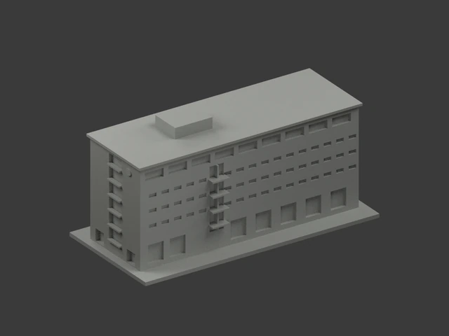
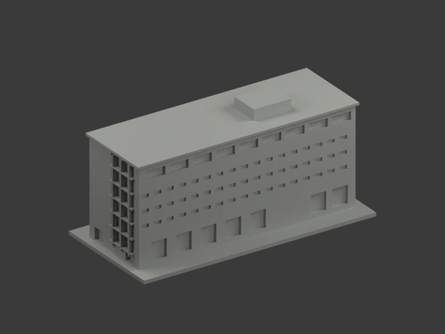
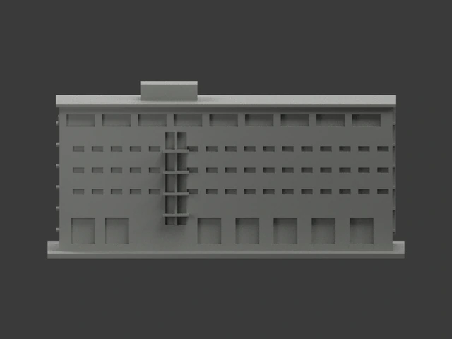
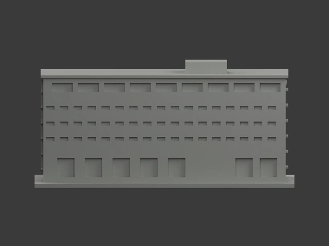
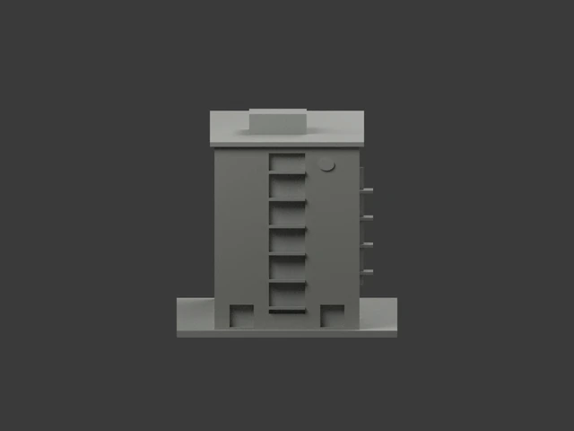
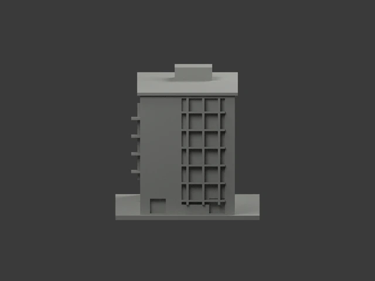
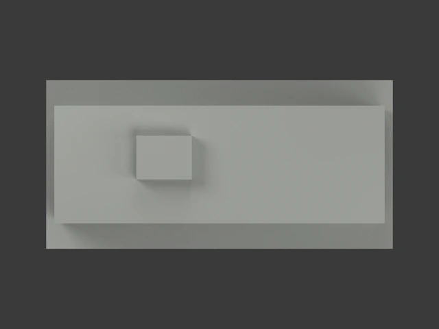
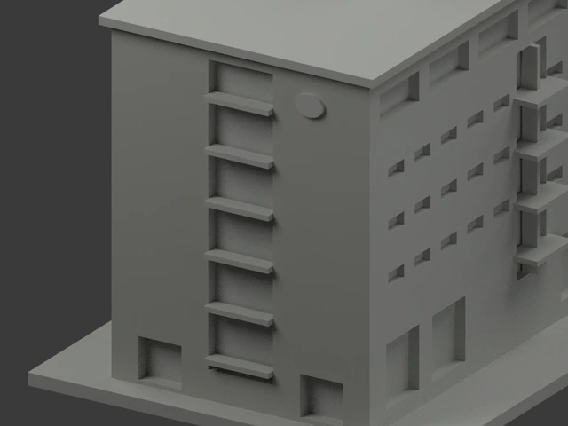
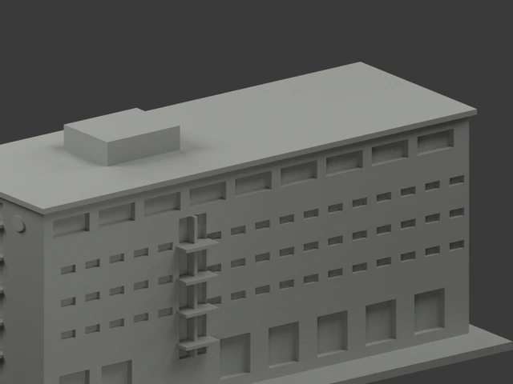
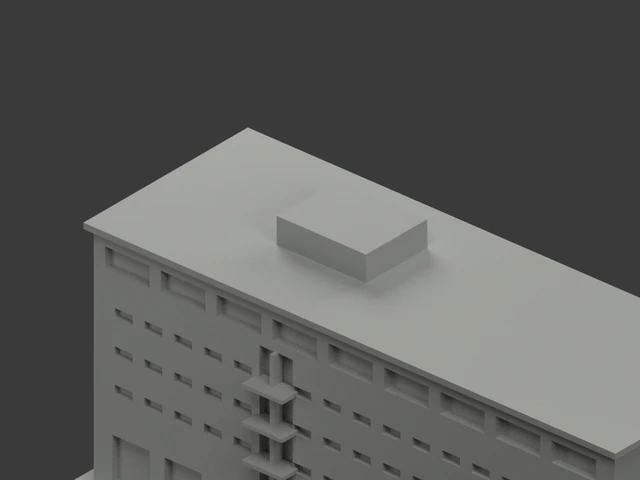

# 臺大碧禎館｜現行局部材色展示

**局部補色未完成。** 現行模型僅鐘端外石壁與兩側長簷前緣共 82 面補灰；其餘 3,494 面中性，不代表實景為灰色。未更改模型或補色，未實體試印。

| 模型預覽 | 模型預覽 | 模型預覽 |
| :---: | :---: | :---: |
| 前斜視  | 後斜視  | 正面  |
| 背面  | 西側  | 東側  |
| 頂視  | 鐘端石壁局部  | 長簷前緣局部  |
| 未完成屋面局部  |  |  |

十張無失真全圖由現行 Blender 場景按原角度重繪驗證；保留所有角度和局部視圖，無文字覆蓋。舊單色圖不作現行預覽。

[現行彩色 Blender](../scene.blend) · [局部材色 3MF](../appearance.3mf) · [STL](../model.stl) · [OBJ](../model.obj) · [渲染驗證](render-proof.json) · [本頁校驗](SHA256SUMS)

[原模型與限制](../README.md) · [中文說明](../README.zh-TW.md) · [現行工程校驗](../SHA256SUMS)。原 README、PNG、工程與歷史資料全數保留。
