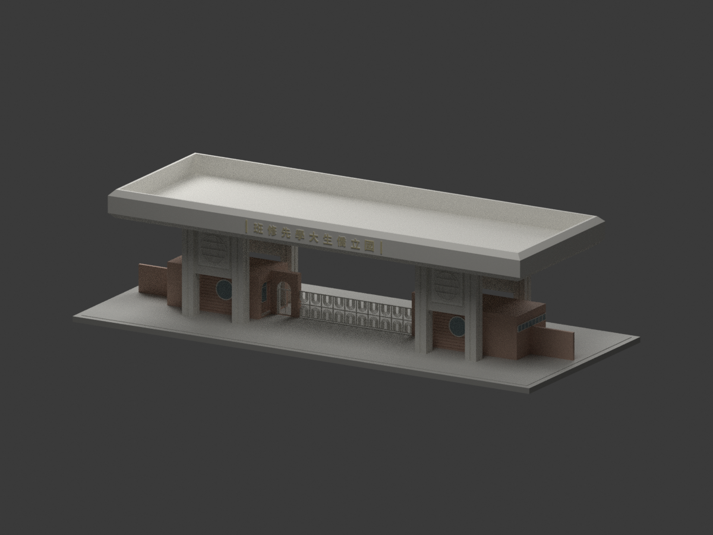
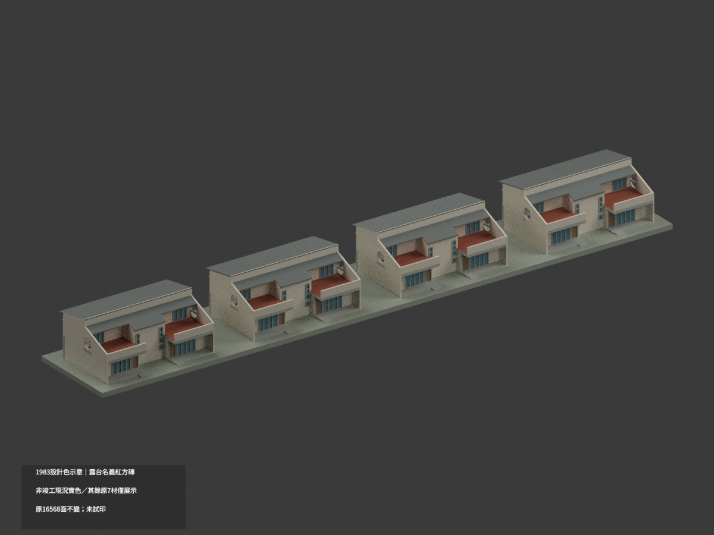

# 國立臺灣師範大學｜林口校區建築研究模型

## 模型圖鑑

| 建築模型 | 建築模型 | 建築模型 |
| :---: | :---: | :---: |
|  **[原僑大林口大門｜1983年5–6月原設計圖版](buildings/nups-linkou-gate-1983-design/README.md)** [STL](buildings/nups-linkou-gate-1983-design/model.stl) · [彩色3MF](buildings/nups-linkou-gate-1983-design/model.3mf) · [Blender](buildings/nups-linkou-gate-1983-design/scene.blend) |  **[原僑大檔案室｜1983設計、四組一包](buildings/nups-archives-four-paired-buildings-1983-design/README.md)** [STL](buildings/nups-archives-four-paired-buildings-1983-design/model.stl) · [彩色3MF](buildings/nups-archives-four-paired-buildings-1983-design/model.3mf) · [Blender](buildings/nups-archives-four-paired-buildings-1983-design/scene.blend) [設計色局部3MF](buildings/nups-archives-four-paired-buildings-1983-design/appearance.3mf) · [範圍與限制](buildings/nups-archives-four-paired-buildings-1983-design/README.md) · [校驗版本與原檔說明](buildings/nups-archives-four-paired-buildings-1983-design/CHECKSUM-SCOPE.md) |  |

現行收錄 **2 套模型包**，非全校區完成。

[回學校圖鑑](../README.md)

## 新增歷史原設計研究

陳其寛／陳其寛建築師事務所CCCK257，1983年5–6月原設計圖外觀；9.95／9.75m高度差異保留。歷史原國立僑生大學先修班於2006年併入師大，歸林口校區同校，不另計現行大學；不是竣工測繪或2026現況。

上述新增模型保留設計者與國立臺灣博物館典藏來源。來源圖像CC BY-NC標示（版本未明）與自行編寫程式／重建模型權利分開，不自動概括整包模型僅限非商業，也不宣稱已獲原圖或建築設計無限制商用權利。不附來源原圖、PDF或私人參考資料；皆未實體試印。

## 僑大檔案室1983歷史設計研究

原題「國立僑生大學先修班檔案室」，CCCK258、1983設計圖示，四組同向雙拼建築共八單元為同一工程一模型包，不拆成四套或八套，不因圖中廚衛改稱宿舍。依僑大歷史校屬及林口籌建關聯歸師大林口目錄；現址、現名與是否實建未獨立確證，不宣稱現存林口宿舍或竣工復原。後欄採詳剖4.20m，A2側立面3.60m仍差60cm；中央後坡5.111±0.10m派生，140cm短簷不蓋滿露台。圓孔側牆10→23cm及細框欄增厚為列印調整；近門短階圖量，遠側道路、圍牆、長階與精確地形不建。1:350含底座251.7×38.6×22.57mm，未試印；原圖私人保存，不保證商用權利。
