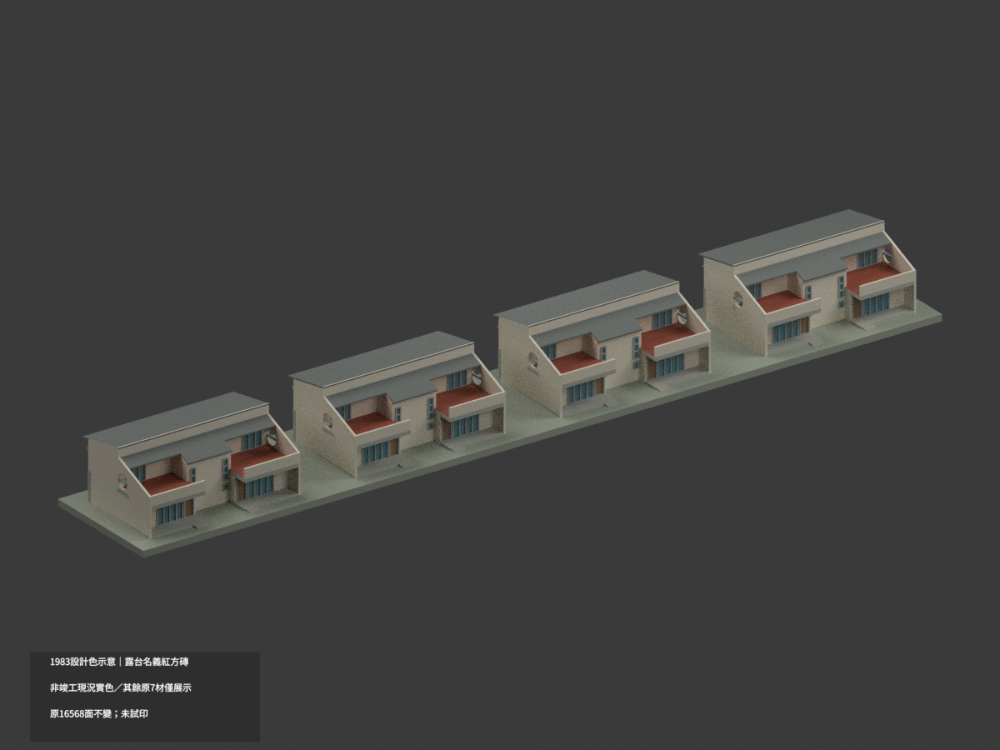
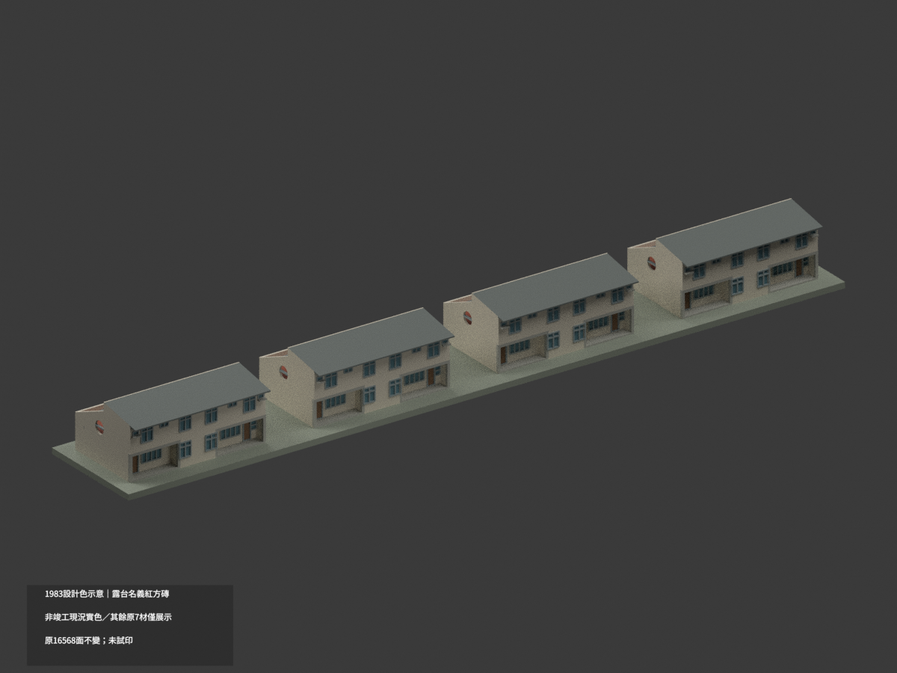
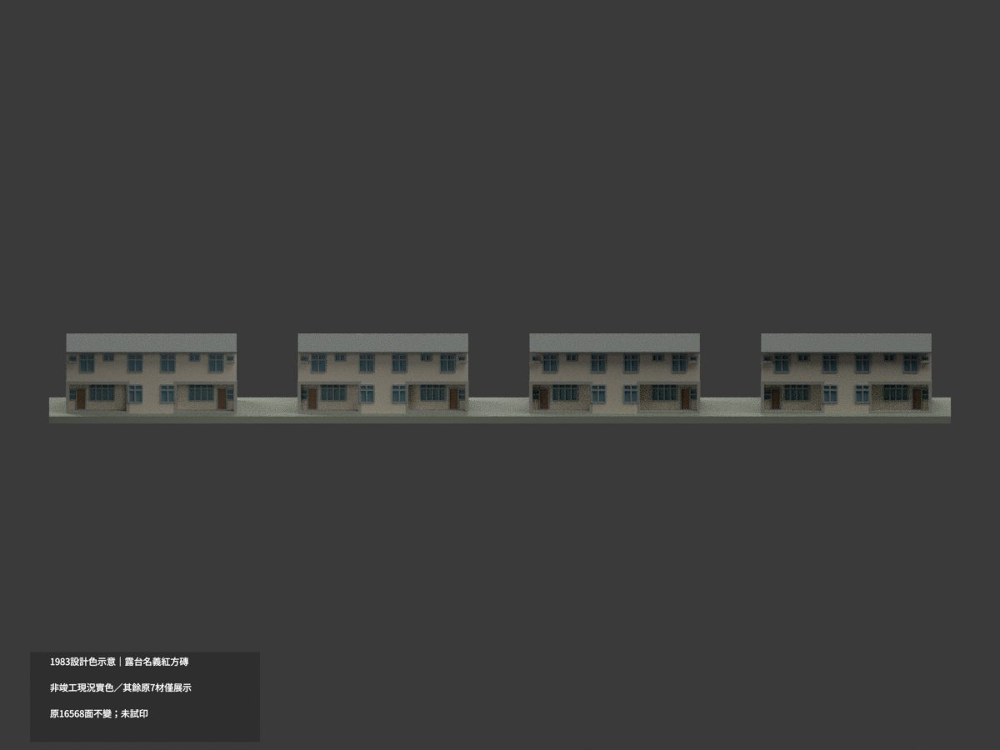
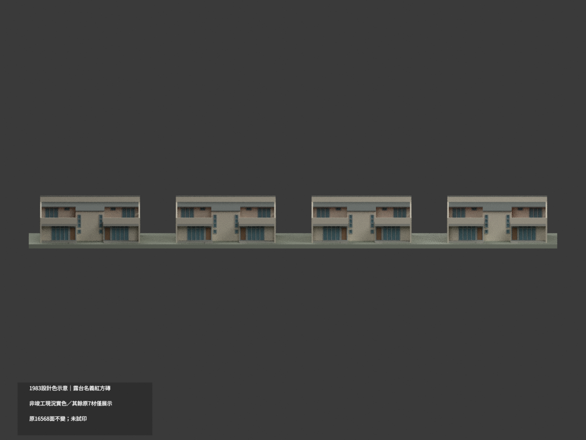
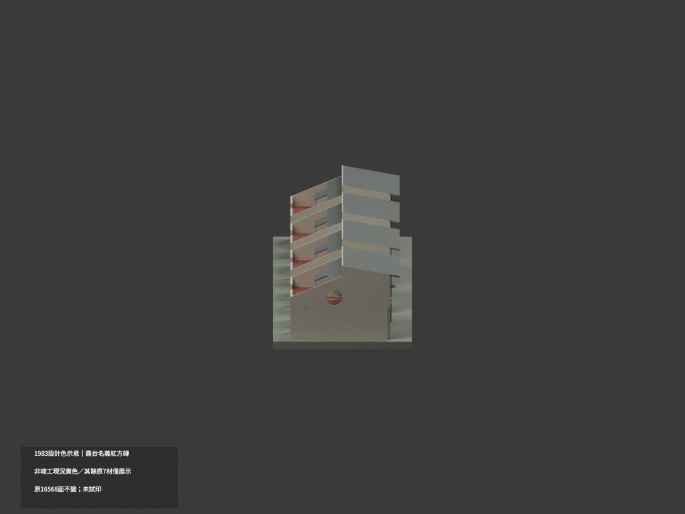
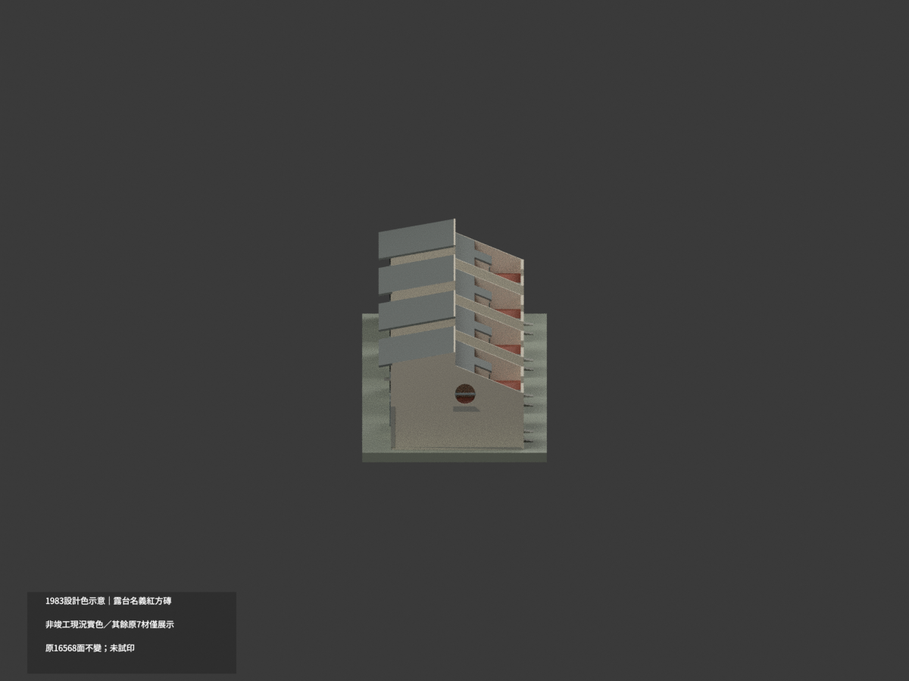
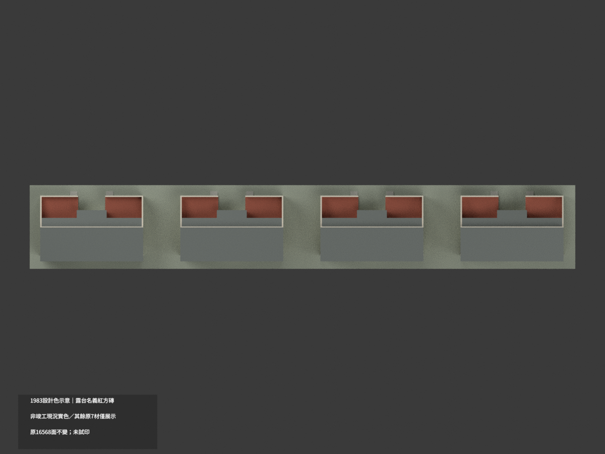
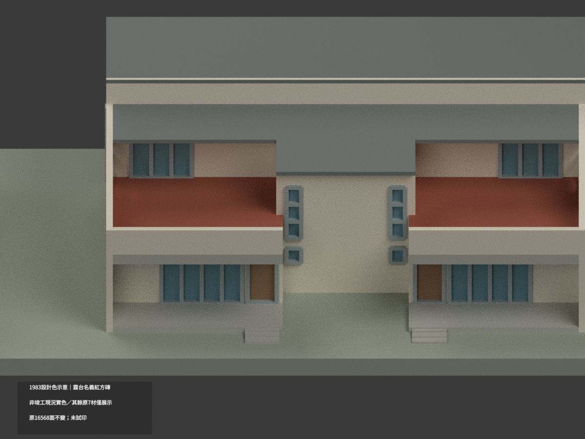
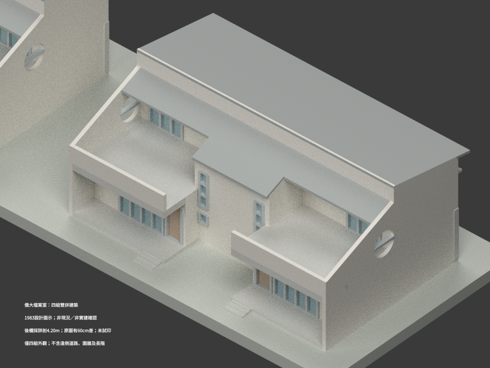
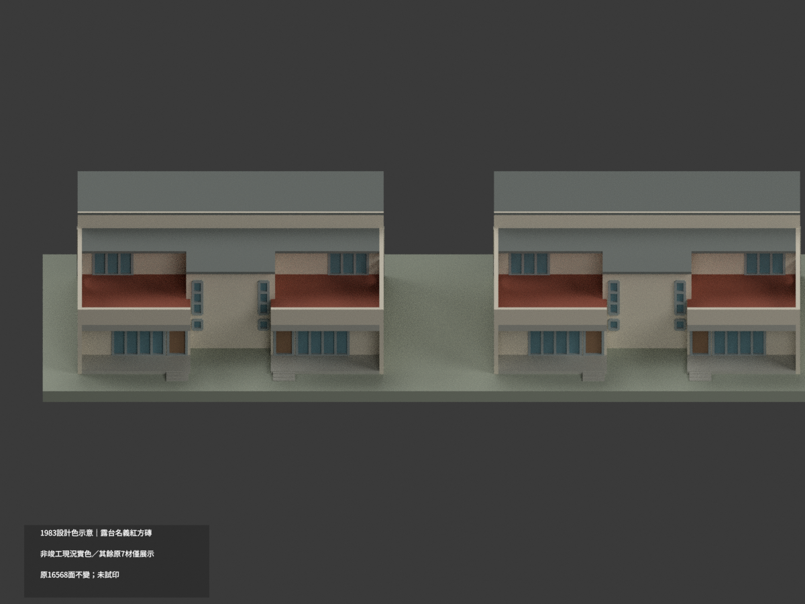

# 國立僑生大學先修班檔案室（1983 年設計圖示，四組建築）

## 模型預覽與範圍

**歷史設計解讀，不是竣工圖、現況測繪或實建確認。** 本包為四組同向雙拼建築（共八單元），只計同一項工程；含外觀及近門短階，**不含遠側道路、圍牆、場地長階或精確地形**。原圖題名為「檔案室」，不因圖中有廚衛而改稱宿舍。尚未實際列印。

| 全群與主要立面 | 全群與主要立面 | 全群與主要立面 |
| --- | --- | --- |
|  |  |  |
|  |  |  |
|  |  |  |
|  |  |  |

## 來源、版本與權利

設計者：**陳其寬／陳其寬建築師事務所**。五張圖同標民國 72 年 5 月（1983-05），未見填寫修訂號。館藏 CCCK258「國立僑生大學先修班檔案室新建工程」。本校後併入國立臺灣師範大學；林口新校籌建關聯不等於已確認此四組建築今日位置、名稱或實建情形。此案不是 CCCK257 校門。

- [A1 配置及面積](https://collections.culture.tw/docomomo_collectionsweb/Collection?GID=MNMEM6MLMD)
- [A2 平面、屋頂及立面](https://collections.culture.tw/docomomo_collectionsweb/Collection?GID=M7MEM6MLMD)
- [A3 剖面與外牆詳圖](https://collections.culture.tw/docomomo_collectionsweb/Collection?GID=MHMEM6MLMD)
- [A4 樓梯及圓孔詳圖](https://collections.culture.tw/docomomo_collectionsweb/Collection?GID=MQMEM6MLMD)
- [A6 門窗表](https://collections.culture.tw/docomomo_collectionsweb/Collection?GID=MKMEM6MLMD)

各原圖影像標示 **CC BY-NC**；元資料 CC BY 與影像授權不同。原圖、裁圖及私人備份均不隨公開模型包散布。公開檔為另行製作的幾何、程式、渲染與來源說明；不把網站／儲存庫的一般授權當成原圖或來源衍生素材的無限制使用許可，也**不保證商用權利**。需另按來源權利、署名及非商業條件判斷使用。

## 尺寸與來源差異

- 每組主橫軸 16.40 m，屋面外寬名義 16.63 m；四組間 6.00 m 淨距，同向平行排列。地面翼室 5.90 × 6.80 m、上層翼室 5.90 × 4.50 m，前後地面平台不填成室內實體。
- 1FL 為 GL +0.20 m，2FL +3.20 m，主屋面低端 +6.20 m、高線 +7.20 m。主坡水平長 5.615 m；中央梯屋總屋面深 8.275 m、後牆位置 7.06 m，牆與簷端分開。
- **後露台欄頂採 A3 詳剖 +4.20 m**；A2 側立面單標若按 1FL 解讀則為 +3.60 m，仍有 **60cm差**，不平均、不宣稱各圖一致。這是有明文限制的剖面優先解讀。
- 高線後先垂降 1.00 m，再向後下降；側翼實際短簷只有 1.40 m，不能把通往欄頂的斜側牆整片蓋成屋頂。以 (y4.615,z6.20) 至 (y9.50,z4.20) 側線協調後坡，短簷端約 +5.627 m、中央屋面端約 **+5.111 m**；屬派生及剖圖估讀，端高約 **±0.10 m**，不是原圖直接標示 EL。
- 露台真圓孔直徑 1.50 m、孔底 +3.35 m、中心 +4.10 m；水平位置 y≈5.33 m 為圖量 ±0.10 m。孔不填玻璃；露台側牆原詳圖厚 10 cm，本模型為 1:350 列印增厚至 23 cm（約 0.66 mm），不把此厚化當原圖尺寸；橫桿亦增厚表示。
- A6 低層 DW1 為 2.80 × 2.60 m，上層 DW1′為 2.10 × 2.50 m；W1–W7 依門窗表尺寸與窗台控制。兩端 AC 預留口按 A4/10 固定玻璃與承座表示，不加未設機械；內孔約 0.68 × 0.43 m、外框約 0.88 × 0.60 m，位置圖量。DW1／DW1′、W1／W2 上亮高 0.50 m，不作上下等分。開口中心及細框局部依圖量；不宣稱施工等級定位。
- 原圖「正立面」對應露台／中央凹口側，「背立面」對應 W1／W2 窗列側；本地座標方向不是地理南北。端面依對稱平面解讀，不是兩端現場獨立測量。
- 近門短階只有可見圖線與位置控制，採有界簡化；不得拿 A4 室內梯 6×26=156 cm 套成外階。隱蔽室內、設備、施工節點、未證實現況色彩不作復原。

## 列印、格式及可重建性

比例 **1:350**，單位 mm；展示底座為作者添加、非現場地形，厚 2 mm。全包約 **251.7 × 38.6 × 22.57 mm**，請核列印床尺寸；縮放會使細桿更細。框／欄最小約 0.4 mm 為視覺與列印折衷，並非原構件真實厚度。薄簷、孔及懸挑可能需要支撐；**未實際列印，不保證特定機台可直接成形**。

- `model.stl`：單一封閉列印網格。
- `model.3mf`：mm 單位與示意材料索引。
- `scene.blend`：模型及十視圖可重建場景；文字標註不是列印幾何。
- `build_model.py` + `geometry_helpers.py`：完整幾何輸入，輸出 `mesh.npz`、STL、元件與調色盤。
- `export_3mf.py`、`validate_model.py`：3MF 與格式檢查。
- `render_model.py`、`verify_scene.py`：Blender 渲染與重開檢查。

```bash
python build_model.py
python export_3mf.py
python validate_model.py
blender -b -t 4 --python render_model.py
blender -b --python-exit-code 1 --python verify_scene.py
```

依 `requirements.txt` 安裝幾何依賴；Blender 4.3.2。QA 檔記錄實際執行結果；來源充分性、網格合格及列印可行性是不同事項。
