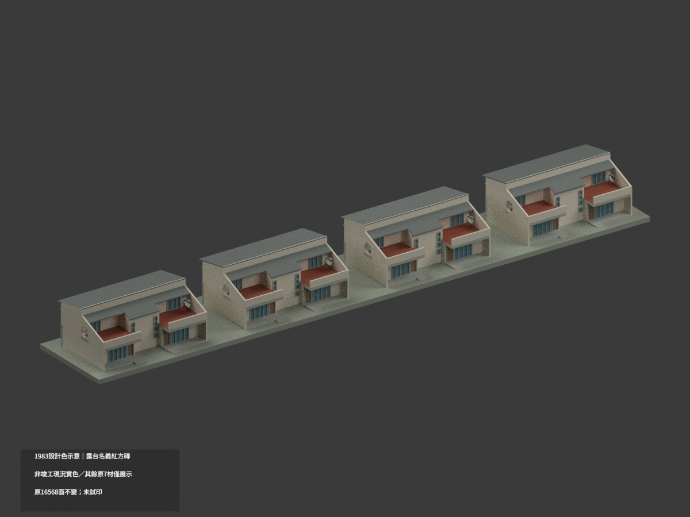
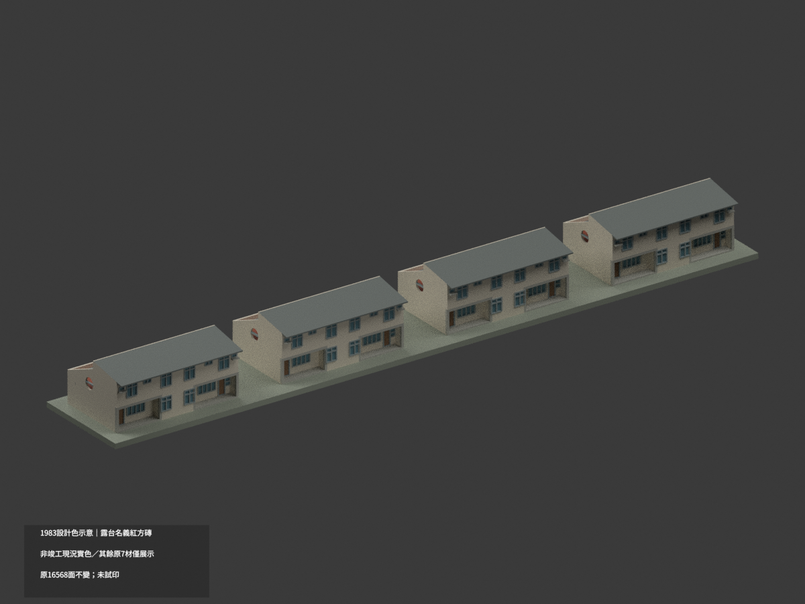
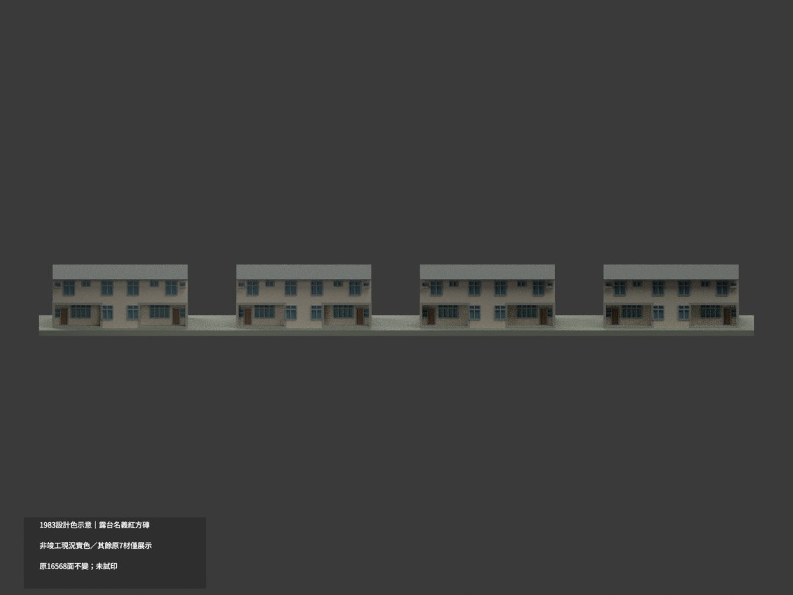
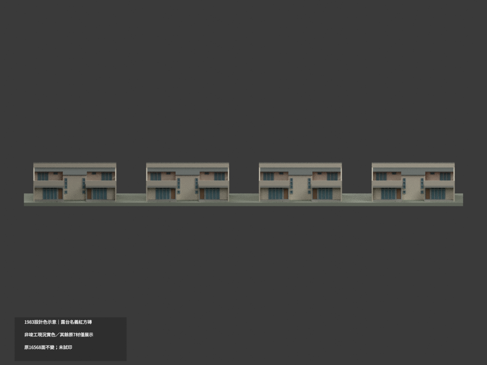
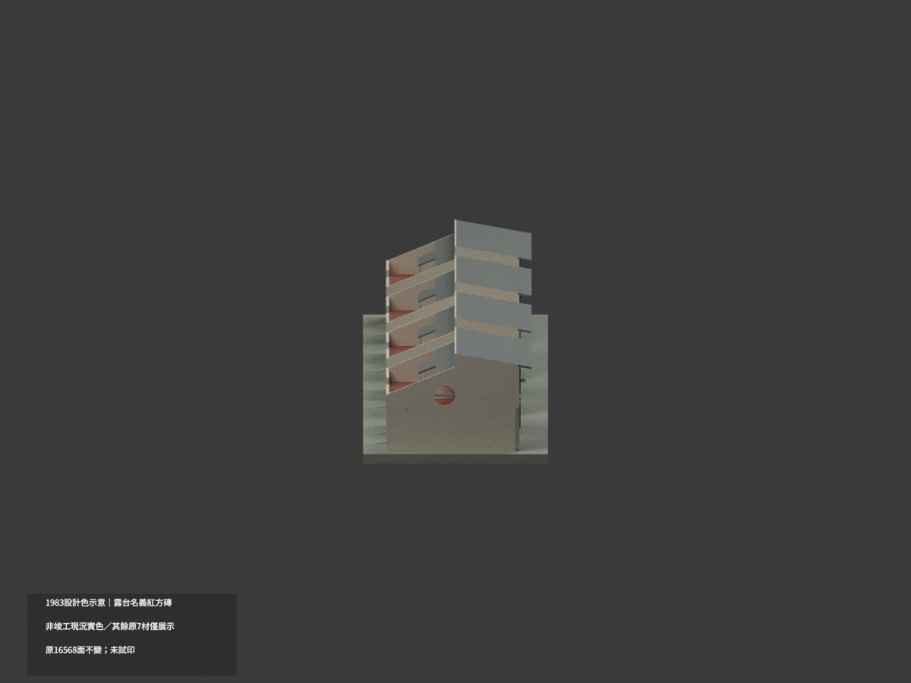
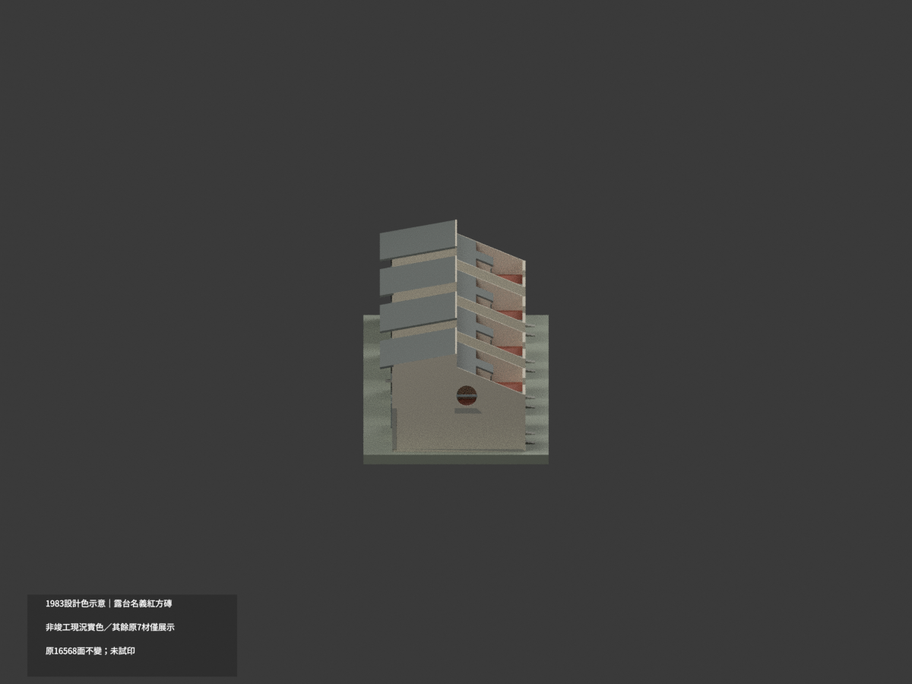
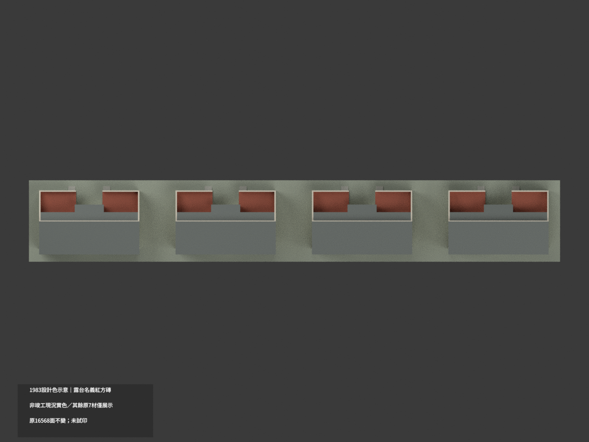
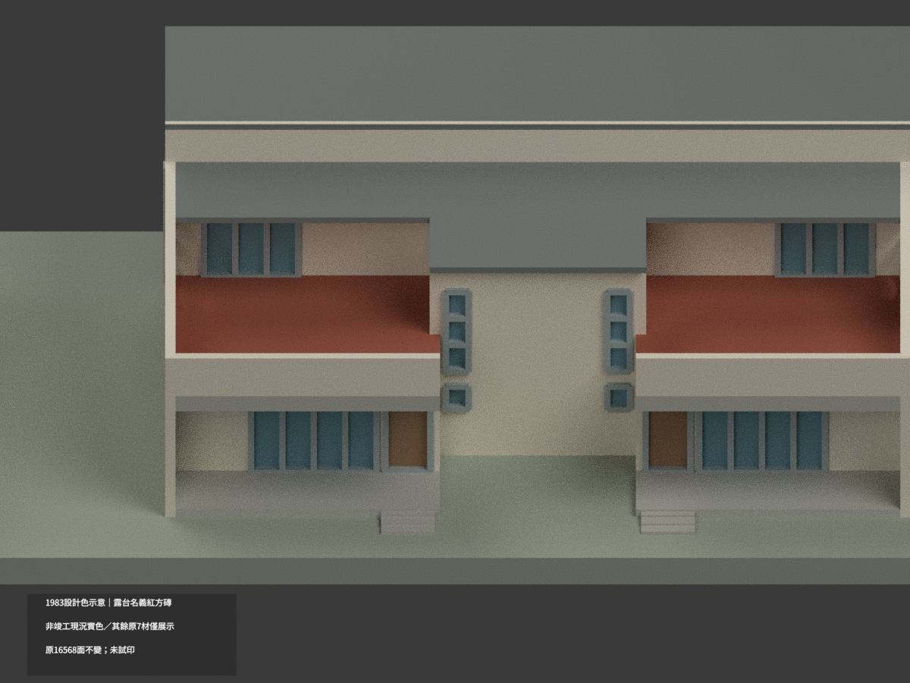
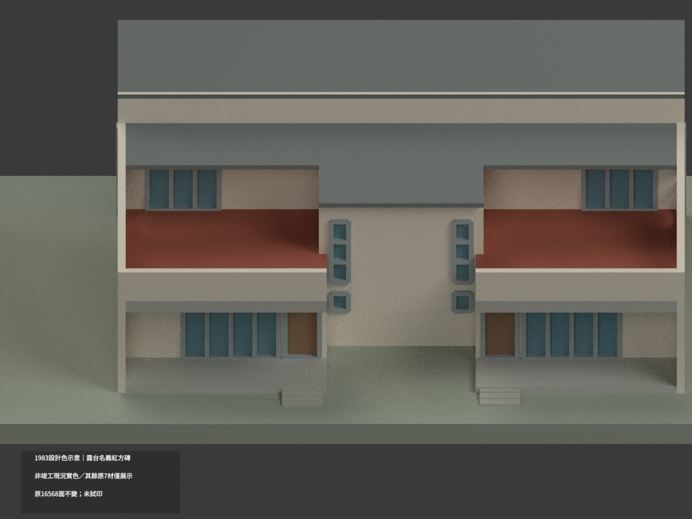
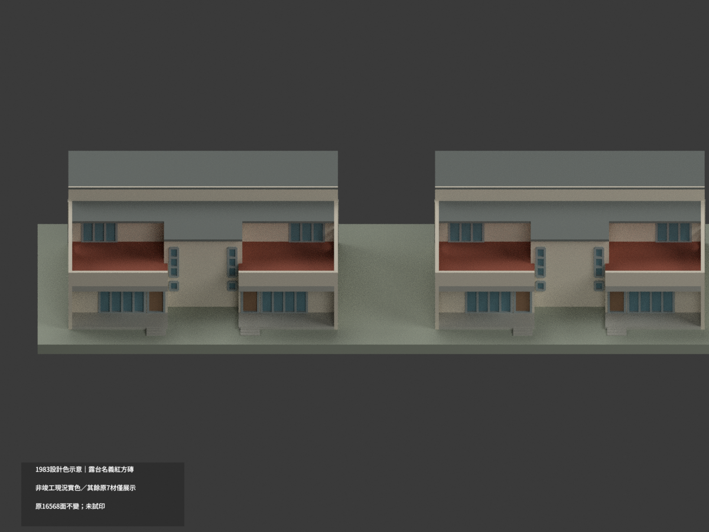

# 僑大檔案室四組雙拼｜1983 露台設計色示意

**1983 設計色示意，非竣工或現況實色。** 僅八個完整露台上表面85原三角依A1「尺二紅方磚」採名義紅色族 #A45F4C；A2同處「尺三磁方磚」文字異文保留。其他16483面保持原七材指派與RGB，仍為歷史展示示意，不是本次新證實的實色。partial_color_incomplete=true、fully_colored_exterior=false。原版不是單色，本次只追加局部設計色，未試印。

| 全群 | 背側 | 窗列側 |
|---|---|---|
||||
||||
||||
||||

## 材色範圍與異文
同 nups-archives-four-paired-buildings-1983-design，16568原三角與原檔bytes完全保留，四組同向雙拼共八單元只計單一工程群，count_delta=0。不是CCCK257校門，不因廚衛改稱宿舍，不宣稱實建或今日地址。原無OBJ，不新增。
原程式八個terrace_floor_open_overhead完整上皮，在z11.142857共平面102面中只選85露台面，另外17柱頂不動；不得染側底/屋頂/外牆/玻璃或下平台，不新增磚縫。原mat1改新增mat7，其餘七材與指派精確保留；新色只是A1名義紅族，HEX非校色或樣板。
A1粉刷表T213/T214勾選「鋪尺二紅方磚」；A2同露台寫「鋪尺三磁方磚」。尺寸/材種異文不強行一致，不能引用初讀誤文「紅缸磚」：那是A1平台T101/T104另一欄，不是本次露台。原勘誤研究歷程私存。

## 原版完整保留與限制
所有 37 原檔在original-classification-version/逐byte保留，包括原7材palette/mesh/model.3mf/scene/十圖/全部QA。原README和scene另有ORIGINAL-SOURCE-GAP前綴alias；render_model.py原bytes不變。舊根QA放original-classification-qa-aliases/，只綁原完整子包，不冒新色QA，不改其hash。新appearance.3mf/scene及十圖為獨立局部設計色variant。
原1983-05陳其寬CCCK258設計解讀，非竣工圖/現況測繪。後欄頂A3 +4.20m與A2解讀+3.60m差60cm保留；主坡低6.20/高7.20m，中央後端約5.111m、短簷約5.627m屬派生±.10m，不是直接EL。真圓孔直徑1.5m、位置圖量±.10m；原10cm側牆加厚23cm與橫桿加厚為列印折衷。短簷不能變整片露台屋頂，原全部尺寸/門窗/圖量限制維持。
原1:350、mm，約251.7×38.6×22.57mm；作者底座非精確地形，不含場地長階/道路圍牆/隱蔽室內。最小約.4mm框欄並非真構件厚度，未試印/未作全域壁厚與支撐保證；新色QA不追認原全局列印放行。

## 來源與格式
[A1館藏](https://collections.culture.tw/docomomo_collectionsweb/Collection?GID=MNMEM6MLMD) · [A2館藏](https://collections.culture.tw/docomomo_collectionsweb/Collection?GID=M7MEM6MLMD)。原影像CC BY-NC與元資料CC BY不同，不保證商用；原圖/裁圖私人研究，不隨包公開或作貼圖。
[原STL](model.stl) · [新增逐面設計色3MF](appearance.3mf) · [新Blender](scene.blend)。實物件 NUPS Archives Four Paired Buildings 1983 Design partial color；八材不是已測試四色耗材切片。原build_model.py+geometry_helpers.py依精確依賴隔離重建，colorize_model.py只改85面指派。

## English scope
1983 DESIGN tile color only,not asbuilt/current appearance. A1 says尺二紅方磚; A2 says尺三磁方磚; discrepancy retained.85 complete terrace topfaces appended nominalred;16483 original seven illustrative assignments/RGB EXACT,not newly certified.16568 unchanged triangles,four paired groups/eightunits oneengineeringpackage,count0,noOBJ.Original classification version,QA,dimensional conflicts,printthickening and untested manufacture remain preserved. Photos/scans private; no newgeometry or tilejoints.
