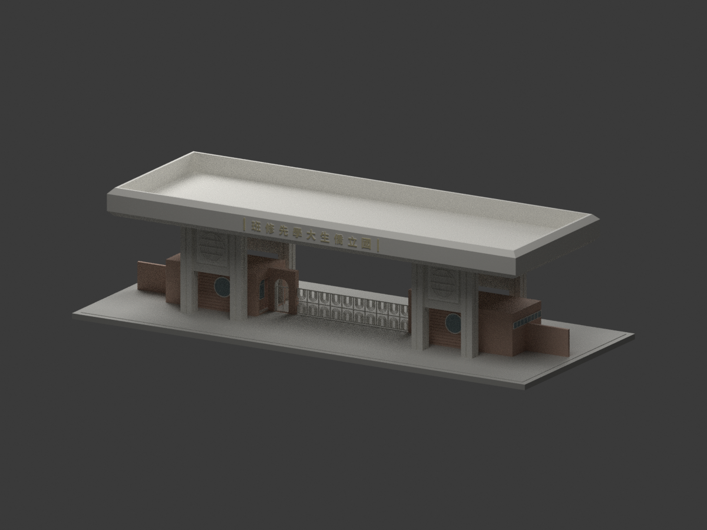
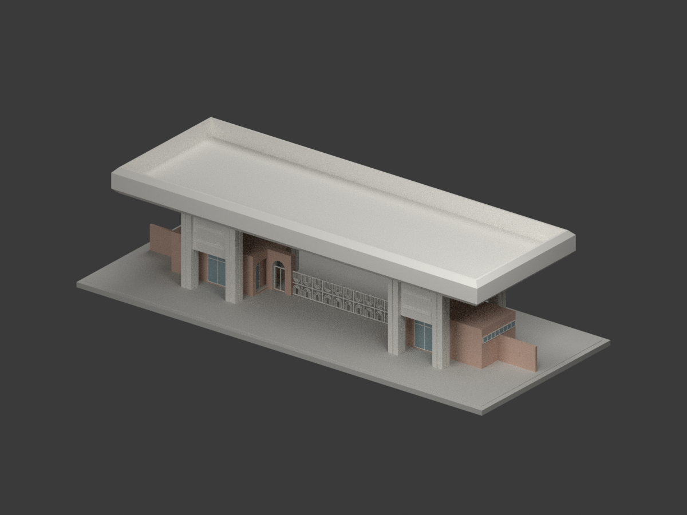
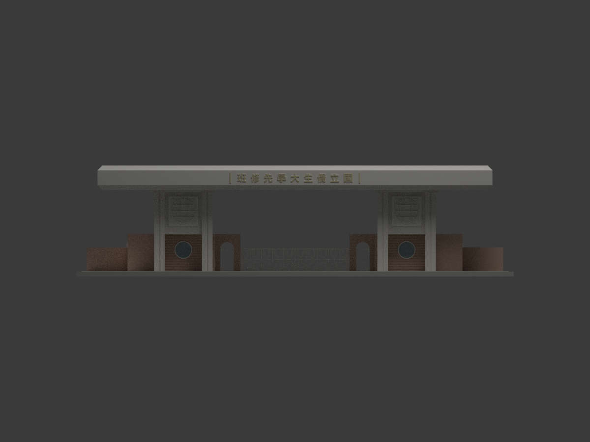
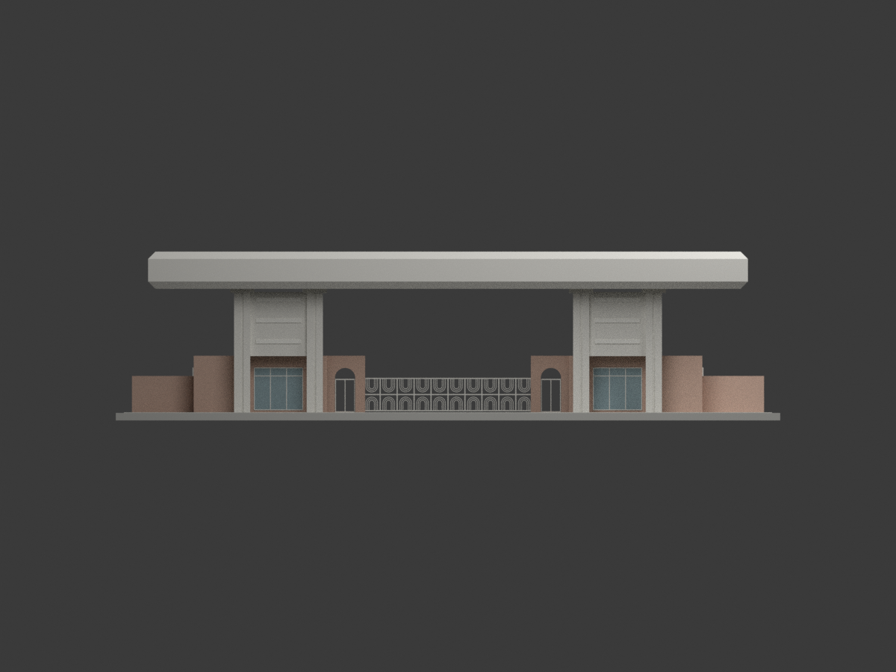
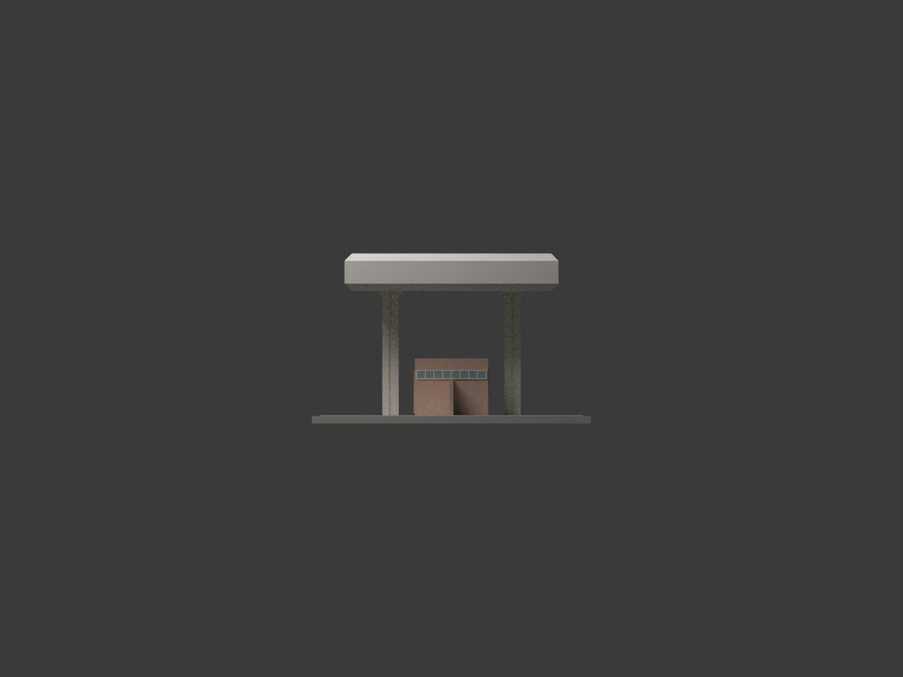
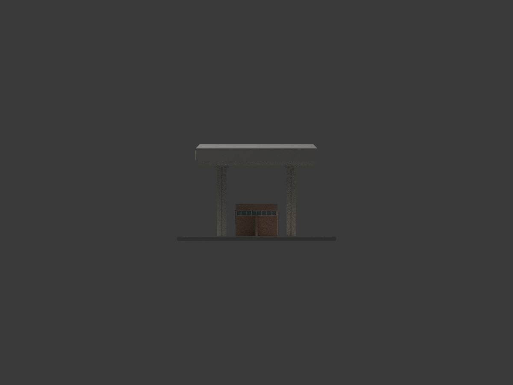
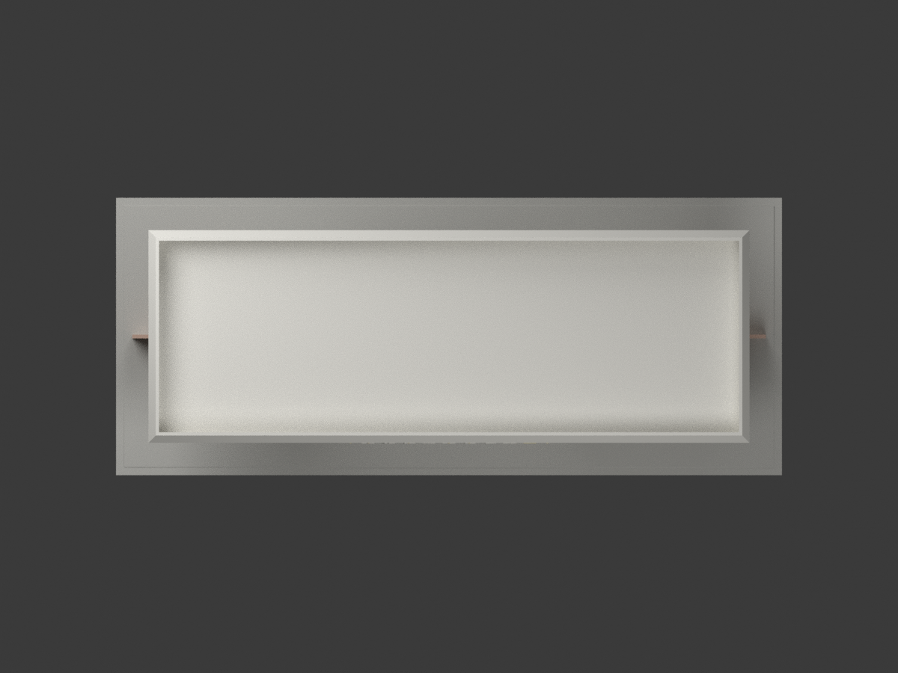
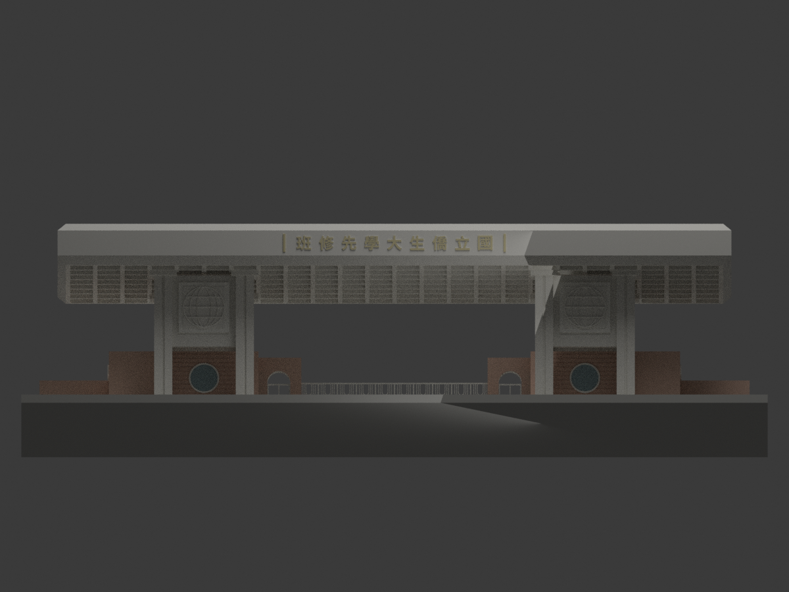
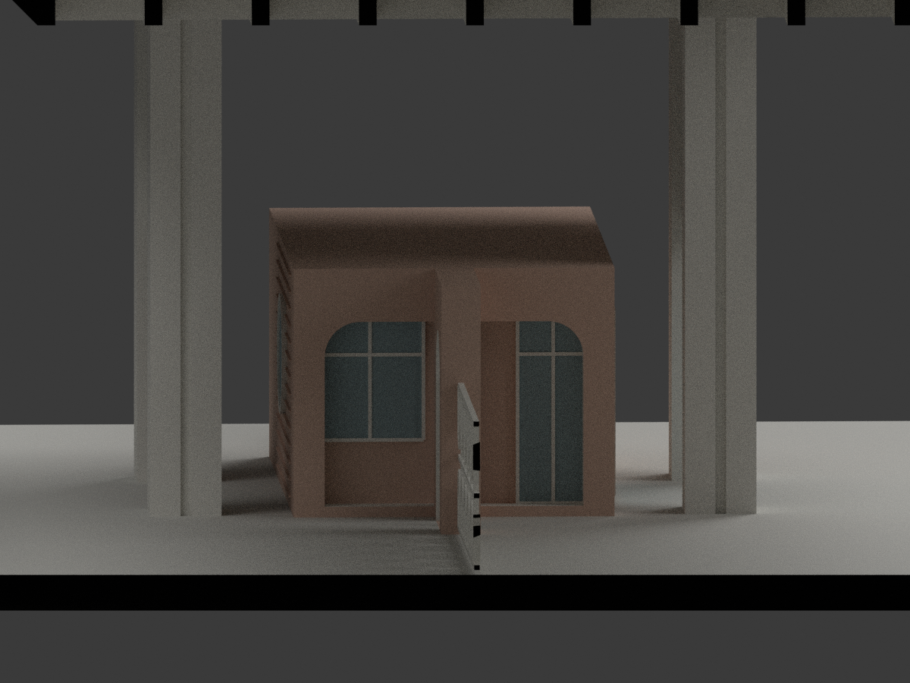

# 國立僑生大學先修班林口大門｜1983年5–6月原設計圖版

依陳其寛／陳其寛建築師事務所「國立僑生大學先修班大門新建工程」CCCK257 圖組重建。**這是歷史原設計，不是竣工測繪，也不是2026年師大林口校區現況。** 原圖 A1–5、A7–10 為1983年5月，A6銘牌詳圖為6月。師大2023年官方照片可支持巨大頂棚、八柱與兩側磚造門房的建築身分，不證明每個設計細節均照建；現今校名與後加設施未混入歷史版。

## 控制尺寸與保留差異

- 頂棚37.15×13.15m；八柱各1.00m見方。屋頂高度採A3剖面與A5明標GL+9.95m；A2/A4立面另標9.75m，**保留20cm圖間矛盾，不宣稱一致**。
- 井字頂棚24×8格，1.50m節距，肋寬0.25m、格淨1.25m；細部另有完成面1.20m，模型未逐層復原飾面厚度。肋底+7.65m、肋深0.60m、板厚0.12m。
- 兩門房外寬8.25m、深4.50m，地坪+0.15m、牆頂+3.50m。7.50m是柱軸間距，不當作房外寬；10.50×4.74m矩形是門房加鄰接門道屋頂，不是大頂棚天窗。
- 兩側行人拱門淨寬1.265m、頂高2.75m。朝道路門房面保留3.63m寬拱形框架與凹入門窗；**後方為封實展示體，不復原未充分驗證的內部空間**。D1為1×2.60m、W3為1.50×1.70m，位置按平面比例讀取，不稱逐項實測。
- 前圓窗直徑1.50m；後窗組3m；端面高窗4.27×0.50m。玻璃使用不透明封背。柱槽保留，微小3cm角倒角與細五金省略。
- A6校名字體註明另定；使用現代 Noto Sans CJK TC 輪廓作80cm字高、由右至左的歷史校名。**不是原書法字模（字形來源 Noto Sans CJK TC；本包不附字型檔）**。徽飾只表現地球輪廓與經緯線，手形／花瓣等細圖樣省略。
- 中央鐵門使用A10未取消的下部平面與門樣，10.50m跨度、2m門高；嵌套U形圖案為縮尺簡化。A10上部已劃取消之鉸鏈／基礎細部未採用。
- 局部圍牆為截斷展示範圍，非完整380m校界或地形重建。底座與色彩為展示設計，磚分縫放大合併，不冒充實際材料色票。
- 比例1:150，STL／3MF單位mm；含底座約274.33×114.33×69.67mm。數位水密不等於實體試印保證；字、格柵和細槽需依設備檢查支撐及解析度。

## 來源與權利

原設計者：**陳其寛／陳其寛建築師事務所**。典藏：**國立臺灣博物館／臺灣現代建築圖說**。來源圖像頁標示 **CC BY-NC，版本未確認**；這是來源圖像標示，**不自動概括套用整包生成模型**，亦不宣稱模型已獲無限制商用授權。保留設計者、來源及版本限制；原圖、照片、PDF與含工作階段資料的HTML不附送。

- [A2平立面](https://collections.culture.tw/docomomo_collectionsweb/Collection?GID=MXMDM6MLMD)
- [A3屋頂與剖面](https://collections.culture.tw/docomomo_collectionsweb/Collection?GID=MNMDM6MLMD)
- [A4背立面與門房](https://collections.culture.tw/docomomo_collectionsweb/Collection?GID=MCMDM6MLMD)
- [A5短向剖面](https://collections.culture.tw/docomomo_collectionsweb/Collection?GID=M7MDM6MLMD)
- [A6銘牌詳圖](https://collections.culture.tw/docomomo_collectionsweb/Collection?GID=MHMDM6MLMD)
- [A10門樣／取消標記](https://collections.culture.tw/docomomo_collectionsweb/Collection?GID=M8MEM6MLMD)
- [師大官方2023年照片與報導](https://pr.ntnu.edu.tw/ntnunews/index.php?id=21989&mode=data)
- [僑大歷史](https://www.lib.ntnu.edu.tw/exhibition/overseastudent/origin.html)

完整10張圖面URL與查讀檔案雜湊見 `sources.json`，控制值及不確定性見 `SOURCE-CONTROLS.json`。查讀日期2026-11-01不是建築年代。

## 其他實際渲染

七張全模型視角經頂點投影邊界檢查；兩張 detail 是刻意裁切的局部圖，不冒稱全體取景。

## 重現與檢查

Python依 `requirements.txt` 安裝；執行 `python build_model.py`、`python export_3mf.py`、`python validate_model.py`。Blender 4.3.2：`blender -b --python render_model.py`，再 `blender -b --python verify_scene.py`。使用預存 `letter-contours.json` 即可重建，不需下載字型；可選 `extract_letter_contours.py` 須系統 Noto Sans CJK TC 與 fontTools。場景以 Blender 原生壓縮保存，須用 Blender 開啟，不以未壓縮檔頭判定無效。

各項 QA 檔分開記錄格式回讀、場景網格綁定、實渲取景及來源視覺判讀；未實體試印。

## 下載與重建檔案

[單色 STL](model.stl) · [彩色 3MF](model.3mf) · [可編輯 Blender 場景](scene.blend) · [建模程式](build_model.py) · [渲染程式](render_model.py) · [3MF 匯出程式](export_3mf.py) · [重建依賴](requirements.txt) · [字形輪廓](letter-contours.json)
