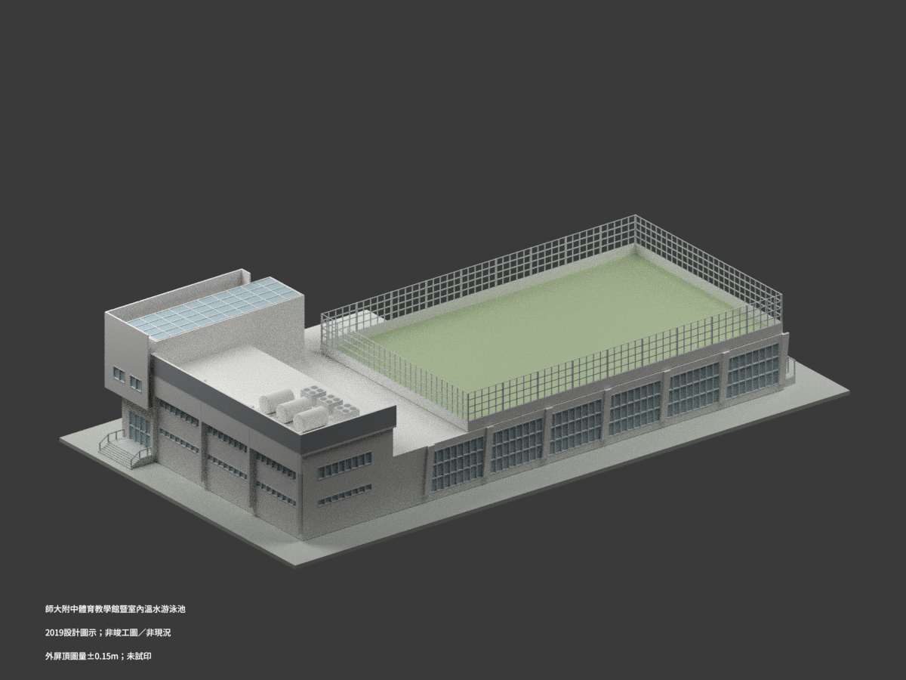

# 國立臺灣師範大學附屬高級中學建築設計模型

## 模型圖鑑

| 建築模型 | 建築模型 | 建築模型 |
| :---: | :---: | :---: |
|  **[體育教學館暨室內溫水泳池｜2019設計](校本部/buildings/hsnu-indoor-pool-physical-education-hall-2019-design/README.md)** [STL](校本部/buildings/hsnu-indoor-pool-physical-education-hall-2019-design/model.stl) · [彩色3MF](校本部/buildings/hsnu-indoor-pool-physical-education-hall-2019-design/model.3mf) · [Blender](校本部/buildings/hsnu-indoor-pool-physical-education-hall-2019-design/scene.blend) |  |  |

現行收錄 **1 套模型包**；不是全校建築數或全校完成。

## 收錄範圍

依校方公開2019設計圖重建同一體育教學館暨室內溫水游泳池、北側教室與屋突、屋頂戶外球場及貼館入口。非2022竣工圖或今日測繪現況，不混同師大本部泳館、舊戶外泳池及獨立場地設備。最高外屏16.20±0.15m圖量，缺A4-06詳圖；北外皮13.50m與低屋皮11.10m分開。DW1外spot不可讀，+0.95m與坡道分段為明示協調，不是原圖直接施工尺寸。獨立基地116、地下車道與隱蔽機電不建。1:250模型316×176×66.8mm、網格與懸挑須核印床和支撐，未實際列印。

[校方網站](https://www.hs.ntnu.edu.tw/)核正式校名為國立臺灣師範大學附屬高級中學，簡稱師大附中／HSNU；此目錄獨立歸高中學校，不併入國立臺灣師範大學高教套件及校數，也不是師大和平校區泳館。

保留設計者與官方文件來源連結；官方PDF未見CC授權，原圖、裁圖和私人參考包不公開，不保證商用或無限制再利用。

[校本部圖鑑](校本部/README.md) · [回總目錄](../README.md)
