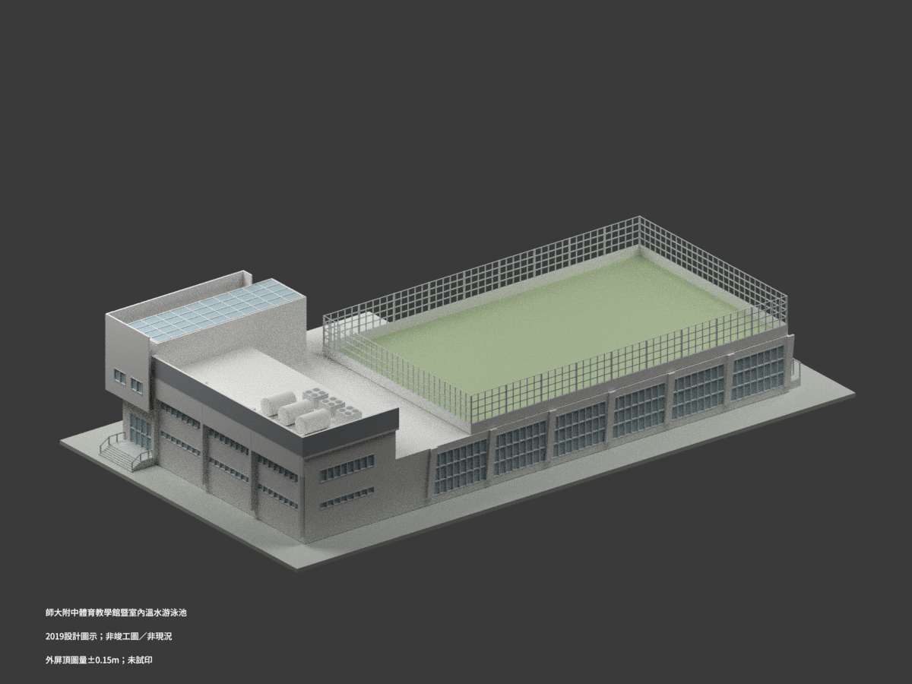
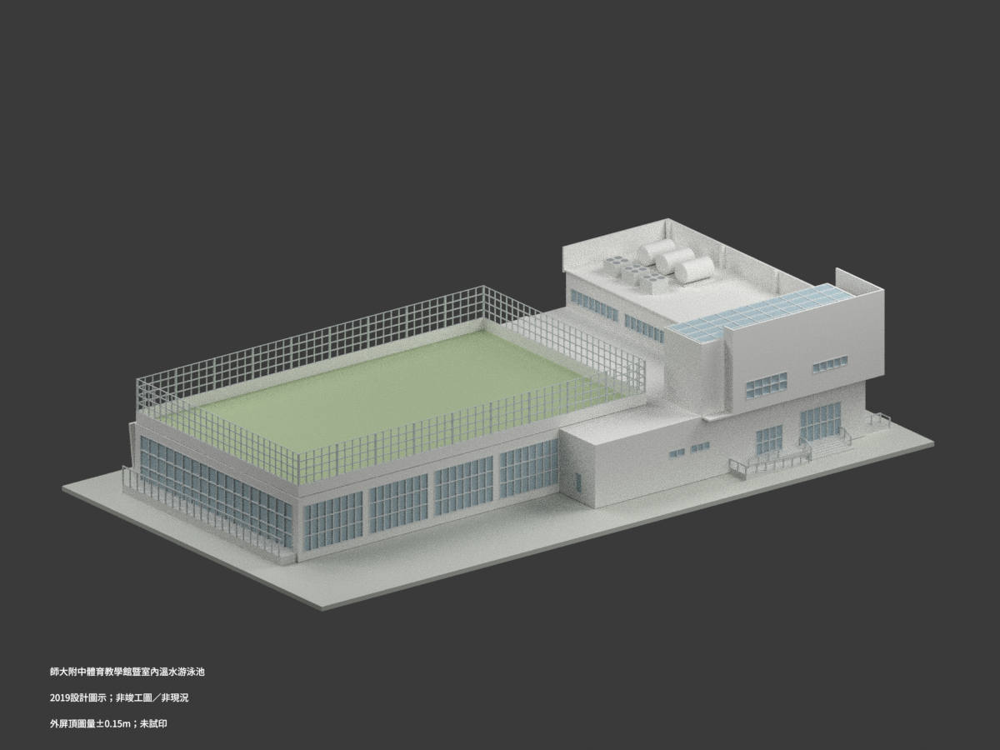
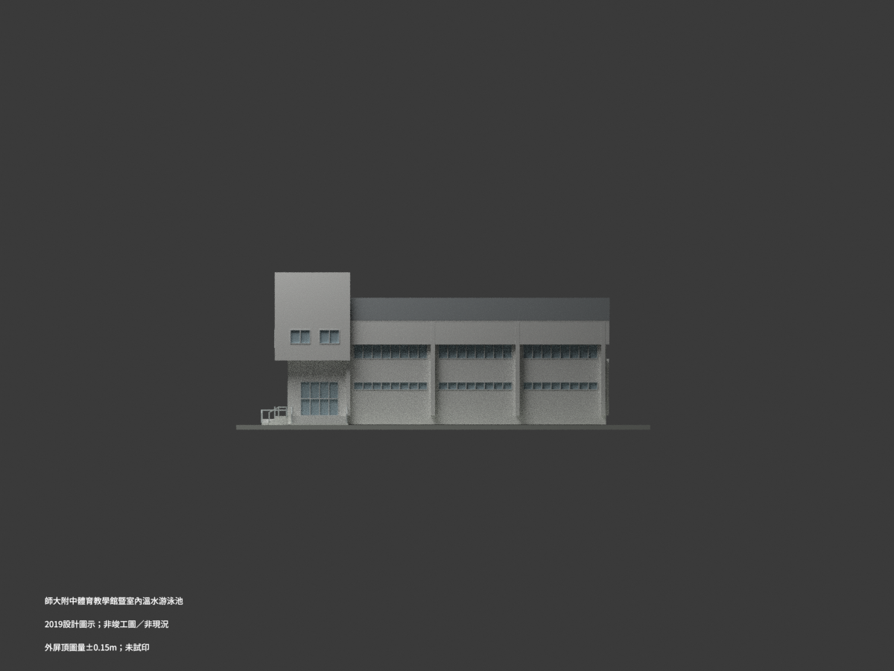
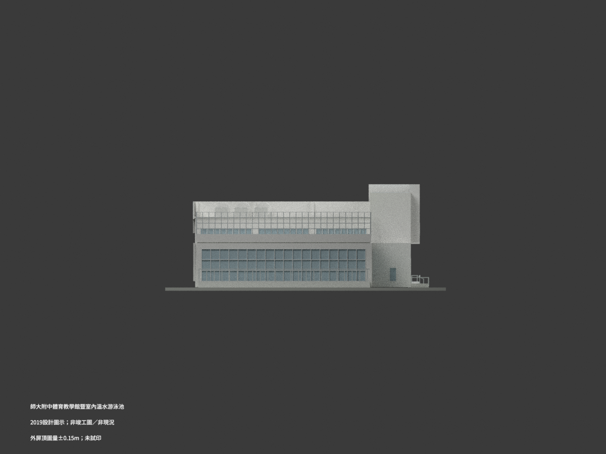
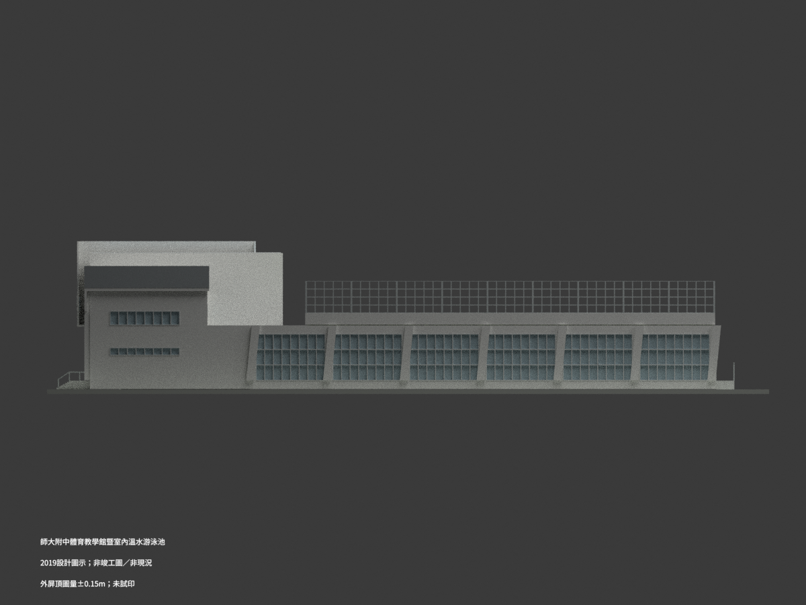
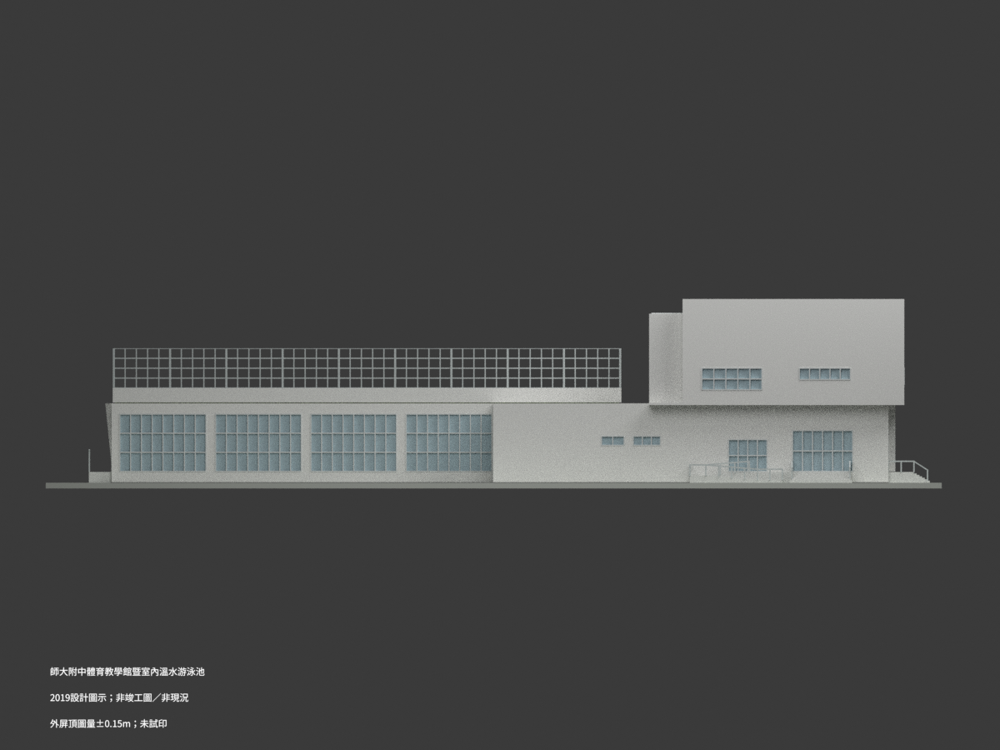
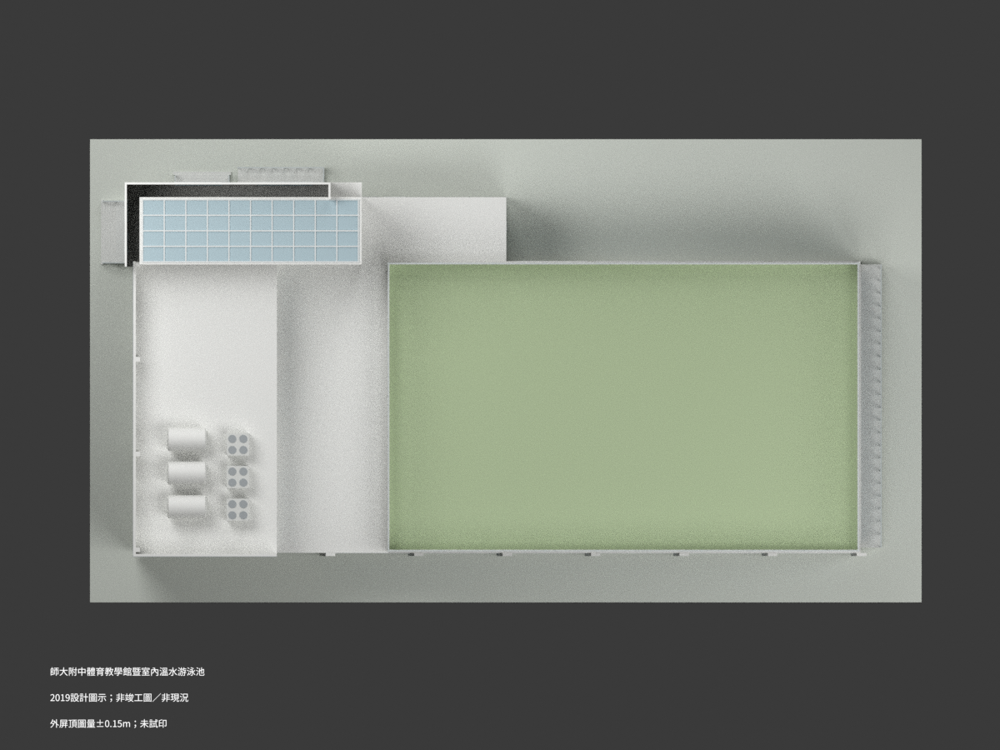
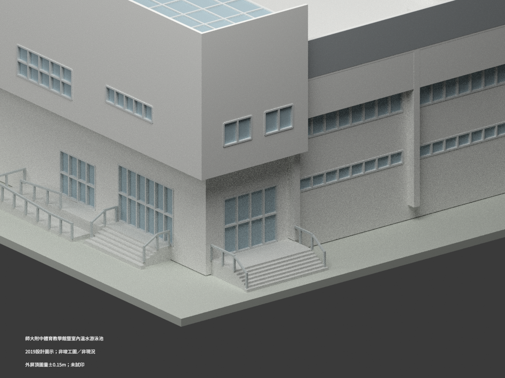
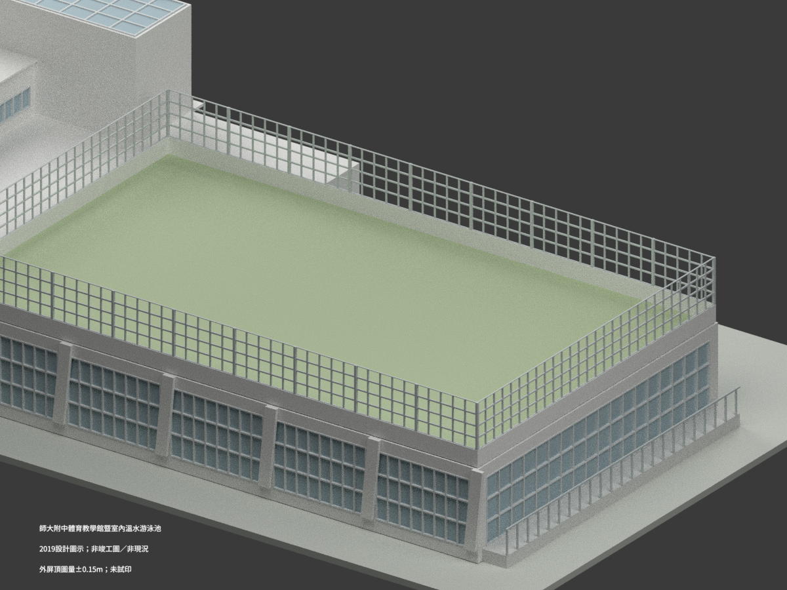
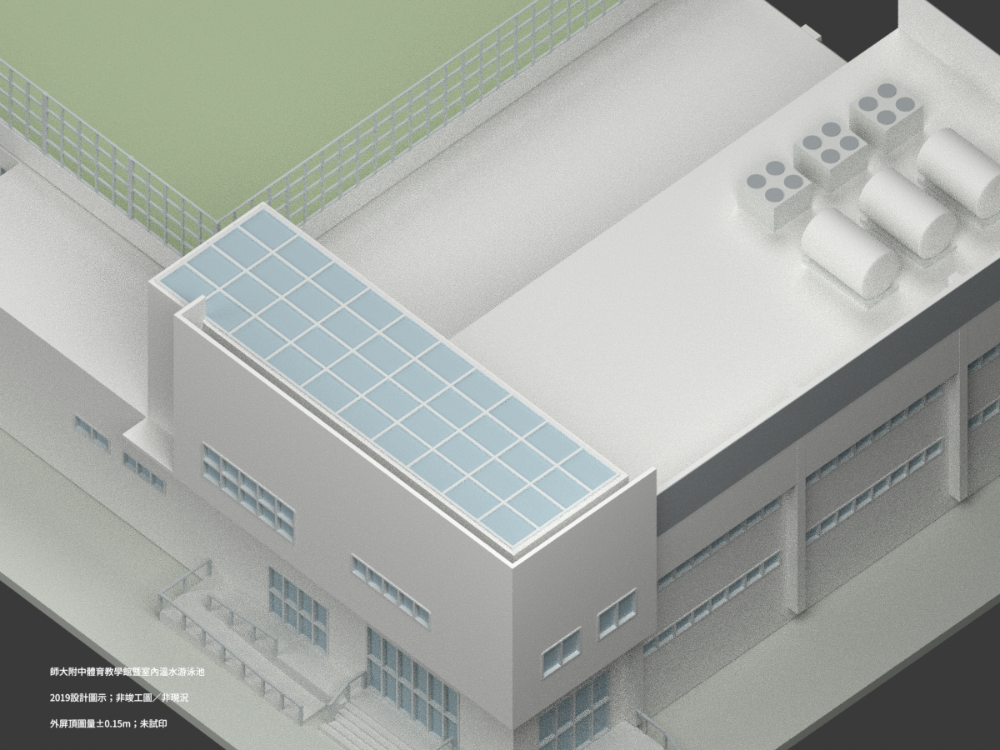

# 師大附中體育教學館暨室內溫水游泳池（2019 設計圖示）

## 模型預覽與範圍

**2019 設計外觀解讀，不是 2022 竣工圖，也不是今日實測現況。未實際列印。**
包含同一泳館、北側教室／屋突、屋頂戶外球場及貼館入口；不把師大本部泳館、舊戶外泳池或獨立場地設備混成同館。
最高外屏 16.20±0.15m 為圖量重建；A4-06 詳圖未附，外皮細部／入口局部標高不能宣稱施工精度。

| 總覽／立面 | 立面／細節 | 立面／細節 |
|---|---|---|
|  |  |  |
|  |  |  |
|  |  |  |
|  |  |  |

## 來源版本與外觀控制

- 陳章安建築師事務所：圖框 V0.3／2019.01；A2-01、A4-01 核准日期 2019-02-21，A2-05 為 2019-01-30。收錄於校方 2022-03 促參評估摘要，不把報告日期當建築圖版本。
- 校方另載 2022-01 工程完成，只作身份歷程，不因此把此模型稱為竣工／現況。
- 主控：官方報告物理頁33透視、34首層／配置、35二層／屋突／屋頂、37長剖；36地下圖僅辨識範圍，不復刻隱蔽空間。
- 軸域 **67.90×33.20m**，不是建築最外 bbox。北教室、東側服務帶、樓梯屋突與南池館不同輪廓，不能整個軸框等高擠出。
- 東側 E–D／D–C／C–B 三 DW4 及 B–A 末 DW7 與西側交替窗序分開；沒有鏡射西立面到東面。

| 控制 | 採用與限制 |
|---|---|
| 基本樓層 | GL0、1FL1.00、2FL7.00、R1FL11.00、RFL15.00參照 |
| 屋頂球場 | 邊完成7.10、中央7.25；是泳池頂戶外球場，不是封閉第三層 |
| 圍網 | 邊7.10＋欄牆1.25＋網3.50＝網頂11.85；網格為可列印粗化，不是原織網尺寸 |
| 北低屋面 | 完成屋面11.10，外皮由2F完成7.05＋150cm＝底8.55；頂由R1FL11.00＋250cm＝13.50。外皮不是屋面，不能把屋皮整體抬至13.50 |
| 屋突 | 層11.20、小高屋皮14.90；藍格為屋面圖示，不造五個通天天井或太陽能板 |
| 最高外屏 | 圖量16.20±0.15m，平面I端外挑1.70、I→屏端17.85；屋突樓梯另至G後3.375，不混同一bbox |
| 開口 | 池側主要DW4／DW7開口高5.05；細框、玻璃分格與白色淺折板依可見圖示簡化，折板出挑／斜角約±0.15～0.25m圖量 |
| 北入口 | DW1外平台spot被粗線遮蔽，不採早期+63或+95確讀。模型名義+.95借鄰DW2作協調約定，並非DW1原圖尺寸；階數及總差示意，不造虛假37cm門檻 |
| 東入口 | DW2外平台+.95、外側+.25、室內1.00；坡道另有G側+.63回轉平台及兩140cm寬帶。模型以1:12推導4.56／3.84m斜段加水平接近段協調，分段位置屬建模約定，不是原圖直標完整跑鏈；上矩形用途未明。坡道分段／局部細部未唯一復原，非通行設計。階級與護欄細部仍為有界示意 |
| 屋面設備 | 三儲熱桶平面寬2.20、間隔1.00；長約3.8m圖量。圓截面、支座及三熱泵外罩高約1.4±.3m為外觀協調；熱泵方組2.10及間1.00有圖，不復刻內機電 |

## 模型範圍與列印限制

- 外觀模型，不建泳池水下、地下室、機房、內部設備／管線、精確室內及真實基地地形。
- A軸外的獨立高壓變電站116、地下車道與相關場地設施不建；貼館窄平台／護欄保留。顯示底座是模型截斷支座，不代表把原下坡車道填成實心地坪。
- 顏色依來源示意作辨識，不宣稱實材實色。門窗採不透明凹面，不是可透視完整室內；沒有仿造原圖文字版面或照片。
- **1:250**，模型支座厚2mm；目前含支座約316×176×66.8mm，需核對印床，可能需縮放／自行分件。沒有實體試印，薄網格／細框、懸挑及長跨度可能需支撐或再加厚；網格名義約0.4mm僅是幾何尺寸，不保證任何印表機可成功。
- 不適用施工、結構／消防分析、導航、現況量測或設施運作判斷。

## 檔案與可重現製作

`model.stl`、`model.3mf`（毫米）、`scene.blend`、`mesh.npz`、`palette.json`、`components.json`，以及10張實際模型渲染。
兩個幾何輸入為 `build_model.py` 與 `geometry_helpers.py`，不需私有原圖即可重建已公開幾何。

```bash
python build_model.py
python export_3mf.py
python validate_model.py
blender -b --python-exit-code 1 --python render_model.py
blender -b --python-exit-code 1 --python verify_scene.py
```

Python套件見 requirements.txt；Blender4.3.2用於實際渲染。QA JSON區分網格／格式／重建／重開／渲染與人工來源審核，不以檔名或元件數量冒充原圖核對。

## 來源與權利

- [校方2022-03促參評估摘要（含2019建築圖）](https://www.hs.ntnu.edu.tw/static/webroot/G162269154830558/application/NN164758951286230.pdf)
- [校方2022說明資料（身份及歷程）](https://www.hs.ntnu.edu.tw/static/webroot/G162269154830558/application/NN165058681750796.pdf)

參考文件**未見 CC 授權**；公開可讀不表示可自由複製或再授權。**原圖不隨模型公開**，原始PDF、截圖、圖說版面及私人核圖裁圖皆另存私人備份。
本包公開的是獨立製作的外觀幾何、程式、自己渲染及原創來源說明。建築設計與參考文件相關權利不包含在既有程式授權內，**不保證商用**或無限制再利用；不自行把原文件改掛自由授權，也不對獨立程式新增未經授權的整包限制。
