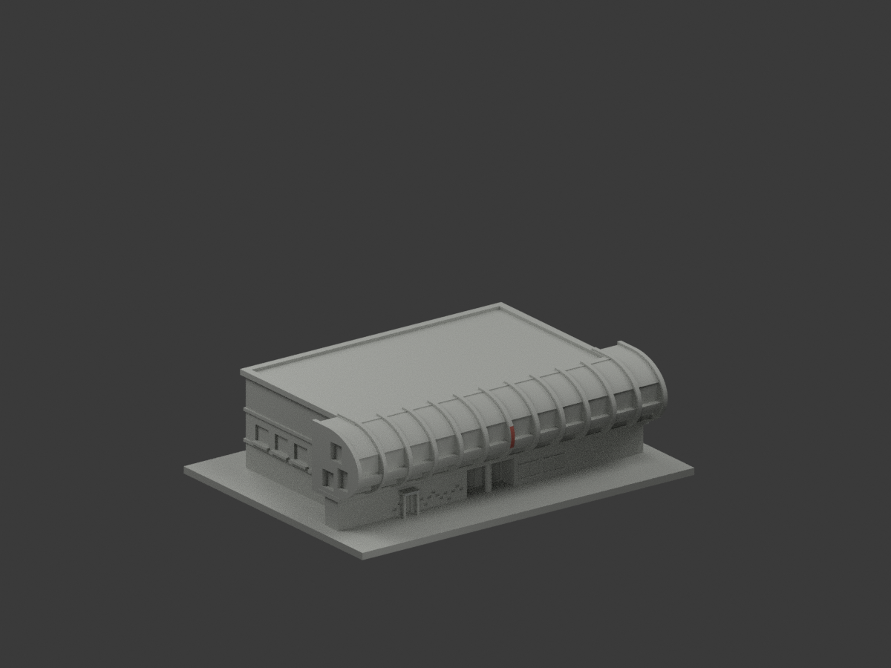
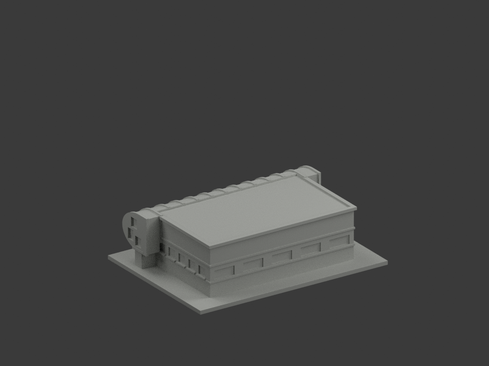
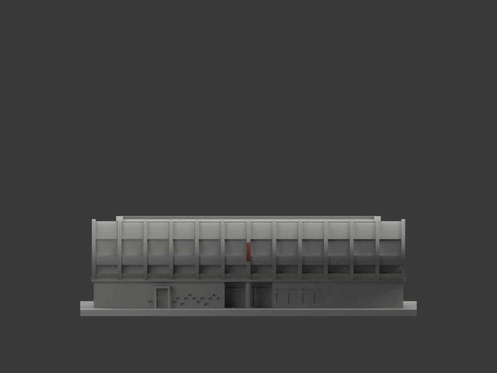
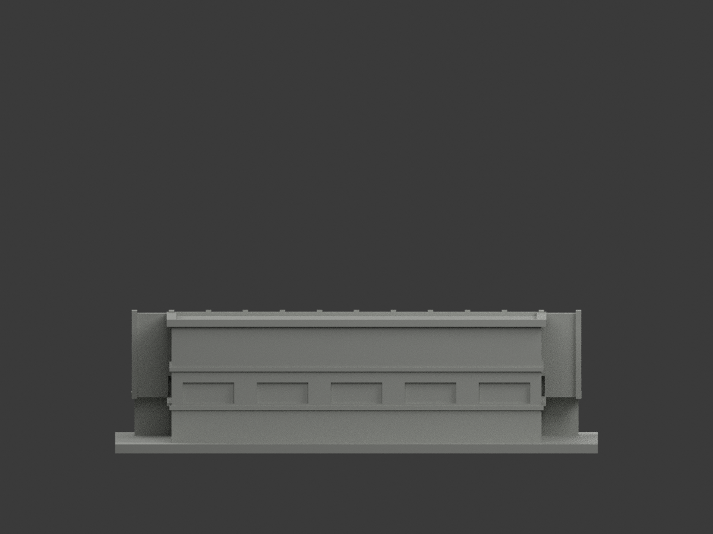
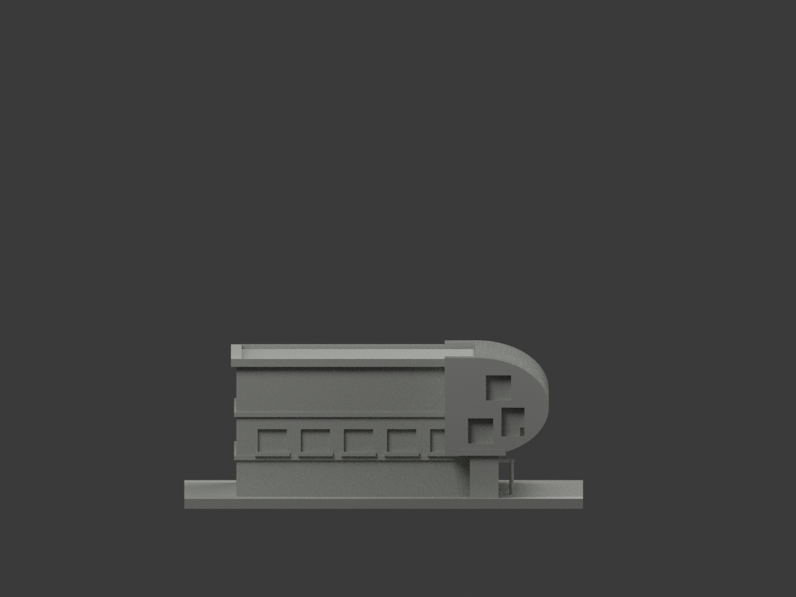
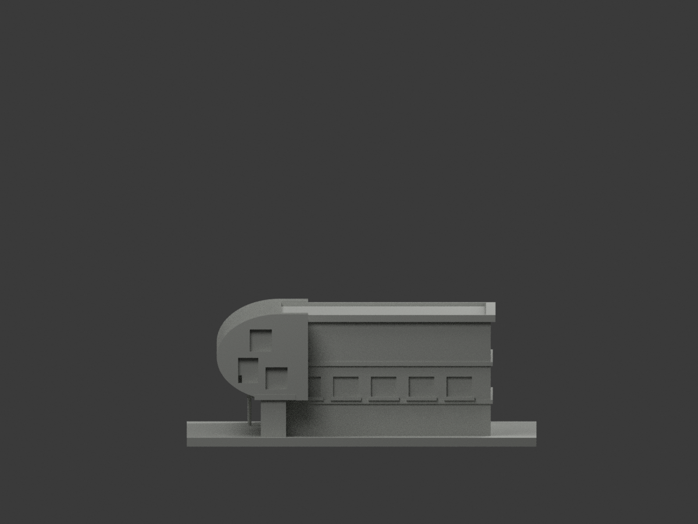
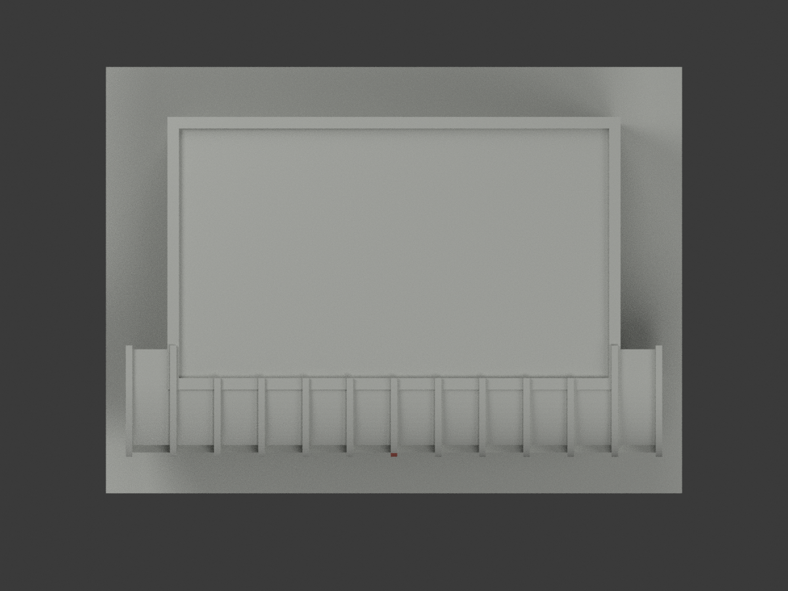
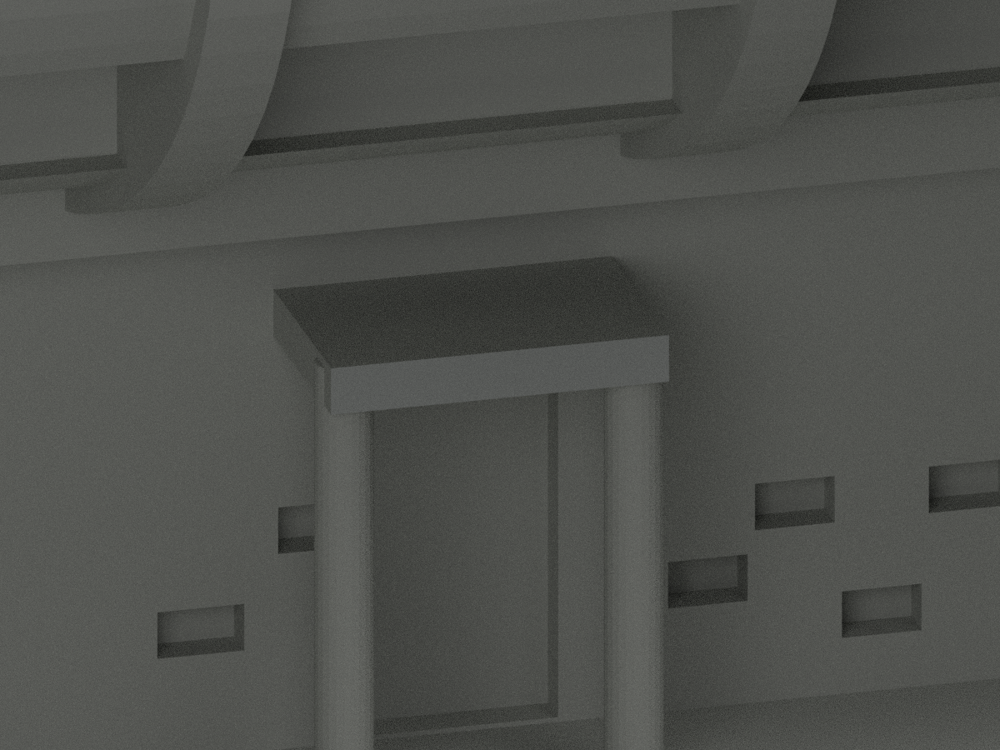
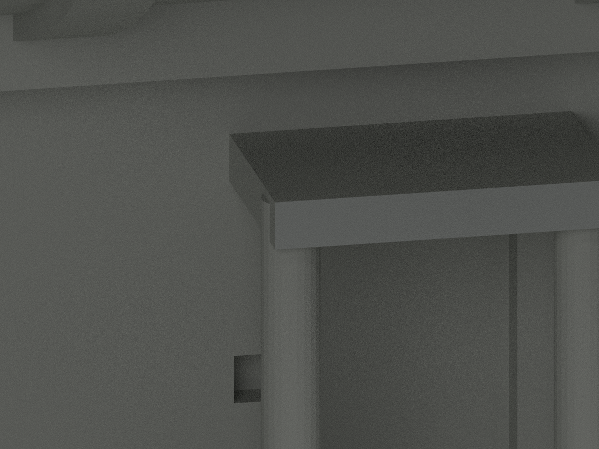
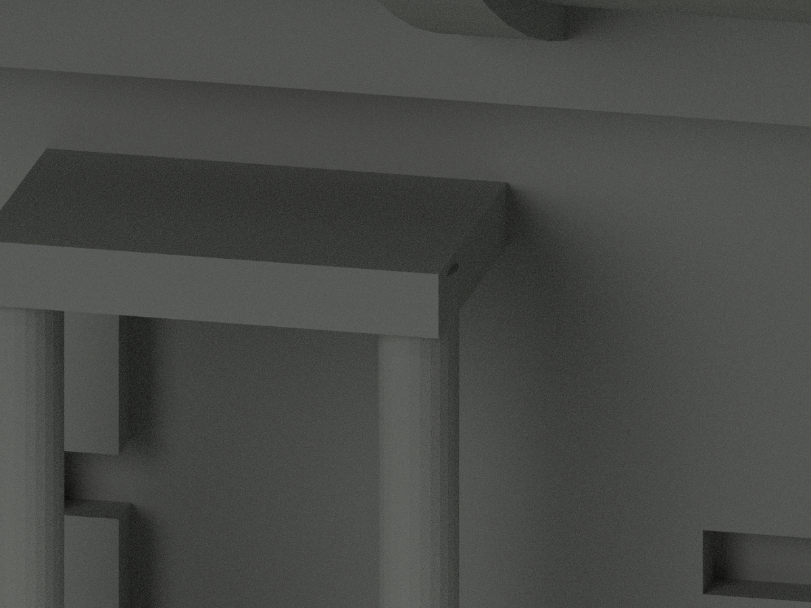

# 海大體育館｜中央紅肋朝前中段有限補色

原5630三角不變，原小棚前2面灰保留；新增中央單紅肋朝前中段18面／8完整共面域，合20色／5610中性。原2palette與其他indices保持，新增index2名義#A65D52紅色族，不是校準HEX或漆料鑑定。原x±0.85、圓弧離散segments16..23（72..108度）全頂點有限弦域，0混材共面域。不改幾何或切三角。

原官方2000px正面照片重新實看並核hash、原作者600px斜近照交核；不是新拍照。中央紅肋位在入口圓柱上方，選最朝前中段紅皮可與灰窗分離。facet只是原代理離散界與本次證據範圍，不是真材縫；原20×27.4半橢圓與1.7厚寬不獲測繪認證。排除上頂、下回捲、側厚、背側、其餘12肋及玻璃、柱、混磚灰牆、字帶，不因局部紅推整弧全館。

新取得官方行政會議PDF僅載外牆鋼構除鏽計畫，不證完工或新色；搜尋摘要聲稱照片未在關聯頁得到實看支持，不引用作色證。原照片頁更新/EXIF/作者署日期均非獨立拍攝認證，不稱2026現況。照片與裁切私人不公開。

重要：原 strict false / run_checks exit1 保持；60原Polygon開孔損失>1%、1227短首弦、12射線沿面區間等工程例外與完整107原工程檔/歷史裁定原bytes保留。原107件的歷史交付差別依 ORIGINAL-FILE-DELIVERY-SCOPE.md：104同位元組原路徑、README及scene兩別名，另歷史子目錄SHA表當年未列 frozen payload；不能把歷史107描述等同當年全部公開清單。本輪以實際基線143 blob核對與保留，不更改舊說明。本次材色QA PASS不等全域最薄壁、零警告、幾何修復或試印可行。原無OBJ，不新增。SOURCE-QA審前pending快照固定，最終獨審另檔。下列舊文2色/5628為歷史版本，由此段20/5610取代，其餘限制全部保留。

## 原版歷史說明

# 海大北寧體育館｜小門棚前緣局部灰

**局部材色未完成全館補色；原 strict false / run_checks exit1 與有限例外全部保留。** partial_color_incomplete=true、fully_colored_exterior=false。只小門棚前緣完整2面名義灰，其餘5628面中性；本次同幾何材色QA不是全域最薄壁、零警告或試印合格背書。

| 總覽 | 背側 | 正面 |
|---|---|---|
||||
||||
||||
||||

## 材色及原件
同 ntou-gymnasium 原項目，國立臺灣海洋大學北寧校區體育館場側修版，same-item、count_delta=0，非新棟。原5630三角/STL/build_model.py及107原件字節保留，immutable無OBJ，不新造OBJ。原150×111×41.9mm含底有界近似非測繪、非全校完成。
原 add(-38.5,-29.7,11.7,7,5.5,1) 小棚前緣 y=-32.45 整plane恰2三角，x[-42,-35]z[11.7,12.7]完整矩形；全3頂點有限界1e-5，wholeplane等於finite，單共享邊component，不人工裁色。灰是名義色族不是測量RGB或金屬種類認證。
其餘5628面未知中性：實景通透格棚被原厚實盒簡化，頂/底/側返/小柱不塗；中央大柱底被人遮、字帶/混磚灰主牆/13紅肋未知回返/玻璃與窗背/屋面背側末端全不擴色。不公開照片、不建人物、不貼紋理。

## 必留原 strict 失敗與限定裁定
原 strict false 與 run_checks.py exit1 維持，不改閾值或原幾何。60原Polygon opening loss>1%（24端肋、36上肋末端），峰5.1513425349%，保留94.8486574651%。56300原面密點中1227短首弦，最小0.0000335533604338mm；既有連續根最短6.65393095985mm、真邊距最大0.782656059265mm只是有限補證，不等於全域最薄壁。
12射線/24原三角包含沿面區間，原8 parity flags在其中；沿面不是體積空氣，面上winding0/1不裁定內外。528非邊界控制通過，72面上值僅診斷。原 INDEPENDENT-REVISION-AUDIT.md、所有107檔與early failure/有限裁定歷程原樣留存，不將警告改綠，不重新背書原全QA。
底座朝下、曲殼/入口/小棚可能需支撐，細柱/窗框/肋端及縮放需獨立評估。未實體試印、未切片器工具路徑驗證。本次 watertight/單體積/材色重建通過只證交付不改原幾何，不能消除以上限制。

## 原展示與新版本
原單材scene另存 ORIGINAL-SOURCE-GAP-scene.blend、README另存 ORIGINAL-SOURCE-GAP-README.md，原render_preview.py/previews與全部原QA/early failure檔不改。新scene與appearance.3mf為有據2面局部材色；不是對原幾何修版或全模型准印。

## 來源日期
親看官方正面與作者斜近照，完整小門棚外前邊採作者照，官方正照左端裁切只對位。EXIF DateTime2026-04-21、官方頁更新2026-04-22不是獨立驗證拍攝日；原來源列作者2026-03-19亦保留未獨立認證，不稱2026全館現況。照片私人保存不公開，未確認CC/商用授權。

## 格式與本輪QA
[原STL](model.stl) · [逐面3MF](appearance.3mf) · [新Blender](scene.blend)
物件 NTOU Gymnasium partial color。STL無色；3MF/scene不是四色耗材切片或試印認證。原build_model.py→colorize_model.py→export_appearance.py→validate_color.py；render_color.py/verify_color_scene.py。隔離Shapely2.1.2原build+color精確重建、原bytes/全三角multiset/有限共面域/3MF/scene重開/十圖1200×900/hash，均限本次材色交付。

## English scope
Partial only:2 complete small door-canopy front fascia triangles nominal gray;5628 unknown neutral. Original5630 triangles/107files retained,no originalOBJ. Original strict false/run_checks exit1 retained with60 polygon-loss exceptions,1227 short first chords and12 along-face rays. Color identity and watertight checks are NOT global minimum-wall, zero-warning or physical-print certification. All early failures/adjudication history unchanged. Sameitem/count0,no geometry repair. Photo EXIF/page/original-attributed dates unverified as capture,not verified2026 condition.
