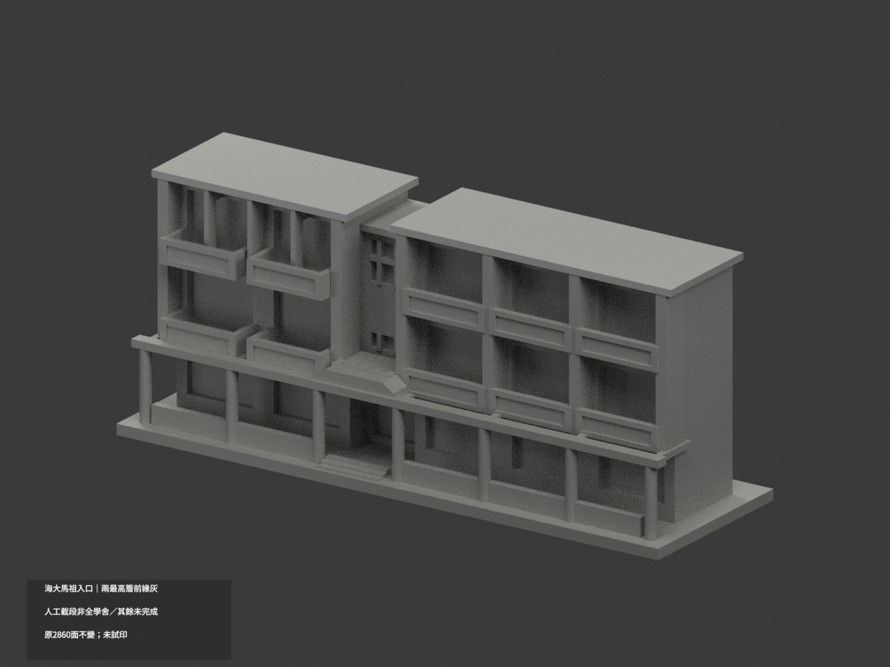

# 國立臺灣海洋大學／馬祖校區

## 模型圖鑑

| 模型預覽 | 模型預覽 | 模型預覽 |
| :---: | :---: | :---: |
| 王光祥暨海大校友國際學舍・入口立面段  [局部材色3MF](buildings/ntou-matsu-dorm-entrance-section/appearance.3mf) · [範圍與限制](buildings/ntou-matsu-dorm-entrance-section/README.md) |  |  |

- [王光祥暨海大校友國際學舍・入口立面段](buildings/ntou-matsu-dorm-entrance-section/)：入口立面段

全校及本區均未完整做完。[校級圖鑑](../README.md) · [逐項範圍與續作清單](../inventory/)
