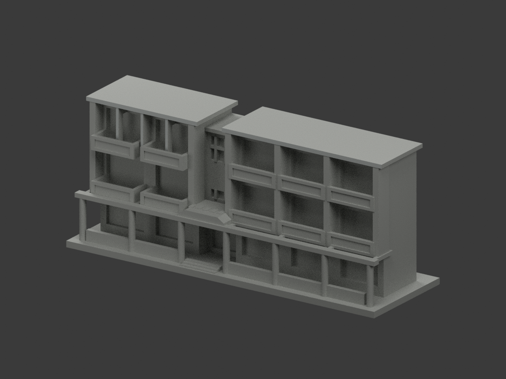
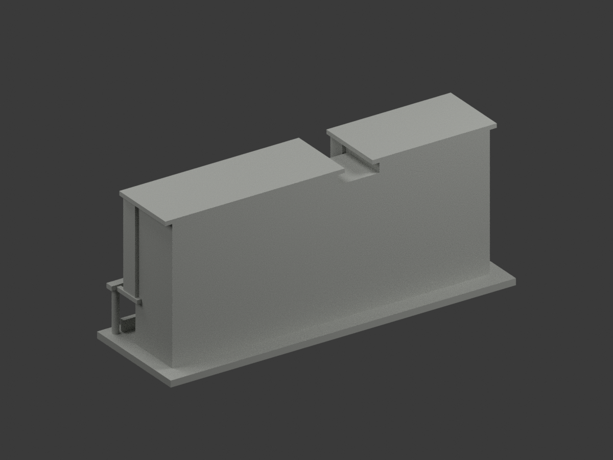
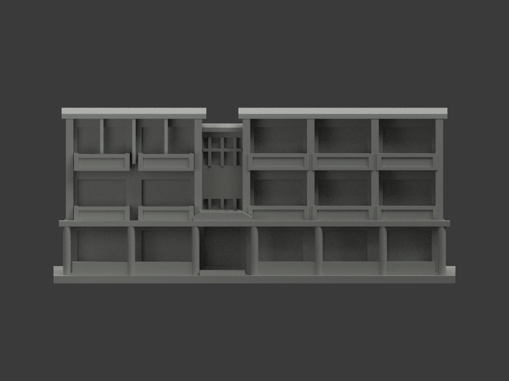
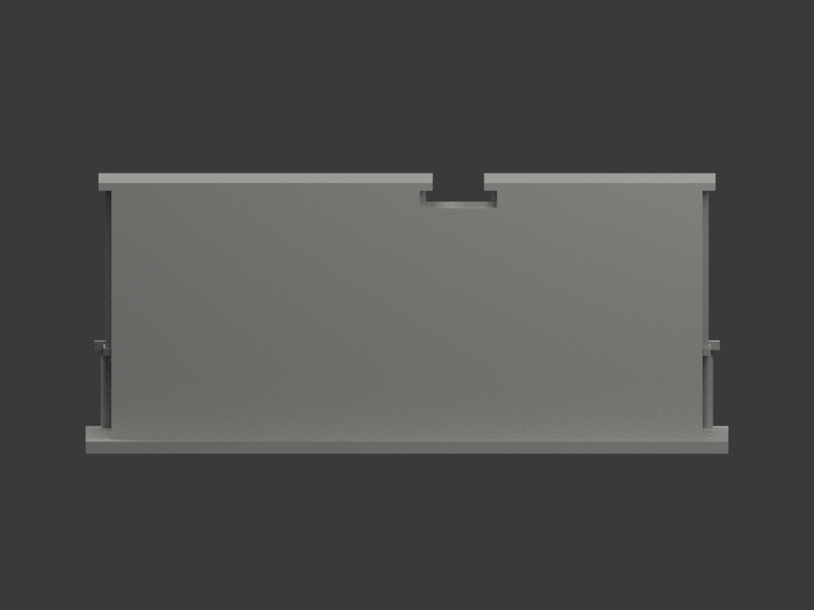
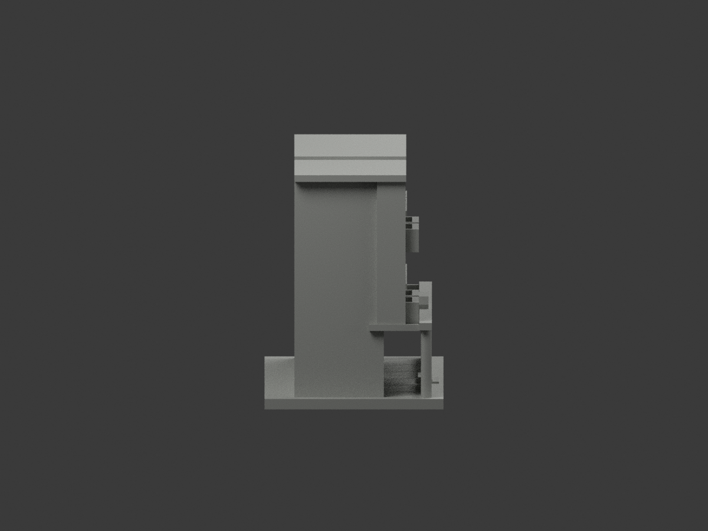
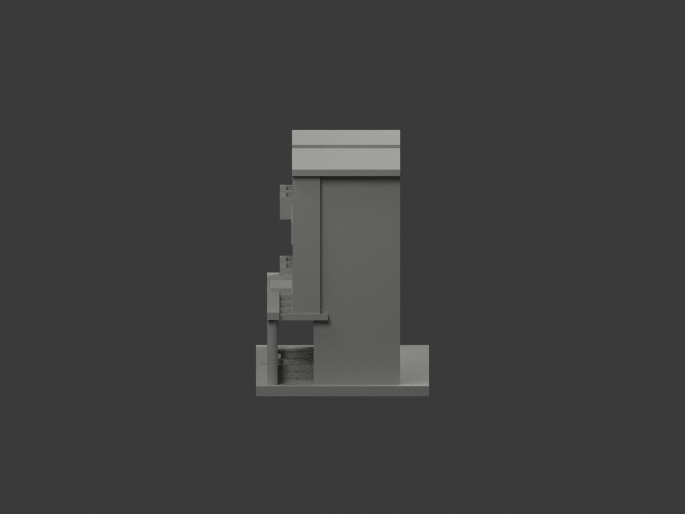
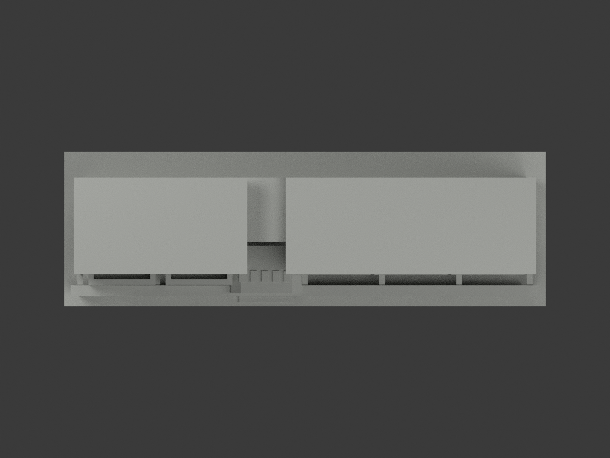
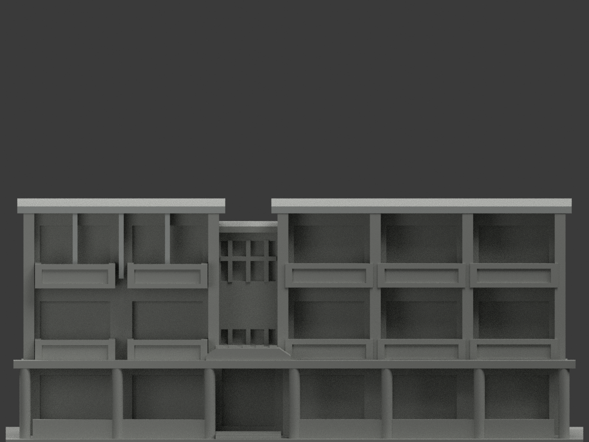
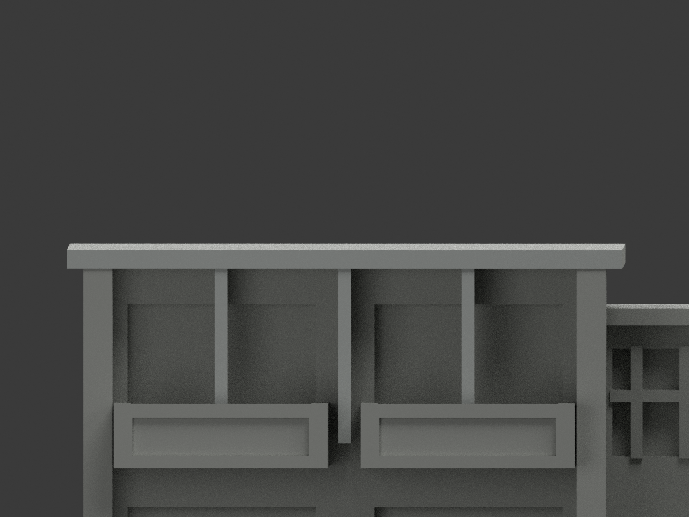
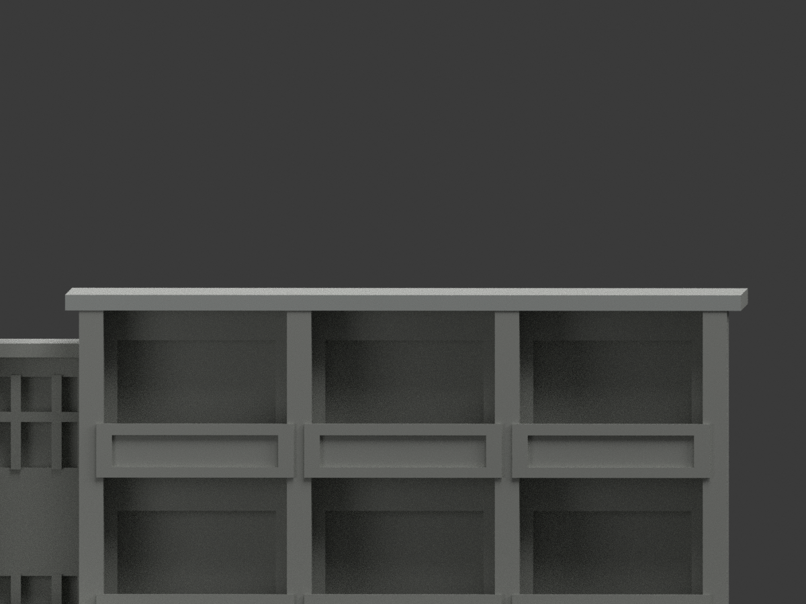

# 海大馬祖國際學舍入口段｜左上三鰭前面有限灰族補色

原最高眉前4面保持，新增左上三窄鰭front6面／3完整連通共面域，10色／2850中性／2860原三角。原2palette及所有未選indices保持，沿用既有名義#C7CBC8灰族而非校準同石化學或精準色號。全部原STL/OBJ/build與工程歷史檔不變，僅24mm名義入口立面段，不是全棟或背側測繪。

原兩官方照片本輪hash精確重新取得及全幅實看，2400原圖可辨上左三鰭front與深窗框、淡石填板分開。新官落成新聞取得同主正照及其他入口人物近圖，非新上鰭角度。原鰭直盒1.25寬、z44..61與真略斜削投影／交接只粗對應，不以原facet端點認證實材縫。只前面，不延5.75深返側、頂底、上層外大柱、陽台填板、低長庇／圓柱、瓦棚、截平主屋面。舊遮擋與混材限制持續，不稱2026現況。

來源原照私人不公開貼圖。兩材非已試印多材切片；SOURCE pending固定階段快照，終審另檔。下列原文為歷史4面版，數量由本段取代，其餘工程限制保持。

## 原版歷史說明

# 海大馬祖學舍入口立面段｜兩最高簷前緣局部灰

**局部補色未完成：僅兩最高簷完整前緣4原三角淺灰，其餘面尚未分色。** partial_color_incomplete=true、fully_colored_exterior=false。同項 ntou-matsu-dorm-entrance-section／count_delta=0，國立臺灣海洋大學馬祖校區。身份 NTOU Matsu Dorm Entrance Section partial color。

**原24mm深是人工入口立面截段，平後面是截界，非全學舍/非真實後立面。** 原scene全2860面同一Warm stone展示材，確為單材；原預覽及scene別名照原字節保留，非因補色增加測繪精度。

| 前斜視 | 後斜視 | 正面 |
|---|---|---|
|  |  |  |
|  |  |  |
|  |  |  |
|  | | |

## 完整原域

原三頂點whole y−14無限平面枚舉4面，共享邊BFS兩個完整2三角矩形。整域後記左x−72..−18、右x−6..72，z61..62.799999，不以照片中間裁色、不按normal/centroid漏端。名義淺灰4、2856未知中性，原2860三角座標拓撲不改。

兩官照可核兩最高簷完整前緣，不外推截斷屋上皮/底/側後。較低長庇超出照片邊、柱被花籃紅帶人物遮擋，不全灰。陽台石板與周框不同、玻璃混框/內部反光，原無對應分面不染滿。中央小瓦庇混淺壓石與暗瓦全中性；階/低欄代理/人工側後截口皆中性。資料界線不是真實材界，中性不當實景灰。

## 日期與原件

官文2023-05-21是揭幕/發布脈絡，不自動是各照片capture；無可核EXIF拍攝時點，不稱2026現況。照片只私存不公開/貼圖。

immutable26件含原model.obj，原STL/build/OBJ字節全保。原README.md另存ORIGINAL-PREVIEW-README.md，原render_preview.py/previews及舊QA保留，原scene公開另名ORIGINAL-PREVIEW-scene.blend且全原包私存；別名ORIGINAL-PREVIEW-render_preview.py與原renderer同字節。新scene與appearance.3mf只實作4有據材面，不改原形。

## QA與英文限制

精確依賴隔離原build+color、原STL/OBJ完整字節及三角multiset、共面一致、3MF/reopen、十張1200×900與身份 NTOU Matsu Dorm Entrance Section partial color 檢核。保留重建不刪，未試印/驗多料切片，STL無色。

NTOU Matsu Dorm Entrance Section partial color. Whole originaly=-14plane4 gives2complete twin highestbrow frontrectangles,leftx-72..-18/rightx-6..72,z61..62.799999.4lightgray2856unknownneutral; original2860triangles/26files includingOBJ retained unchanged. Original actualscene is singleWarmstone preview,not a prior certified colorvariant. Retain originalscene/render/preview aliases and private fullpackage.

Only photographed2+3bay entrancefront;24mmcutdepth artificial,not whole residence/rear elevation. Roofupper/rear/under,lowercroppedcanopy,obscuredcolumns,mixedstonebalconies/glass/centraltiles/ground neutral. Official2023-05-21article event date not eachphoto capture,no2026claim. No publicsourcephotos,geometrychange/count_delta0,testprint.
