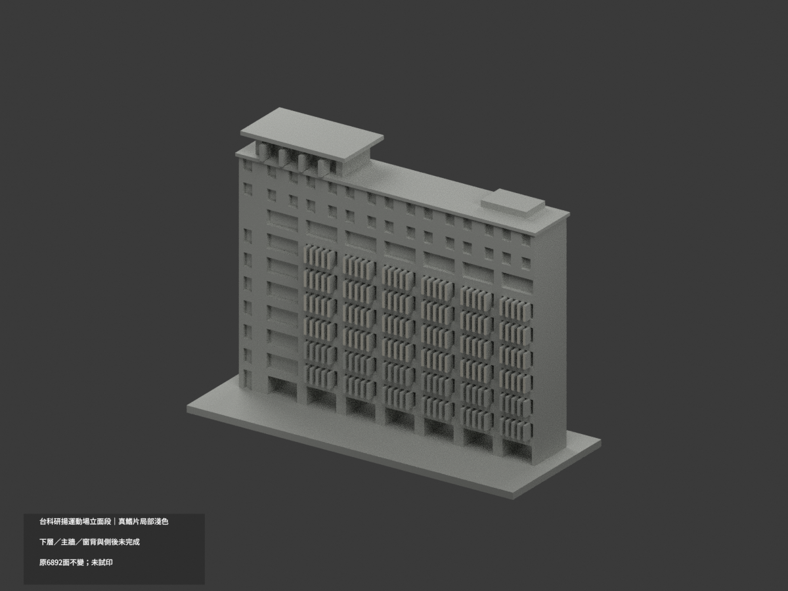
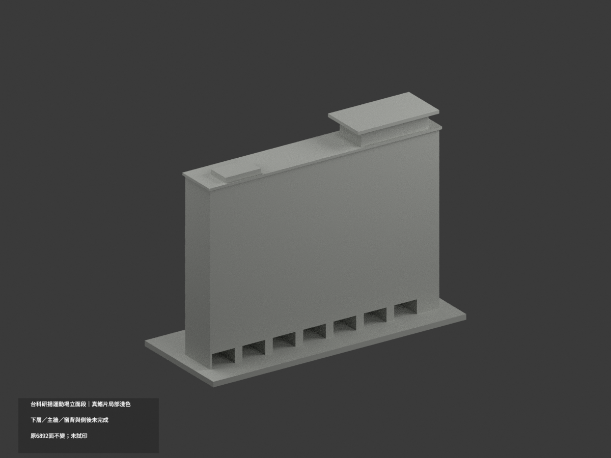
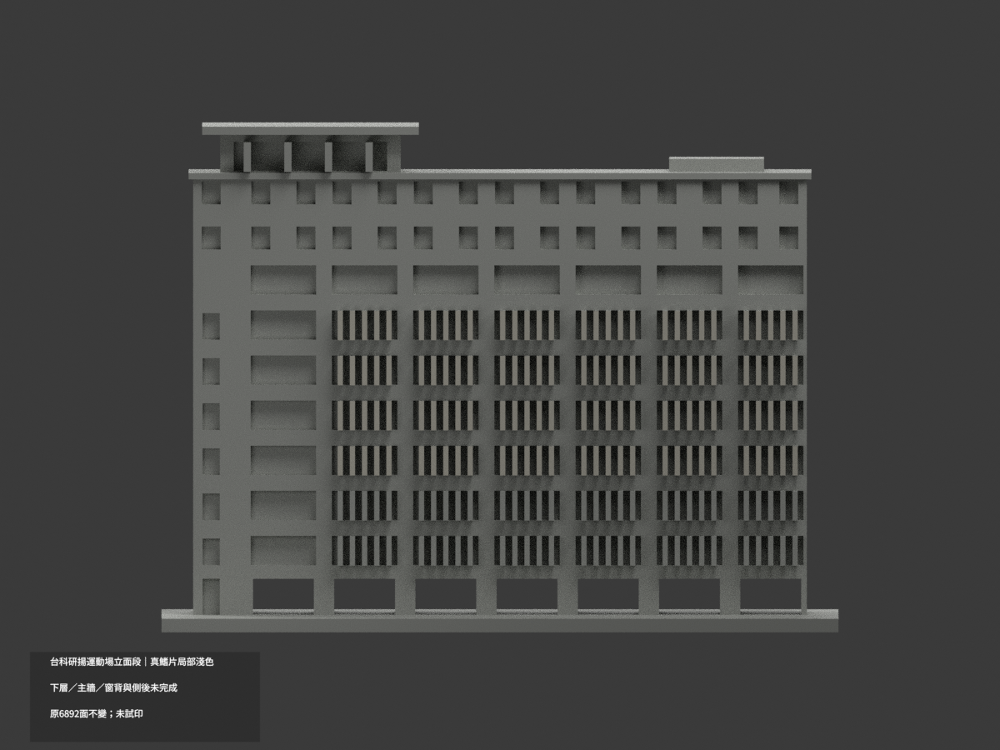
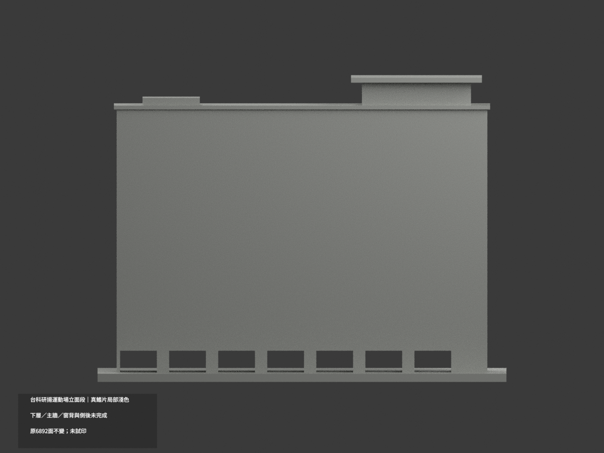
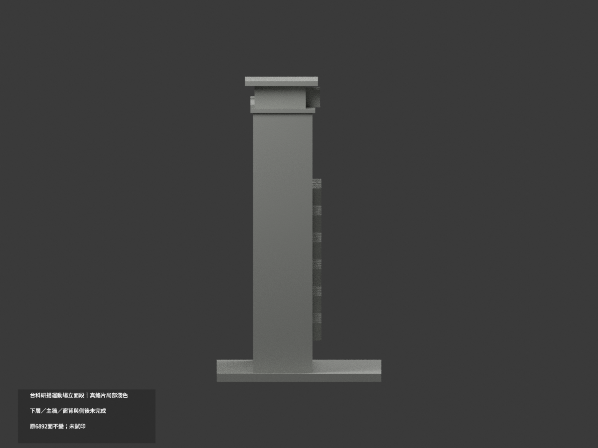
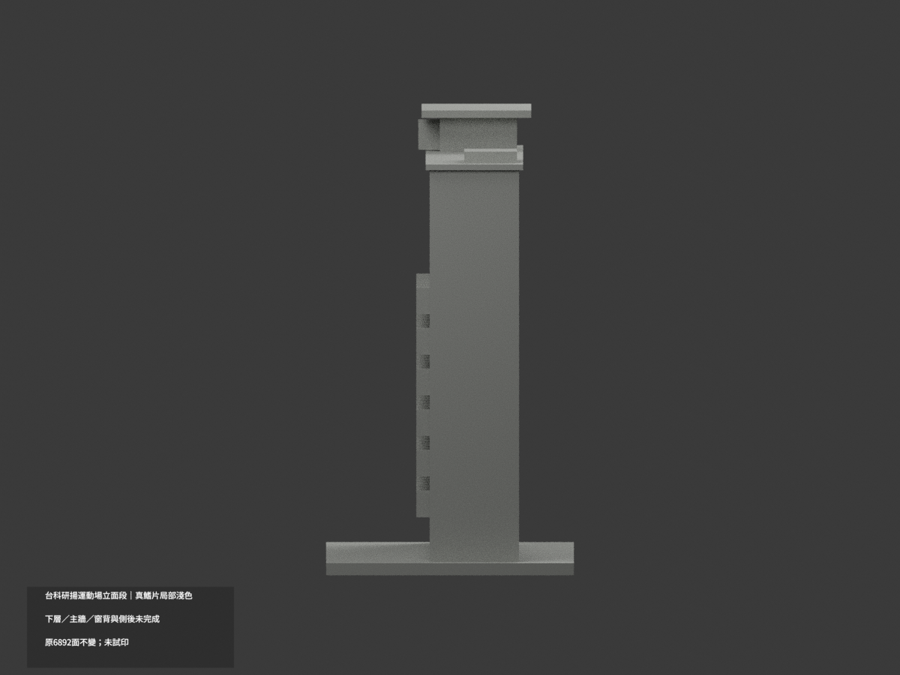
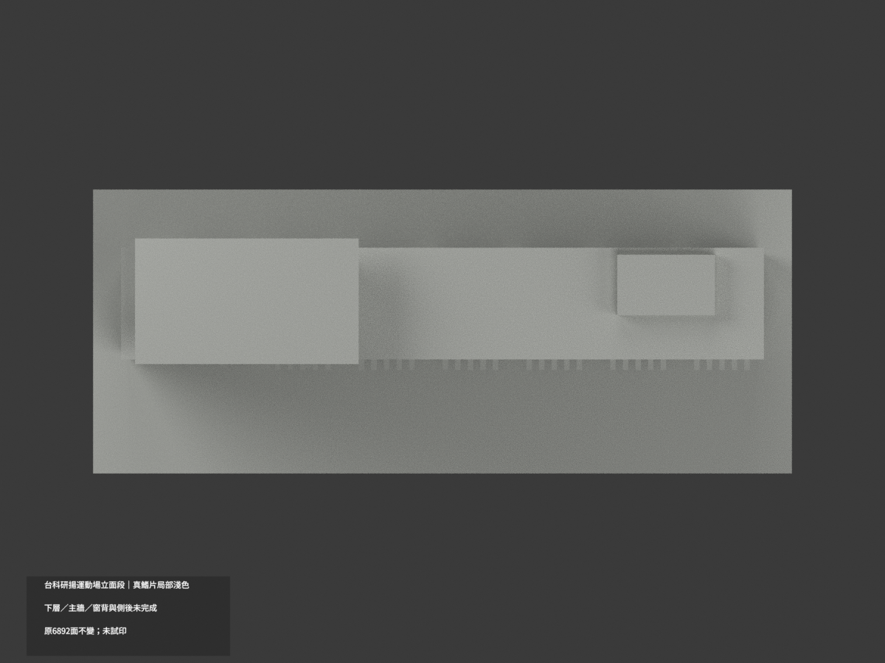
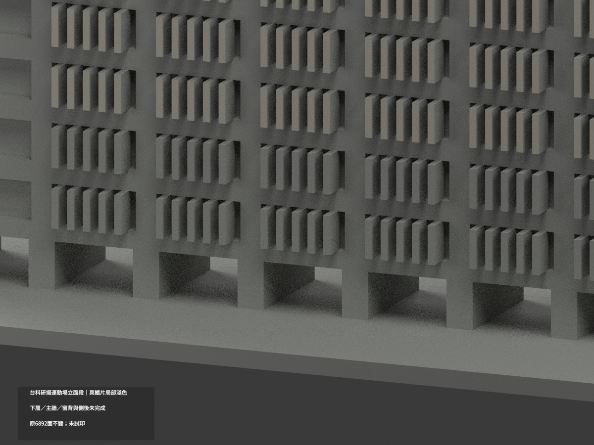
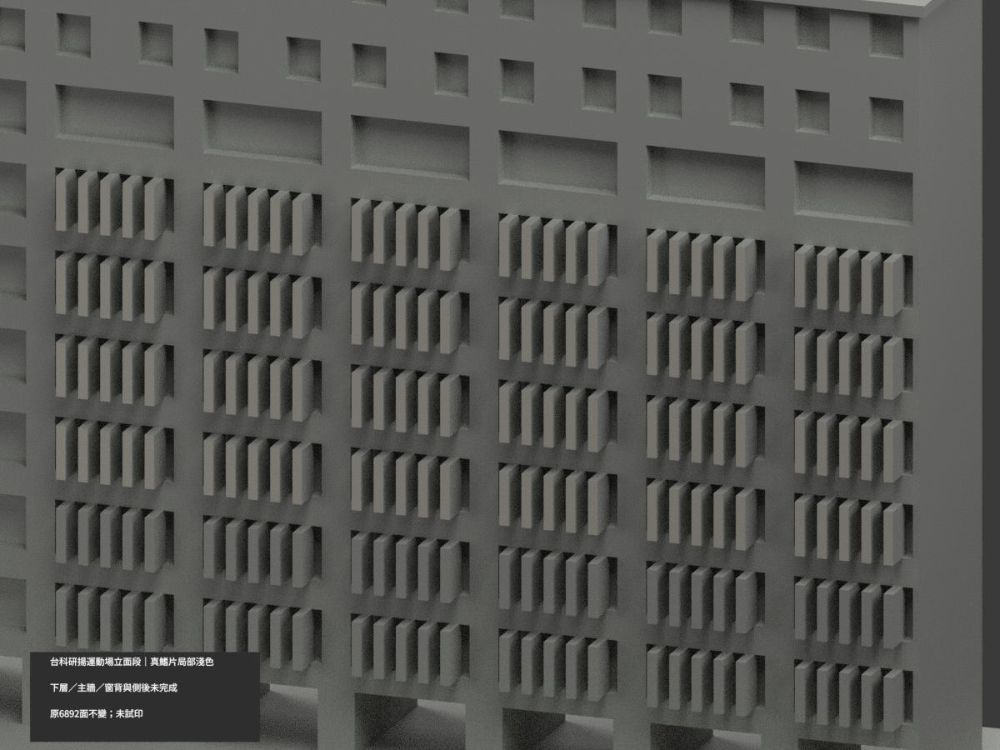
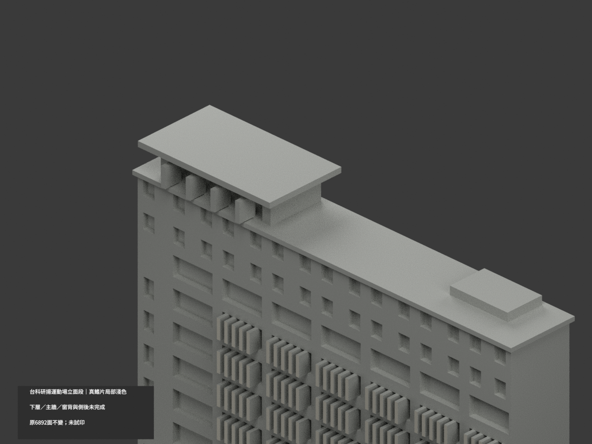

# 台科研揚大樓運動場立面段｜中上鰭片局部淺色

**樹遮下層、混材主牆、窗背與屋側後未完成分色。** `partial_color_incomplete=true`、`fully_colored_exterior=false`。僅原立面段，不是獨立體育館／完整研揚大樓或全色完成。

| 總覽 | 背側 | 正面 |
|---|---|---|
||||
||||
||||
||||

## 材色範圍
同 `ntust-aeon-sports-facade` 原項目，same-item、count_delta=0。**原6892三角面、STL與build_model.py字節不變**；不切面或添幾何。原公開包無OBJ，不聲稱保留不存在原件。
- 原中上四tier z34/44/54/64、六組×五獨立真鰭片，外向 y−8.3 的120完整矩形／240三角面淺灰白。
- 原下兩tier z14/24因樹遮整構件中性，不照樹輪廓任意切色。側返／上底面也未外推。
- 其餘6652面中性：主牆混底材、窗背與上窗框反光、入口柱、基座、屋頂設備、側端與22mm原近似背襯。
- 共面連通域同材，0候選撤色。色／中性界是證據與原拓撲限制，不是真實材接縫；補色不重新背書原幾何或樓層精度，不含運動場地景與其他樓。

## 來源／日期與權利
唯一已讀官方高視角外觀照。檔案EXIF DateTimeOriginal為2009:06:18 16:33:30、DateTime為2011:10:04 11:07:51；時區未知，不轉UTC，檔案相機時鐘未獨立認證，非2026現況。
另頁及正面P1250616曾503未讀，不能當補充證據，沒有繞行。原照私人保存，不公開或貼圖；未確認CC／再散布授權，不保證商用。HEX只近似淺灰材色族非校準色票。

## 格式與列印
[原STL](model.stl) · [材色3MF](appearance.3mf) · [Blender](scene.blend) · [原說明](ORIGINAL-MONOCHROME-README.md)
150×61mm原展示底座，最大高度111.3mm；照片近似非精測比例。STL無色，3MF與Blender真逐面材質。兩材質標籤不是驗證兩色／四色耗材切片；**未實際列印**，無切片路徑。

## 重建與 QA
原 `build_model.py` → `colorize_model.py` → `export_appearance.py` → `validate_color.py`；Blender `render_color.py` 與 `verify_color_scene.py`。
原字節／三角multiset、閉合正體積、3MF面材、完整隔離原build＋color重建、scene重開、十圖1200×900及圖文hash皆核，程序不取代來源人工判讀。
原README與單色previews/render/validation保留歷程，不冒稱新QA，沒有刪除原件。
