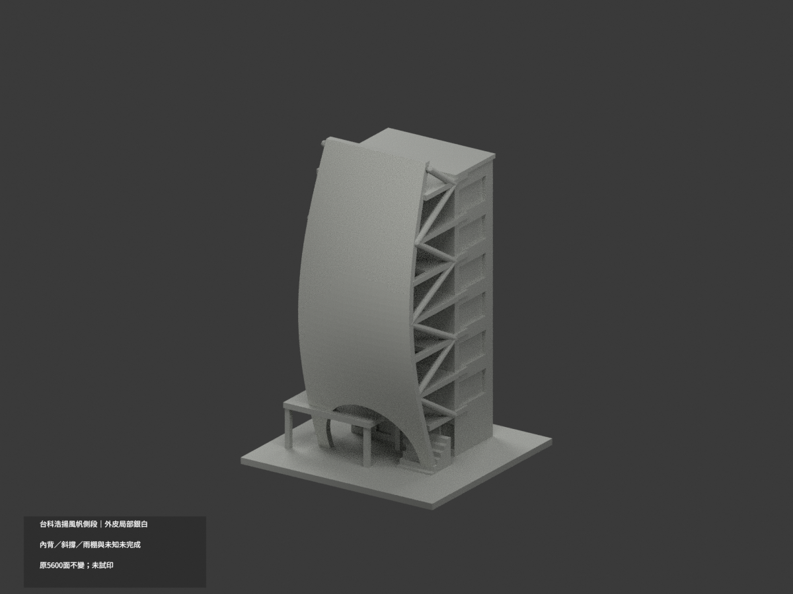
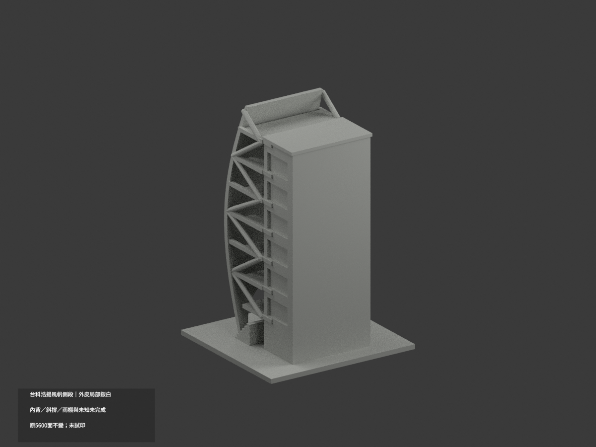
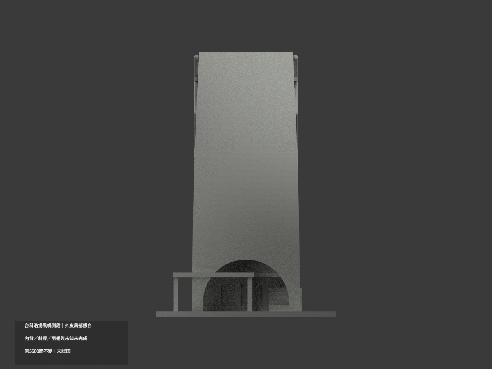
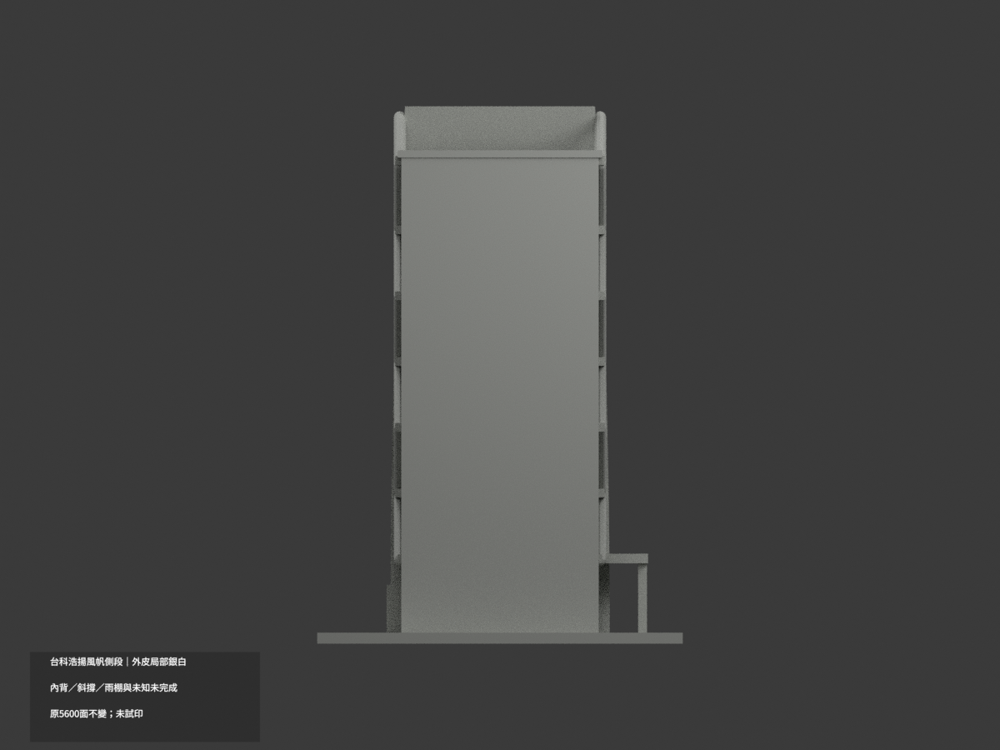
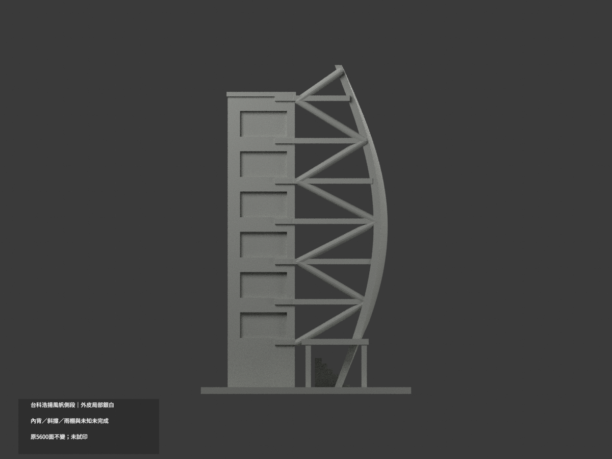
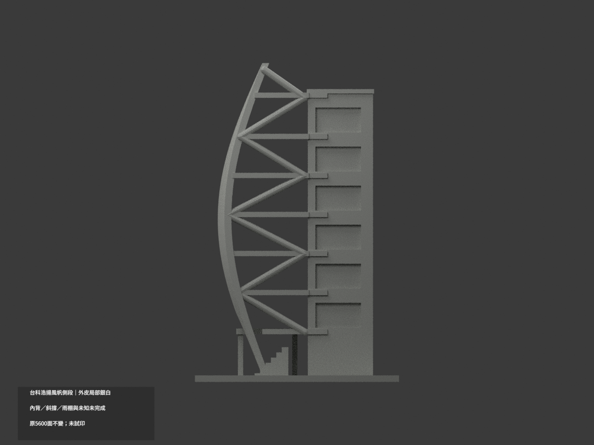
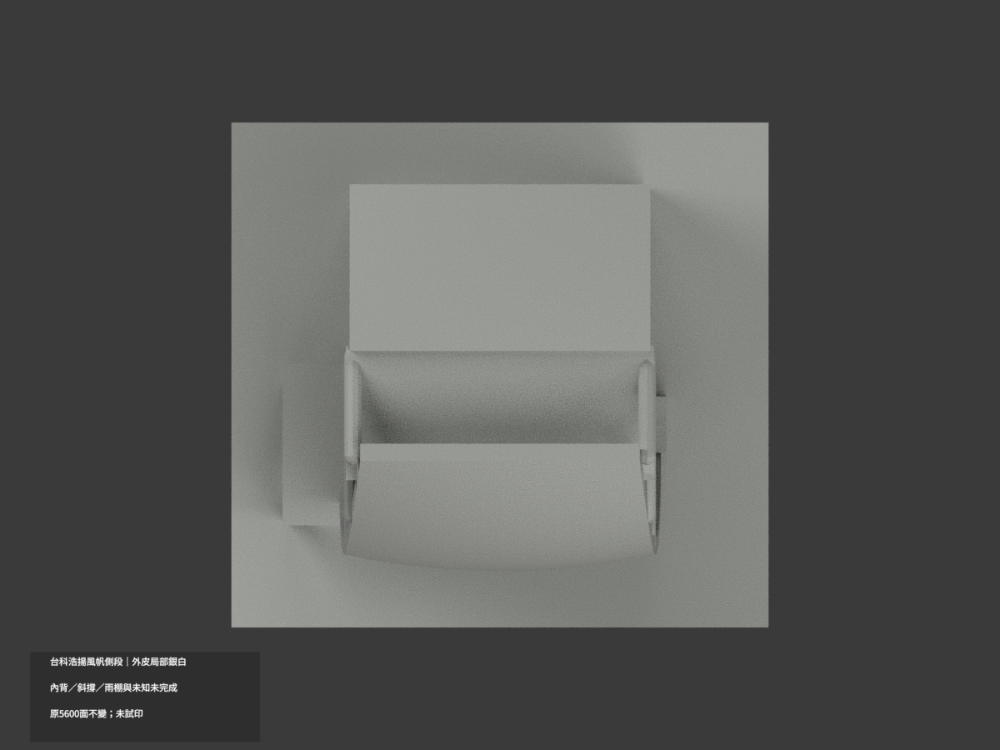
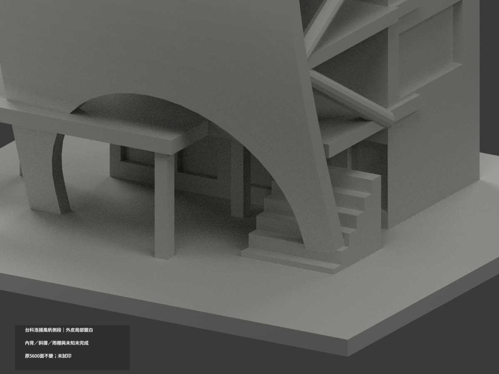
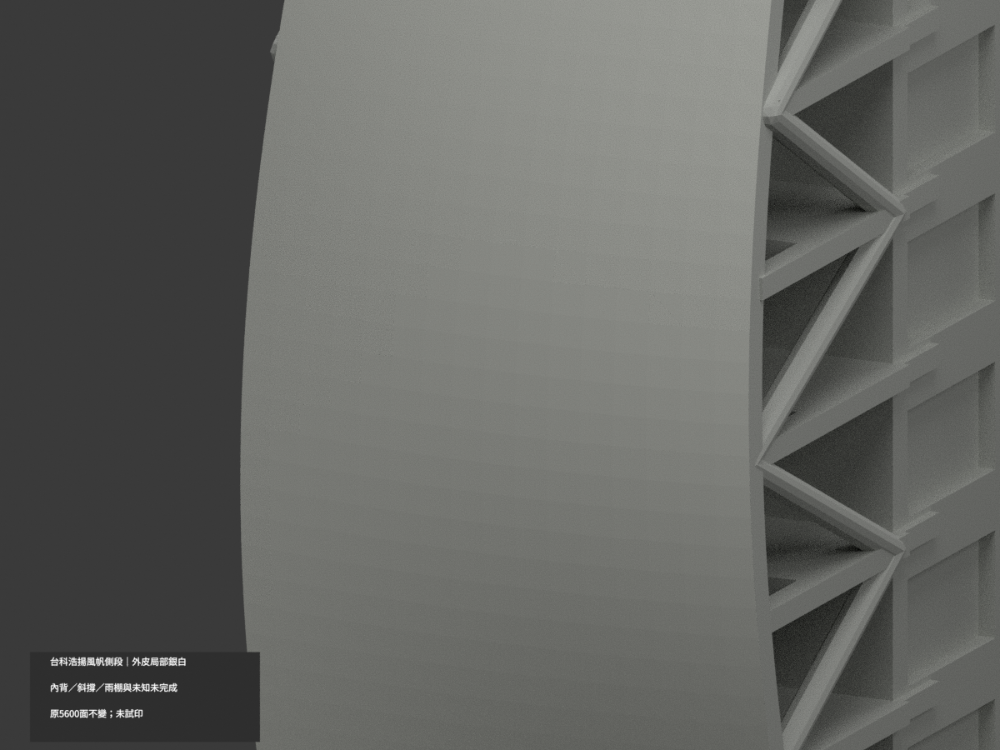
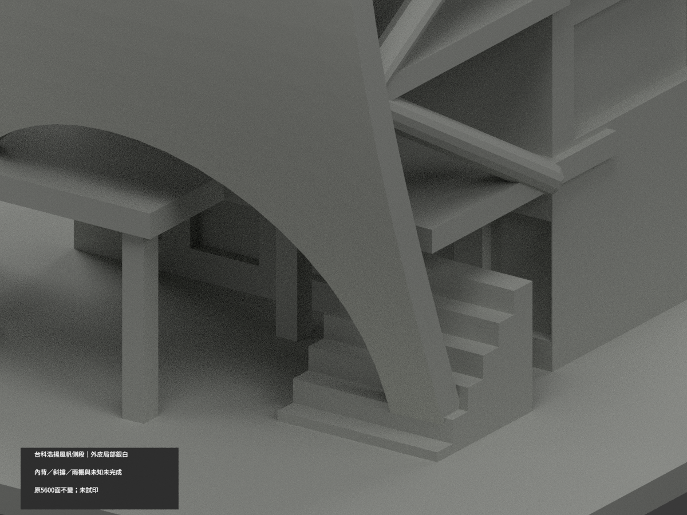

# 台科浩揚風帆側段｜外皮局部銀白

**內背、厚側、斜撐、混色雨棚與未知面未完成分色。** `partial_color_incomplete=true`、`fully_colored_exterior=false`。只原風帆外皮，不是全浩揚大樓或全色完成。

| 總覽 | 背側 | 正面 |
|---|---|---|
||||
||||
||||
||||

## 材色範圍
同 `ntust-haoyang-sail` 原項目，same-item、count_delta=0。**原5600三角面、STL與build_model.py字節不變；原公開包無OBJ，未聲稱保留不存在原件**，無切面／重造／新增穿孔。外皮1300面銀白，其餘4300面中性。
- 根據原建構16×44網格有限三角facet，將原匯出150/147縮放還原核對layer0。1298面嚴格平面及有限重心範圍匹配，不用解析sy接近值染色。
- 原STL2708／2711為兩個原Boolean微小邊界patch：仍在facet156同平面、同外向皮，共邊連續；最大平面誤差約0.00000832mm，局部超原row邊約0.00149mm。只這兩原件經精確座標與重心誤差驗證納入，不全域放寬容差、不改頂點。
- 原階面5377雖接近解析曲面，其有限facet平面差約0.4553mm，明確排除。整階、內背layer1、上下與兩側厚度、下拱reveals、斜撐、雨棚、主體窗背與基座中性。
- 全共面連通域同材，0候選撤色；不畫假三角色楔，不把陰影當黑材。照片細穿孔／板線原未建，仍不新增透明孔或貼圖。原幾何粗化不因本次補色重新背書。

## 來源／日期與權利
建築協會斜視及建築師低視角兩張外觀照片，拍攝日未知。2011案例刊載／2024圖片網址不是拍攝日期；只風帆側段，不宣稱整棟或2026精測。
原照私人保存，不公開／貼圖；未確認CC／再散布授權，不保證商用。HEX為不透明縮尺銀白材色族近似，非金屬反射精測或色票。

## 格式與列印
[原STL](model.stl) · [材色3MF](appearance.3mf) · [Blender](scene.blend)
原最大高度150mm照片近似，縮放150/147非建築測繪比例。STL不含色，3MF與Blender真逐面材質。兩材質標籤不是驗證兩色／四色耗材切片；**未實際列印**，無切片路徑。

## 重建與 QA
原 `build_model.py` → `colorize_model.py` → `export_appearance.py` → `validate_color.py`；Blender `render_color.py` 與 `verify_color_scene.py`。
原字節、三角multiset、閉合正體積、3MF面材、完整隔離原build＋color重建、scene重開、十圖1200×900與圖文hash核驗；程序不取代來源人工判讀。
原README與單色previews/render/validation保留歷程，不冒稱新QA，沒有刪除原件。
