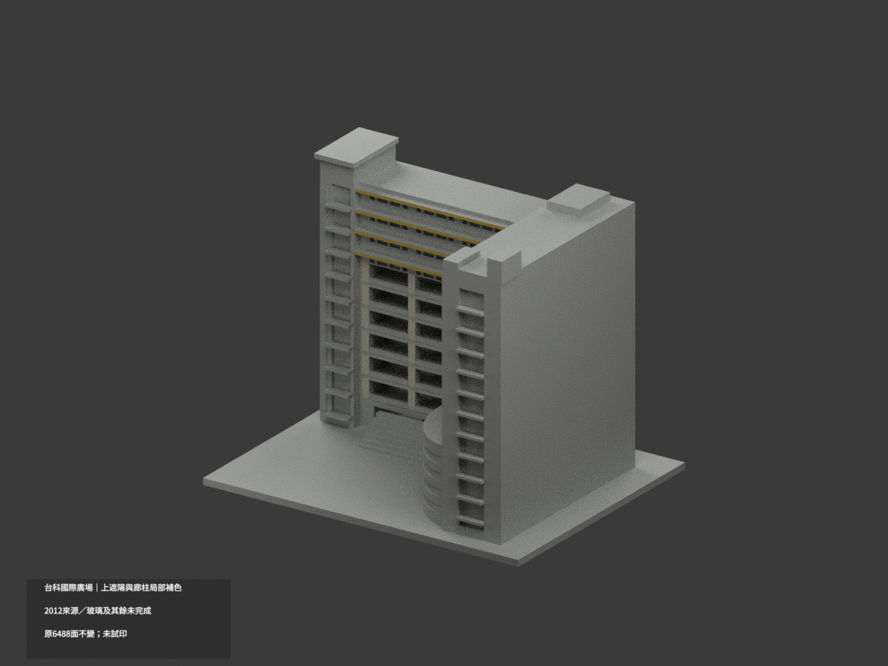
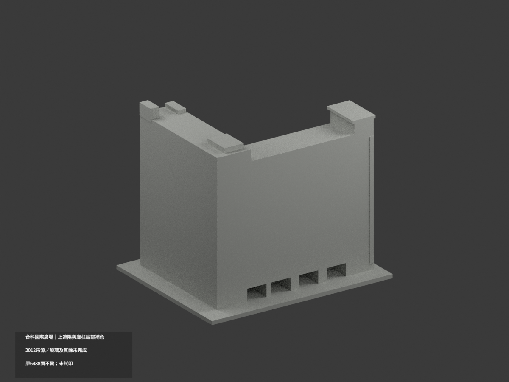
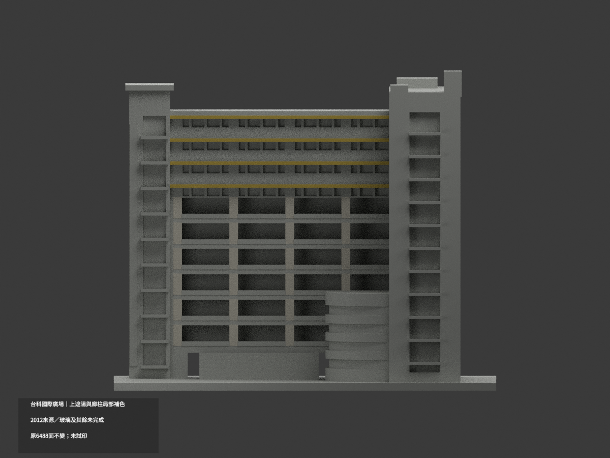
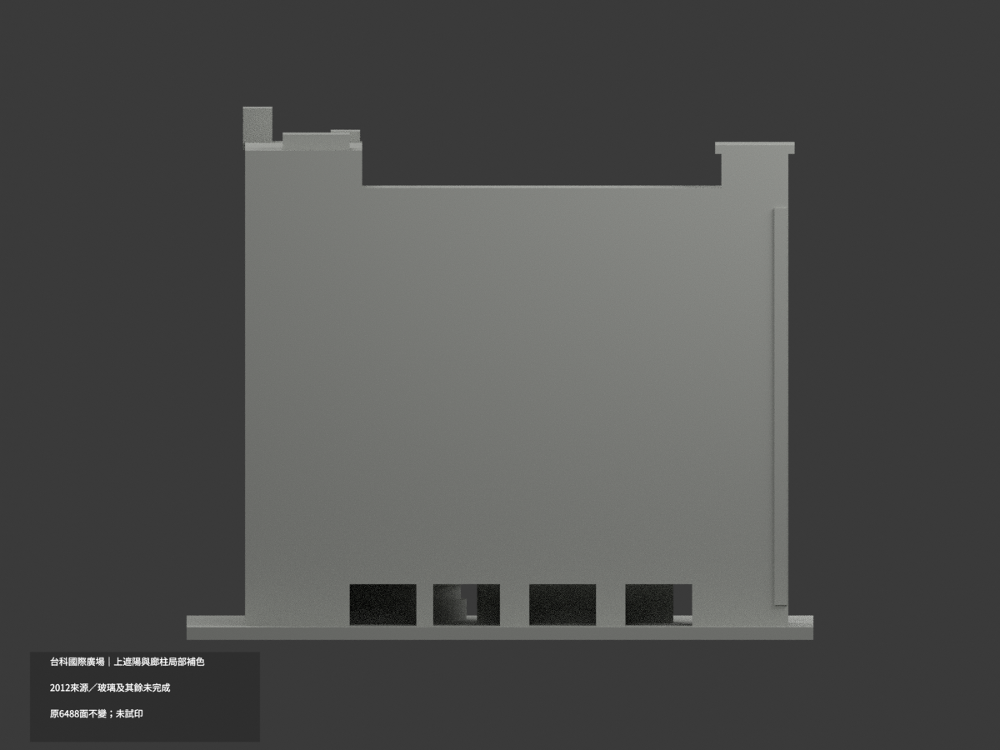
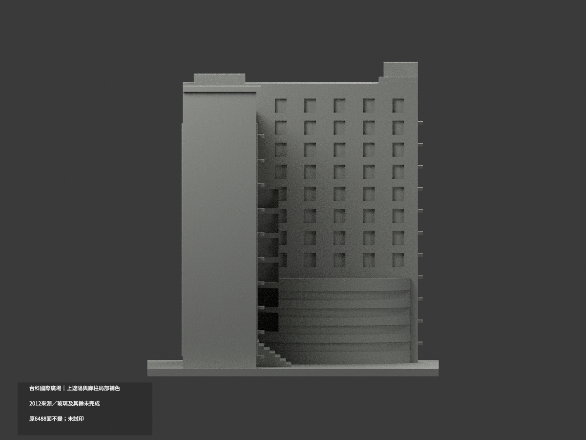
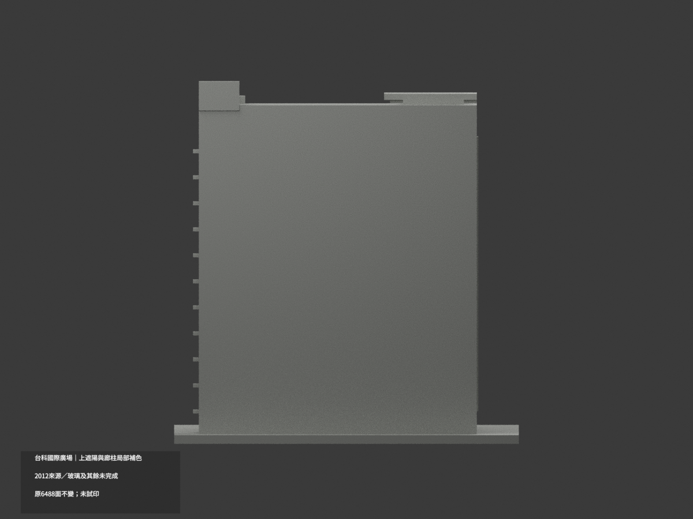
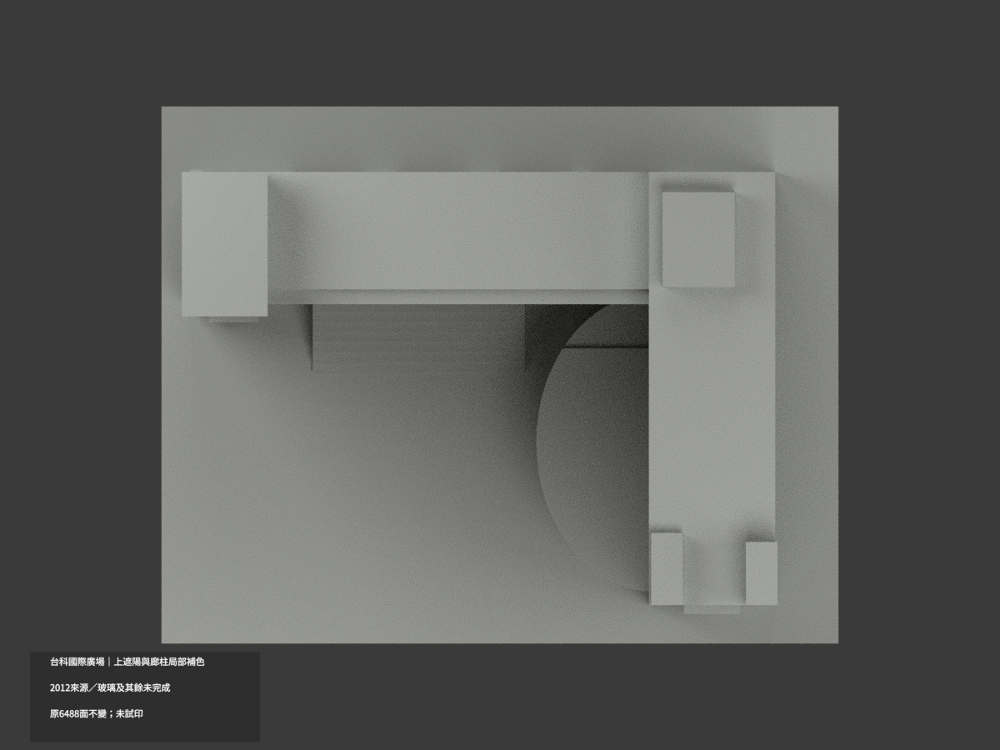
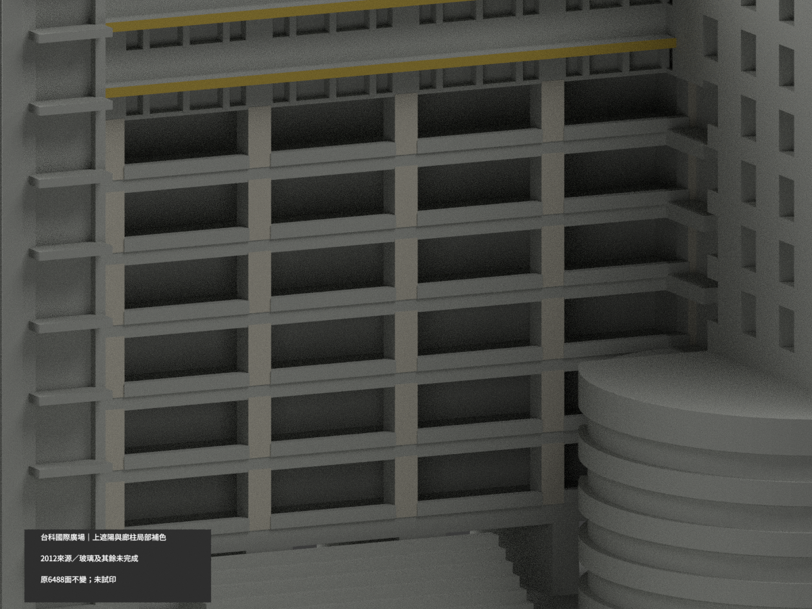
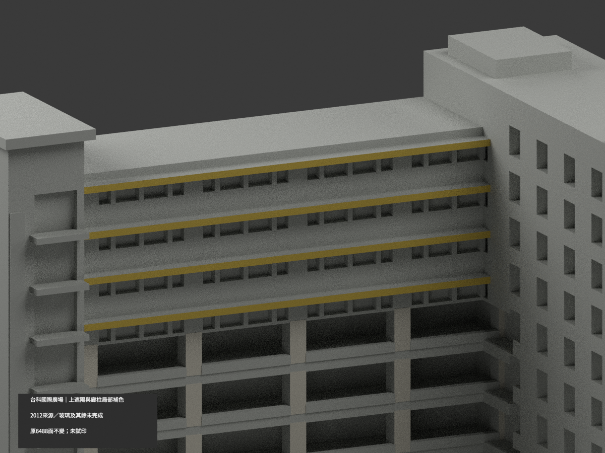
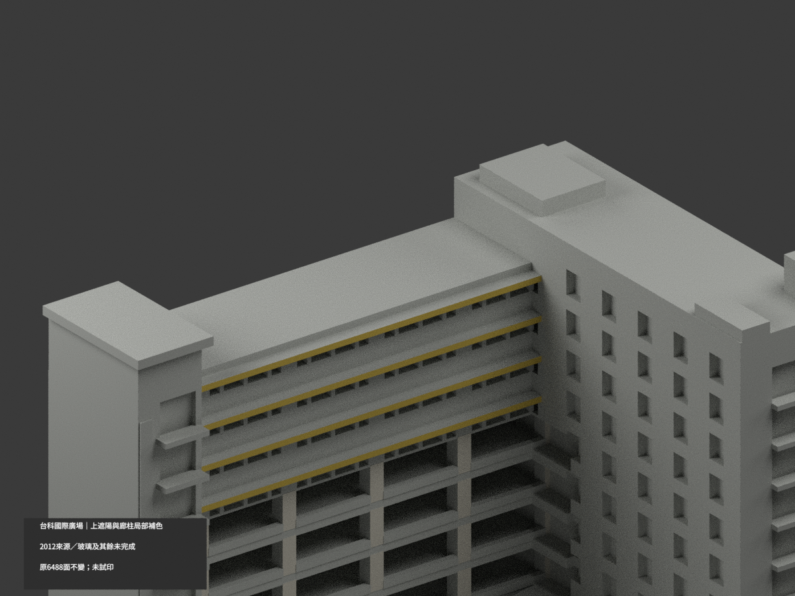

# 台科國際大樓廣場側｜遮陽與廊柱局部補色

**局部補色未完成：只四上遮陽前面黃色及六層廊柱前面灰色；玻璃、代欄實板與未知面未完成。2012來源非2026現況。** `partial_color_incomplete=true`、`fully_colored_exterior=false`。同項目`ntust-international-plaza`／`count_delta=0`，不新增套數。

| 前斜視 | 後斜視 | 正面 |
|---|---|---|
|  |  |  |
|  |  |  |
|  |  |  |
|  | | |

## 材色範圍

原四上遮陽y15.7的完整可見前板8面黃；原primitive橫跨x[-57.5,45.5]，但布林聯集後可見真前矩形只有x[-53,33]，每片面積86×1.35，不把嵌入兩翼的部分補造。六層五柱的真正前面y18.9共156面暖灰；依各原柱中心x-50/-28/-6/16/38、寬3.4、各層z15.7..24.1以10遞增核原面。**同y18.9亦有其他牆，絕不整plane染色**。

8黃＋156灰＋6324中性，全部1485共面連通域uniform。中性不代表實景灰色；未知與有證面界是資料覆蓋非實景不同材料縫。不新增百葉縫、分格或任何面，原遮陽實板近似保留。

陽台實板代替真欄杆／下坎組合，不能整板灰；窗與電梯背含框／不透板／設備／反光，不全藍綠。曲翼混白框黃遮陽青玻璃而原無界，全部中性。地層黑柱／標牌、全高塔片、側背、柱側、遮陽上底／返邊、屋突／屋頂／階／基座未知。只原廣場側段，不擴建別翼。

原6488三角、STL／build字節及尺寸保留，原exportscale=150/150=1，不重縮。色審不追認原近似幾何或2026全色現況。

## 來源、年代與權利

三張台科總務官網實照均已親看；URL與SHA見`COLOR-SOURCE-REGISTER.json`。EXIF DateTimeOriginal依序是`2012:11:08 10:53:39`、`2012:11:08 10:55:23`、`2012:11:08 10:56:14`；**無timezone，不轉UTC、不拿修改或發表時間代拍攝日**。內嵌資訊非獨立現況認證，不稱2026全貌。

原照私存不隨模型公開、不作貼圖；未見CC不沿repo license推定自由商用。HEX僅色族近似、不是實測色票。

## 檔案、重建與 QA

`appearance.3mf`含3展示材、`scene.blend`實面材、`color-mesh.npz`保原頂點/面/材索引。原STL無色、原build字節不變；immutable原包無OBJ，不冒稱保留原OBJ（隔離build產生OBJ僅重建歷程）。舊README另存`ORIGINAL-MONOCHROME-README.md`或`.zh-TW.md`，舊圖/QA保留作單色歷程非本次色審。

依`requirements.txt`執行`python colorize_model.py`、`python export_appearance.py`、`python validate_color.py`；Blender執行`render_color.py`與`verify_color_scene.py`。原build+color全隔離重建目錄保留不刪。格式/三角multiset/封閉正體積見`COLOR-*QA.json`、重開`SCENE-QA.json`、10張1200×900與hash綁定`DELIVERY-QA.json`；父另人工終審。

**未實際列印。** 3展示材不是已驗四色切片工程；支撐、材料對應、薄件強度另驗。

## English limitations

Partial material reference only: four original sunshade front plates8yellow triangles and thirty genuine gallery column front domains156gray triangles;6324neutral. Original6488faces/STL/build bytes unchanged; immutable original package has noOBJ, count_delta0. Same-plane walls are not automatically columns. Solid rail and sunshade approximations retained; mixed glazing/curved wing/unknown roof remain neutral. Three EXIF original timestamps are2012-11-08 local metadata without timezone; no UTCconversion or2026current-condition claim. Photos private, not redistributed textures. Not physically test-printed.
