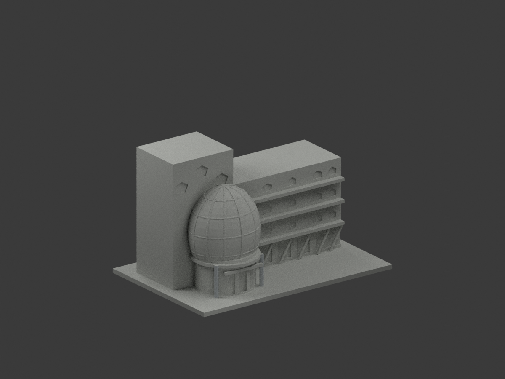
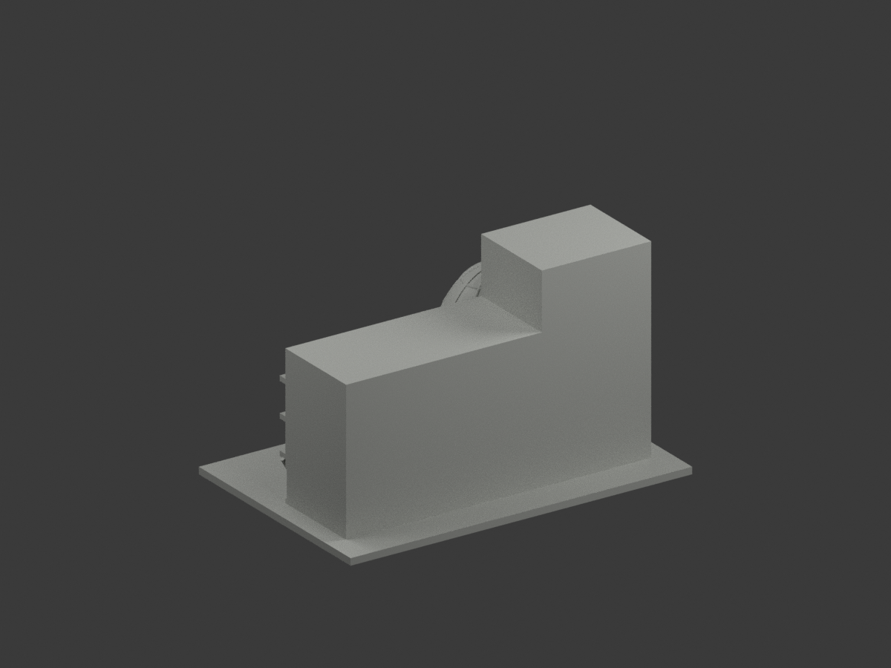
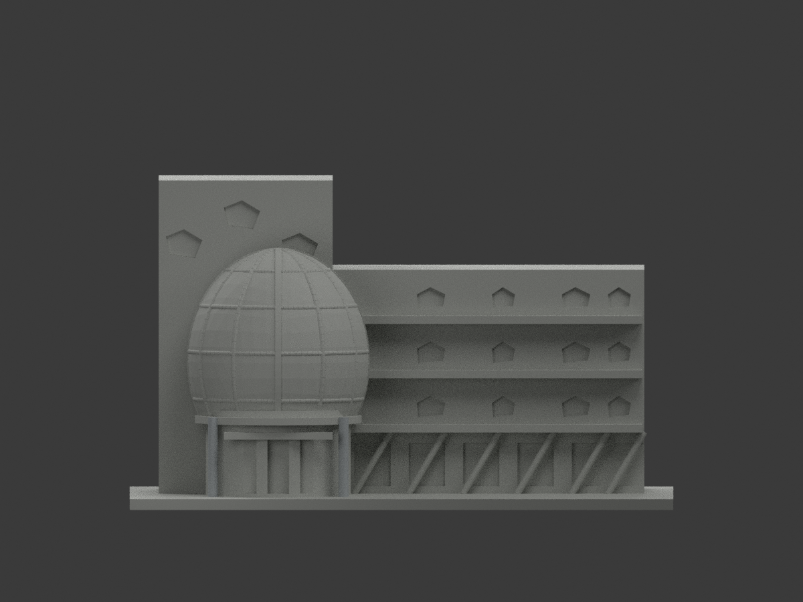
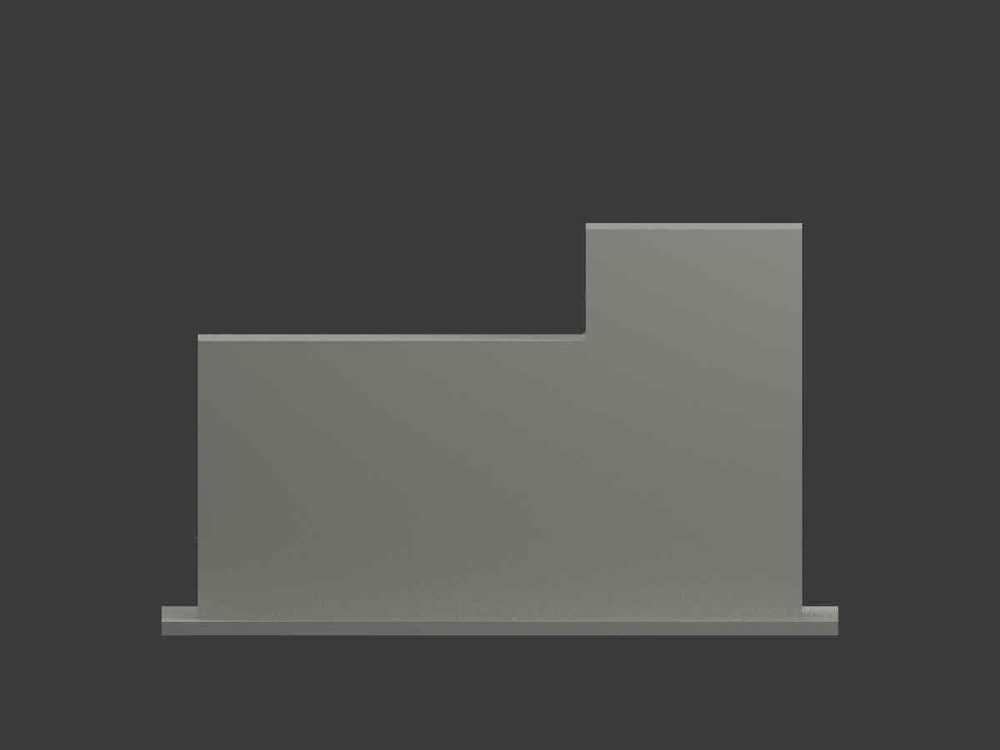
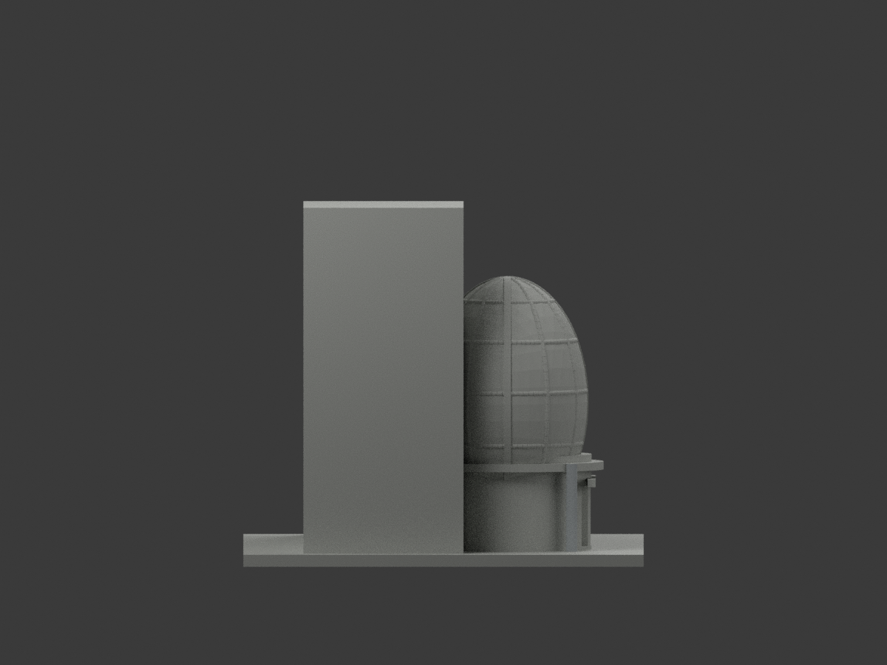
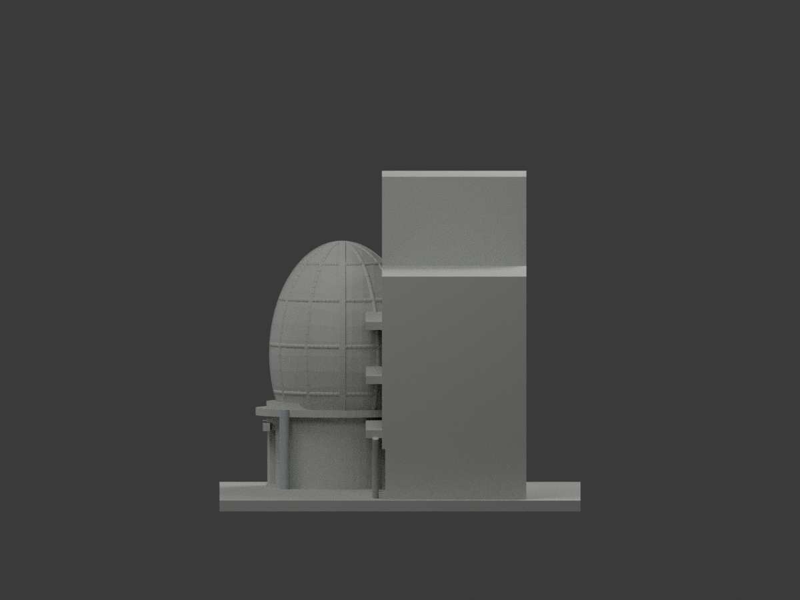
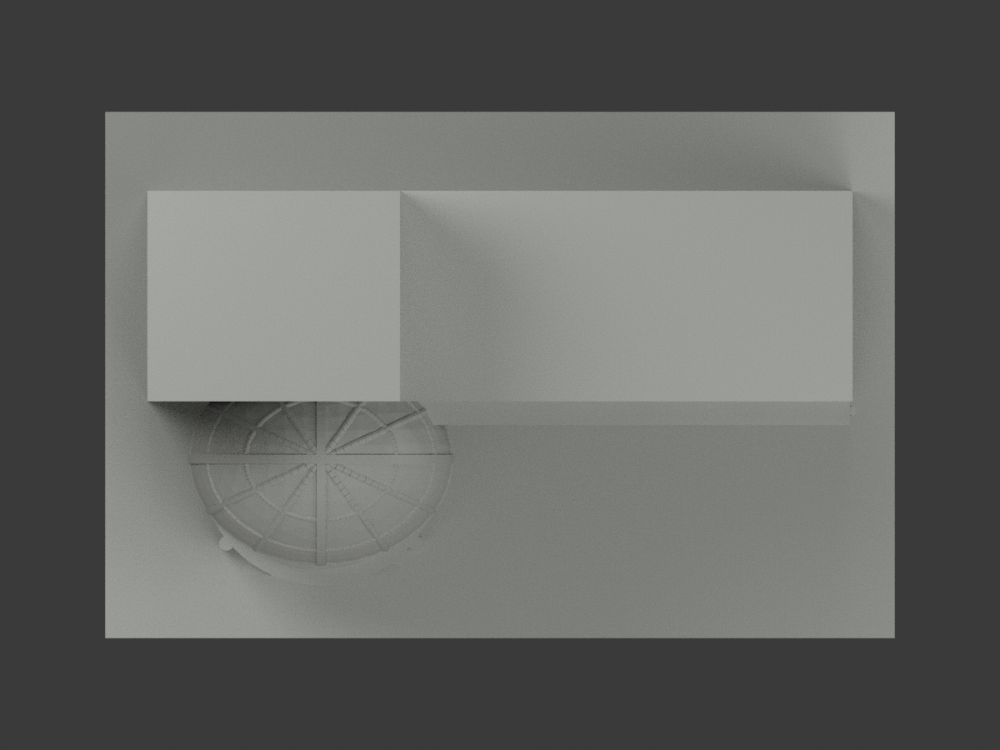
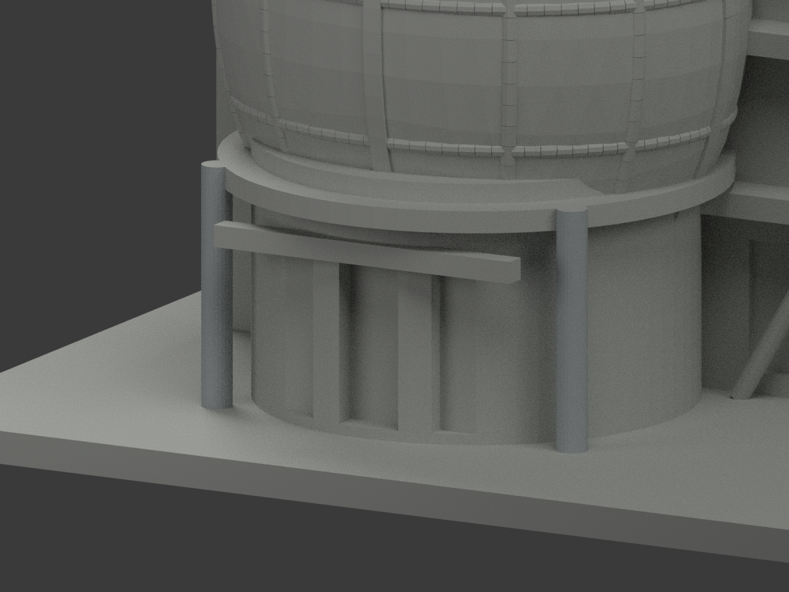
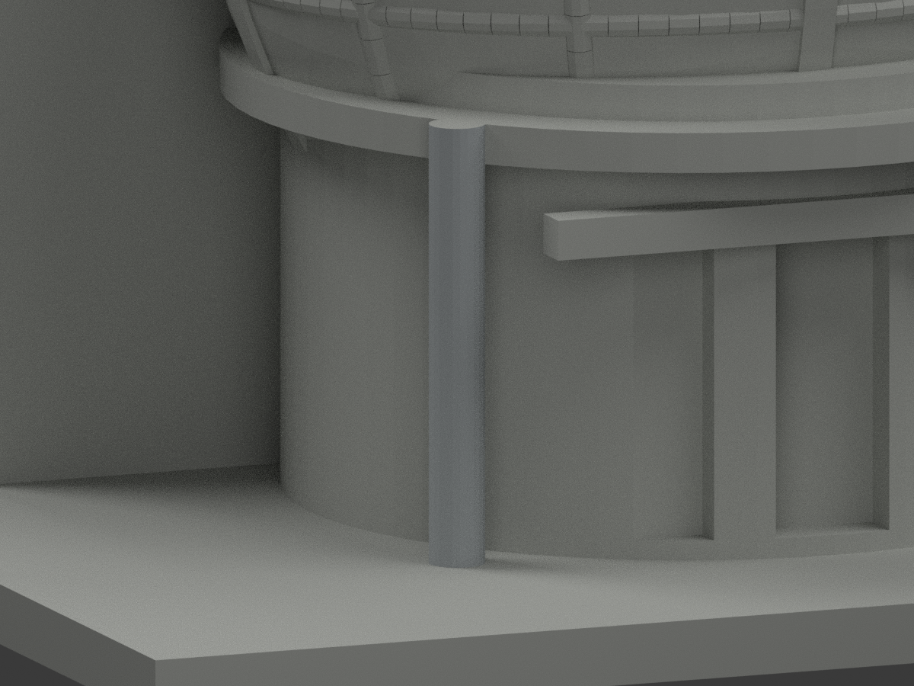
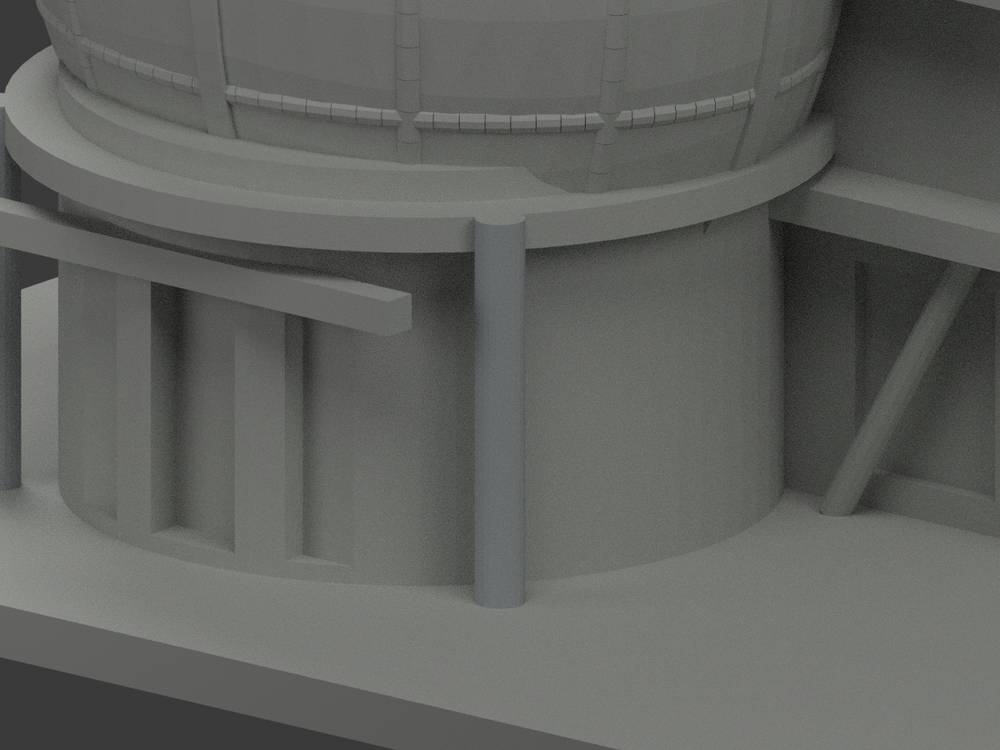

# 臺藝圖書館入口鄰段｜兩柱後半同構件銀灰延續

## 模型預覽

| 總覽 | 背側 | 正面 |
|---|---|---|
||||
||||
||||
||||

## 本次入口兩柱後半同構件銀灰延色

只將兩支既有銀灰支柱的後半 52 個原三角延用同一銀灰材料 0（#AEB3B5）。原前半 52 色面全部保留，現 104 面銀灰、17,578 面中性未知；不是全館或全外觀完成配色。17,682 原面、8,827 原點、原 STL 字節、面序與座標精確不變，150×100×89.5 mm 原示意尺寸不是測量比例。一個原入口鄰段，同項 count_delta=0。

兩柱原中心 x=−52/−16、y=−32，r=1.4 mm、z=3…25 mm，各 12 個原 24 邊柱後半弦面。以全部三頂點與完整共面域核對，不按形心截半。每原弦矩形扣除原中心(−34,−17)、半徑23 mm、64邊雨棚在z=23…25的接觸域；22域兩三角、2域四三角，共24完整有限域52面，不補造埋入區。解析182.3507323886 mm² 對原網格182.3507477571 mm²，差屬原float32；不改任何幾何、柱頂底、實心球代理、格柵、雨棚、玻璃或牆。

本輪親看既有校方原照 https://lib.ntua.edu.tw/wSite/public/data/f1664124832118.jpg 及夜照 https://lib.ntua.edu.tw/wSite/public/data/f1664174889180.jpg，雜湊與歷史來源登記完全相同。日照可見圓柱銀灰環向表皮；隱藏後半只作同柱同材延續推論，不稱背面照片證實。夜照只核位置，不採藍黃照明作材料。EXIF2010-07-25時鐘／時區未驗，非2026現況。沿用名義色族，不是校準材料或金屬反射重建。原照私人保存，不入包、不作紋理。

原球體仍是透空鋼格球的實心近似，不能整球染銀充當實物。所有歷史QA/source/checksum按原字節保留，以下舊文與舊數字為本次前歷史快照，不覆寫追認。原90採樣層、最大0.8mm開運算損失0.001468057597085358、無超1%層等既有工程記錄不重算亦不升級為可列印保證；未驗耗材分色、支撐、切片或實體試印。

新增 qa-continuous-column 保存本輪有限域、獨立二審與輸出補核、strict3MF零警告及編輯往返、Blender材質與頂點編輯存檔重開、原場景重渲染精確、ZIP孤立重建、十圖檢視。重建 python continuous-column-source/build_continuous.py；verify_exchange.py；Blender render_continuous.py、strip_previews.py、Blender verify_scene.py。色盤原名稱含front halves是歷史標籤，保留原字節；本次範圍以新域與新QA為準。此為本地交付包，不代表已上傳。

---
## 原版歷史文件（原色數52面）

場景僅同步更新 source_mesh_sha256 以對應本次含材質指派的 color-mesh.npz，並更新 scope，明示原 52 銀灰前半面保留、52 後半面同柱銀灰推論及 24 個完整弦域扣原雨庇接觸，不是全外觀完成。原入口鄰段示意尺寸、實心球代理、未知建築後側中性與未試印限制保留；非後半照片獨立證實、非2026現況或測繪。其餘原屬性、全部材質定義與幾何不變。palette.json 原 bytes 完全保留，front halves 原槽名為歷史標籤。

本頁為現行說明；根 README.zh-TW.md 與舊 SHA256SUMS／SHA256SUMS.txt 保留歷史 bytes，當前完整校驗以 CONTINUATION-SHA256SUMS 為準。

## 前版說明與保留限制（完整歷史文字）

# 臺藝圖書館入口鄰段｜兩柱前半局部銀灰

**球體、牆窗與其餘面尚未完成分色。** partial_color_incomplete=true、fully_colored_exterior=false。只有兩支柱前半52原面名義銀灰，非全館完整補色。

## 材色範圍
同 ntua-library-entrance-section 原項目，same-item、count_delta=0。國立臺灣藝術大學板橋校區圖書館入口鄰段，非完整六層圖書館。原17682三角及STL/build_model.py字節不變，17原件無OBJ，原code可重建輸出OBJ不等於有原件。
- 原兩24邊柱中心x−52/−16、y−32，r1.4、z3..25，前半各12有限facet，共52原三角。全3頂點核chord plane/tangent/z，原Boolean四片交接完整保留，不用normal閾漏碎面。
- 其餘17630面中性：柱後半、帽、球體實心代理與原凸格、玻璃代理、透明雨棚的原實心皮、五角窗/背板、斜撐、牆體與裁切背。
- 實照為透空鋼格球，原模型為實心曲體加凸格，不能整球染銀當真實鋼網。保留既有近似構造，不新增孔或結構，不因色審追認幾何。材色邊界是證據範圍，不是真實半柱材縫。

## 來源與日期
親看官方日照與夜照。日照兩入口柱可支持名義銀灰；夜照只作位置對照，不取藍黃照明色。EXIF2010-07-25時鐘與時區未驗，不稱2026現況、URL數字不是拍攝時間。色族非校準材料。原照私人保存、不公開、不作紋理、不建人物，未確認再散布或CC授權，不保證商用。

## 格式與列印
[原STL](model.stl) · [逐面材色3MF](appearance.3mf) · [Blender](scene.blend)
原150mm底座示意尺寸不是測量比例。實際物件名 NTUA Library Entrance Section partial color，獨立核對真slug/館名。STL無色；3MF與Blender逐面分材，兩材標籤不是兩色或四色耗材切片驗證，未實際列印。

## 重建與 QA
原build_model.py → colorize_model.py → export_appearance.py → validate_color.py；Blender render_color.py／verify_color_scene.py。完整隔離Shapely2.1.2精確原build＋color重建、原bytes/全三角multiset、共面均一、閉合正體積、3MF面材、scene重開、十圖1200×900與hash。原README/previews/validation保留歷史，不冒充新QA，不刪檔。

## English scope
Partial only:52 original triangles on the complete front halves of two24gon entrance supports, nominal silver gray;17630 neutral. Allthreevertices tested against finite chords/tangent/z, including Boolean fragments. Original17682 triangles and17 immutable files preserved;no originalOBJ, even though original code can export a rebuilt OBJ. Solid globe proxy is not the real open steel grid and remains neutral, as do canopy, glazing, walls and back. Entrance adjacent section not full library. EXIF2010-07-25 with unverified timezone/clock, night illumination not material evidence;not2026 survey. Sameitem/count0/no geometrychanges/no filament test.
