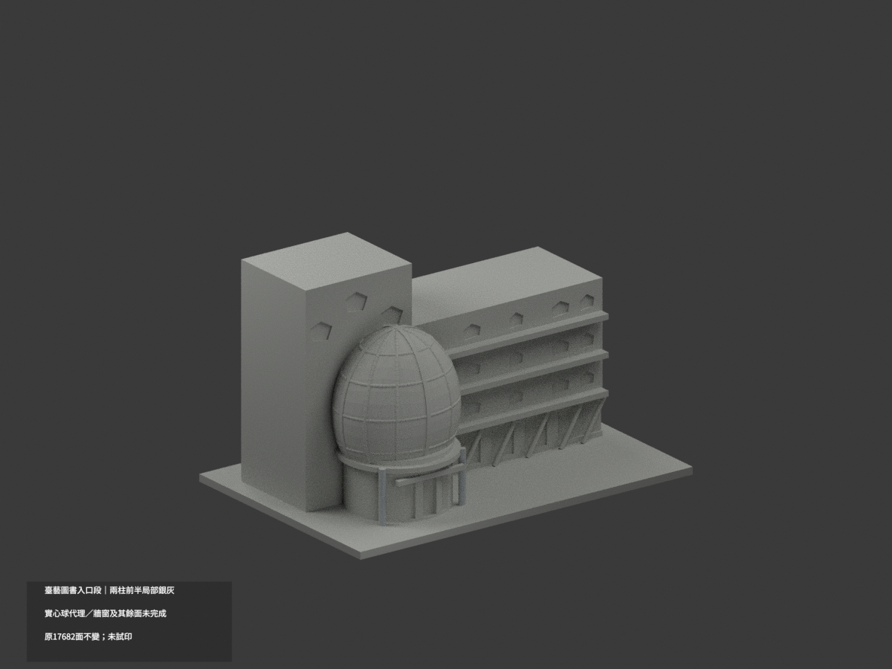
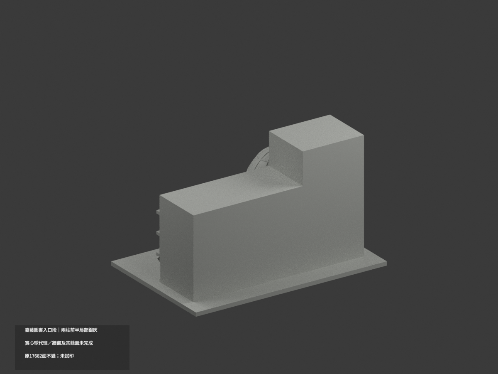
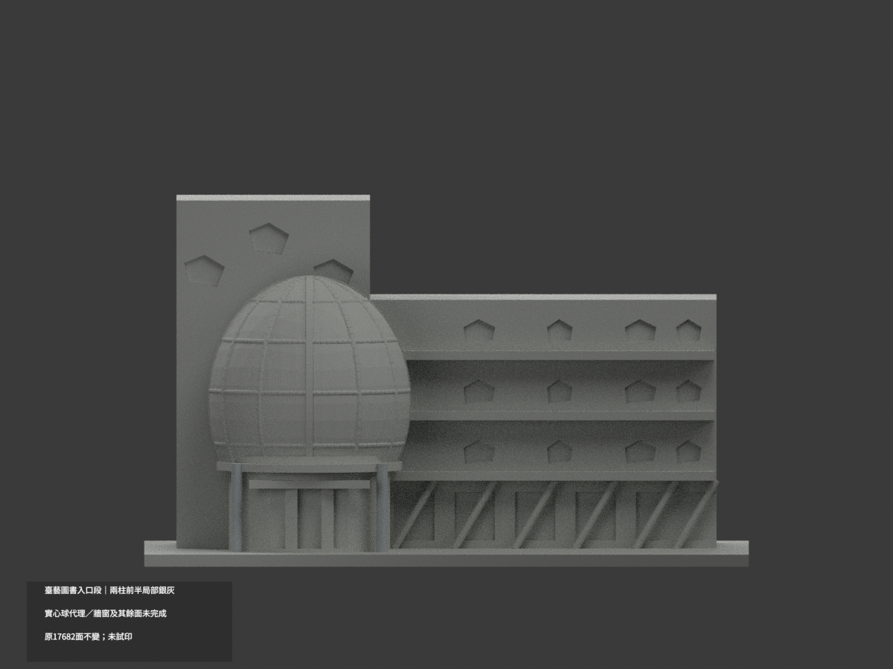
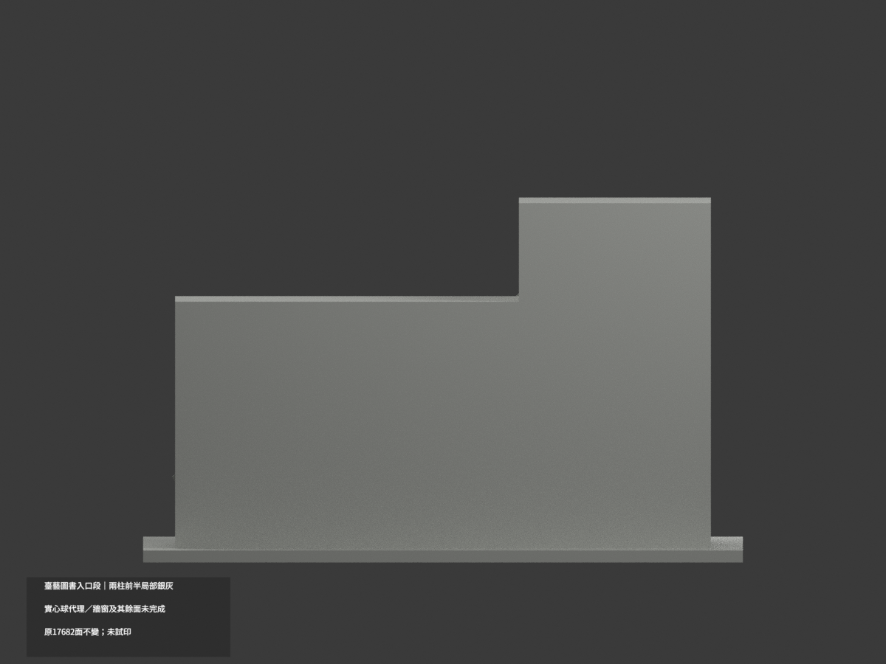
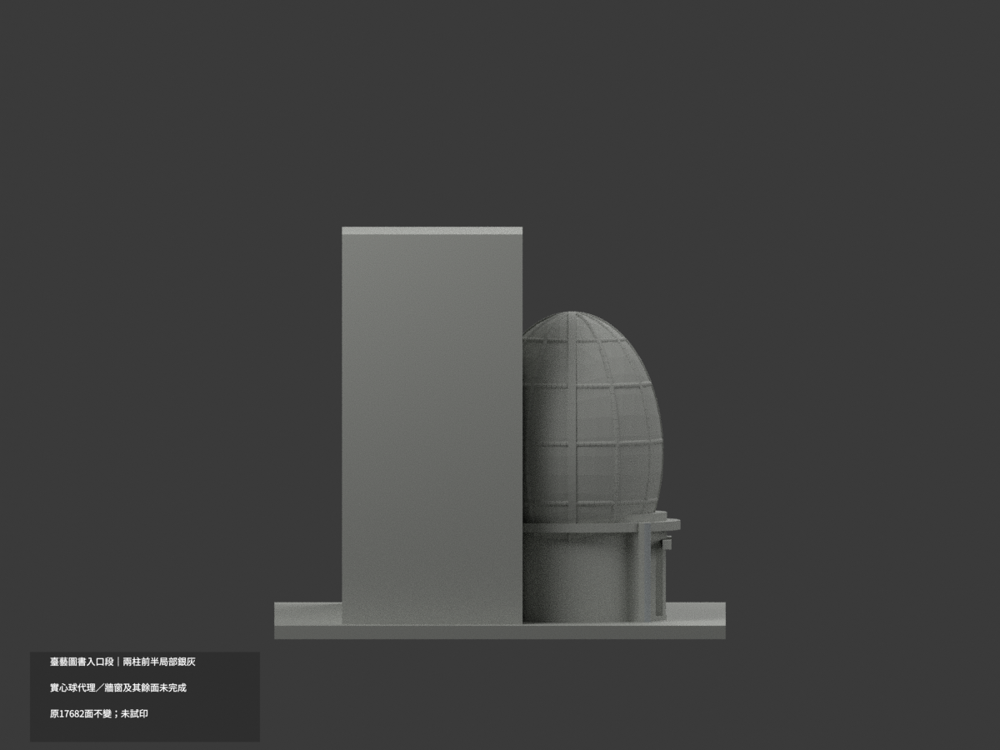
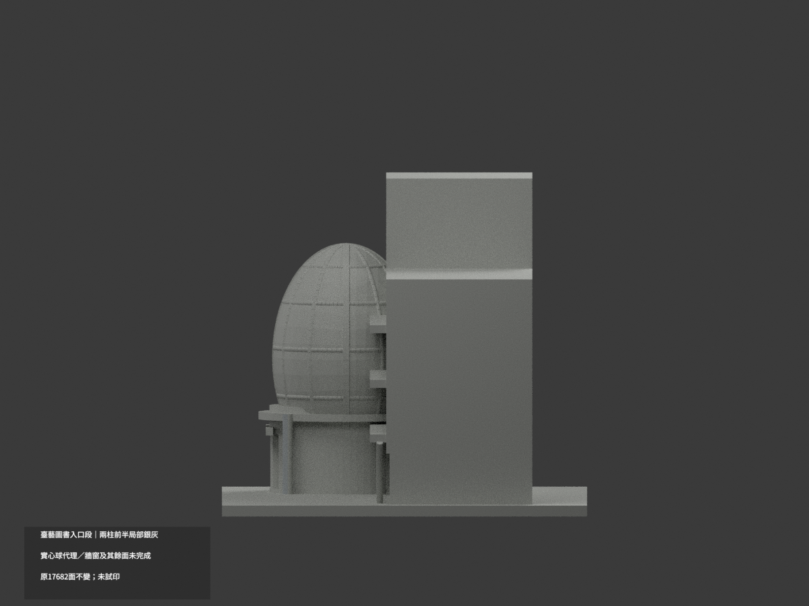
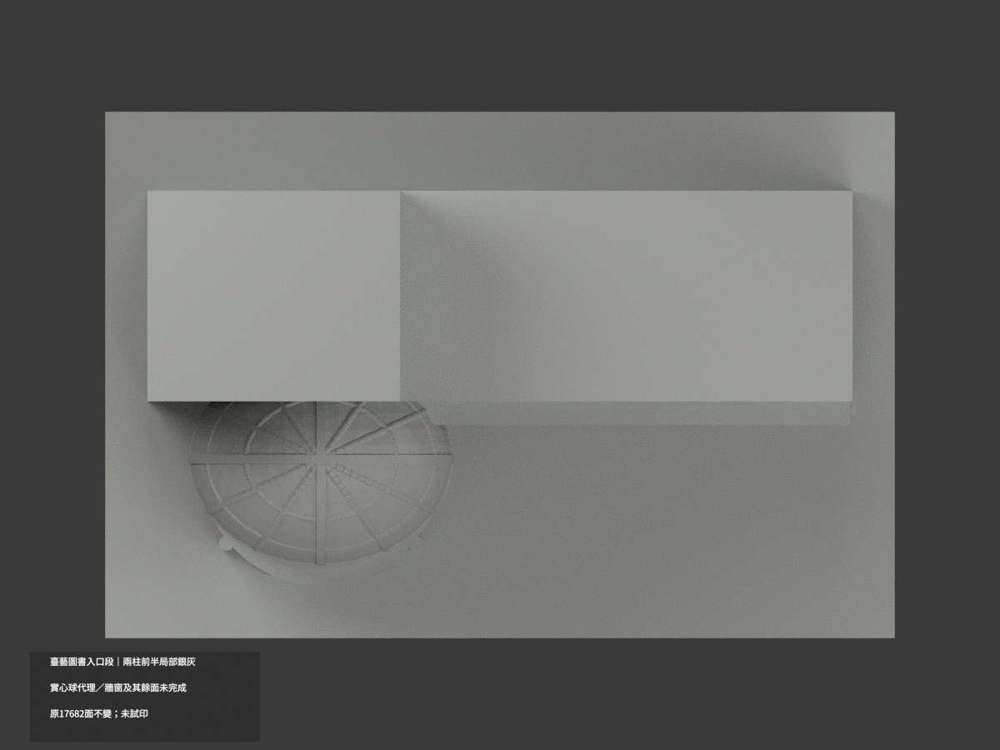
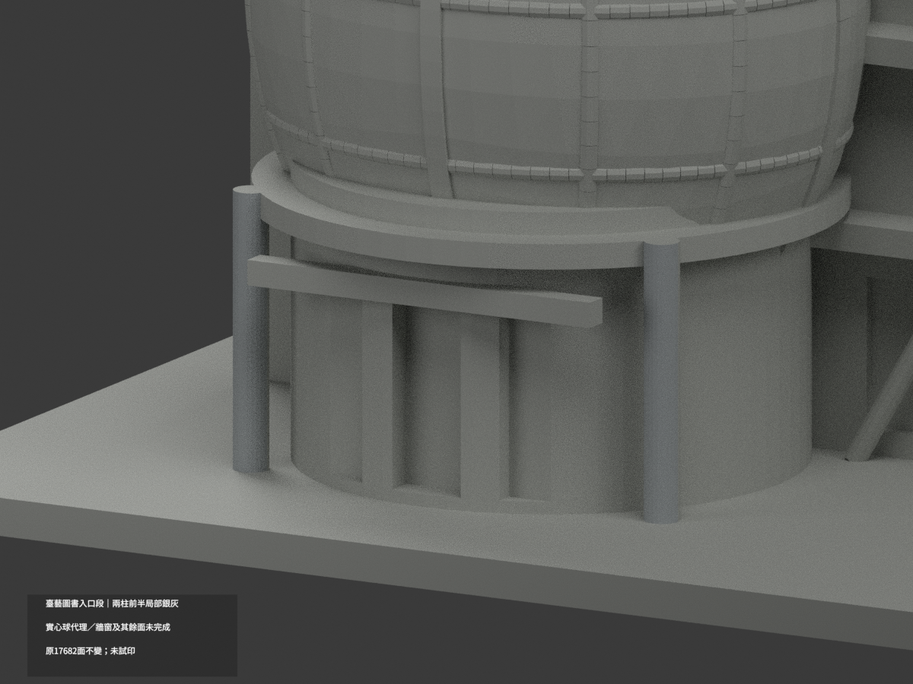
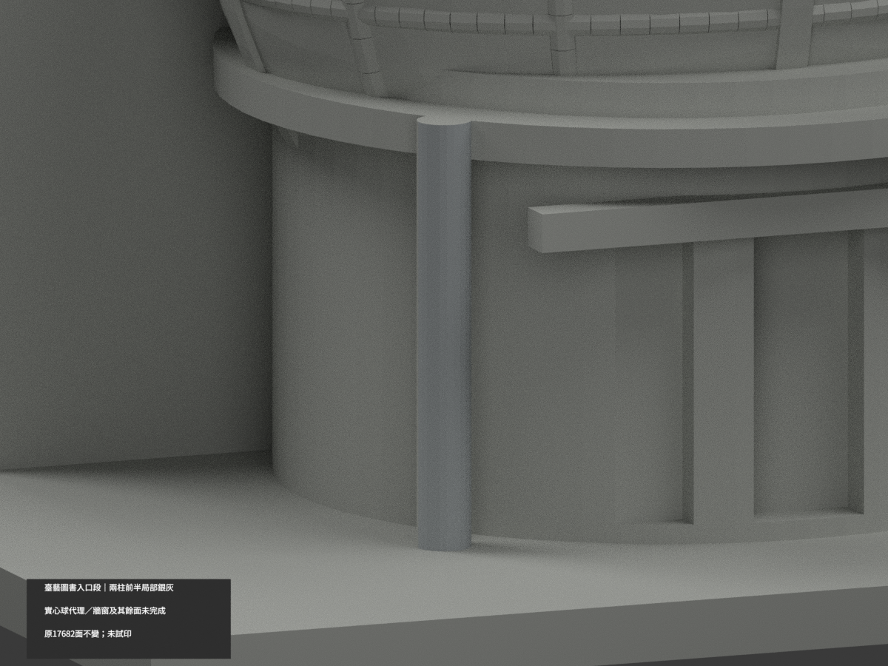
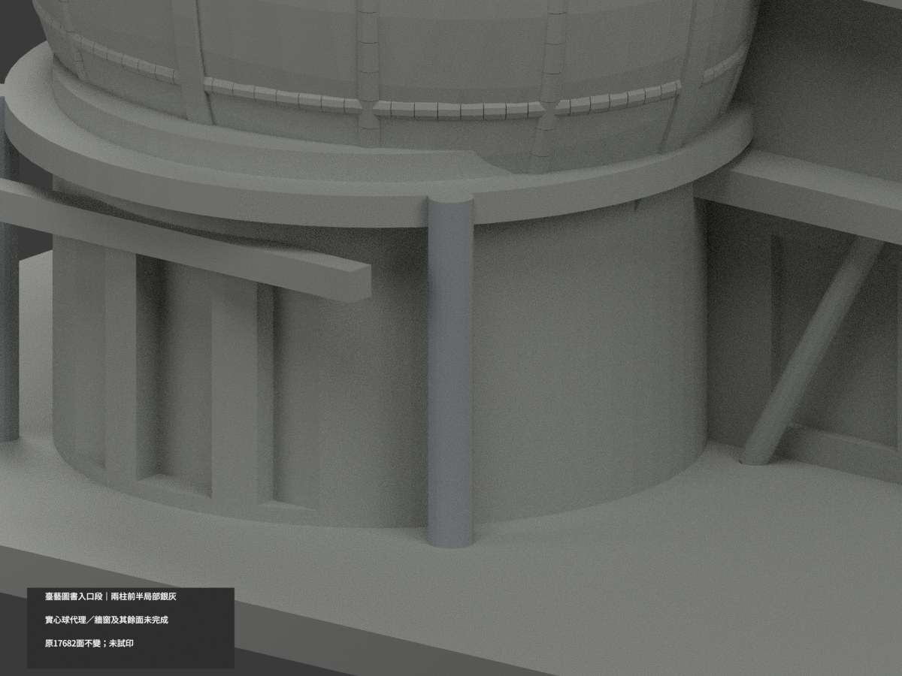

# 臺藝圖書館入口鄰段｜兩柱前半局部銀灰

**球體、牆窗與其餘面尚未完成分色。** partial_color_incomplete=true、fully_colored_exterior=false。只有兩支柱前半52原面名義銀灰，非全館完整補色。

| 總覽 | 背側 | 正面 |
|---|---|---|
||||
||||
||||
||||

## 材色範圍
同 ntua-library-entrance-section 原項目，same-item、count_delta=0。國立臺灣藝術大學板橋校區圖書館入口鄰段，非完整六層圖書館。原17682三角及STL/build_model.py字節不變，17原件無OBJ，原code可重建輸出OBJ不等於有原件。
- 原兩24邊柱中心x−52/−16、y−32，r1.4、z3..25，前半各12有限facet，共52原三角。全3頂點核chord plane/tangent/z，原Boolean四片交接完整保留，不用normal閾漏碎面。
- 其餘17630面中性：柱後半、帽、球體實心代理與原凸格、玻璃代理、透明雨棚的原實心皮、五角窗/背板、斜撐、牆體與裁切背。
- 實照為透空鋼格球，原模型為實心曲體加凸格，不能整球染銀當真實鋼網。保留既有近似構造，不新增孔或結構，不因色審追認幾何。材色邊界是證據範圍，不是真實半柱材縫。

## 來源與日期
親看官方日照與夜照。日照兩入口柱可支持名義銀灰；夜照只作位置對照，不取藍黃照明色。EXIF2010-07-25時鐘與時區未驗，不稱2026現況、URL數字不是拍攝時間。色族非校準材料。原照私人保存、不公開、不作紋理、不建人物，未確認再散布或CC授權，不保證商用。

## 格式與列印
[原STL](model.stl) · [逐面材色3MF](appearance.3mf) · [Blender](scene.blend)
原150mm底座示意尺寸不是測量比例。實際物件名 NTUA Library Entrance Section partial color，獨立核對真slug/館名。STL無色；3MF與Blender逐面分材，兩材標籤不是兩色或四色耗材切片驗證，未實際列印。

## 重建與 QA
原build_model.py → colorize_model.py → export_appearance.py → validate_color.py；Blender render_color.py／verify_color_scene.py。完整隔離Shapely2.1.2精確原build＋color重建、原bytes/全三角multiset、共面均一、閉合正體積、3MF面材、scene重開、十圖1200×900與hash。原README/previews/validation保留歷史，不冒充新QA，不刪檔。

## English scope
Partial only:52 original triangles on the complete front halves of two24gon entrance supports, nominal silver gray;17630 neutral. Allthreevertices tested against finite chords/tangent/z, including Boolean fragments. Original17682 triangles and17 immutable files preserved;no originalOBJ, even though original code can export a rebuilt OBJ. Solid globe proxy is not the real open steel grid and remains neutral, as do canopy, glazing, walls and back. Entrance adjacent section not full library. EXIF2010-07-25 with unverified timezone/clock, night illumination not material evidence;not2026 survey. Sameitem/count0/no geometrychanges/no filament test.
