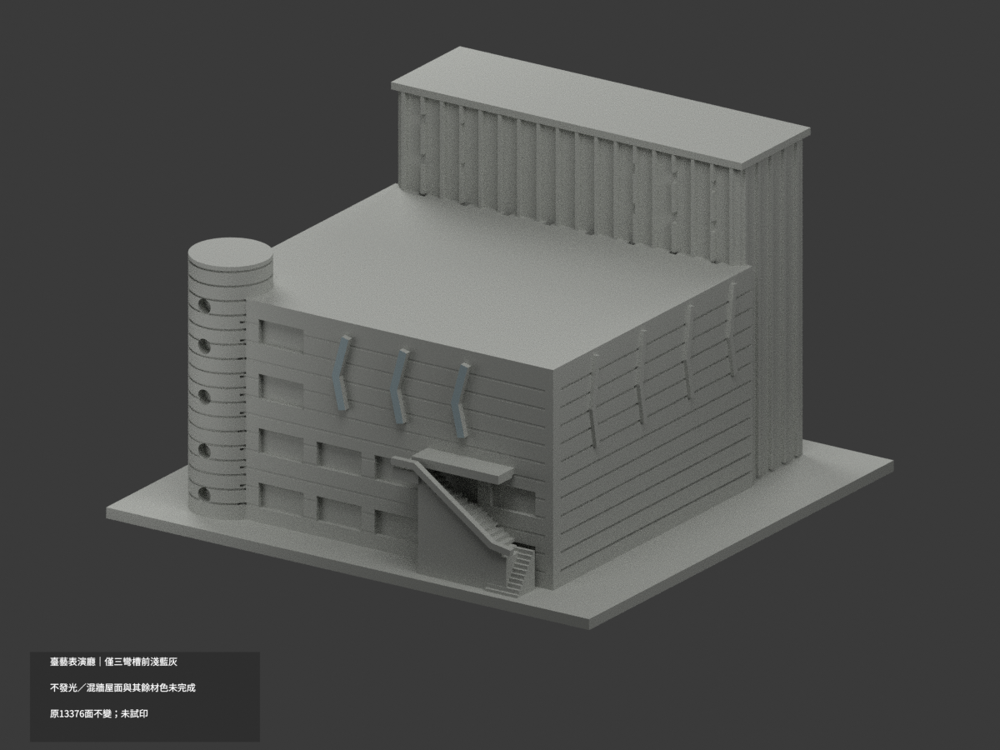
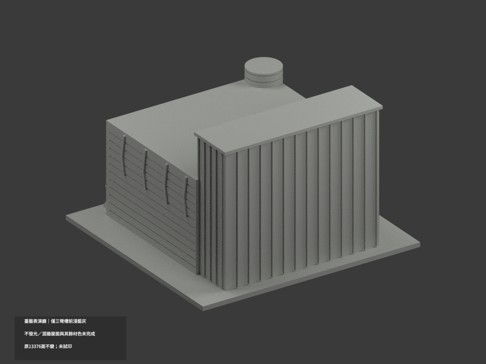
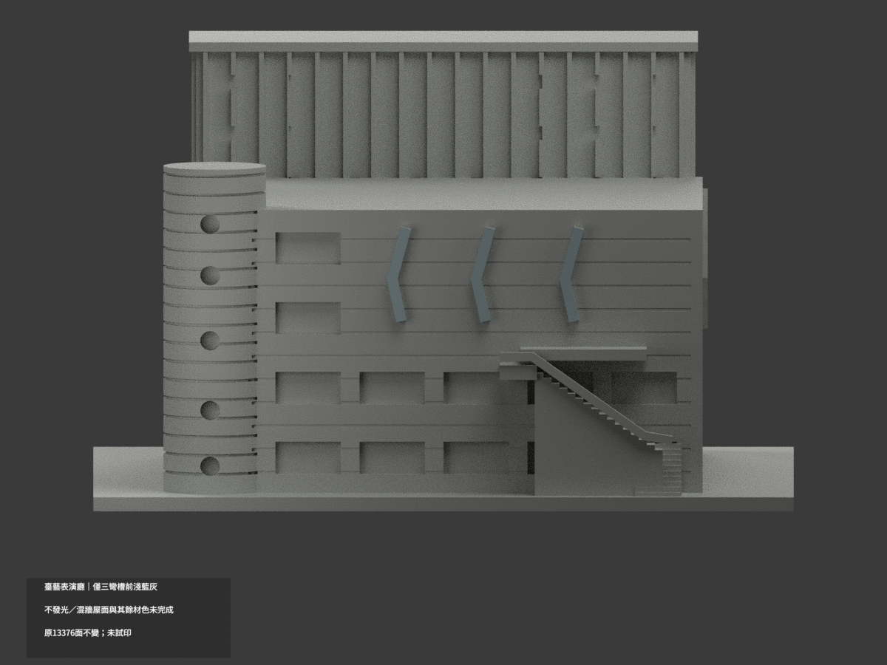
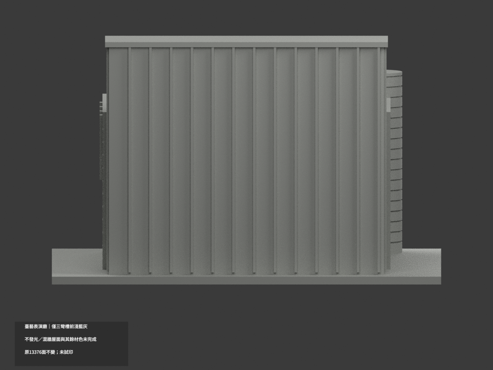
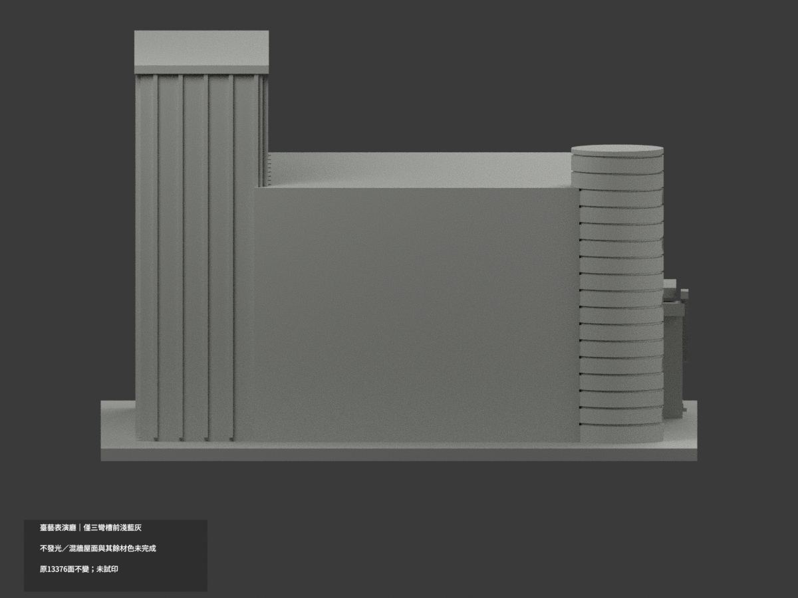
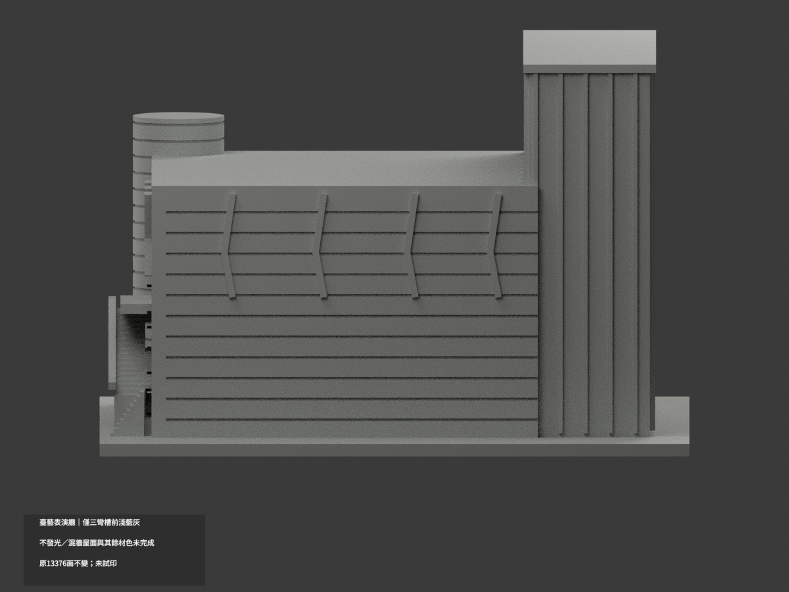
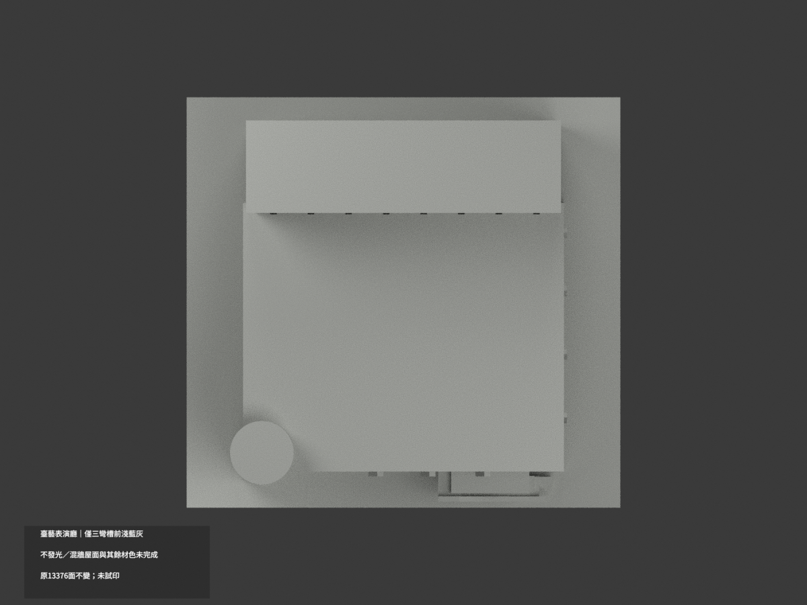
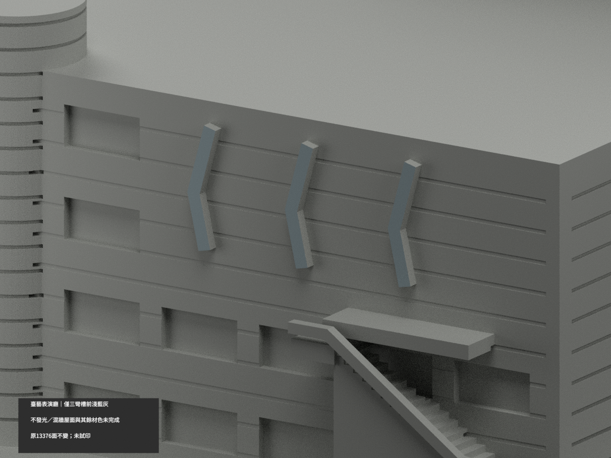
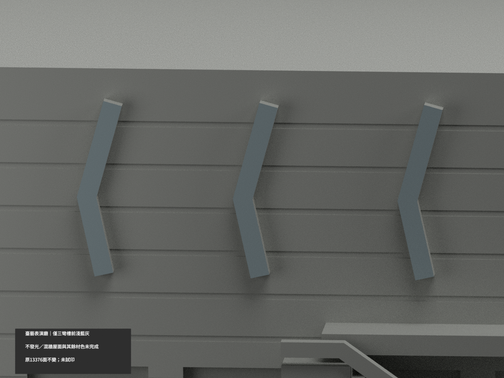
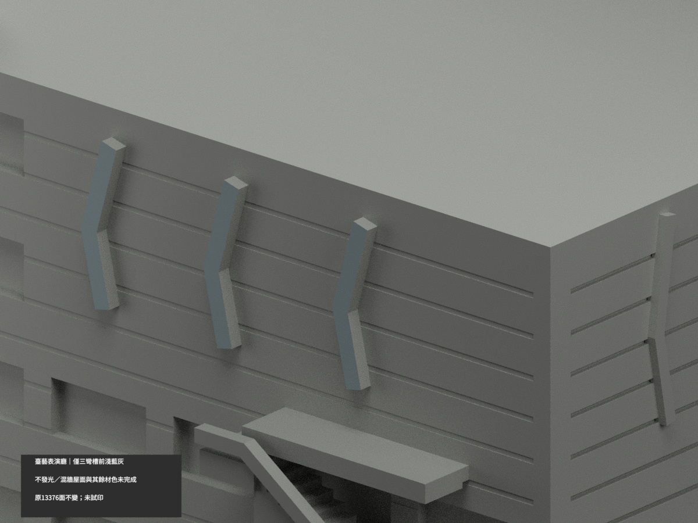

# 臺藝表演藝術廳｜三條彎槽正面局部淺藍灰

**局部補色未完成：只三條彎折燈槽前面12原三角淺藍灰實體色，不發光；混橫帶牆、圓筒、屋頂與其餘面尚未分色。** partial_color_incomplete=true、fully_colored_exterior=false。同項 ntua-performing-arts-hall／count_delta=0，國立臺灣藝術大學板橋校區。英文身份 NTUA Performing Arts Hall partial color。

**一座含高舞台塔與低觀眾廳的既有劇場量體，不拆三場館，不含相鄰教學大樓；原照片估測毫米近似非測繪。**

| 前斜視 | 後斜視 | 正面 |
|---|---|---|
|  |  |  |
|  |  |  |
|  |  |  |
|  | | |

## 材色範圍

全原y−60.2無限plane三頂點0.0001mm枚舉，恰12面分為三個完整共享邊4面原buffer彎折輪廓。保留buffer超出設計路徑端點的全部面，包括z39.761375..60.289429，不以路徑40..60裁端、不normal漏細面、無centroid切色。12名義淺藍灰實體色，13364中性，原13376三角不變。全原共面連通域一致。

白日實景支持前三條槽件的低飽和淺藍灰；夜景僅補位置，不把鮮藍光當日間材質，不設自發光。原三條統一彎折/寬度是簡化代理，不改形、不宣精準製造。槽側/端/背中性，右側四條缺充分白日完整對位，不套前槽或夜光色。大牆與圓樓梯筒混淺皮/深橫帶不整白，後舞台塔/屋皮/小飾/設備未知；實填外階底代理、玻璃窗簾背、粗扶手、雨庇/支撐皆中性。中性不是實景灰；資料界線不是真實材界。

## 日期與原始限制

兩來源圖片無DateTimeOriginal。原建模來源描述白日參考2012、文章2014只是來源脈絡，不是獨立驗證拍攝日期，不稱2026現況。保原外觀尺度估計、加厚細件、實填外階與未知背面不裝飾限制；補色不追認完整測繪。照片僅私人研究，不公開貼圖，不推定商用權利。

## 檔案與 QA

原STL/build與13376三角座標拓撲/字節保留；immutable17件無OBJ，原程式可生成OBJ但隔離產物僅私存，不冒稱原repo有OBJ。原README另存ORIGINAL-MONOCHROME-README.md，單色圖/QA歷史保留。appearance.3mf兩展示材與scene.blend真面材同原幾何；export/validate/render/verify及真3MF/scene精確身份 NTUA Performing Arts Hall partial color。精確依賴隔離build+color、閉合正體積/3MF座標面材/Blender重開/10張1200×900檢核；保留重建不刪，未試印或驗多料切片，STL本身無色。

## English limitations

NTUA Performing Arts Hall partial color. Single theater mass withstagetower/lowerauditorium,notthreevenues orneighboracademicblocks. Whole originaly=-60.2 plane12faces forms threecomplete4triangle bufferedprofiles;retainbufferendextentsz39.761375..60.289429,nodesignendpoint clipping. Nominalunlitpalebluegray12/neutral13364,original13376triangles/STL/buildunchanged,noimmutableOBJ,count_delta0. Nightblue onlylocation evidence,noemissionorcolorcalibration. Sides/ends/back,sidefourchannels,mixedhorizontalbandfacades/cylinder,roof/towerrear/glass/solidstairproxyneutral. BothEXIFcaptureunknown;2012/2014sourcecontextnotverifiedcapture/no2026claim. No publicphotos/textures,not testprinted.
