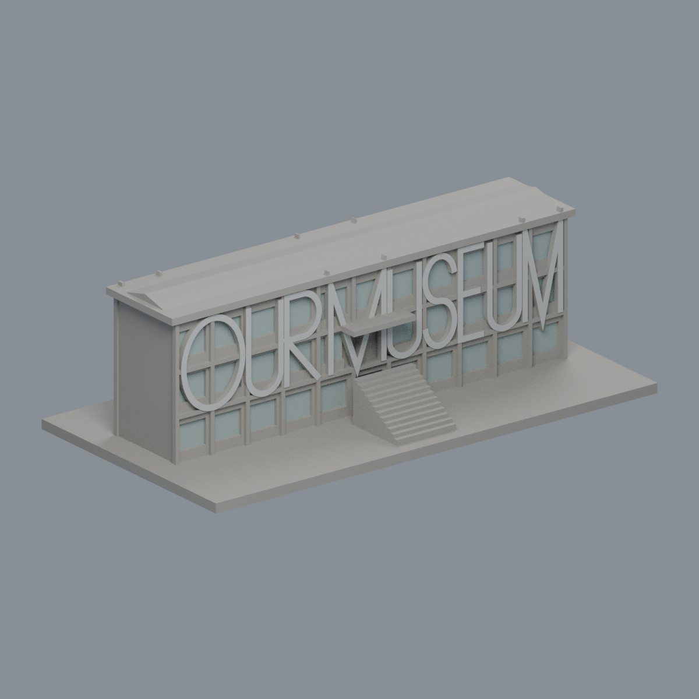
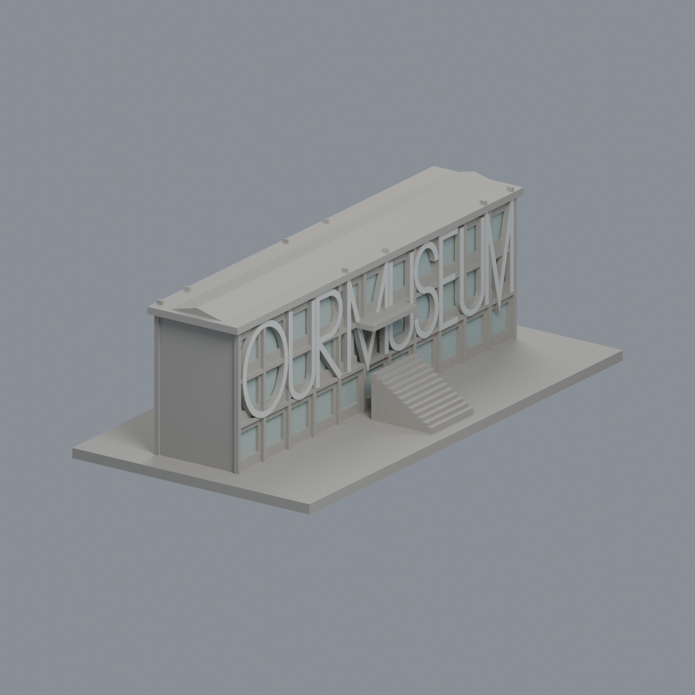
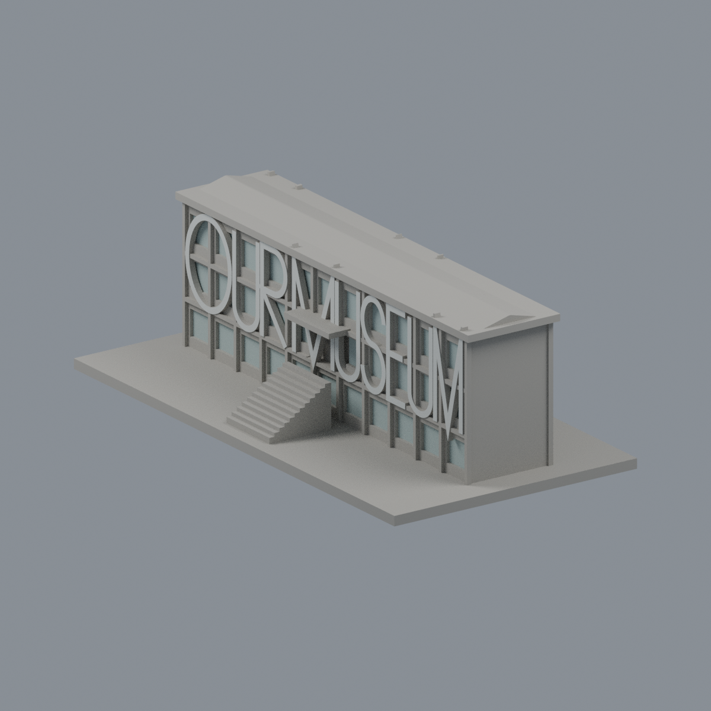
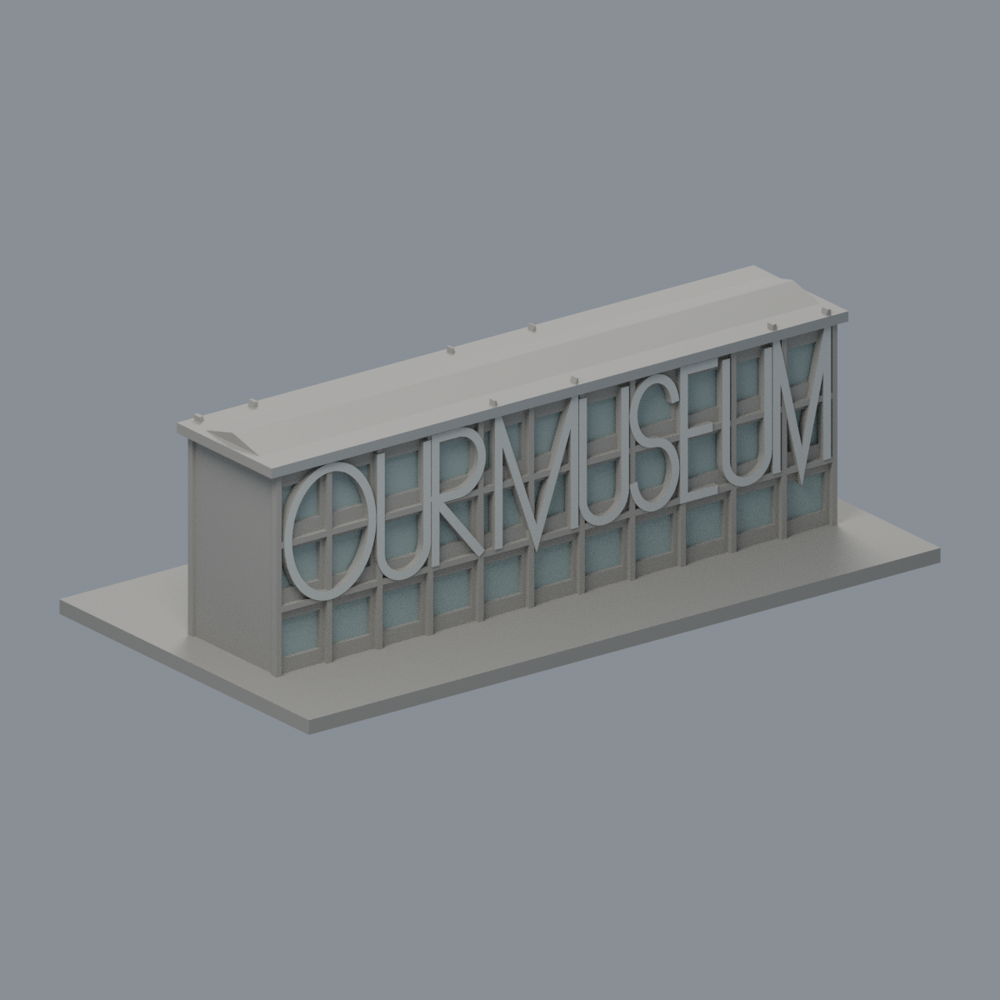
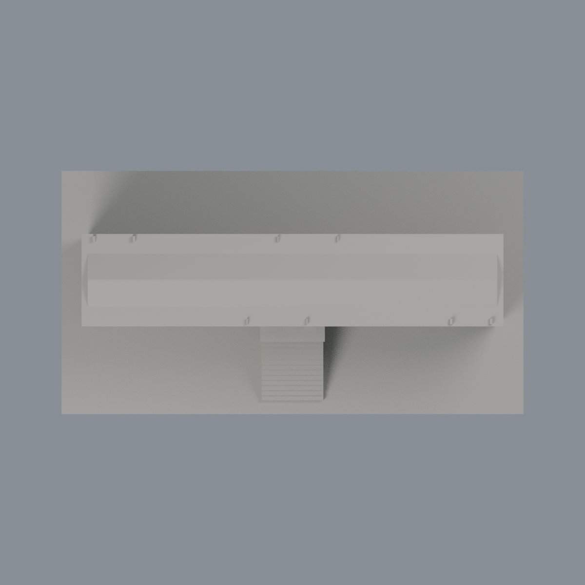

# 國立臺灣藝術大學｜有章藝術博物館現館

## 模型預覽

| 新版模型預覽 | 新版模型預覽 | 新版模型預覽 |
| :---: | :---: | :---: |
|  |  |  |
|  |  |  |

板橋校區。這是根據公開外觀照片自行製作的3D列印縮模，不是官方測量或施工模型；實際尺寸不詳，模型採獨立展示比例。含底座最長邊150 mm；檔案單位為毫米。

## 檔案
- [STL](model.stl)
- [材色 3MF](pool-side-fascia-20261120/model-colored.3mf) · [可編輯 Blender](pool-side-fascia-20261120/scene.blend)：網格與交付 STL 幾何一致；只有既有水池側簷帶兩面補色
- [參數建模](build_model.py)・[依賴](requirements.txt)・[現版渲染證據](render-proof.json)
- [原始網格驗證](validation.json)・[0.2mm輪廓檢查](contour-validity-check.json)・[0.8mm細節篩查](thin-feature-check.json)
- [來源紀錄](sources.json)・[現版 SHA-256](PUBLIC-MODEL-SHA256SUMS)

## 外觀與限制
三層長條體、低雙坡屋頂、深簷、前後玻璃帷幕構架、OUR MUSEUM 巨型字樣、中央外樓梯與二樓入口。

此件為1967年舊行政大樓改造的現館，不是北側新館計畫。官方照片DSCF2826是改造前照片，只作歷史辨識，未當作現況背面。巨型英文字採自製簡化筆畫，不是字體或招牌精確複製。進深、端牆與屋脊高度均依公開外觀估計；不含鄰近綜合大樓或室內。

## 列印與數位QA
建議0.4mm噴嘴、0.2mm層高起始試切片，底座平放；請先檢查切片預覽。深簷、入口雨庇及字樣跨越窗凹處可能需要局部支撐。玻璃採實心背襯，細字、窗框已加厚，非透明帷幕構造。

原始STL檢查包含水密、每邊兩面、頂點link單一循環、原始法向、正體積、單一連通表面、無獨立內腔殼、150mm、獨立重建SHA，以及保存的Blender幾何相符。0.2mm層截面檢查degree2閉合及個別／組合Polygon valid。0.8mm檢查是每1mm高度的形態學開運算篩查，銳角也可能被標示；不是全面壁厚測量。

這些僅為數位QA，不是實體試印、真切片驗證或對所有自交的窮盡證明。底座與主體為單件；部分細節被加厚或省略以便列印。

## 重建與歷史
- [現版材料重建與校驗](pool-side-fascia-20261120/README.md)；需取得不可變歷史基準，無需私人照片。
- [歷史單色幾何 QA](https://github.com/hplin50643/taiwan-buildings-3d/blob/5018bb0b9c8fd679e1155e09afd8814e9dc88166/%E5%9C%8B%E7%AB%8B%E8%87%BA%E7%81%A3%E8%97%9D%E8%A1%93%E5%A4%A7%E5%AD%B8/%E6%9D%BF%E6%A9%8B%E6%A0%A1%E5%8D%80/buildings/ntua-you-chang-museum/SHA256SUMS.txt)與[舊外觀校驗](https://github.com/hplin50643/taiwan-buildings-3d/blob/5018bb0b9c8fd679e1155e09afd8814e9dc88166/%E5%9C%8B%E7%AB%8B%E8%87%BA%E7%81%A3%E8%97%9D%E8%A1%93%E5%A4%A7%E5%AD%B8/%E6%9D%BF%E6%A9%8B%E6%A0%A1%E5%8D%80/buildings/ntua-you-chang-museum/appearance/SHA256SUMS.txt)仍可核對，均不當作現版。
- 公開畫廊及點開的大圖均為無失真 WebP，使用原相機。水池側是看到本次簷帶補色的角度。

## 來源
- https://museum.ntua.edu.tw/B01.asp
- https://museum.ntua.edu.tw/F04.asp
- https://museum.ntua.edu.tw/upfiles/HF5/DSC05978.jpg
- https://museum.ntua.edu.tw/upfiles/HF5/04.jpg

來源照片與PDF權利屬原權利人，未附在本公開模型資料夾；僅提供原始網址。STL、參數程式與預覽皆為本案自行製作。

## 現版歷史照片限域外觀

2026-11-20 版維持原 8,560 三角面；在原 1,132 個已配色面之外，新增水池側兩個原三角面中灰代理 (#A5A8A6)，共 1,134 面、未查證中性 7,426 面。依館方照片，不代表材質鑑定、2026 現況、試印或新館模型。幾何及原 STL 不變。
