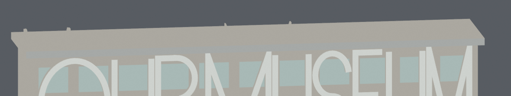

# 有章藝術博物館舊行政大樓改造館｜水池側簷帶補色

此變體只將水池側的直立簷帶改為中灰近似色 `#A5A8A6`。它是[原限域彩色外觀](../appearance/README.md)的補充，不是北側新館，不另計一棟，也沒有修改原模型、代表圖、檔案校驗或重建封存。

| 補色前（相同角度） | 補色後（簷帶局部） |
| :---: | :---: |
|  |  |

[補色 3MF](model-colored.3mf) · [可編輯 Blender](scene.blend) · [同幾何原 STL](../model.stl) · [新檔 SHA256](SHA256SUMS)

## 歷史參照與範圍

[館方水池側照片](https://museum.ntua.edu.tw/upfiles/HF5/DSC05978.jpg) 可見無外梯的長側門窗上方有一條連續灰簷帶。樹枝、樹叢遮住兩端小段；這些短段是依同一連續構件作局部延伸，並非獨立照片證明。[館方外梯側照片](https://museum.ntua.edu.tw/upfiles/HF5/04.jpg) 只用來辨認構件和方向，不支持改另一側。照片 EXIF 分別自報 **2007-11-01** 與 **2007-10-24**，無時區或獨立拍攝日期核證，2017 為影像修改時間，皆不是 2026 年現況。未隨包放入照片，也不是材料鑑定或校準色票。

- 只處理模型 +Y 法向、y=19 mm、x 約 ±68.5 mm、z 約 44.3–46.4 mm 的兩個原三角面（約 287.70 mm²）。原水池側簷帶短側端、水平頂底面、瓦、牆、框、玻璃後材料及立體字本身不改。
- 保留原 8,560 個三角面與 4,202 個頂點，不切面、不加頂點。原有 1,002 個字正面、130 個窗背材質指派皆原樣；新增的灰色槽僅供該兩面。
- 仍是尺寸近似的外觀展示模型，未切片或試印。上圖為新配對診斷渲染，非替換代表圖。

## 獨立重建與驗證

在本模型資料夾執行（皆用倉庫既有檔案，不需參考照）：

    blender -b appearance/scene.blend -t 4 --python-exit-code 1 -P pool-side-fascia-20261120/apply_pool_fascia.py -- --qa-renders
    python3 pool-side-fascia-20261120/rebuild_exchange.py

Blender 4.3.2 實際重開，原新場景網格與原 STL 逐面一致；lib3mf 嚴格讀回原新 3MF 零警告，所有三角頂點及材質已比較。檔案：[確切面域](domain.json) · [格式與材質](verification.json) · [視覺差異](visual-QA.json) · [隔離重建](reproduction-QA.json) · [原外觀版校驗](../appearance/SHA256SUMS.txt)。
