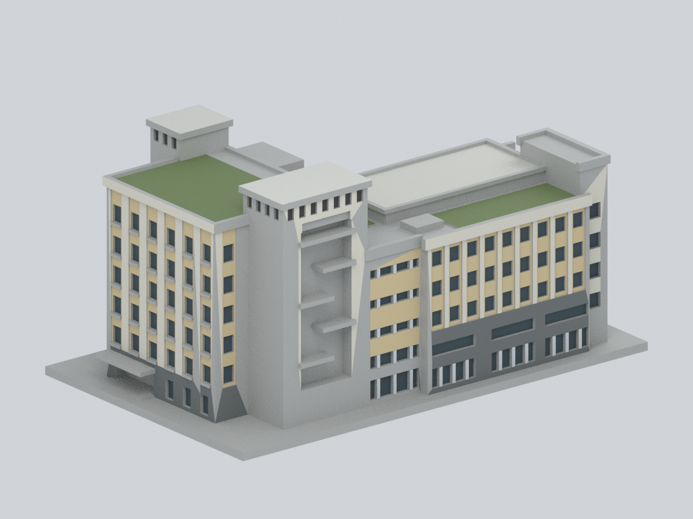
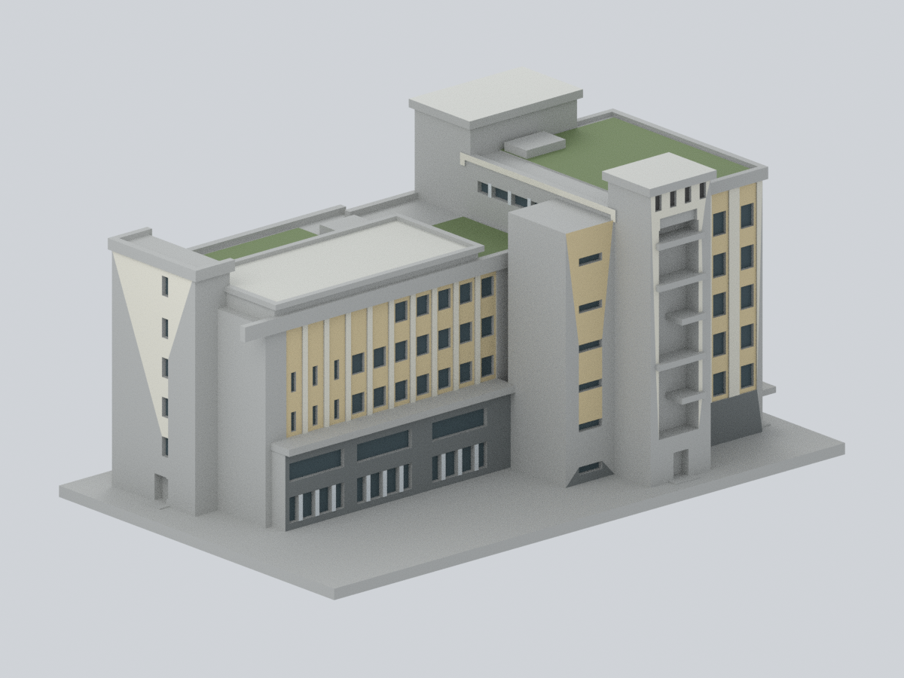
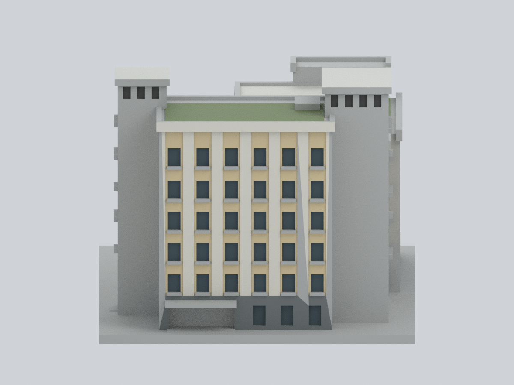
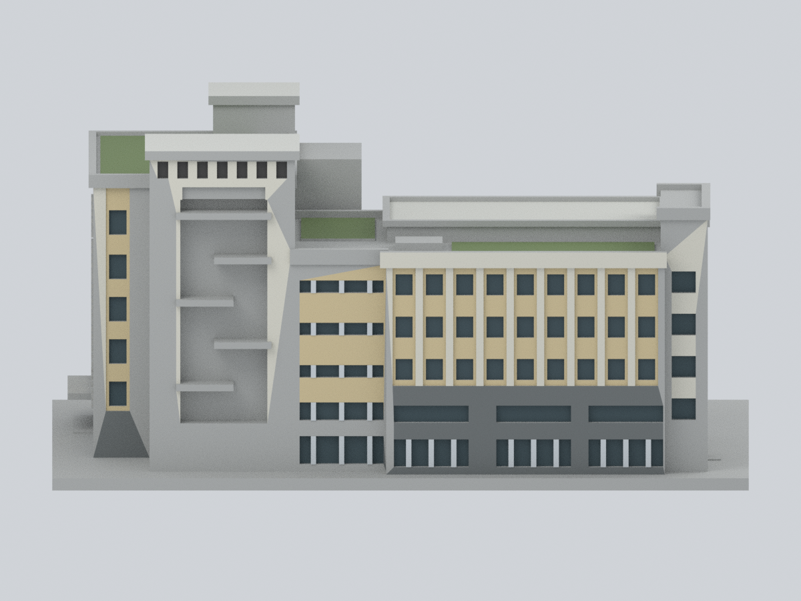
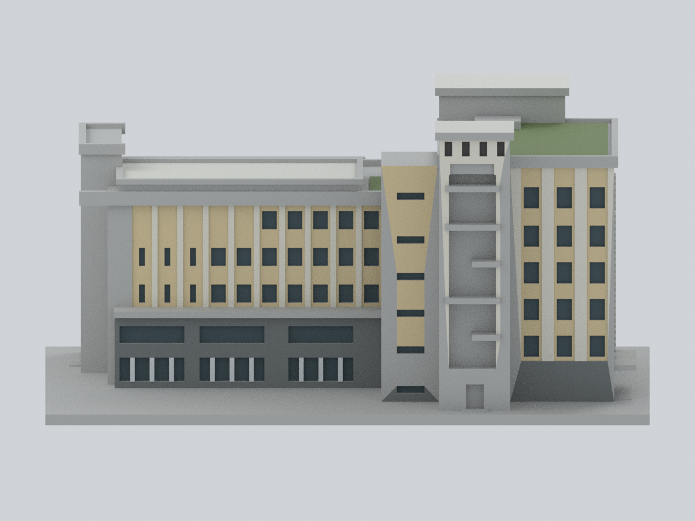
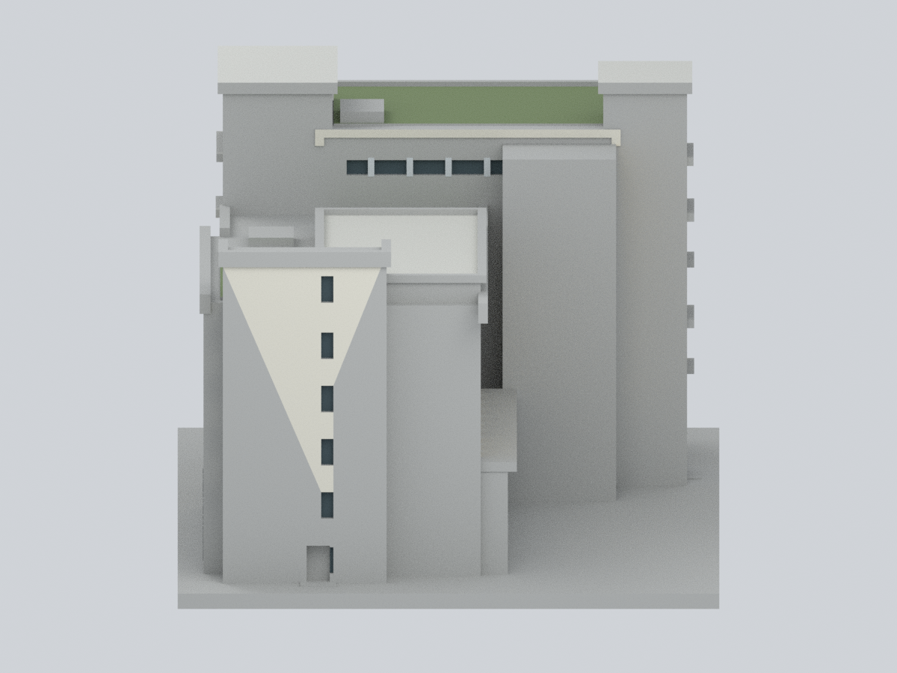
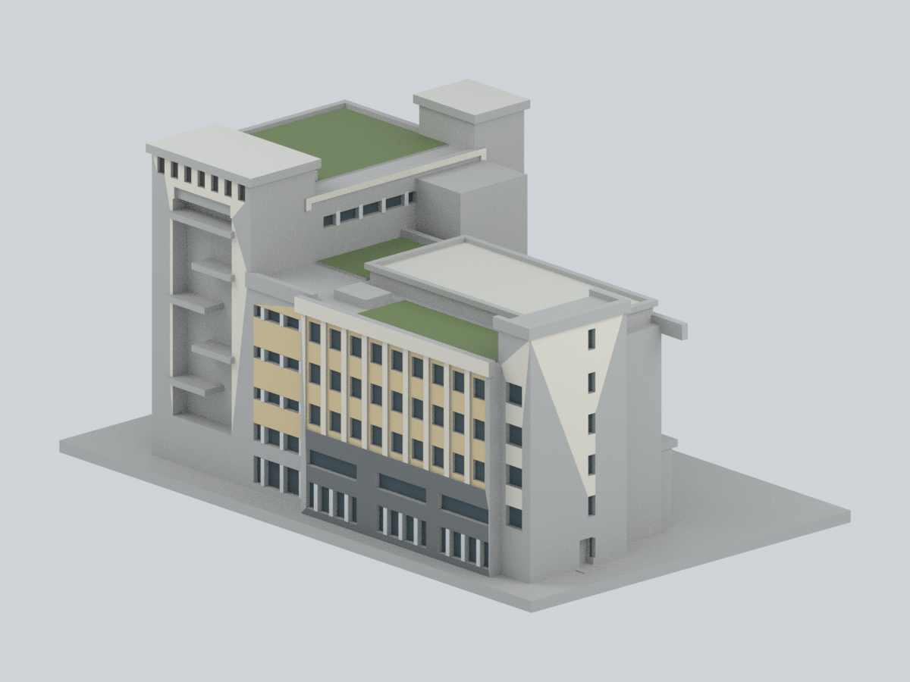
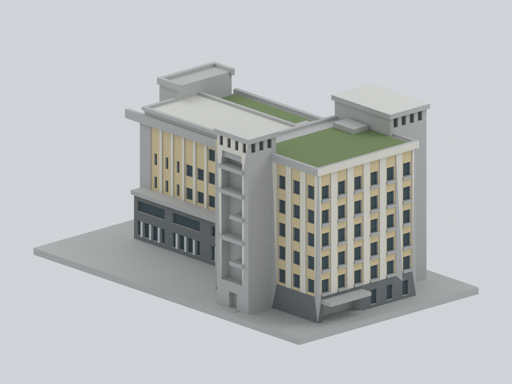
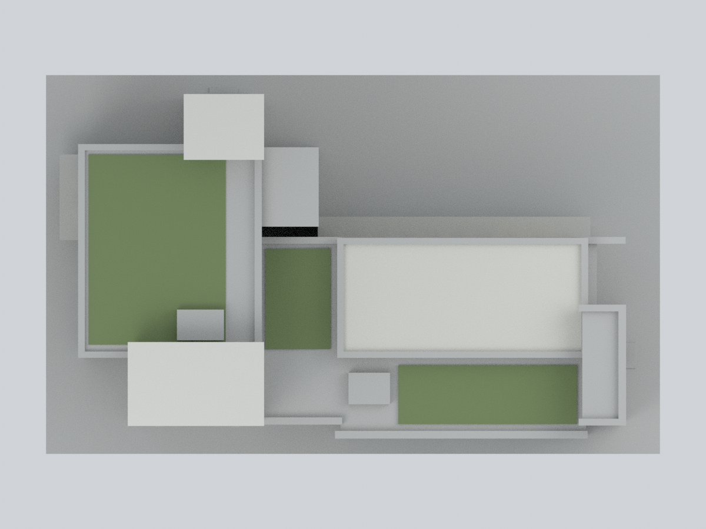

# 長啓樓｜2017 原主體的有界配色

| 正面斜視 | 後側斜視 | 六窗列街側 |
| --- | --- | --- |
|  |  |  |
| 長低翼側 | 圖書館凹側 | 端部樓梯側 |
|  |  |  |
| 低翼斜視 | 高翼斜視 | 屋頂俯視 |
|  |  |  |

## 檔案與編輯

- [可編輯 Blender](ntus-changqi-appearance.blend)：單一原模型網格、9 個材質槽；每面含原 STL 面序號及證據規則索引。可直接改材質的 Base Color；沒有修改器或隱藏替代網格。
- [逐面材質 3MF](ntus-changqi-appearance.3mf)：毫米、單一網格、真正的逐三角面 base-material 指派，並非縮圖或純色容器。切片器支援程度仍需自行確認。
- [原 STL](../model.stl)：無色列印幾何，SHA-256 `957c89bd2ae7e39ef4987e41e4f89803c6031e471c0986b1aa41696e892f9be4`。原幾何的近似尺寸、細節與列印限制全部保留；配色不構成無支撐或可列印保證。
- [完整逐面對照](face-materials.csv)、[登錄規則](mapping-rules.json)、[調色盤](palette.json)、[來源](sources.json)；CSV 的面序號為原二進位 STL 順序，從 0 開始。

## 代表色與來源邊界

| 材質 | 色碼／面數 | 支持與限制 |
| --- | --- | --- |
| N00 中性未知 | `#B6B7B4`／3,915 | 非現場材料主張；底座、底面、回折、混合邊界與未確認細部。 |
| M01 淡黃色內凹磚牆 | `#D9C79C`／865 | C-10 黃色系 45×95 磚，C-11/12 完工照、承商照交叉確認；不是石灰岩。 |
| M02 淺色凸柱及大面磚帶 | `#E1DED0`／231 | 淺色系丁掛磚的可登錄正面；未將所有淺色細帶推成相同材質。 |
| M03 灰色下層磚牆 | `#727777`／209 | 只限具體牆面平面及完整面範圍；不以單一高度刷灰。 |
| M05 玻璃視覺讀值 | `#405258`／352 | 只取可定位開口背面；不把窗洞側壁當玻璃，不宣稱鍍膜或透明度。 |
| M06 鋁框代表色 | `#D4DADD`／74 | C-26 氣密鋁窗及承商近照；只用已存在的凸直框正面。 |
| M07 原綠屋面 | `#718456`／14 | C-31 空拍中的三片既有植生床頂面；不表示綠漆。 |
| M08 大片非綠屋面 | `#D0D0C8`／2 | C-25 屋頂隔熱磚與 C-31 淺灰屋面；不外推到塔頂或設備。 |
| M09 樓梯塔上部深色屏面 | `#494847`／36 | C-11/12 可見深色百葉；只用既有開口背面，不新增葉片。 |

## 本次高翼女兒牆後外緣同材質延續

現行基準已有 10 個材質，含先前追加的 M10 梯間帽頂四面，並非舊說明的九色版。本次保留全部 1,787 已色面、原 229 條規則及所有未變更 CSV 欄位；僅高翼女兒牆後外緣 16 個原 N00 三角延用既有 M02 淺色族。新增 certainty 明記 `INFERRED_SAME_COMPONENT`，不偽裝來源直接配準。原 5,698 三角／2,851 點、STL bytes、頂點表、座標與面序不變。

使用原 source 座標 x=mm_x/(150/68)+30、y=−mm_y/(150/68)+13、z=mm_z/(150/68)−1.2。只取向 +x 的 x=19.9 平面，四個 y/z 矩形聯集為 [−0.35,0]×[26.85,28.15]、[0,0.35]×[27,28.15]、[0.35,22.65]×[27.5,28.15]、[22.65,23.35]×[26.85,28.15]。全三角以多邊形裁切計算在聯集內面積，包含兩端原回條並保留北服務核的原缺口，不切面或補缺口。原面積 79.13193001 mm²，解析 (22.3×0.65+1.4×1.3−0.35×0.15)×(150/68)²=79.13197448 mm²，差小於 0.0001 mm²。

本輪親看官方工程簡報 C-10 設計材料圖及 C-11 兩張完工照，支持前及端部淺色丁掛磚家族；後外緣是同女兒牆構件推論，不是後側材質獨立照片確認。2017 工程範圍與照片拍攝日期分開，不稱 2026 現況；不加後來太陽能設施。內緣、頂底、綠化、窗洞、設備、主牆、梯間及全部 M10 帽頂不擴色。原尺寸與小缺口是原近似模型，不冒充量測接縫或防水構造，未試印。

歷史 QA、qa-continuation、原腳本與資料來源仍留存。新 QA 在 `qa-continuous-walls/`；新校驗在 `appearance/SHA256SUMS` 及根 `PUBLIC-MODEL-SHA256SUMS`。新版可編修原生檔與實際九視圖沒有照片貼圖。3MF 使用完整原座標 XML 與明確物件預設材料，strict 原生讀取精確對回 STL；臨時改色重存的 SDK 量化另記，原交付未採量化副本。新版重建 `python appearance/rebuild_continuous_walls.py`，交換檢查 `verify_continuous_exchange.py`，Blender 背景執行 `render_continuous_walls.py`、`verify_continuous_scene.py`。ZIP 含原 STL、原視窗註冊資料、原建模腳本與有限新域，不含私人簡報圖片。原 build_appearance.py 是舊版重建入口，不是本次新版入口。

場景僅同步更新 unknown 文字，明示高翼女兒牆後外緣 16 個原面沿用 M02 的同構件推論，並保留沒有獨立背面照片證據、N00 未驗證中性及樓梯植栽／玻璃混界維持中性的限制；其餘原屬性、全部材質定義與幾何不變。

## 前版說明與保留限制

國立臺灣體育運動大學臺中校區長啓樓。這是**原模型的外觀子目錄，不是新增建物，也不改動原 STL、原預覽或原幾何**。只把有來源、且能與既有完整三角面對應的區域加入代表色；不補造窗框、植物、樓板或後期太陽能棚。

**保留原來 5,698 個三角面與順序。** 1,783 面為來源登錄的近似配色；3,915 面保留 `N00` 中性未知，包括窗洞側壁、未見底面、設備及跨材料邊界的長三角面。屋頂只標三片原綠屋面；樓梯凹槽混合植生與玻璃，37 個背面未強塗綠。中性色不代表現場灰色材料；個別斜向色塊邊線是原三角面可登錄範圍，不是實際立面斜向分色。這是保守配色研究，不是完整逐面實測復原。

## 九視角

以下全部由本目錄的實際模型、面材質和相機渲染，沒有照片貼圖或後製補色。方位名稱沿用模型局部軸；不是精密羅盤測量。


色碼是未校色照片下的低飽和**顯示近似值**，不是測色、原廠色票或材料採購規格。每個已配色三角面皆須三個頂點全部落在登錄平面及範圍內，另驗證朝向；不用面中心推整面，不細分跨界三角面。來源登錄面約占總表面積 24.63%（包含底座與底面在分母）；這個比率不等於可見立面的覆蓋率。

### 主要資料

- [校方長啓樓金質獎建築簡報](https://acc.ntus.edu.tw/index.php?article_id=18246&code=list&flag=detail&ids=838)：實看 C-10 材料標示、C-11/12 四方向完工照、C-25 屋面、C-26 鋁窗、C-31 屋頂空拍、C-43 植生牆。完工照片優先於概念立面；四張航照未一概假定同一拍攝日。
- [允祥營造工程頁](https://www.onever.com.tw/product_info.asp?id=20)：灰色下層橫向磚縫與淺色框近照；照片日期未確認。
- [圖書資訊處沿革](https://lis.ntus.edu.tw/index.php?code=list&ids=4)：大樓 2017 年竣工；2019 年圖書館開幕不是大樓竣工日。
- [後續總務會議](https://ga.ntus.edu.tw/index.php?article_id=20412&code=print&ids=845)：僅用於排除後期光電棚，規劃紀錄不等於設備完工日期。

原照片、簡報及 PDF 的權利仍屬原權利人；此目錄不散布原資料，也不使用照片貼圖。抿石子小帶、淡粉窗楣及植生／玻璃混合背面的逐面界線不足，因此不冒充確認材質。

## 重建及驗證

需要 Blender 4.3.2、Python、NumPy、Pillow 與 lib3mf 2.5.0。**不執行原 `build_model.py`**，不改寫 STL。

```sh
python rebuild.py --input ../model.stl --out /tmp/changqi-appearance-rebuild
```

所有產出寫入 `--out`；腳本自帶的窗區登錄只作定位。若只想調色，可編輯 `palette.json` 後執行 `export_3mf.py --out ...` 及 Blender `render_appearance.py -- --out ...`；完整重建則以 `build_appearance.py` 內 `PALETTE` 為準。

驗證內容見 [qa](qa/)：原 STL 位元組、全部三角面座標及面序一致；Blender 重開及實際改色另存重開；3MF strict 讀取、逐面材料及 round-trip；九張實圖及獨立重建像素對照；整段固定路徑緩衝區與 PNG 文字／EXIF／時間資訊檢查。

3MF 寫入器的十進位座標序列化造成最大 **0.000003814697265625 mm** 漂移；面索引、面序與材質完全一致，strict 與 round-trip 均零警告。Blend 與中間網格座標則與原 STL 完全相同。這是浮點輸出精度差，不是幾何改造。

重新建立時，lib3mf 會另產生物件／build UUID；比較工具只排除這些識別碼，所有幾何、面材質、轉換與名稱仍須一致。九視角另以解碼後 RGB 像素逐點比對。


## 2026-11-13 有限外觀修正｜模型交付版
僅兩座既有高梯塔帽頂的4個原三角由未知N00改既有M10。色族是2017完工時期背景的有限近似，不是精確漆色或目前現況；不延其他屋頂、塔牆及未證面。
模型與原生視角圖沿用完成候選的原bytes；不改幾何、不增加分界、不稱全棟精確配色或實體試印通過。原來源年代、工程及列印限制仍適用。先前敘述與審核屬其原版本，本段僅更新上述局部範圍。
本次只交付模型、必要重建輸入/腳本、預覽與此說明；完整研究與獨立審核紀錄另行保留，不在本批公開。PUBLIC-MODEL-SHA256SUMS只核本次所列公開產品，舊校驗與QA不代表本次新版。
