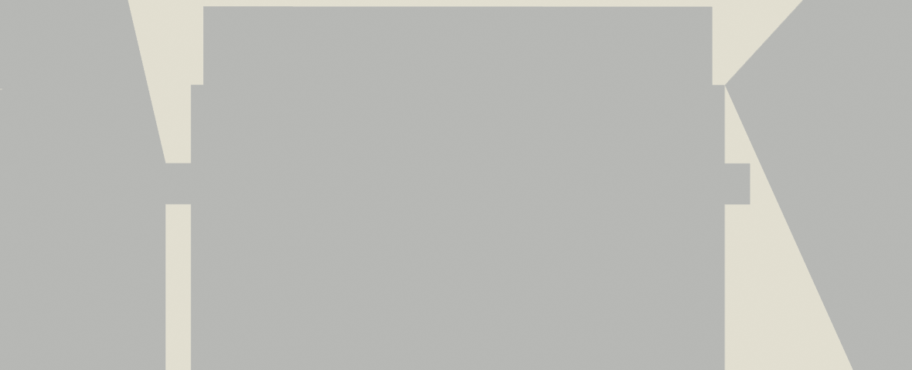
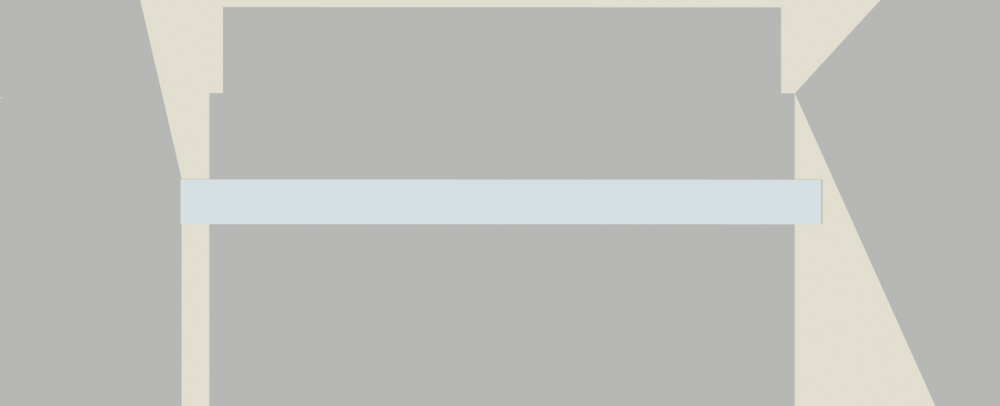

# 國立臺灣體育運動大學長啓樓｜西南側梯間上遮簷

這是既有長啓樓的獨立局部配色版本，不增加建物數，也不取代原檔、代表圖或舊配色。只將四個交錯落台上方、淺凹矩形下方的獨立遮簷外側垂直端面補為淺冷灰（名義色 `#D5DFE2`）。補色限原三角 5353、5359（零起算，合計 29.414449 mm²）。原先 10 材質、其餘 5,696 面與 2,851 個頂點均不變；面序、法向、尺度、STL bytes 不改。

## 下載與對照

- [逐面材色 3MF](model-colored.3mf) · [可編修 Blender](scene.blend) · [原無色 STL](../model.stl)
- [精確選面、來源與原版雜湊](domain.json) · [驗證](verification.json) · [再現報告](reproduction-QA.json) · [SHA256SUMS](SHA256SUMS)

| 原中性色 | 局部補色後 |
| --- | --- |
|  |  |

兩圖是由原網格產生的同角度局部診斷，沒有原照片貼圖。畫面不當作全棟代表圖。

## 來源與限制

以[校方工程獎簡報](https://acc.ntus.edu.tw/upload/general/attachment/5a557fa162efa2a7bc25ccff70fd9800.ppsx) C-11 右圖「西南向現況」為主要色族依據，C-10 上方斜角成屋照核對凸出的構件。只用上部獨立淺色遮簷的正緣；落台的深灰牆面與白色下緣、植栽和門窗在現場可分，但不擴色到原模型未分材的面。遮簷上／下與兩端、另一側及既有女兒牆全不改。簡報描繪 2017 工程竣工主體，照片實際拍攝日未獨立確認；不是 2026 現況，色碼也不是校色或材料規格。模型輪廓仍為原近似；未進行實體試印或驗證切片路徑。未附外部照片或簡報。

## 重建

自本目錄執行以下步驟，建議先複製到工作目錄。基準檔若不符 [domain.json](domain.json) 鎖定版本，腳本會中止。固定的公開基準：[原 Blender](https://github.com/hplin50643/taiwan-buildings-3d/blob/5018bb0b9c8fd679e1155e09afd8814e9dc88166/%E5%9C%8B%E7%AB%8B%E8%87%BA%E7%81%A3%E9%AB%94%E8%82%B2%E9%81%8B%E5%8B%95%E5%A4%A7%E5%AD%B8/%E8%87%BA%E4%B8%AD%E6%A0%A1%E5%8D%80/buildings/ntus-changqi-building/appearance/ntus-changqi-appearance.blend)、[原 3MF](https://github.com/hplin50643/taiwan-buildings-3d/blob/5018bb0b9c8fd679e1155e09afd8814e9dc88166/%E5%9C%8B%E7%AB%8B%E8%87%BA%E7%81%A3%E9%AB%94%E8%82%B2%E9%81%8B%E5%8B%95%E5%A4%A7%E5%AD%B8/%E8%87%BA%E4%B8%AD%E6%A0%A1%E5%8D%80/buildings/ntus-changqi-building/appearance/ntus-changqi-appearance.3mf)。

```sh
python rebuild_exchange.py ../appearance/ntus-changqi-appearance.3mf
blender -b -t 4 --python-exit-code 1 ../appearance/ntus-changqi-appearance.blend --python apply_hood.py -- --qa-renders
```

獨立重跑比對 3MF、診斷圖和場景實際內容。Blender 容器 bytes 可能因重存標識不同而不全同；以原網格、場景和逐面材質檢查判定。既有根目錄舊 `SHA256SUMS` 內的 README 雜湊在此版本以前已不同，原檔不改；原本包以 `PUBLIC-MODEL-SHA256SUMS` 及 `appearance/SHA256SUMS` 核對各自列出的舊項目，這個新資料夾另用自己的 `SHA256SUMS`。
