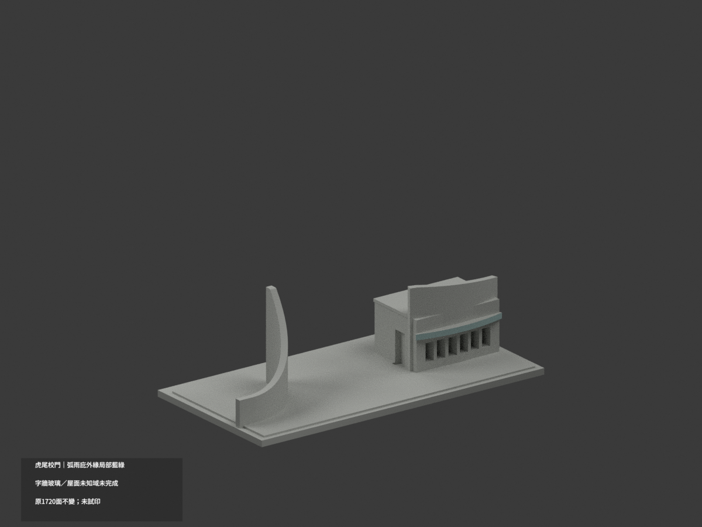
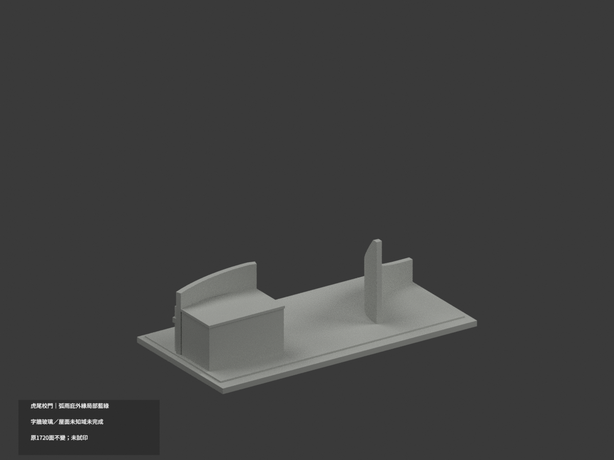
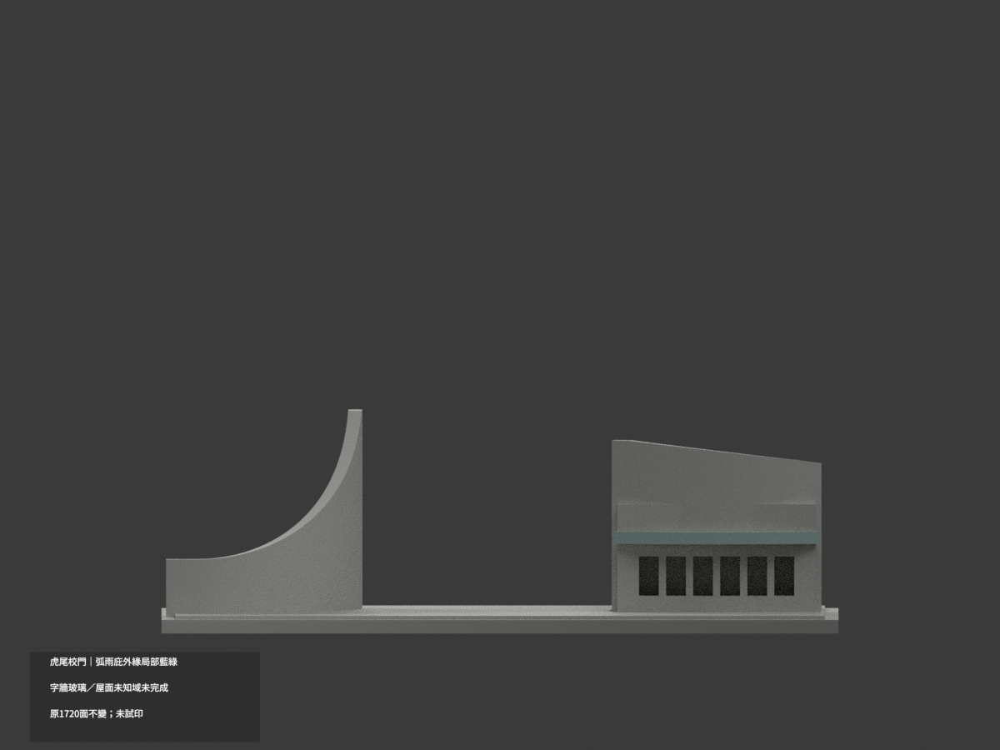
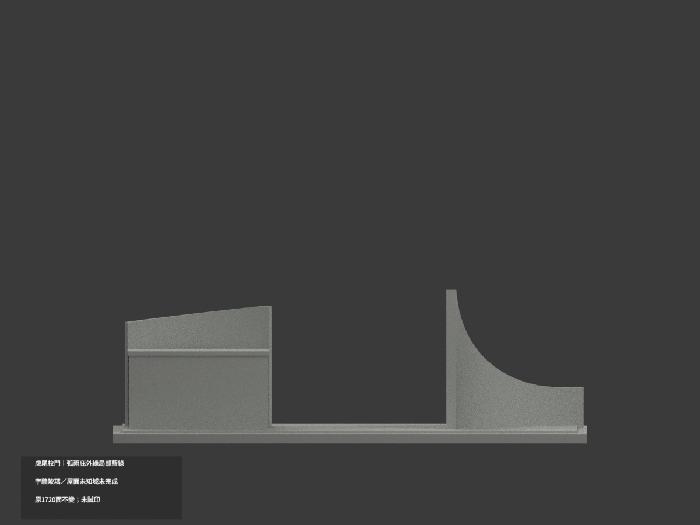
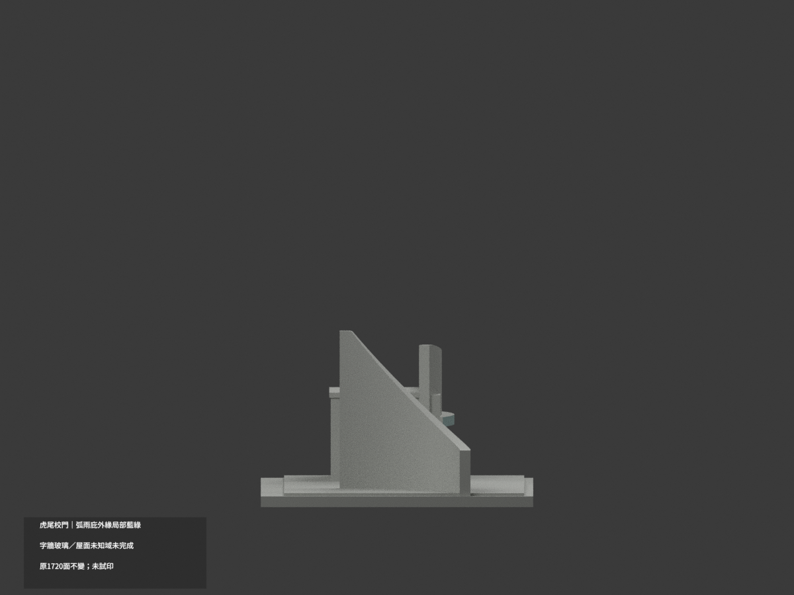
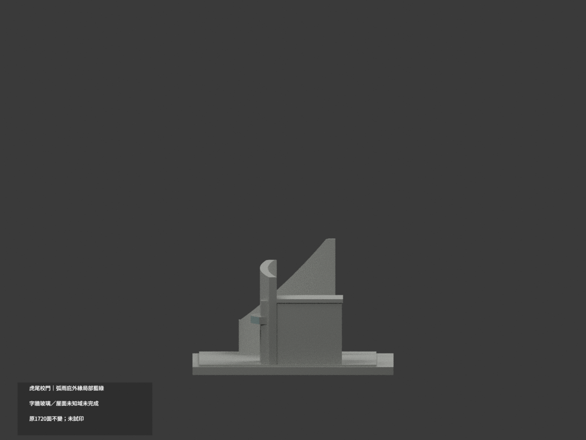
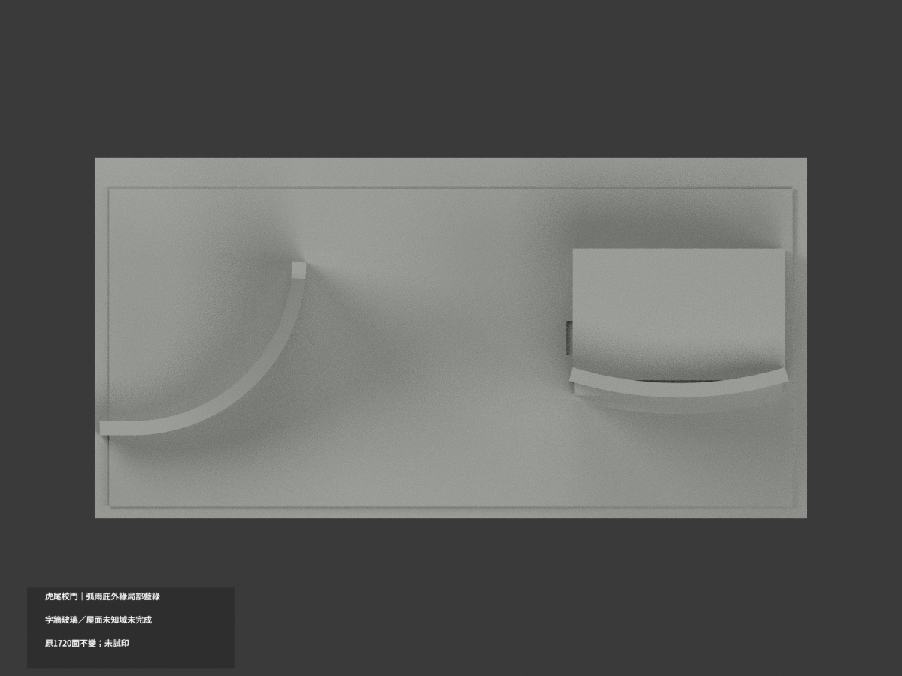
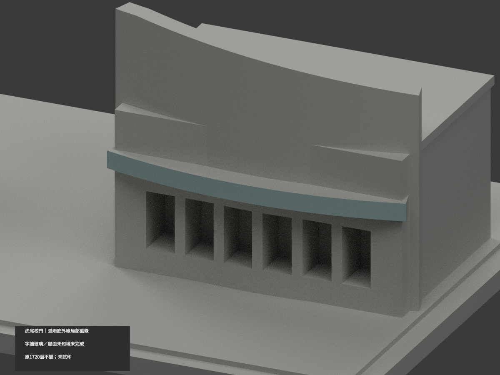
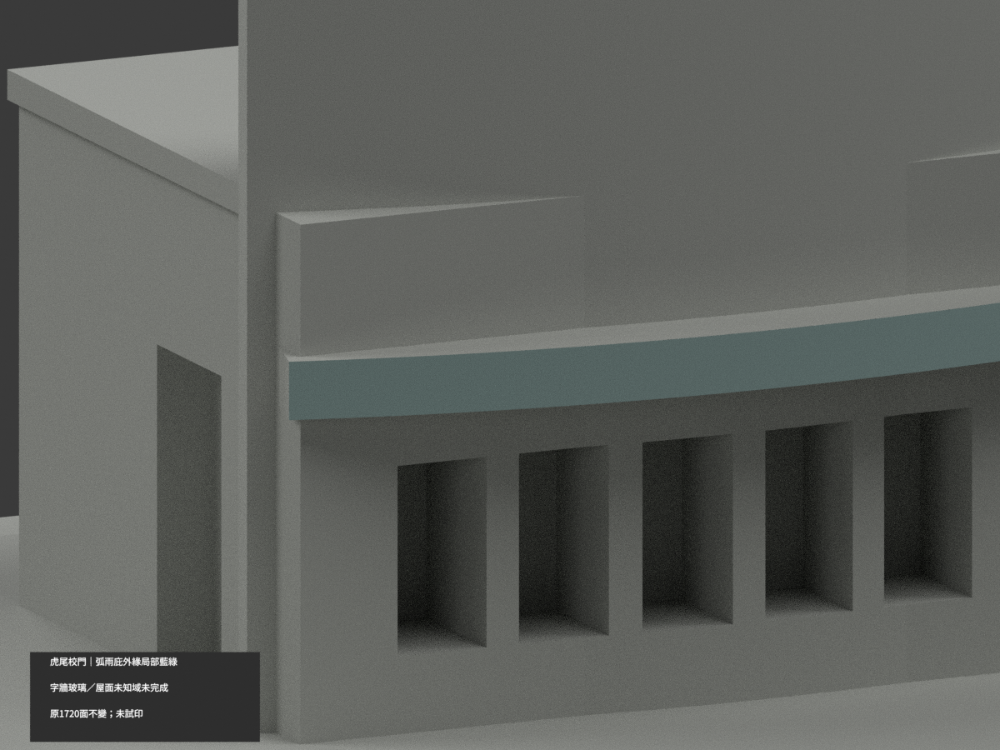
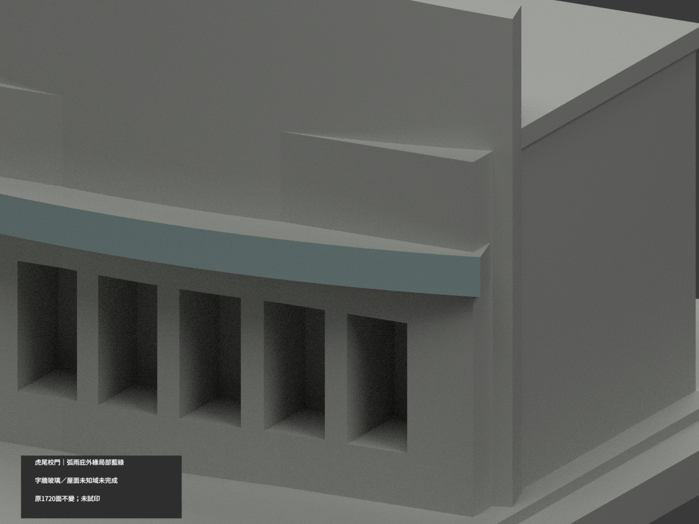

# 虎尾校門與警衛室｜弧雨庇外緣局部淡藍綠

**含字曲牆、玻璃與其餘域尚未完成分色。** partial_color_incomplete=true、fully_colored_exterior=false。僅弧雨庇外側立邊128面名義淡藍綠，非整校門全色。

| 總覽 | 背側 | 正面 |
|---|---|---|
||||
||||
||||
||||

## 材色範圍
同 nfu-main-gate 原項目，same-item、count_delta=0。國立虎尾科技大學校本部（第一教學區）既有校門與警衛室，非全廣場。原1720三角及STL/build_model.py字節不變，20原件無OBJ。
- 原curved_wall外半徑83，中心(48,67)、254..286度、z19..21.7，64真chord各完整2面共128。全3頂點plane/tangent/z界1e-5核，每無限plane恰等有限域，保原Boolean三角，不用normal閾漏片。
- 其餘1592面中性：含黃字校名兩牆無文字材界、雨庇上皮/內背/端/底、框玻璃反光混窗、警衛室屋背/設備/階地。淡藍綠為不透明名義示意，不新造透明板、窗框或字樣。
- 原未有虎雕仍不造2025虎雕，鄰教學大樓/另景觀不納。補色不追認原近似幾何，證據邊界非真材縫。

## 來源與日期
親看官方位置PDF第2頁校門近照及空拍；抽圖為同PDF證據非獨立新源。不使用QR目標。文檔2025-06-27非已驗拍攝日，不稱2026現況。原照私人保存、不公開、不作紋理、不建人物；未確認CC或再散布授權，不保證商用。

## 格式與列印
[原STL](model.stl) · [逐面材色3MF](appearance.3mf) · [Blender](scene.blend)
150mm底座為原示意尺寸非測量比例。物件明名 NFU Main Gate partial color，獨立核真slug/館名。STL無色，3MF/Blender逐面分材，不是兩色或四色耗材切片驗證，未實際列印。

## 重建與 QA
原build_model.py → colorize_model.py → export_appearance.py → validate_color.py；Blender render_color.py／verify_color_scene.py。完整隔離Shapely2.1.2精確原build＋color重建、原bytes/全三角multiset、共面均一、閉合正體積、3MF面材、scene重開、十圖1200×900與hash。原README/previews/validation保留歷史，不冒新QA，不刪檔。

## English scope
Partial only:128 original outer curved canopy fascia triangles pale muted blue-green;1592 neutral. Exact64 finite chord facets centered48,67 radius83 angles254..286 z19..21.7,all3vertex whole planes equal finite domains. Canopy top/inner/ends/underside, lettered walls, mixed glass and guardhouse rear neutral. Original1720 triangles and20 immutable files unchanged;no originalOBJ. OfficialPDF2025-06-27 publication not imagecapture;not2026. No tiger sculpture, adjacent teaching tower, transparency or geometrychanges; sameitem/count0/no filament test.
