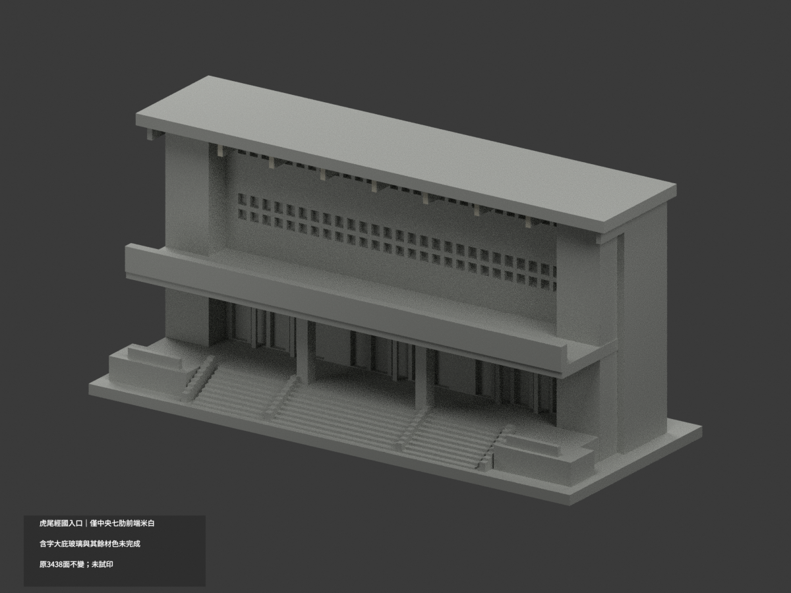
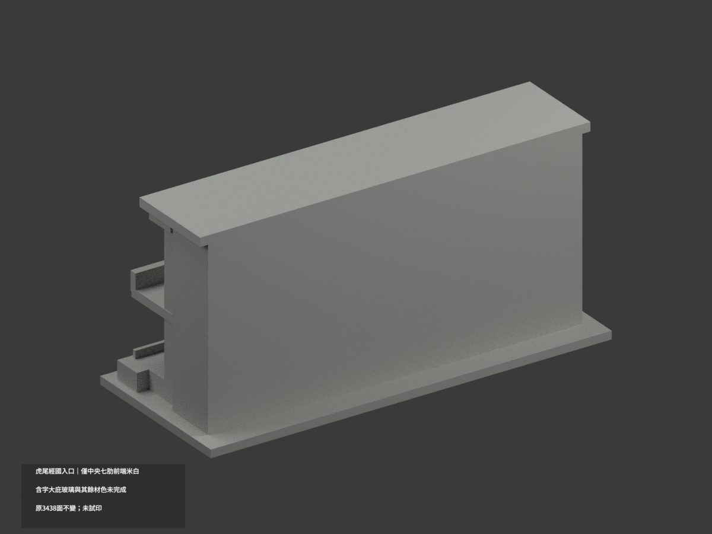
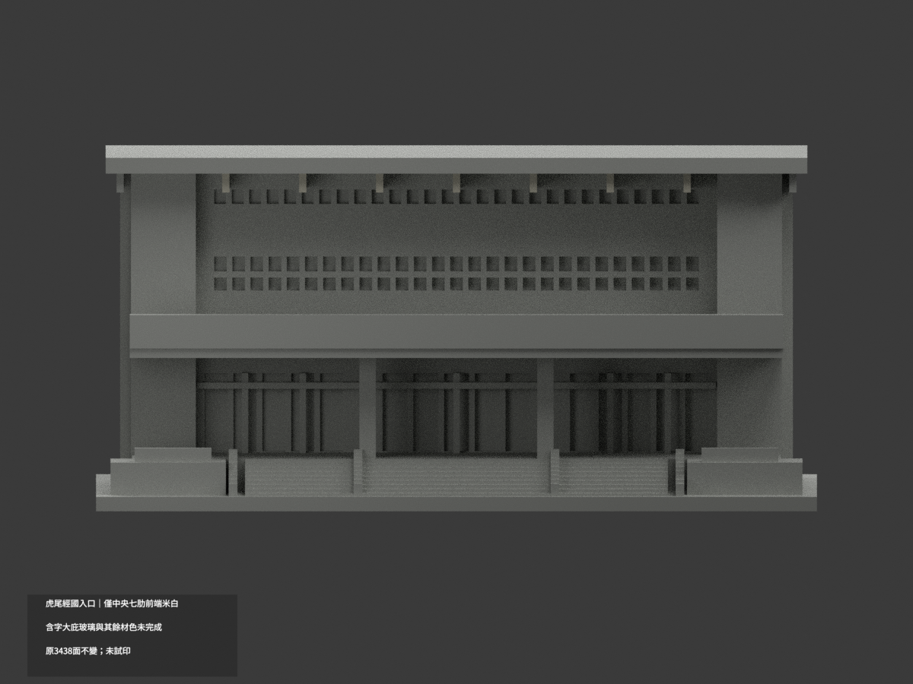
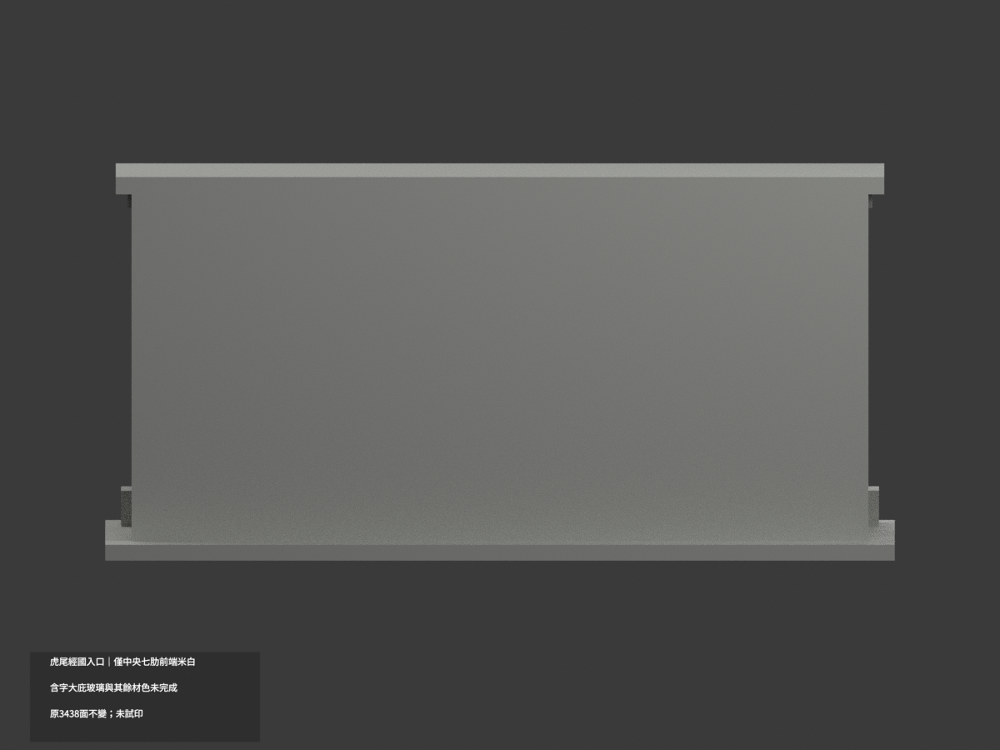
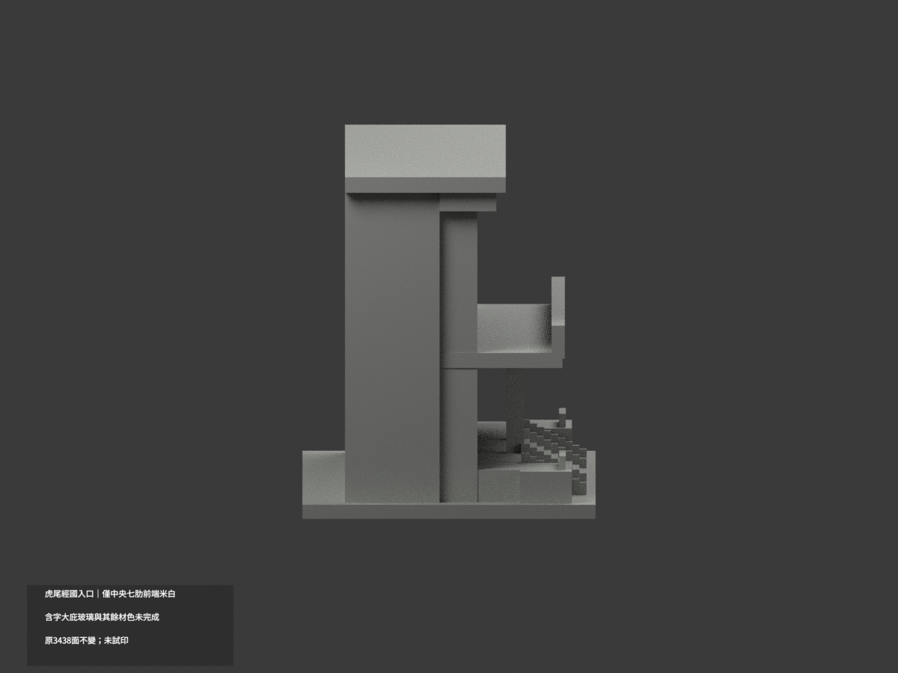
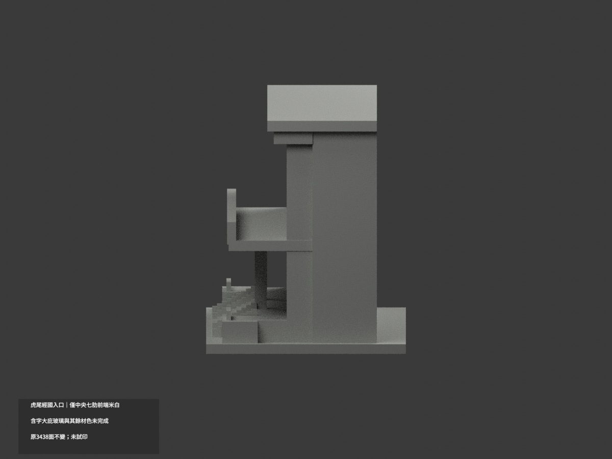
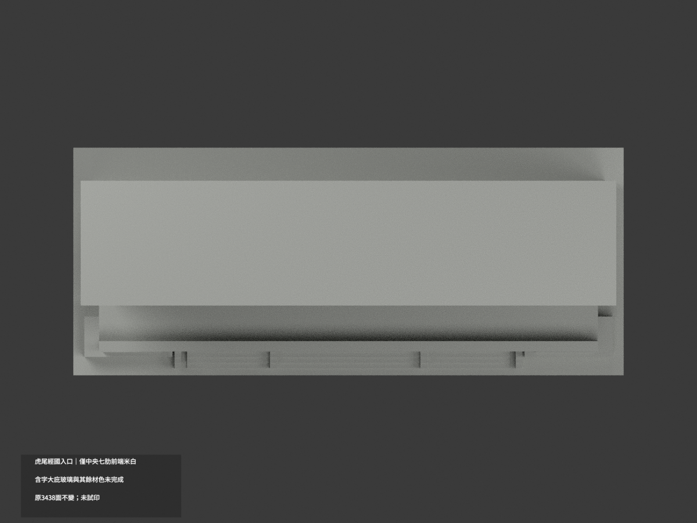
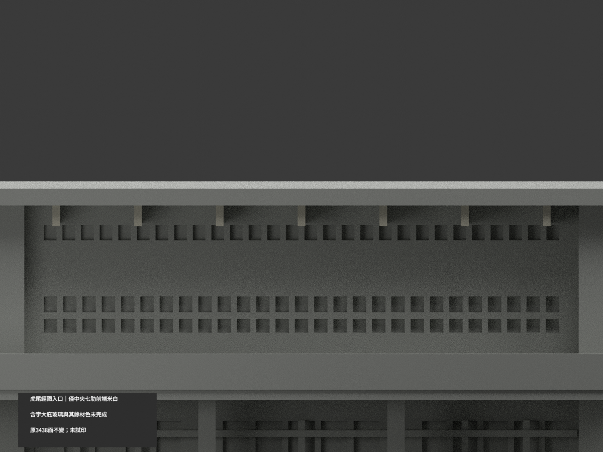
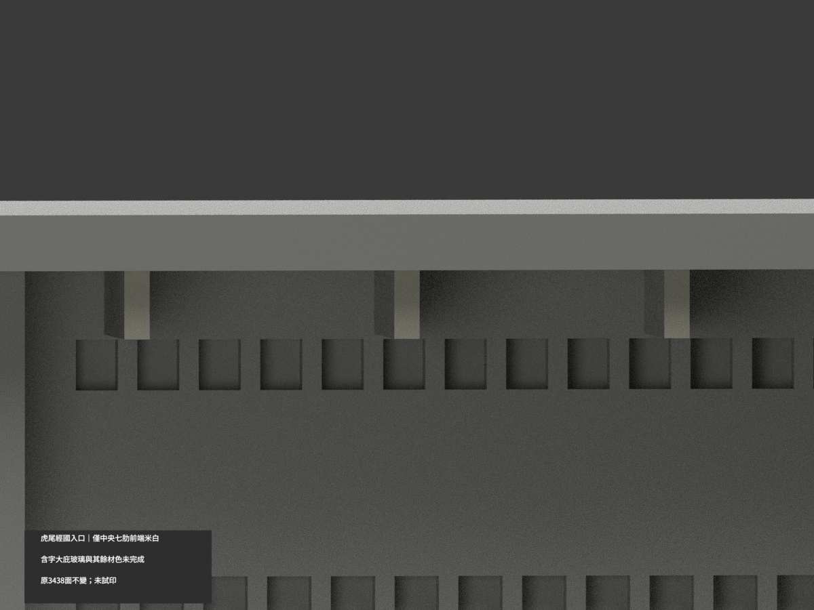
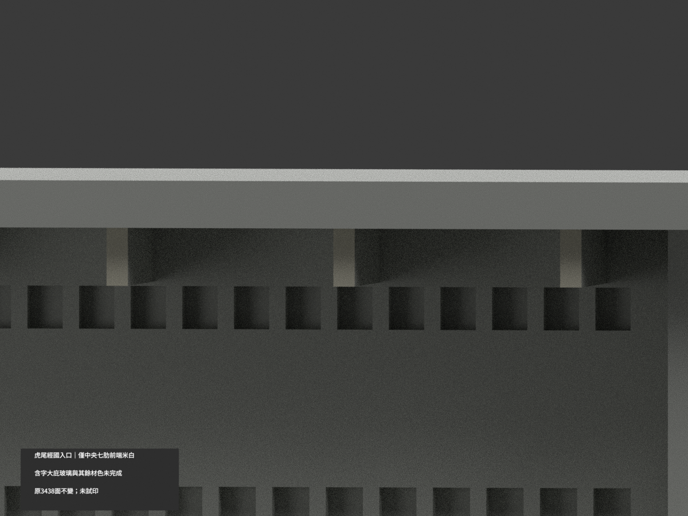

# 虎尾科技大學經國體育館正面入口段｜中央七短肋前端局部米白

**局部補色未完成：僅最高庇下中央七短肋完整前端14原三角米白，其餘面尚未分色。** partial_color_incomplete=true、fully_colored_exterior=false。同項 nfu-chingkuo-entrance／count_delta=0，國立虎尾科技大學校本部（運動區）。英文身份 NFU Chingkuo Entrance partial color。

**只保既有正面入口截段，原20mm截深為展示近似，不是全館深度或後立面測繪；不因補色追認原估測/加厚/簡化。**

| 前斜視 | 後斜視 | 正面 |
|---|---|---|
|  |  |  |
|  |  |  |
|  |  |  |
|  | | |

## 完整原域

原三頂點whole y−10無限平面0.0001mm枚舉18面，共享邊BFS九個完整兩三角矩形。只選原中心x−48、−32、−16、0、16、32、48七完整域，不按normal/centroid、亮度或任意截色；外兩x±70全中性。每原露出域寬1.5、z65..69.099998，union上端真遮斷不補原設計高度。14名義米白、3424中性，3438原三角不變，共面連通域一致。

原官方高解析正面照片可證七中央短肋前端；照片裁掉最高146mm大庇兩端，不能整庇推米白。含金字入口庇、燈具暗底、柱旗幟、反光玻璃混框簾不整染。肋側底、外兩肋、階/欄代理/屋頂/後面等全中性；中性不是實景灰，來源範圍不是真實材界。未取503 PDF，不新增活動拱門/文字。

## 日期、檔案與 QA

官方照片無可核capture日期，發表文案不當拍攝日，非2026現況。原圖僅私人研究不公開或貼圖，不推定商用權利。

原STL/build及3438三角座標拓撲不變，immutable17件無OBJ，不新增或冒稱原OBJ。原README.md另存ORIGINAL-MONOCHROME-README.md；原單色預覽/QA歷程保留、原scene私人保存。兩展示材appearance.3mf與scene.blend實際面材同原形，export/validate/render/verify及實際物件身份 NFU Chingkuo Entrance partial color。

精確依賴隔離原build+color、閉合正體積、3MF座標/面材、Blender重開與十張1200×900檢核，保留重建不刪。未試印或驗多料切片，STL本身無色。

## English limitations

NFU Chingkuo Entrance partial color. Infinite original y=-10 plane18faces forms9complete two-triangle edge-connected rectangles; only seven central x=-48,-32,-16,0,16,32,48 components colored palecream14faces. Outer ribs,all sides/undersides,lettered broad canopy,mixed glazing/banners/columns/stairs/roof/back remain neutral3424faces. Original3438triangles and17files retained,no originalOBJ. Illustrative20mm entrance cutdepth is not fullgym depth or rear survey; no added geometry/count_delta0. Single high-resolution official photo,captureunknown/not2026,no failedPDF use. No public reference photos,testprint or calibrated finish claim.
