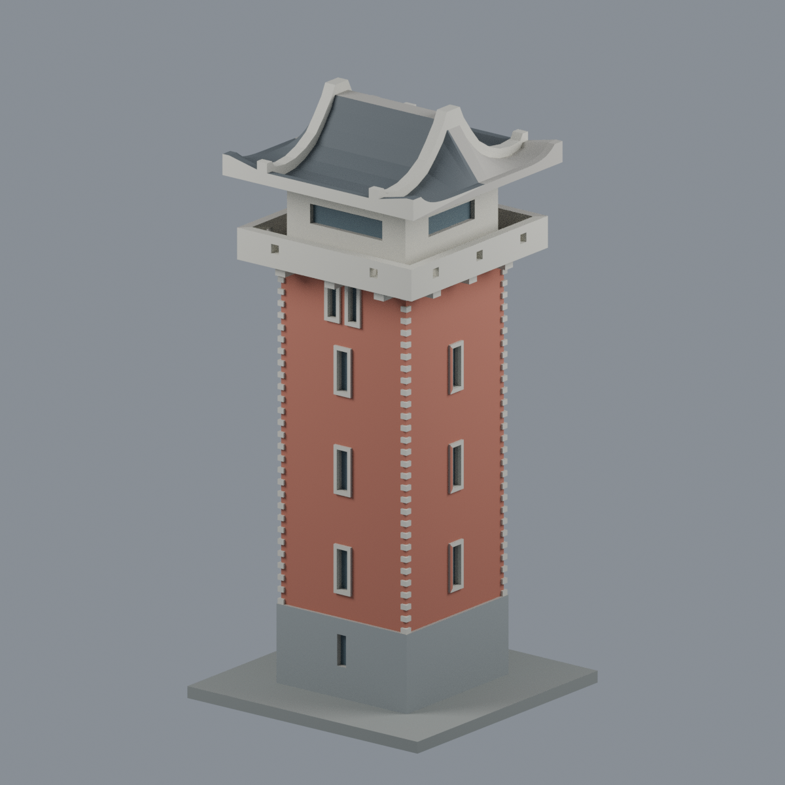
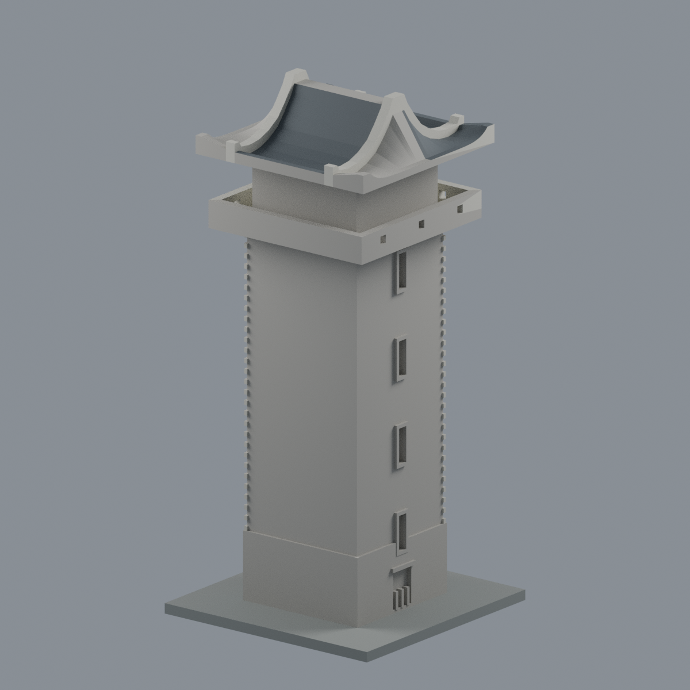

# 國立金門大學｜楊清廉圖資大樓銃樓段

## 模型預覽

| 模型預覽 | 模型預覽 | 模型預覽 |
| :---: | :---: | :---: |
| 正面原幾何配色  | 後坡限域延色，其餘背牆中性  |  |

## 本次中央後瓦坡同材質延續

僅將兩片已淡色曲線山牆間的中央後瓦坡 9 個完整原曲面分段矩形／18 個原中性三角延用既有炭灰瓦代理色 3。原 5,775 個已色面、全部理由與 7 槽色盤材料不變；其餘 9,014 面不變。原 9,032 面／4,502 點、STL bytes、座標、面序皆不變。

選區 x=−15.5…15.5 mm、後側 y=2.5…29 mm，以原屋頂 profile 高度減 2.5 的 9 段有限坡面逐段核對全部三頂點與向上法向。每段兩三角完整四頂點，面積合計 1,050.61314308 mm²；逐段與解析 31×hypot(Δy,Δz) 差小於 0.0002 mm²。兩山牆內界、屋脊 y=−2.5…2.5、側 hip、簷邊、底面、塔身混牆與窗全部排除；不切面、不改曲線、厚度或新增瓦紋。

本輪親看 JJP 建築師官方作品原照，前瓦炭灰與淡色曲線山牆可辨；後中央坡明示為同一屋頂瓦族延續推論，沒有獨立背面照片確證。原分段曲線及其他曲坡皆為原近似造型，非測繪或施工圖。攝影日期未確認；不是 2026 現況、量測色值或實體試印。照片留私人研究，不入公開包，亦未建立旁邊圖書館新模型。

新版 QA 在 `appearance/qa-continuous-walls/`，歷史 QA 與 checksum 留存；新校驗表用 `appearance/SHA256SUMS`、根 `PUBLIC-MODEL-SHA256SUMS`。歷史文件的後坡中性屬原版範圍，本節記錄新增 18 面。新版重建 `python appearance/source/build_continuous_walls.py`，交換驗證 `python appearance/source/verify_continuous_exchange.py`，Blender 背景執行 `render_continuous_walls.py` 與 `verify_continuous_scene.py`。ZIP 含原 STL、建模腳本與有限原坡域，不含照片。原製造限制完整保留。

場景僅同步更新 limitations 文字，將原後坡中性範圍改記為這 18 個中央後瓦坡原面的同瓦族延伸推論；其餘原屬性、材質定義與幾何不變。

## 前版說明與保留限制

本修版補入2024-09-23新側面實拍證據；本件僅為圖資大樓的**銃樓局部外觀近似**，不是獨立建物、全館測繪或全校完成。以建築師實拍、校方簡報和2019年記者實拍交叉核對，自行以 Python / manifold3d 建立；沒有擷取第三方3D網格。

## 最新七材質外觀版（2026-10-20）

[來源界線與四視角](appearance/README.md) · [表面色 3MF](appearance/nqu-appearance.3mf) · [可編輯場景](appearance/scene.blend)

只對建築師實景可登錄正面與右側配色；凸角石和窗框淡色，前瓦坡炭灰，未覆核左側與未知背面中性。原STL與歷史QA不變，不是新增幾何。原單色正面（歷史檔案留存，不作本頁預覽）／原單色背面（歷史檔案留存，不作本頁預覽）

正立面（歷史檔案留存，不作本頁預覽） · 頂視（歷史檔案留存，不作本頁預覽） · 屋頂低視角（歷史檔案留存，不作本頁預覽）

## 範圍與版本
- 外觀候選：2024側面補證修版v2；保留成對曲線山牆及橫向屋脊。獨立數位驗證已完成，44筆角損及沿面限定證據已核可，不能視為已發布或已試印。
- 保留主塔身三列單窄窗、最上雙窄窗，另一已見立面的三列單窄窗，外挑欄板正面2孔／側面3孔、環繞陽台凹槽、屋頂成對曲線山牆。
- 山牆曲線、相對比例、進深為照片近似；為列印加厚山牆板至3.0mm，脊頂保留約5.0mm寬平台、上翹端保留至少2.0mm端面，並非原建築測量尺寸。
- 新增x負側4錯層單窗（底標高20/45/70/95mm），最低跨z23mm石基線；front石基窄窗；x負石基淺門洞、加粗3竪格及過梁、陽台3小孔。尺寸是照片近似。未知y正背面與接主館段留白，不推造。主館、階梯廣場、山牆主屋群、後翼與室內皆未製作；底座是人工列印底座。
- 不以館內圖書館、李奇茂美術館或電算中心另算建物。圖資大樓正式别名由2025年7月館方樓層導覽確認為楊清廉圖資大樓。
- 建築師記載2008年竣工；照片多未標攝影日期。已查校方現行頁面、2025簡報及修繕關鍵字，未取得能證明2026全棟外牆／屋頂改造完成的資料。未查獲不代表沒有施工。

## 檔案與重建
- [model.stl](model.stl)：毫米，70 × 70 × 150 mm，含底座
- [scene.blend](scene.blend)：由交付STL匯入的可編輯網格，非另造展示模型
- [build_model.py](build_model.py)：獨立參數重建；[requirements.txt](requirements.txt)
- [render_preview.py](render_preview.py)、[render_roof_detail.py](render_roof_detail.py)：由實際交付網格渲染
- [來源與限制](sources.json)、[QA說明](QA.md)、[SHA256](SHA256SUMS.txt)

安裝 requirements 後執行 python build_model.py；用 Blender 4.3.2 執行 blender -b -P render_preview.py，再執行 blender -b -P render_roof_detail.py。驗證以 python run_checks.py 執行；原嚴格失敗會原樣記錄，不能把exit1改綠。

## 列印提醒
底座朝下。外挑陽台、屋簷與屋頂山牆需在切片軟體檢視支撐，細孔、窄窗及壁角石條不宜再任意縮小。這裡的數位網格與0.2mm截面檢查，不是 Cura／PrusaSlicer 工具路徑驗證，也沒有實體試印；不保證免支撐或任何機種均可直接成功。

所有原照片、PDF及CAD參考只用於私下覆核，未隨公開包散布。

## 本次列印源修與未解限制
原谷段屋板90,320密採樣中有22點首段約0.7075–0.7417mm；本版僅底面131.8→131.4mm，頂面曲線不變。新密採樣最小0.999999880791mm，這不是全方向最小壁厚定理。新門格1mm寬、窗框/山牆沿用或加粗，屬列印表達。

44筆原Polygon角損（36山牆端、8屋面外角）最大2.213313498497953%，最少保留97.78668650150205%；原0.8mm opening零消失/分裂，真角0.41mm鄰域外損失0。仍保留原strict false，特定限定裁定見獨立補充。全射線後區間有122條沿面／3551原三角區間，沿面不算實體厚度或開放空氣；詳見QA。

新增側面（歷史檔案留存，不作本頁預覽） · 側正立面（歷史檔案留存，不作本頁預覽） · [本次變更](CHANGELOG.md)

獨審補充：15點/原面共135480點；73旗標分71正長度外表面（涵作者原63全）＋2孤立共享邊切觸。作者先前以單點winding判46正常的解釋撤回；原值與strict false保留，詳QA更正。

[獨立修版覆核與限定例外](INDEPENDENT-REVISION-AUDIT.md) · [獨立密面摘要](independent-dense-summary.json)
