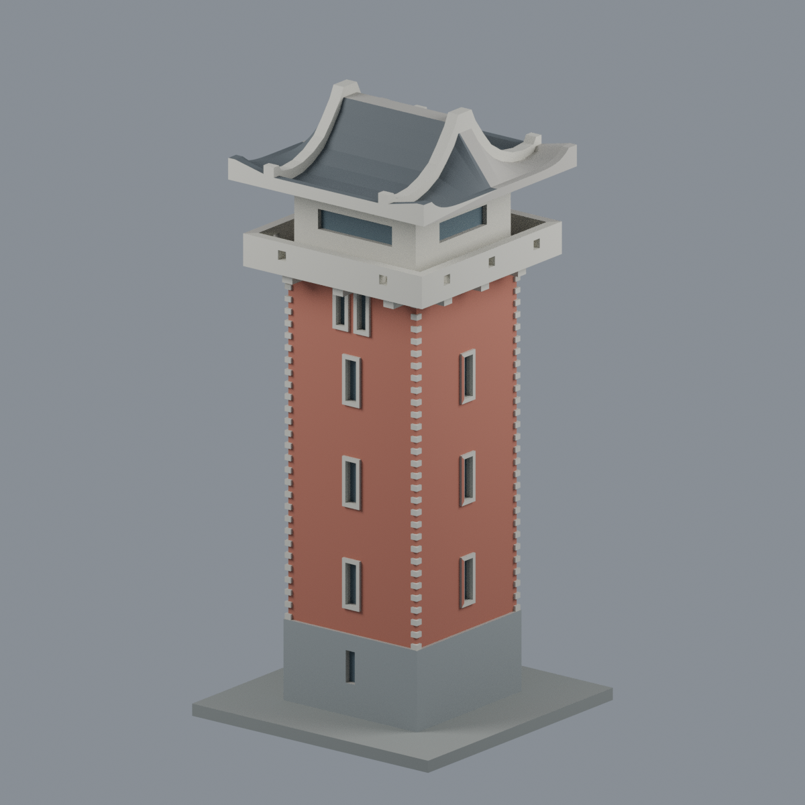
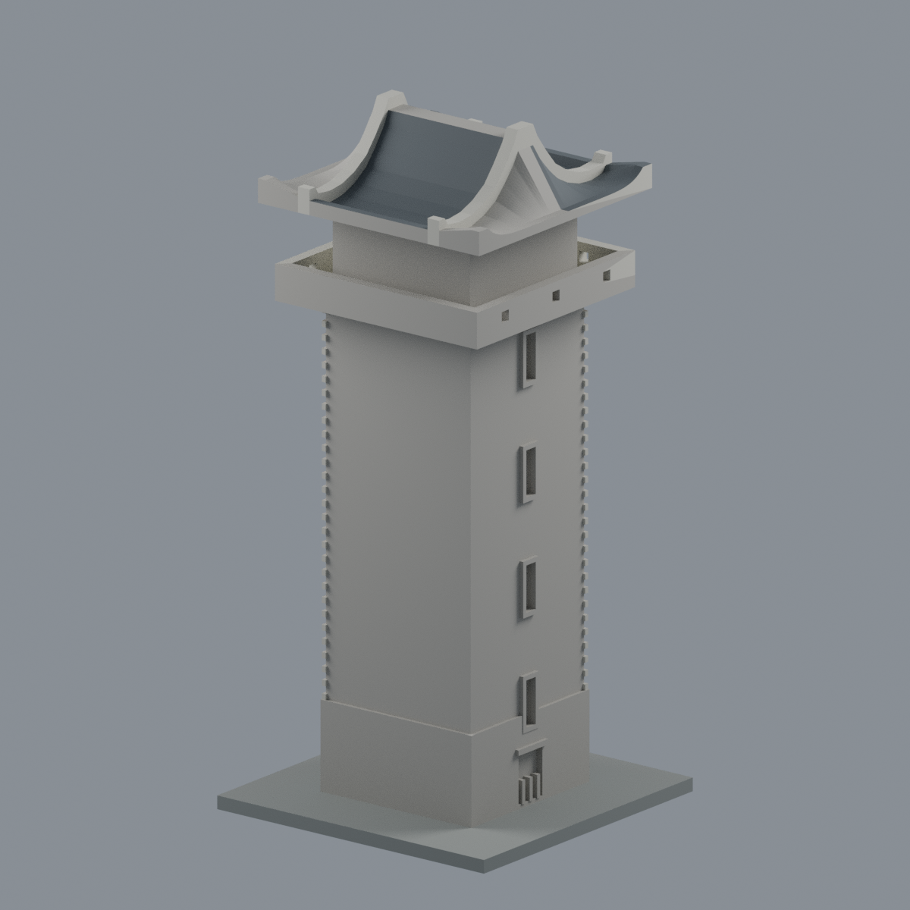
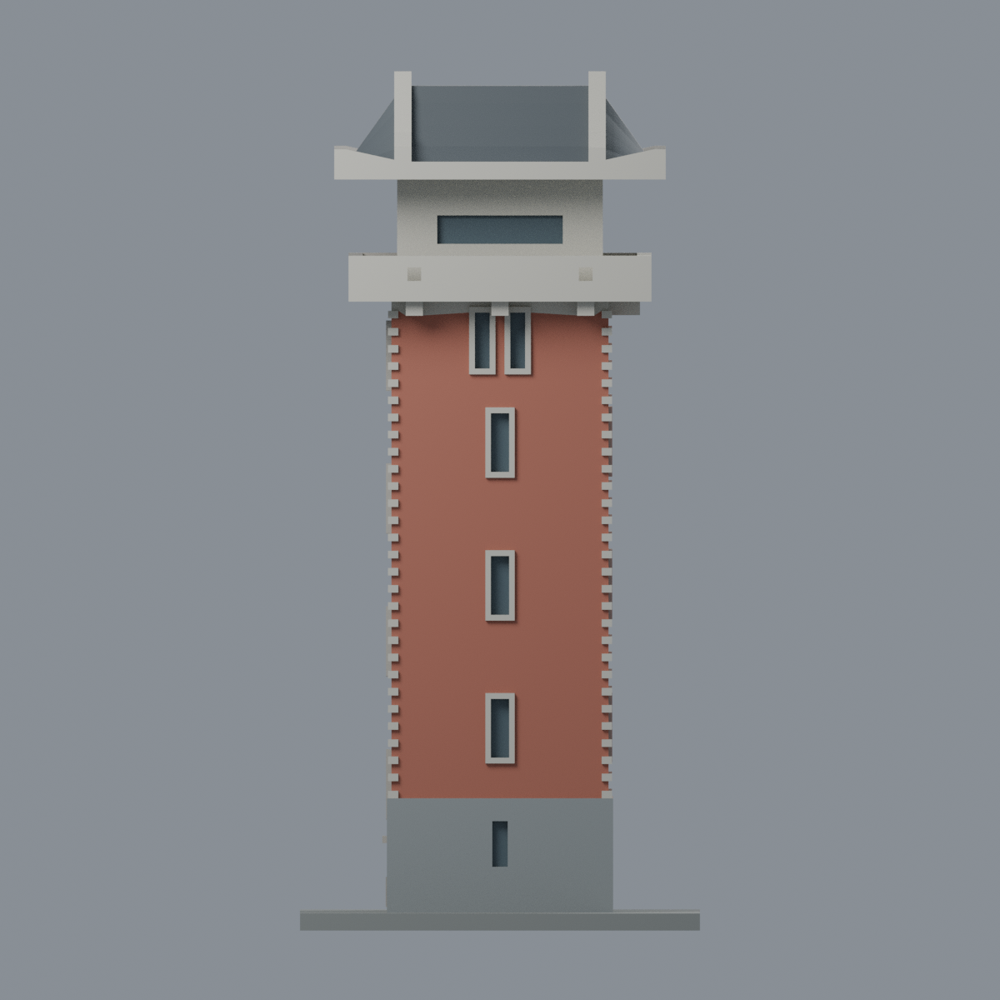
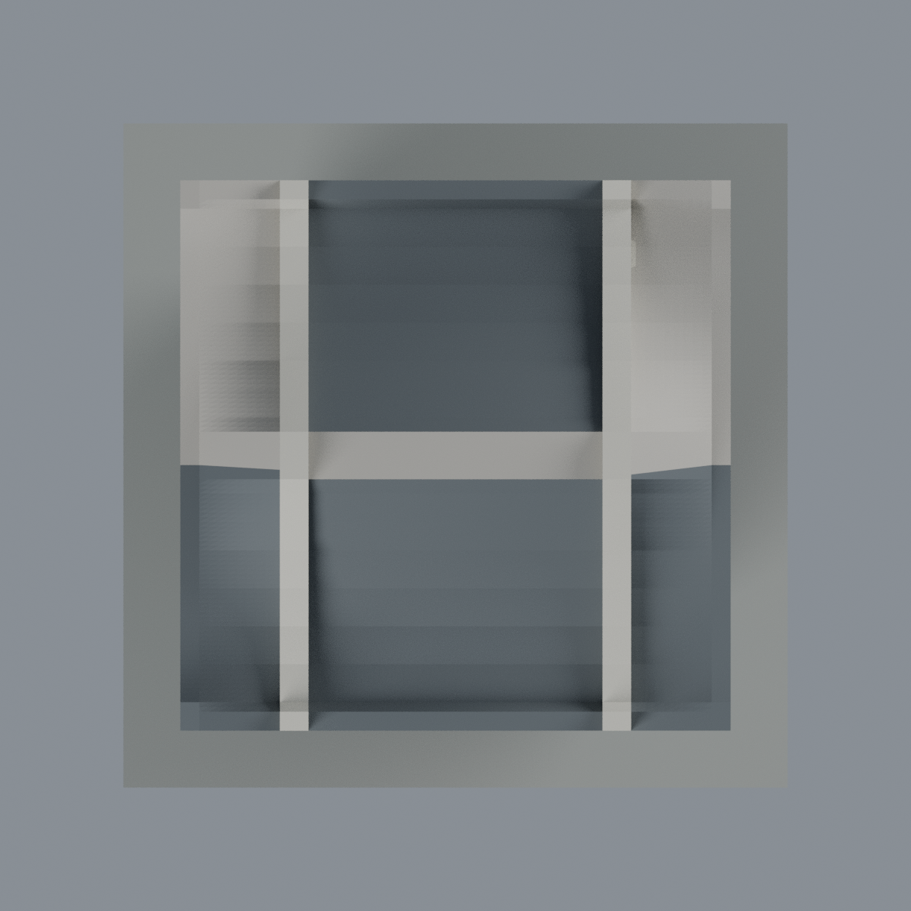

# 楊清廉圖資大樓銃樓段：七材質外觀版

| 模型預覽 | 模型預覽 | 模型預覽 |
| :---: | :---: | :---: |
| 正面  | 後坡限域延色，其餘背牆中性／同構山牆淡色延伸  |  |
|  |  |  |

## 本次中央後瓦坡同材質延續

僅將兩片已淡色曲線山牆間的中央後瓦坡 9 個完整原曲面分段矩形／18 個原中性三角延用既有炭灰瓦代理色 3。原 5,775 個已色面、全部理由與 7 槽色盤材料不變；其餘 9,014 面不變。原 9,032 面／4,502 點、STL bytes、座標、面序皆不變。

選區 x=−15.5…15.5 mm、後側 y=2.5…29 mm，以原屋頂 profile 高度減 2.5 的 9 段有限坡面逐段核對全部三頂點與向上法向。每段兩三角完整四頂點，面積合計 1,050.61314308 mm²；逐段與解析 31×hypot(Δy,Δz) 差小於 0.0002 mm²。兩山牆內界、屋脊 y=−2.5…2.5、側 hip、簷邊、底面、塔身混牆與窗全部排除；不切面、不改曲線、厚度或新增瓦紋。

本輪親看 JJP 建築師官方作品原照，前瓦炭灰與淡色曲線山牆可辨；後中央坡明示為同一屋頂瓦族延續推論，沒有獨立背面照片確證。原分段曲線及其他曲坡皆為原近似造型，非測繪或施工圖。攝影日期未確認；不是 2026 現況、量測色值或實體試印。照片留私人研究，不入公開包，亦未建立旁邊圖書館新模型。

新版 QA 在 `qa-continuous-walls/`，歷史 QA 與 checksum 留存；新校驗表用 `appearance/SHA256SUMS`、根 `PUBLIC-MODEL-SHA256SUMS`。歷史文件的後坡中性屬原版範圍，本節記錄新增 18 面。新版重建 `python appearance/source/build_continuous_walls.py`，交換驗證 `python appearance/source/verify_continuous_exchange.py`，Blender 背景執行 `render_continuous_walls.py` 與 `verify_continuous_scene.py`。ZIP 含原 STL、建模腳本與有限原坡域，不含照片。原製造限制完整保留。

場景僅同步更新 limitations 文字，將原後坡中性範圍改記為這 18 個中央後瓦坡原面的同瓦族延伸推論；其餘原屬性、材質定義與幾何不變。

## 前版說明與保留限制

沿用原 **9,032 三角面／4,502 頂點**，不改原 STL 位元、座標、面序或幾何；這是既有模型外觀改版，不增加模型包數。

[表面色 3MF](nqu-appearance.3mf) · [可編輯 Blender](scene.blend) · [材質色表](palette.json) · [逐面指派與依據](face-materials.json) · [原 STL](../model.stl)

## 來源與配色邊界

親自查看[JJP 潘冀聯合建築師事務所專案頁](https://www.jjpan.com/project/education/main-library-for-NQU)及[實景主照片](https://www.jjpan.com/static/file/9f8228540ce1c59e8aa8924b5fbb84b99ba1132d.webp)，登錄銃樓正面 y− 與右側 x+。精確拍攝時間未確認，專案完工年或頁尾版權年份不當作拍攝年；不宣稱 2026 現況。參考照片不隨模型或備份散布。

- 正面及右側既有塔身為陶紅磚色；原凸起轉角石與窄窗框留淡石色，不把石框整片染成紅磚，也不新增磚縫或砌法紋理。
- 可辨識的前／右石基座為灰色；只在原有窗凹格背面給深色玻璃代理，不把全部深色陰影當黑漆。
- 正面及右側陽台、頂室、原托座為淡石色。原小方凹格仍為幾何陰影，不加彩色標誌；招牌、徽章、天線與其他設備全部未新增。
- 前半片瓦坡為炭灰色，既有兩片凸起曲線山牆給淡石色；兩片同構山牆的淡色延續是限定構造推估，不代表各個隱蔽面都已拍到。後瓦坡保持中性，未新增瓦紋或細紅邊。
- 原 2024 新左側面幾何與歷史證據不變，但本次未重新逐區登錄該照片，因此左側窗及牆保留中性，不把前／右配色直接複製過去。未知背面也中性。
- 本件只含原銃樓段，不包括相連圖資館與大階梯。色值未校正，玻璃不透明；展示底板不代表現場地面。

[原完整來源](../sources.json) · [原幾何與年代界線](../README.md) · [本次來源覆核](qa/source-review.json)

## 重建與核驗

安裝 [依賴](source/requirements.txt)，Blender 使用 4.3.2。由本資料夾上層提供原 model.stl：

1. `python appearance/source/build_appearance.py`
2. `python appearance/source/verify_exchange.py`
3. `blender -b -t 3 --python-exit-code 1 -P appearance/source/render_appearance.py`
4. `blender -b -t 3 --python-exit-code 1 -P appearance/source/verify_scene.py`

[獨立重建 ZIP](rebuild-source.zip)含原 STL、四支程式及依賴，不含第三方照片；不取代原建模腳本。[逐檔 SHA256](SHA256SUMS)

[交換／拓撲 QA](qa/exchange-validation.json)核對原座標與面序、全部面材質、單連通、有向水密邊、頂點 link 單環、正體積與零退化／重複面；lib3mf 嚴格讀取零警告，實際編輯單材質再存讀，其他材質及面指派不變。SDK 六位小數量化誤差另列。

[Blender 存讀與編輯](qa/scene-validation.json) · [渲染記錄](qa/render-manifest.json) · [獨立重建](qa/rebuild-validation.json)

## 製造限制照舊

尺寸仍為 70 × 70 × 150 mm；原 STL、建模程式、場景及歷史 QA 保留。原層檢與薄特徵檢查本次未重跑，不能由材質 QA 代替。

3MF 是同一網格的表面色，不是七個封閉分色實體、切片專案、噴頭映射或 G-code。切片 GUI、多材料路徑與實體列印未測；曲線挑簷、陽台凹槽、窗框及凸角石仍須評估材料、支撐及拆除風險，沒有保證可印或免支撐。
