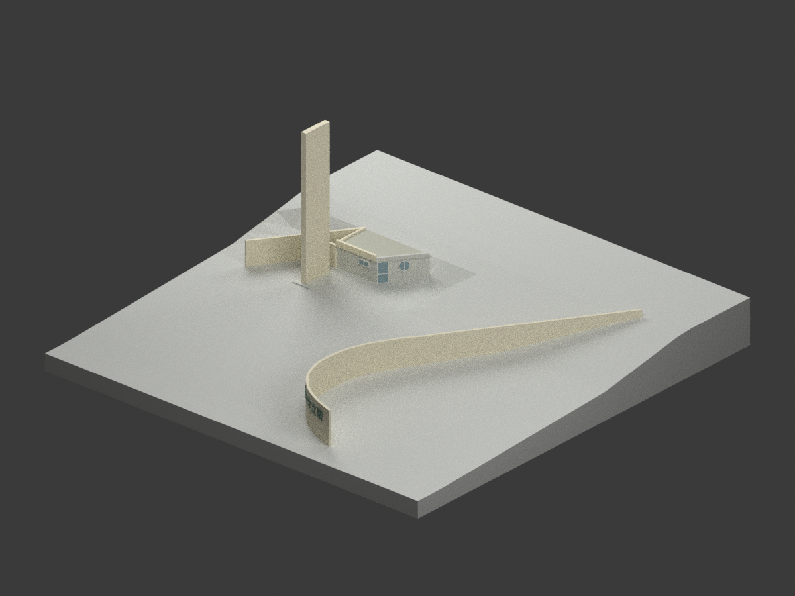
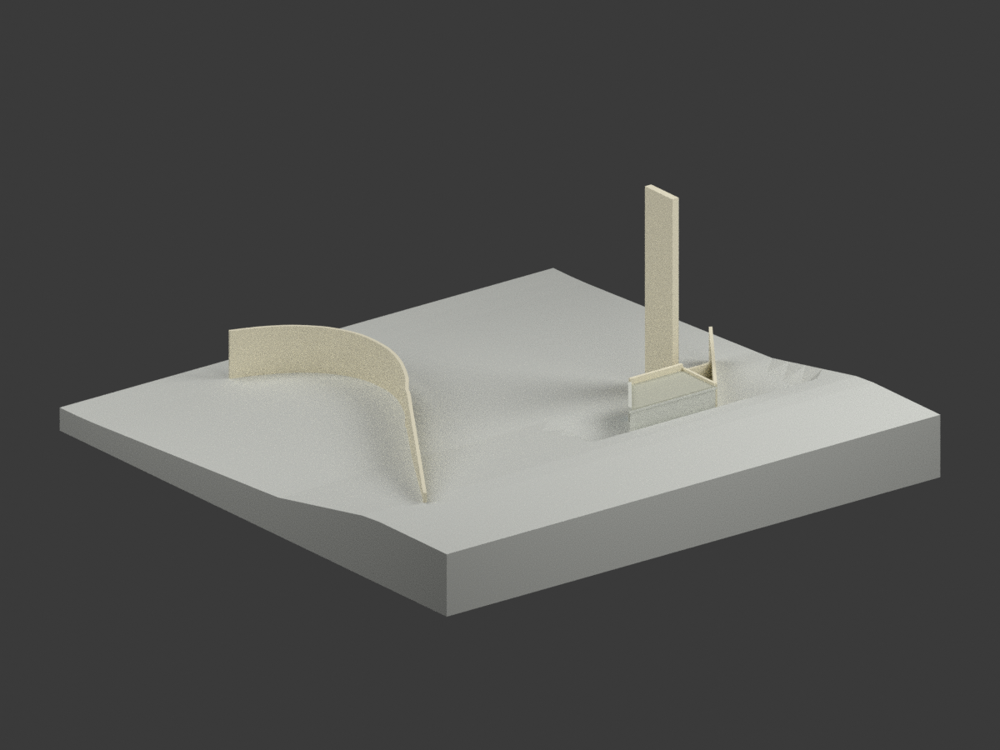
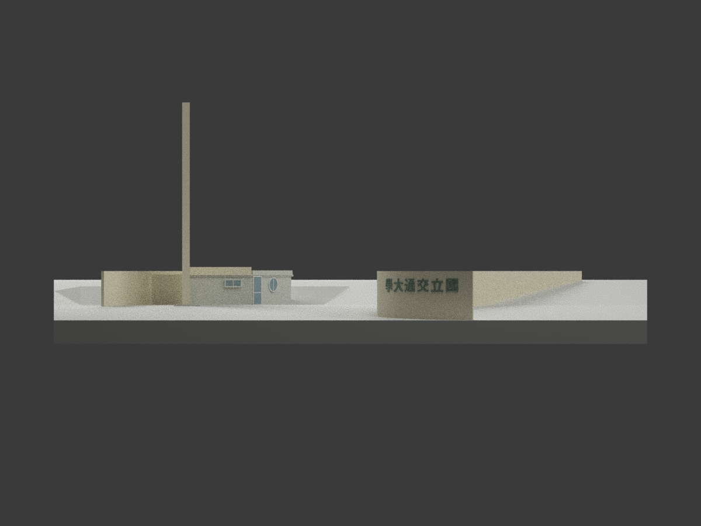
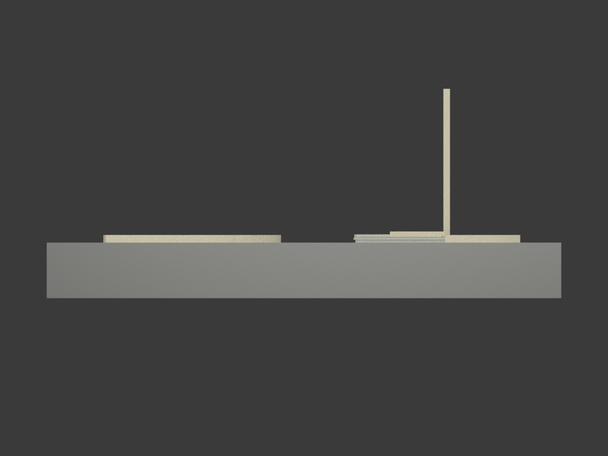
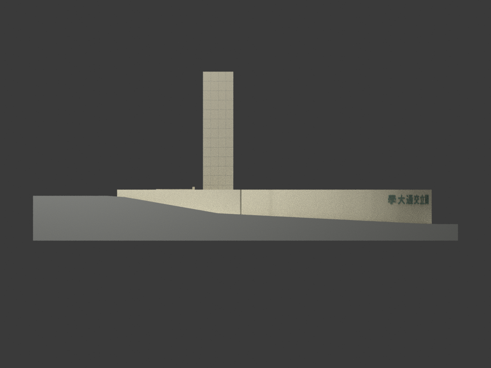
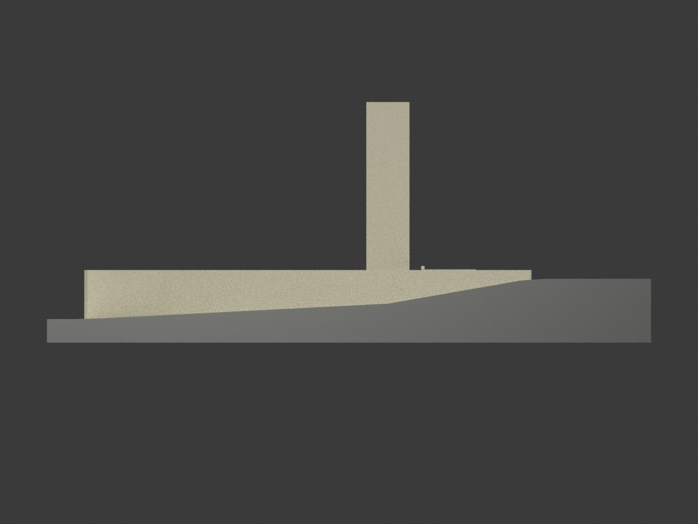
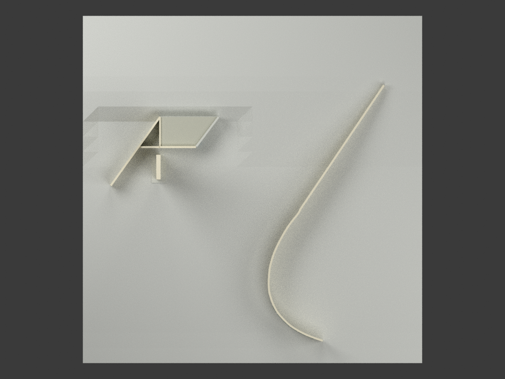
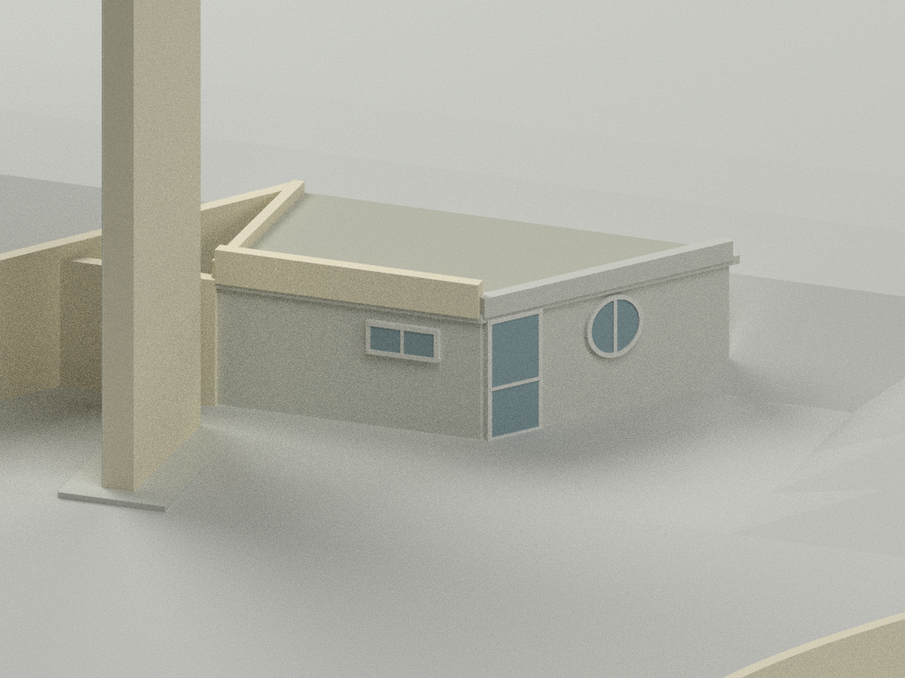
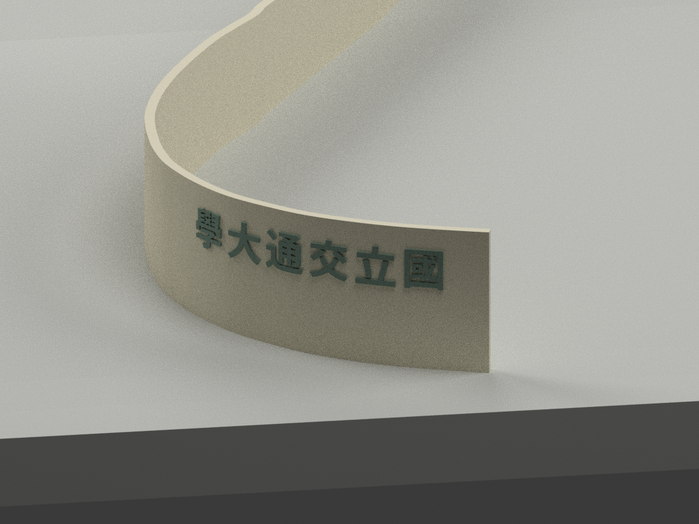
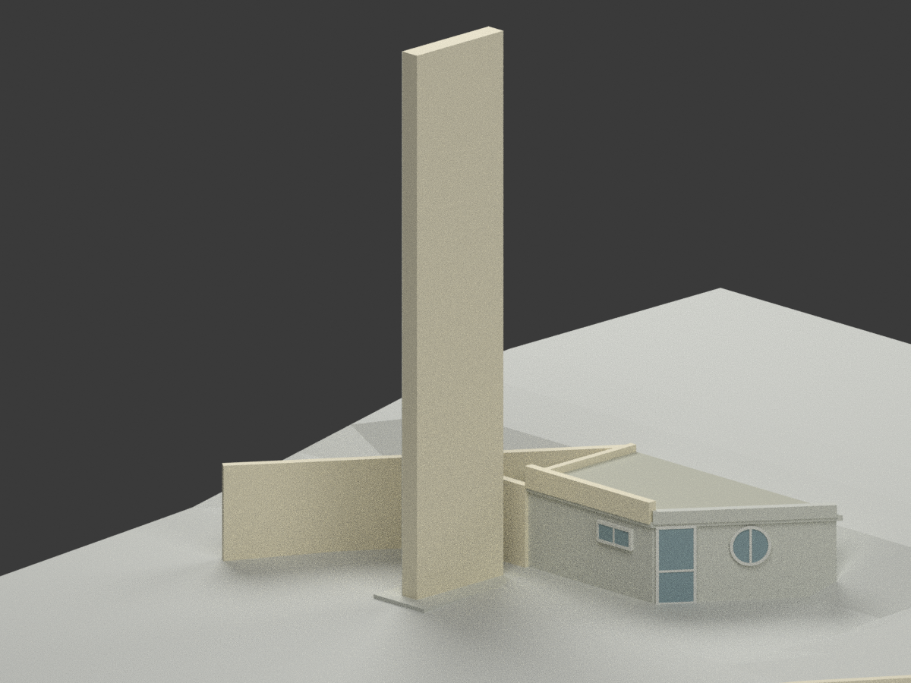

# 交通大學光復校區北大門與守衛室｜未定年原設計

## 模型圖集

| 透視 | 背面 | 南向 |
|---|---|---|
|  |  |  |
| 北向 | 西向 | 東向 |
|  |  |  |
| 俯視 | 守衛室細節 | 曲牆字樣 |
|  |  |  |
| 塔柱細節 | | |
|  | | |

## 範圍與交付

依陳其寛／陳其寬建築師事務所（C. K. CHEN & ASSOCIATES）原設計圖重建；設計日期未確認。這是歷史設計解讀，**不是現況掃描、竣工實測或可施工圖**。官方歷史照片僅核對建築身分，照片所見而原圖沒有的校徽未混入。保留原「國立交通大學」字樣，不換成現校名。

提供 STL、含基本材質的 3MF、Blender 場景、10 張實際模型渲染及可重建程式。比例 **1:200**，檔案座標單位 mm；展示底座約 220 × 225 mm，含底座高度 89.5 mm。地形底座為作者添加的粗略高程插值，不是測量地形。

## 原圖控制與不能消除的差異

- 塔柱高 15.00 m 是從 EL+2.40 m 起算，頂端 EL+17.40 m；平面長 3.20 m。厚 0.55 m 是依 A2 圖量估計，非明示尺寸。
- 守衛室以 226+444+90=760 cm、深390 cm、前參考465 cm及西側280 cm定位。原圖67°／23°標註與這些線性尺寸及圖形不符，模型採線性尺寸，**未宣稱角度吻合**。
- 屋頂按剖面分別為結構板下EL450／上EL465、側女兒牆EL495、前女兒牆EL520；「415／485」是先期誤讀，已校正。明示後側表面EL475與「覆土25cm」文字存在15cm差異；模型採EL475外表面（即10cm覆蓋），不宣稱重建了25cm構造層，也不任意加斜屋頂消除矛盾。
- 曲牆採 A3 100cm格網逐點數位化後平滑，不是猜測圓弧。以多條標號格線回歸校準兩軸，格線殘差只反映圖面擬合，不是建物實際精度保證。曲直接點依1700格線附近尺寸引線圖量定位，再接明示1930cm直段（先期1920為誤讀）。A3直線65°與A1配置56°未完全協調，65.75°另屬格線參照角、不是同一基準；本版以校準後末段切線旋轉對齊A1配置方向，保留矛盾，並非證明兩圖完全相符。末端以不超過3cm的圖量平滑量接至直線，非原CAD精確曲率。A1相對定位亦為圖量估計。牆厚25cm、頂EL490；以EL125至425的地面控制呈現變化露出高度。
- 門窗尺寸按A3；外窗採不透明背板、簡化框格，室內封閉，內門與管線不重建。金門花崗石、義大利黃色大理石為原圖材質名稱，顏色僅近似。
- 字樣用 Noto Sans CJK Bold 替代而非原字形描摹，高度按3尺3寸作約1.00m解讀；原厚2寸3分約0.07m，模型加厚為0.12m；浮雕與細框為可讀性簡化。接縫並非精確石材放樣。

## 品質與列印限制

本包附幾何、格式、重建、場景重新開啟及獨立來源／視覺審核紀錄。閉合單一連通體不等於所有印表機都可直接列印。1:200牆厚1.25mm、塔厚約2.75mm；字樣與細框可能低於FDM可靠細節尺度，需自行切片檢查、支撐及必要放大。**未實際列印，未作結構工程驗證。**

## 來源與權利分離

- [國立臺灣博物館 A1，CCCK27823004：配置與立面](https://collections.culture.tw/docomomo_collectionsweb/Collection?GID=MQMAMAMXMD)
- [A2，CCCK27823005：守衛室平剖面](https://collections.culture.tw/docomomo_collectionsweb/Collection?GID=MPMAMAMXMD)
- [A3，CCCK27823006：曲牆、塔柱、門窗](https://collections.culture.tw/docomomo_collectionsweb/Collection?GID=MKMAMAMXMD)
- [陽明交大校史典藏：北門歷史照片](https://nctuhistory.lib.nycu.edu.tw/list_detail.aspx?cultID=8742&sorting_field=1&url=2)

博物館來源影像標示CC BY-NC；原圖、裁圖與照片僅私人參考，未包含在公開包。模型、程式、渲染與第三方原圖不是同一權利客體；本說明既不把來源NC條款一概套用到所有新檔，也不保證建築、字形或其他第三方權利可無限制商用。使用者須依用途自行確認。Noto字型採SIL OFL；本包只含製作的字形網格，不附字型檔。

## 重建

Python依賴見 `requirements.txt`，Blender 4.3.2。執行：

```sh
python build_model.py
python export_3mf.py
python validate_model.py
blender -b --python render_model.py
blender -b --python verify_scene.py
```

`letter_meshes.npz` 是可重用的中間字形網格；可選 `blender -b --python build_letters.py` 以系統Noto字型重產。曲線取點與材質由JSON及程式保留，無需私人原圖即可重建此解讀版本。
