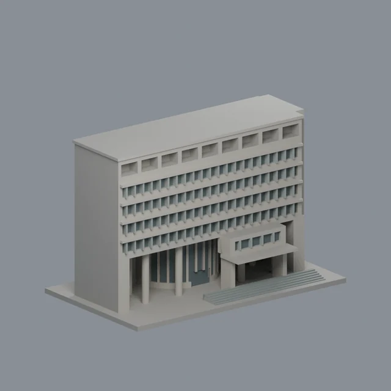
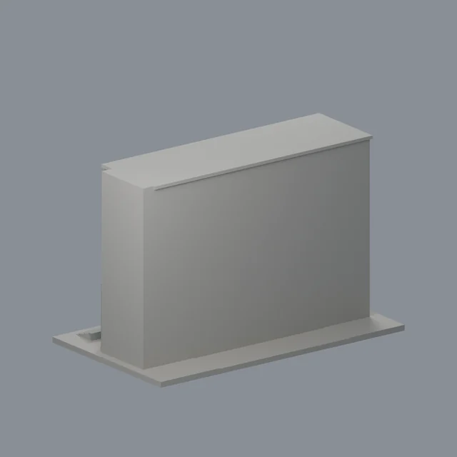
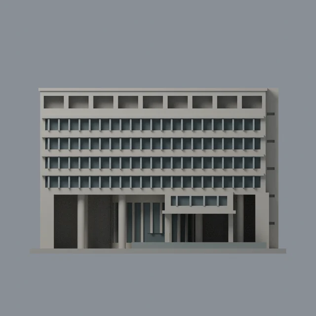
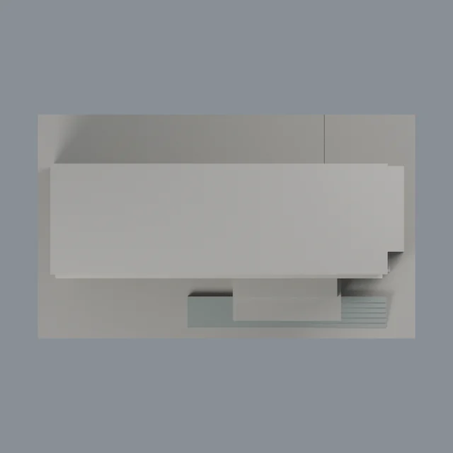

# 陽明交大浩然圖書資訊中心・廣場立面段｜現行模型 WebP 預覽

四張均以現行五材質模型重渲染核對，不使用舊單色圖。表格用同視角 WebP 縮圖，點圖可開啟無損原尺寸 WebP。

| 模型預覽 | 模型預覽 |
| :---: | :---: |
|  正面與廣場立面 |  截段背面（中性） |
|  正立面 |  頂視 |

[模型說明](../README.md) · [五材質與來源界線](../appearance/README.md) · [表面色 3MF](../appearance/nycuhaoran-appearance.3mf) · [可編輯 Blender](../appearance/scene.blend) · [原 STL](../model.stl) · [展示校驗](SHA256SUMS) · [模型與渲染對照](render-proof.json)

原始渲染 PNG、工程模型、來源覆核與重建記錄保留。本版不新增配色或幾何，不是現況色彩測量或試印。[調整前模型說明](https://github.com/hplin50643/taiwan-buildings-3d/blob/f05a9dcad16883835017b0056b3d0267d73db073/%E5%9C%8B%E7%AB%8B%E9%99%BD%E6%98%8E%E4%BA%A4%E9%80%9A%E5%A4%A7%E5%AD%B8/%E5%85%89%E5%BE%A9%E6%A0%A1%E5%8D%80/buildings/nycu-haoran-library-front/README.md) · [調整前外觀說明](https://github.com/hplin50643/taiwan-buildings-3d/blob/f05a9dcad16883835017b0056b3d0267d73db073/%E5%9C%8B%E7%AB%8B%E9%99%BD%E6%98%8E%E4%BA%A4%E9%80%9A%E5%A4%A7%E5%AD%B8/%E5%85%89%E5%BE%A9%E6%A0%A1%E5%8D%80/buildings/nycu-haoran-library-front/appearance/README.md)
