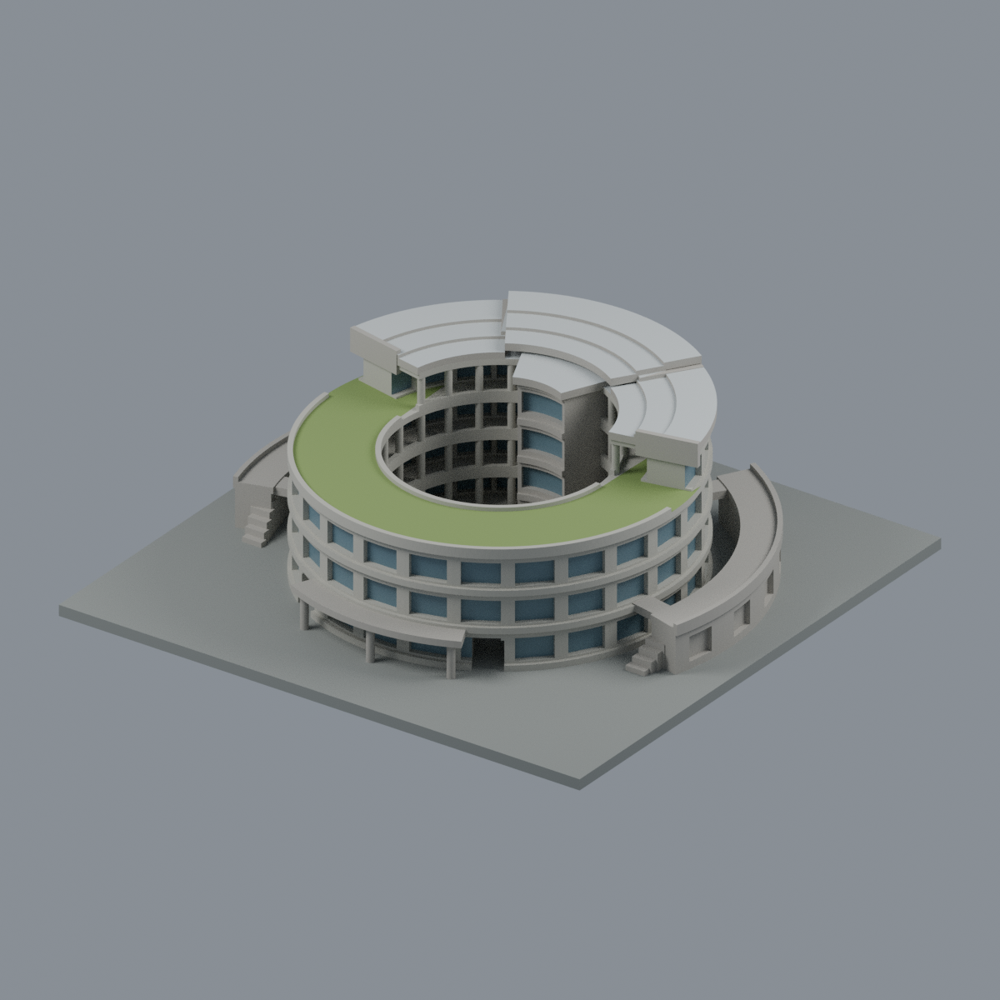
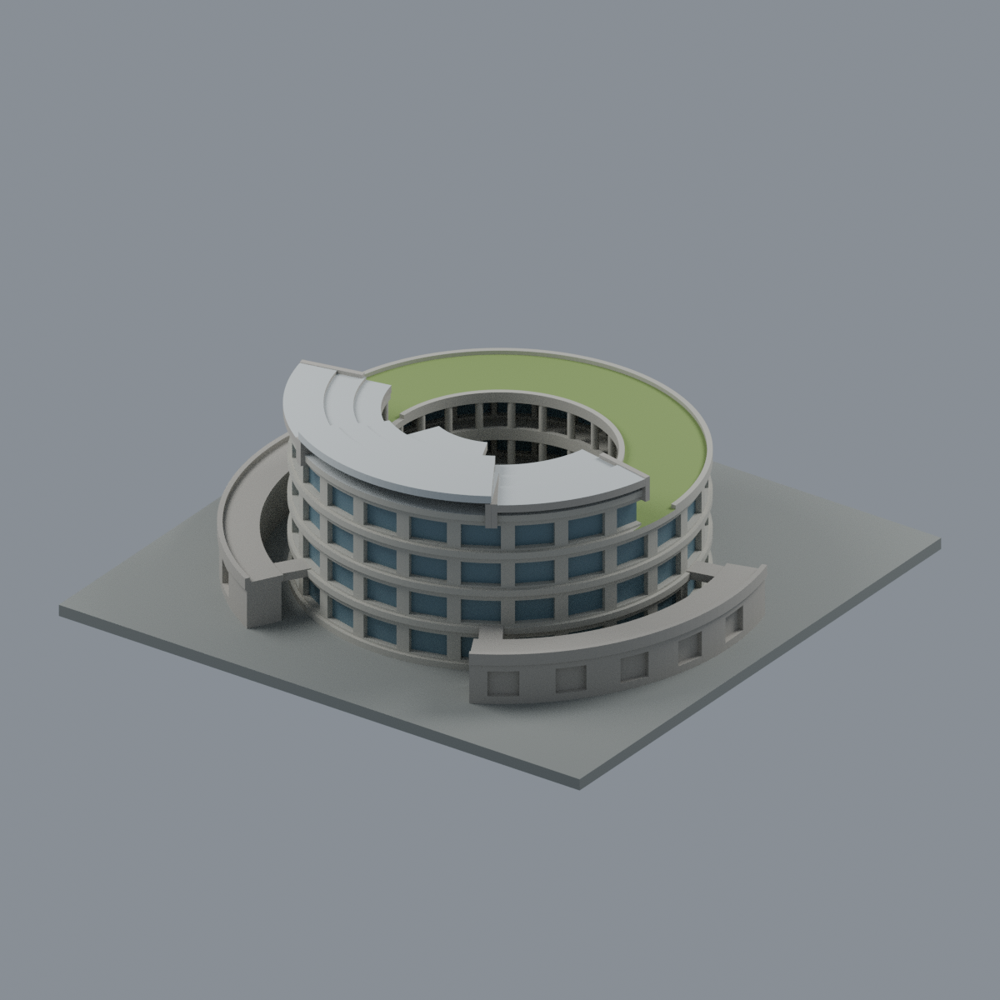

# 客家文化學院圓樓

## 模型預覽

| 模型預覽 | 模型預覽 | 模型預覽 |
| :---: | :---: | :---: |
| 正面原幾何配色  | 後側與高扇形屋頂  |  |

## 本次最高中央扇形屋頂外弧緣同銀灰延伸（推估）

將既有最高中央扇形屋頂外弧緣的 33 個原完整矩形／66 個原三角延續銀灰材 2。原 29,603 個著色面與所有未變更面理由保留，其餘 35,018 面不變；原 35,084 面／17,374 點、六色表、STL 位元、座標及面序不變。現中性 5,415、混凝土框 27,422、銀灰扇頂 826、灰藍玻璃代理 468、前露臺草坪代理 313、底座 640。

範圍為原半徑 51 mm、角度 57…123°、z=48.4…50.4 mm 的最高中央扇外緣，以每 2° 的有限弦平面、朝外法向及三頂點全包含選取。每組恰為 2 原三角／4 頂點，面積約 3.560291 mm²；沒有按半徑或面中心粗選。中央原支柱最高 z=48.2 mm，低於這段外緣，不含柱交接。較低左右扇、內弧、徑向端、頂底、牆體與窗全部不變，不切面或新增面。

本輪親看陽交官方空拍，後部階梯式扇形屋頂呈銀灰；外緣同色為有界同屋面族推估，非精確邊緣材質／厚度量測。**原模型用三段加厚 2 mm 的階梯環近似真實徑向坡屋頂**，本次不重建薄金屬邊或排水構造，不把灰色推稱已驗證特定金屬成分。照片日期未獨立核實，不宣稱 2026 現況或實體試印；照片僅私人研究，不入公開包。

新版 QA 位於 `appearance/qa-continuous-walls/`，歷史 QA 與根 `SHA256SUMS.txt` 原樣留存；根舊清單中的 README 雜湊屬歷史版本，現行完整校驗以 `PUBLIC-MODEL-SHA256SUMS` 為準。重建外觀 `python appearance/source/build_continuous_walls.py`；交換驗證 `python appearance/source/verify_continuous_exchange.py`；渲染 `blender -b --python appearance/source/render_continuous_walls.py`；場景驗證 `blender -b --python appearance/source/verify_continuous_scene.py`。ZIP 包含原 STL、原建模程式及有限弦域，不含照片；驗證不代表重算歷史製造檢核。

## 前版說明與保留限制

國立陽明交通大學｜六家校區。完整主圓樓及相連外圈低翼之外觀近似；非測繪，鄰近古厝與永昌宮不包含。

## 最新六材質外觀版（2026-10-20）

[來源界線與四視角](appearance/README.md) · [表面色 3MF](appearance/hakka-appearance.3mf) · [可編輯場景](appearance/scene.blend)

依官方內院與空拍照片登錄後扇形屋頂、主環凹窗和前露臺草坪代理；不假造草地與步道精細邊界，外圈低翼混合面中性。原STL與歷史QA不變，不是新增幾何。原單色正面（歷史檔案留存，不作本頁預覽）／原單色背面（歷史檔案留存，不作本頁預覽）

俯視（歷史檔案留存，不作本頁預覽） · [STL](model.stl) · [可編輯 Blender 網格](scene.blend) · [參數重建](build_model.py)

## 範圍與來源

- 開放環形中庭與各層真實凹入走廊
- 前低環3層與後高環4層，中央扇屋頂抬高
- 後方突出會議／攝影棚空間、錯高扇形棚頂
- 外圈分離低翼、短連橋、側階梯與前入口棚

- 外圈低翼背面個別門窗未逐扇調查，已簡化
- 屋頂扇形分段與坡度為實拍視覺估計，未重建精確鋼構
- 空調、細欄杆、植栽、地下空間及校外古蹟不包含

[來源與支持特徵](sources.json) 包含精確公開 URL、查閱日及照片年代不確定性。第三方原照片／PDF不隨本模型散布。這是自建的外觀近似，非測繪、非精密尺寸資料。色彩僅為網格預覽材質。

## 列印與比例

- 單位：毫米；含底座尺寸 150.00 × 147.00 × 50.40 mm，最大邊150 mm，各館獨立比例。
- 底座朝下；不要用切片軟體自動修補來掩蓋幾何問題。請自行檢查工具路徑與首層。
- 深挑空、走廊、棚頂及窗洞上緣可能需要局部支撐。細柱、窗框與低欄牆已為縮印加粗；搬運與拆支撐仍需小心。
- 0.2 mm輪廓檢查採固定 z=0.071 mm 起始以避開共面退化，本件共 252 層全部degree 2閉合、個別及組合Polygon有效，無修補輸入輪廓。
- canonical thin v2以1 mm層距、0.8 mm參考寬度形態opening作輔助篩檢，最大面積損失 0.142%。此數值不是全面最小壁厚或噴嘴可印保證。
- 數位QA不等於Cura／Prusa真實工具路徑，未做實體試印，不宣稱免支撐或保證可印。

## 重建與验证

Python 3.12，先依 [requirements.txt](requirements.txt) 安裝套件，另需Blender 4.3.2或相容版本。

依序執行 python build_model.py、blender -b -t 2 -P render_preview.py、python validate_model.py、python check_layers.py、python check_valid_sections.py、python thin_canonical_v2.py。建模階段將CSG輸出在float32精度下正規化；驗證直接讀原始交付STL，不作修復。

- [原STL、重建SHA及Blend對比](validation.json)
- [0.2 mm閉合輪廓](layer-check.json) · [有效Polygon](valid-sections.json)
- [thin v2報告](thin-feature-check.json) · [QA合併摘要](qa-summary.json)
- [逐檔SHA256](SHA256SUMS.txt)

scene.blend由實際交付STL匯入，內含可編輯三角網格；完整參數來源是build_model.py。預覽亦由同一STL生成。
