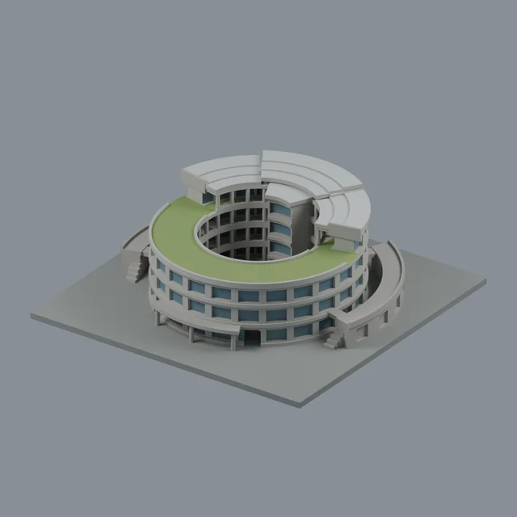
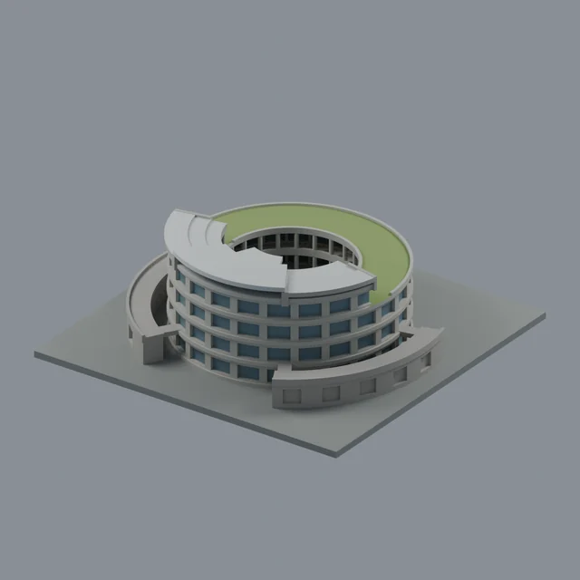
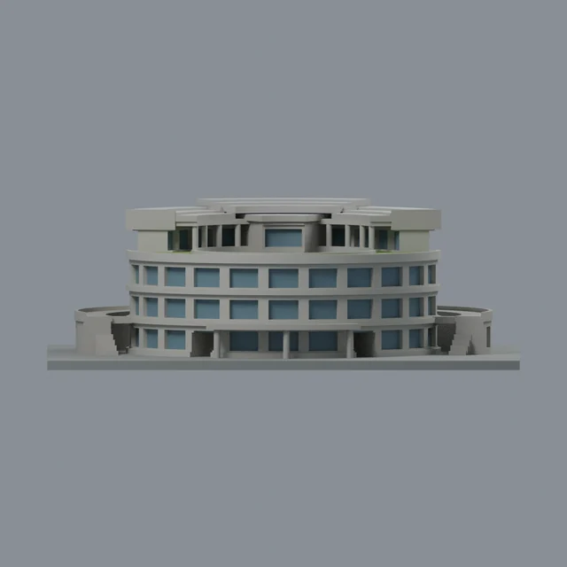
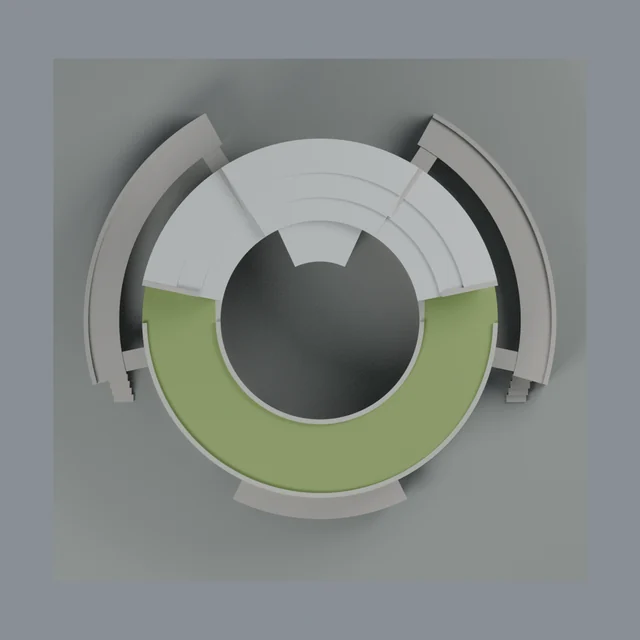

# 客家學院圓樓：六材質外觀版

沿用原 **35,084 三角面／17,374 頂點**，不改原 STL 位元、座標、面序或幾何；這是既有模型外觀改版，不增加模型包數。

| 模型預覽 | 模型預覽 |
| :---: | :---: |
|  正面 |  後側與高扇形屋頂 |
|  正立面 |  頂視 |

## 本次最高中央扇形屋頂外弧緣同銀灰延伸（推估）

將既有最高中央扇形屋頂外弧緣的 33 個原完整矩形／66 個原三角延續銀灰材 2。原 29,603 個著色面與所有未變更面理由保留，其餘 35,018 面不變；原 35,084 面／17,374 點、六色表、STL 位元、座標及面序不變。現中性 5,415、混凝土框 27,422、銀灰扇頂 826、灰藍玻璃代理 468、前露臺草坪代理 313、底座 640。

範圍為原半徑 51 mm、角度 57…123°、z=48.4…50.4 mm 的最高中央扇外緣，以每 2° 的有限弦平面、朝外法向及三頂點全包含選取。每組恰為 2 原三角／4 頂點，面積約 3.560291 mm²；沒有按半徑或面中心粗選。中央原支柱最高 z=48.2 mm，低於這段外緣，不含柱交接。較低左右扇、內弧、徑向端、頂底、牆體與窗全部不變，不切面或新增面。

本輪親看陽交官方空拍，後部階梯式扇形屋頂呈銀灰；外緣同色為有界同屋面族推估，非精確邊緣材質／厚度量測。**原模型用三段加厚 2 mm 的階梯環近似真實徑向坡屋頂**，本次不重建薄金屬邊或排水構造，不把灰色推稱已驗證特定金屬成分。照片日期未獨立核實，不宣稱 2026 現況或實體試印；照片僅私人研究，不入公開包。

新版 QA 位於 `qa-continuous-walls/`，歷史 QA 與根 `SHA256SUMS.txt` 原樣留存；根舊清單中的 README 雜湊屬歷史版本，現行完整校驗以 `PUBLIC-MODEL-SHA256SUMS` 為準。重建外觀 `python appearance/source/build_continuous_walls.py`；交換驗證 `python appearance/source/verify_continuous_exchange.py`；渲染 `blender -b --python appearance/source/render_continuous_walls.py`；場景驗證 `blender -b --python appearance/source/verify_continuous_scene.py`。ZIP 包含原 STL、原建模程式及有限弦域，不含照片；驗證不代表重算歷史製造檢核。

## 前版說明與保留限制

[表面色 3MF](hakka-appearance.3mf) · [可編輯 Blender](scene.blend) · [材質色表](palette.json) · [逐面指派與依據](face-materials.json) · [原 STL](../model.stl)

## 來源與配色邊界

親自查看[陽明交大官方校園景色頁](https://www.nycu.edu.tw/nycu/ch/app/artwebsite/view?id=314&module=artwebsite&serno=a78dc404-e439-4dd8-80fc-68f946a5d222)的[客家學院內院照片](https://www.nycu.edu.tw/userfiles/nycuch/images/20230920124555631.jpg)與[客家學院圓樓空拍](https://www.nycu.edu.tw/userfiles/nycuch/images/20230920124608504.jpg)。檔名數字與頁尾版權年份不是拍攝日期；精確拍攝時刻未確認，不宣稱 2026 現況。來源影像不隨模型或備份散布。

- 依空拍登錄高後扇形屋頂、較低前半圓露臺與中央向內突出會議鼓室；只給原有扇形屋頂上表面銀灰色，未新增屋縫、設備或太陽能板。
- 前露臺草坪色僅限既有女兒牆之間的頂面；牆頂、立面和展示底板不染綠。**原三角形跨越草坪與窄步道，草坪色是整片露臺的粗略代理，不聲稱精確草地／鋪面邊界**。不細分原網格，也不追造紅橘步道。
- 外側低翼頂面的原三角形橫跨草地與鋪面，無法在原面級精度內可靠分離，故**整個低翼頂面保持中性**，不為了綠屋頂效果整片染綠。中央庭院地坪與周邊草地亦未新增。
- 原實際徑向凹窗的背面給低飽和藍灰玻璃代理，包括可辨識的中央鼓室內向凹窗；並非把整個環形牆帶都當玻璃。窗數、層數與曲率仍沿用原簡化模型，不代表測量。
- 環形梁板、柱與主環牆體採混凝土近似色；可見內院材料延續至原重複環形構件屬明示的重複構造推估，不宣稱每一面都有照片。未分離的木色面板、欄杆細線及隱蔽區域不新增細節。
- 色值未校正，不能當建材色票；玻璃為不透明展示代理，非透明材質或採光模擬。沒有新增文字、招牌、植栽、設備與精細紋理。

[原完整來源](../sources.json) · [原幾何與年代界線](../README.md) · [本次來源覆核](qa/source-review.json)

## 重建與核驗

安裝 [依賴](source/requirements.txt)，Blender 使用 4.3.2。由本資料夾上層提供原 model.stl：

1. `python appearance/source/build_appearance.py`
2. `python appearance/source/verify_exchange.py`
3. `blender -b -t 3 --python-exit-code 1 -P appearance/source/render_appearance.py`
4. `blender -b -t 3 --python-exit-code 1 -P appearance/source/verify_scene.py`

[獨立重建 ZIP](rebuild-source.zip)含原 STL、四支程式及依賴，不含第三方照片；不取代原建模腳本。[逐檔 SHA256](SHA256SUMS)

[交換／拓撲 QA](qa/exchange-validation.json)核對原座標與面序、全部面材質、單連通、有向水密邊、頂點 link 單環、正體積與零退化／重複面；lib3mf 嚴格讀取零警告，實際編輯單材質再存讀，其他材質及面指派不變。SDK 六位小數量化誤差另列。

[Blender 存讀與編輯](qa/scene-validation.json) · [渲染記錄](qa/render-manifest.json) · [獨立重建](qa/rebuild-validation.json)

## 製造限制照舊

尺寸仍為 150 × 147 × 50.4 mm；原 STL、建模程式、場景及歷史 QA 保留。原層檢與薄特徵檢查本次未重跑，不能由材質 QA 代替。

3MF 是同一網格的表面色，不是六個封閉分色實體、切片專案、噴頭映射或 G-code。切片 GUI、多材料路徑與實體列印未測；環形露臺、內院欄板、扇形挑簷及細柱仍須評估材料、支撐及拆除風險，沒有保證可印或免支撐。

[現行展示圖與渲染校驗](../display/README.md) · [原工程檔與舊校驗對應版本](https://github.com/hplin50643/taiwan-buildings-3d/blob/bc7eea1c1741b4d8065711b9fac2c1e82a2d646a/%E5%9C%8B%E7%AB%8B%E9%99%BD%E6%98%8E%E4%BA%A4%E9%80%9A%E5%A4%A7%E5%AD%B8/%E5%85%AD%E5%AE%B6%E6%A0%A1%E5%8D%80/buildings/nycu-hakka-round-building/appearance/README.md)
