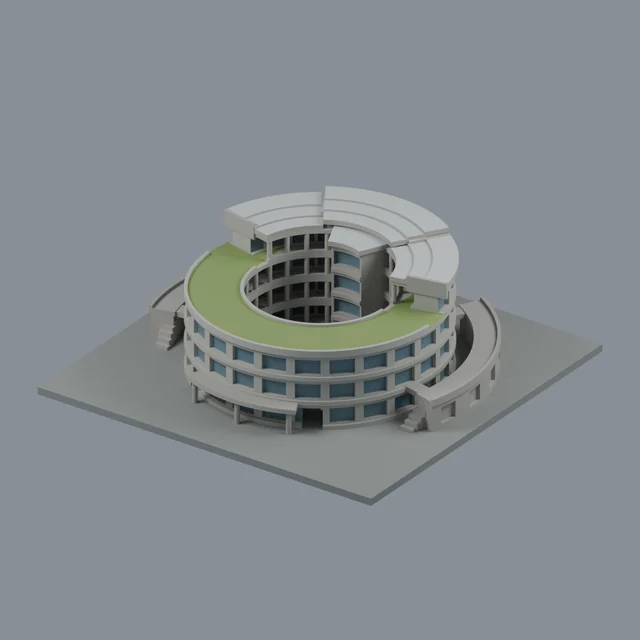
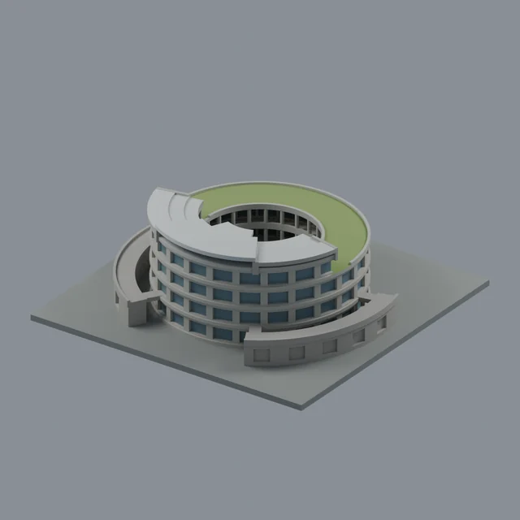
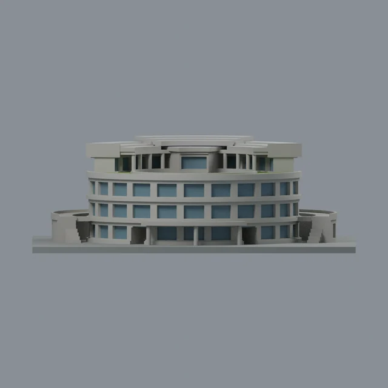
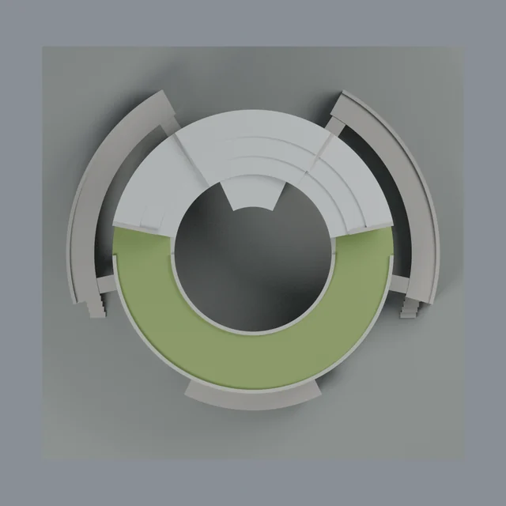

# 客家文化學院圓樓｜現行模型 WebP 預覽

四圖皆以現行六材質模型重新渲染核對，不使用舊單色版。點圖可開啟無損原尺寸 WebP。

| 模型預覽 | 模型預覽 | 模型預覽 |
| :---: | :---: | :---: |
|  正面 |  後側與高扇形屋頂 |  正立面 |
|  頂視 |  |  |

[模型說明](../README.md) · [六材質與來源界線](../appearance/README.md) · [表面色 3MF](../appearance/hakka-appearance.3mf) · [可編輯 Blender](../appearance/scene.blend) · [原 STL](../model.stl) · [展示校驗](SHA256SUMS) · [渲染對照](render-proof.json)

只更新展示，原始 PNG、幾何、色材、歷史版本與工程 QA 都保留。中央高扇屋頂弧緣為既有銀灰推估；未驗證的低翼細部、精確材料及實體試印不在本次更新範圍。
