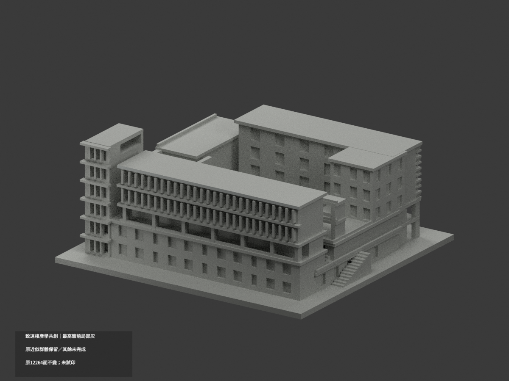
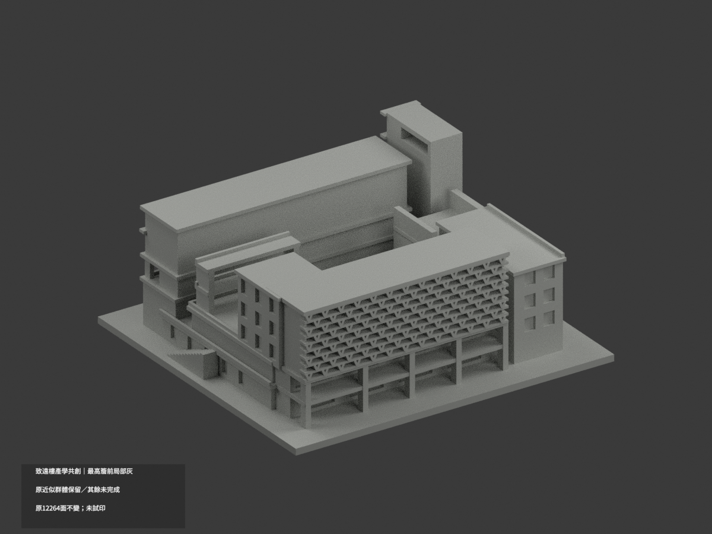
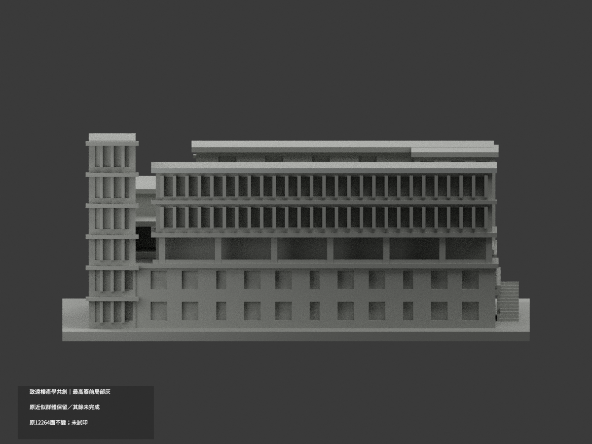
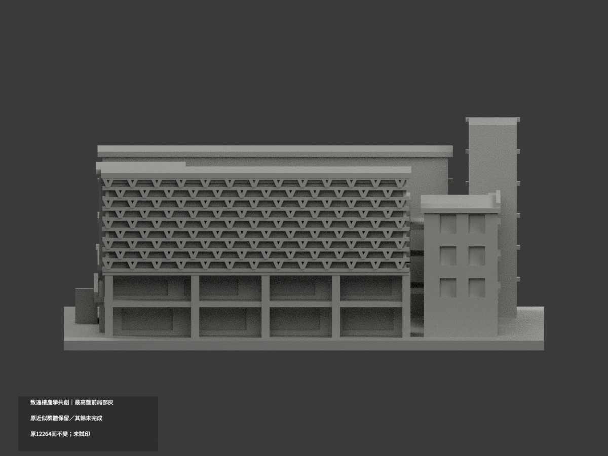
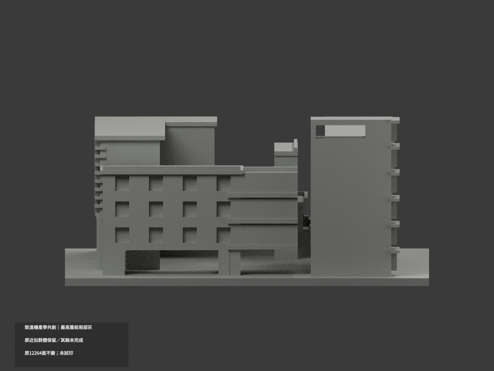
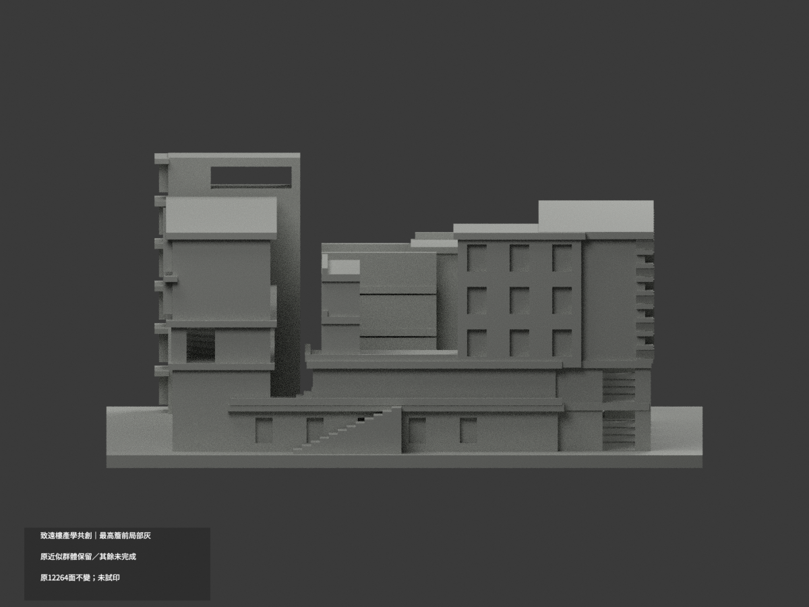
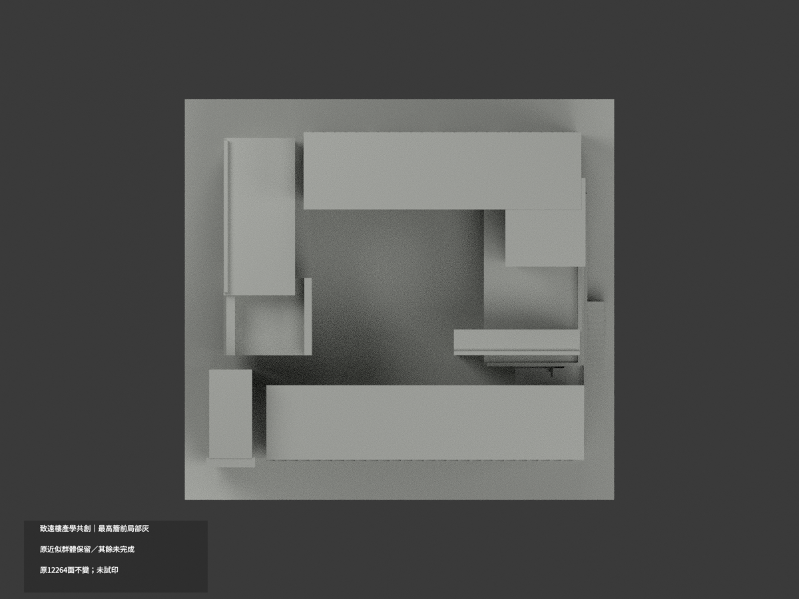
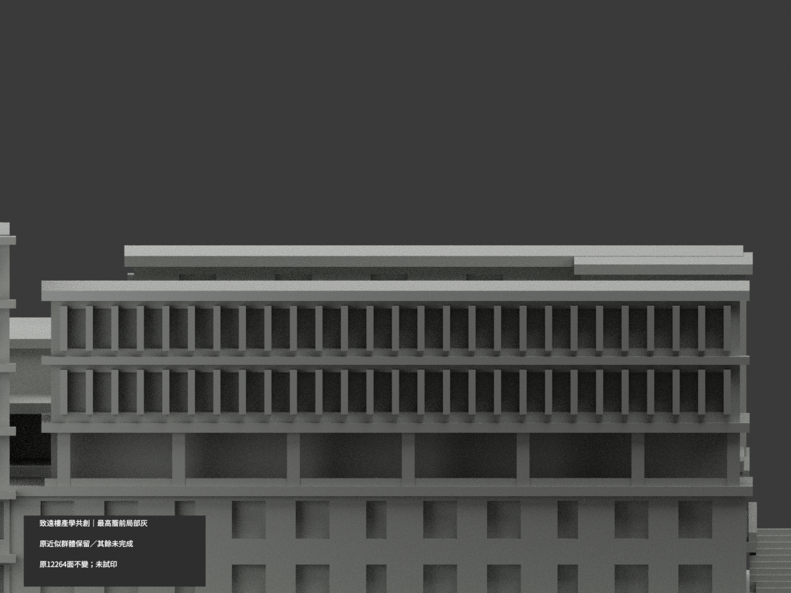
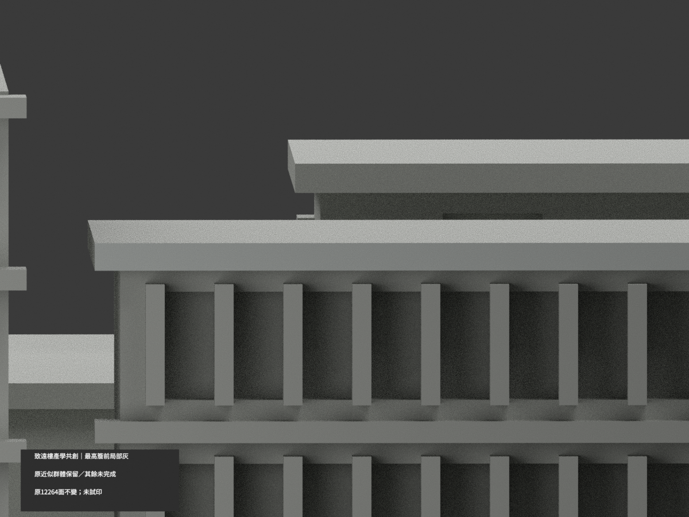
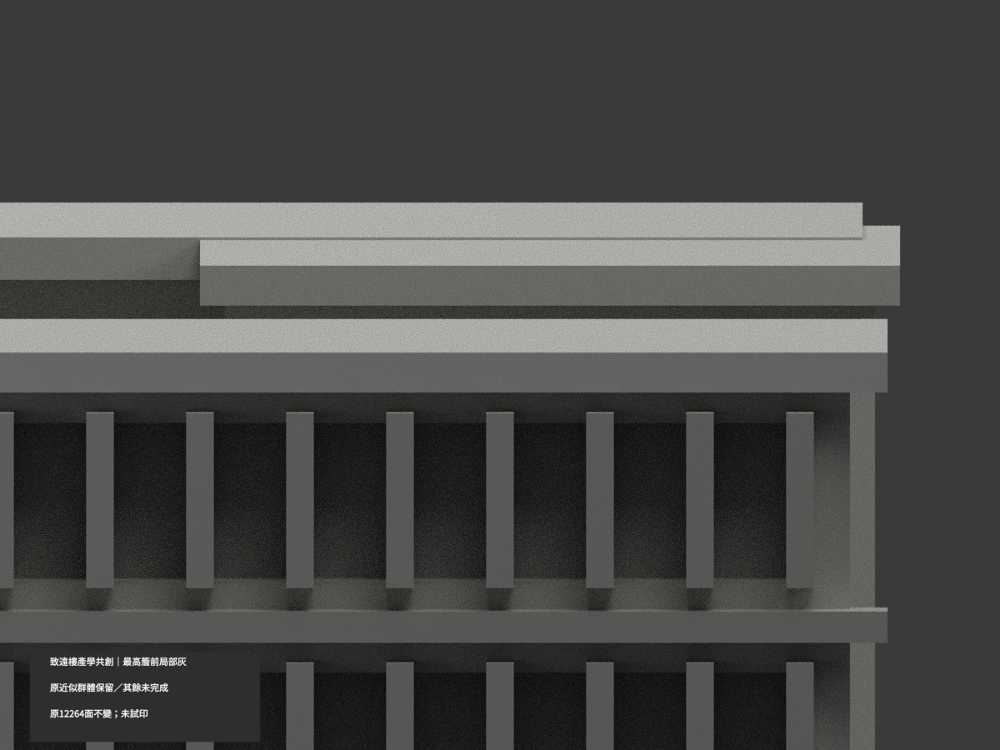

# 致遠樓產學共創中心｜最高街側簷前局部淺灰

**局部補色未完成：只最高街側屋簷完整正面2原三角名義淺灰，其餘面尚未分色。** partial_color_incomplete=true、fully_colored_exterior=false。同項 nycu-chihyuan-coinnovation／count_delta=0，國立陽明交通大學歸仁校區。身份 NYCU Chihyuan Co-Innovation partial color。

原雙翼與連接區塊/中庭/露台同一群體，不拆套；保原內院資料不足、橋/深度近似、遮陽端加粗/截平及實板欄代理。不是2026精測現況，不因補色追認原幾何精度。

| 前斜視 | 後斜視 | 正面 |
|---|---|---|
|  |  |  |
|  |  |  |
|  |  |  |
|  | | |

## 材色範圍

原整y−56無限平面4面，共享邊BFS為兩個各2三角矩形。只取最高完整域x−46.5..64.5/z53..54.599998；下方z32.3..33.8另一完整域中性，不按照片裁出半塊。2名義淺灰#C7CBC8、12262未知中性#B8BAB5；原12264三角座標拓撲不改。資料覆蓋界線不是真實材料接縫，中性不當已證實灰。

暮色正面及兩日景只支援灰族，不採黃昏粉光為材料。低簷樹遮、主牆橘塊無原分界、玻璃框反光、欄實板代理、折屏黃點/其他豎梃、中庭/柱/屋面/未知背側皆中性，不染滿或鏡像。

## 原件與限制

20 immutable 原件沒有model.obj；原build會export OBJ，但不是repo已有OBJ，不冒稱保留原OBJ。原STL/build/QA/renderer/previews原字節保留；原README.md另存ORIGINAL-PREVIEW-README.md，原scene另名ORIGINAL-PREVIEW-scene.blend且私存全包。原單展示材場景不是完整已驗色版，原中斷來源歷史不代表現完整原包仍缺失。

原317截面與canonical thin v2最大0.311%opening loss原值保留，不當全域最小壁厚或實體列印認證。未知院內細節、近似橋深、厚化細構仍照原README，不新增地理北向或實測尺寸。

設計者project2020與媒體路徑2025不是已核各照capture，不稱2026。原照只私存不公開/貼圖。隔離精確原build+color、原字節/三角multiset、共面一致、3MF/reopen與十張1200×900及explicit身份QA；保重建不刪，未試印/多料切片，STL無色。

NYCU Chihyuan Co-Innovation partial color. Only the complete highest street-wing fascia front rectangle is nominal lightgray:2 original triangles,12262 unknownneutral. Whole y=-56plane4 yields two complete2triangle components; upper x-46.5..64.5,z53..54.599998 selected, lowercomponent retainedneutral. No crop or geometric modification.

Three architect photographs provide a bounded gray family, not dusk-pink calibration. Tree-obscured lowerfascia,mixedorange walls,glazing/reflections,opaque railing proxies,chevron/yellow accents,courtyard,othercolumns/roofs/rear neutral. Original12264triangles and20immutablefiles retained; repo has noOBJ even though code exports one. Same pairedwings and connected courtgroup/count_delta0; no duplicate building. Original317sections/canonicalthin maximum0.311%openingloss not globalminimumwall/physicalprint certification. Approximate depth/bridges/thickened screens and incomplete court evidence preserved. Project2020/media2025 not verified capture; no2026claim. Sourcephotos private.
