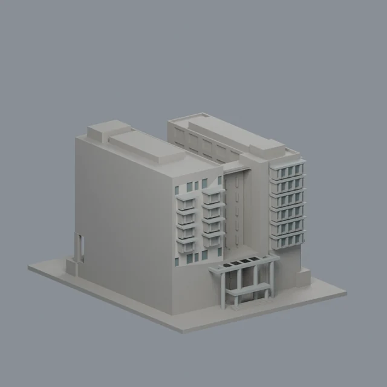
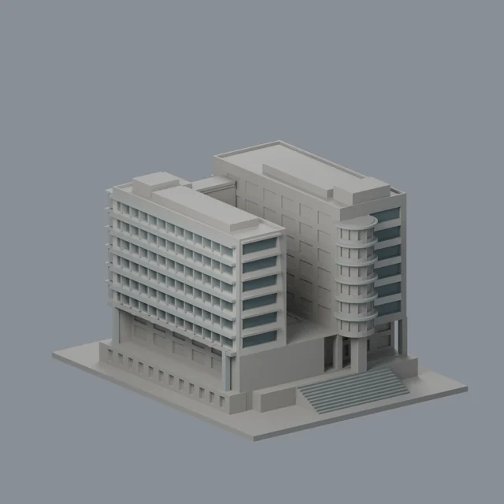
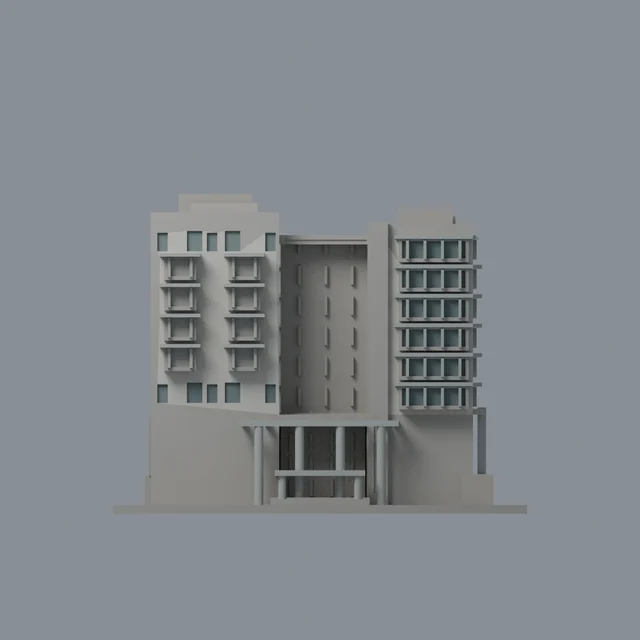
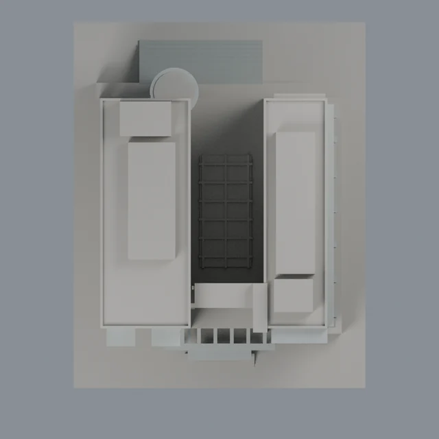

# 陽明交大圖書資訊暨研究大樓｜現行模型 WebP 預覽

四張均以現行五材質模型重渲染核對，不使用舊單色圖。表格用同視角 WebP 縮圖，點圖可開啟無損原尺寸 WebP。

| 模型預覽 | 模型預覽 | 模型預覽 |
| :---: | :---: | :---: |
|  正面與來源支持區域 |  來源支持後端／混合窗區中性 |  正立面 |
|  頂視 |  |  |

[模型說明](../README.md) · [五材質與來源界線](../appearance/README.md) · [表面色 3MF](../appearance/nycuyangming-appearance.3mf) · [可編輯 Blender](../appearance/scene.blend) · [原 STL](../model.stl) · [展示校驗](SHA256SUMS) · [模型與渲染對照](render-proof.json)

原始渲染 PNG、工程模型、來源覆核與重建記錄保留。本版不新增配色或幾何。未見的外側長立面與後中段保留簡化，混合窗區與屋頂等未證實部分維持中性，不是現況色彩測量或試印。[調整前模型說明](https://github.com/hplin50643/taiwan-buildings-3d/blob/c1cb32dd515d9c4f1f8321478db15490f1368467/%E5%9C%8B%E7%AB%8B%E9%99%BD%E6%98%8E%E4%BA%A4%E9%80%9A%E5%A4%A7%E5%AD%B8/%E9%99%BD%E6%98%8E%E6%A0%A1%E5%8D%80/buildings/nycu-yangming-library-research/README.md) · [調整前外觀說明](https://github.com/hplin50643/taiwan-buildings-3d/blob/c1cb32dd515d9c4f1f8321478db15490f1368467/%E5%9C%8B%E7%AB%8B%E9%99%BD%E6%98%8E%E4%BA%A4%E9%80%9A%E5%A4%A7%E5%AD%B8/%E9%99%BD%E6%98%8E%E6%A0%A1%E5%8D%80/buildings/nycu-yangming-library-research/appearance/README.md)
