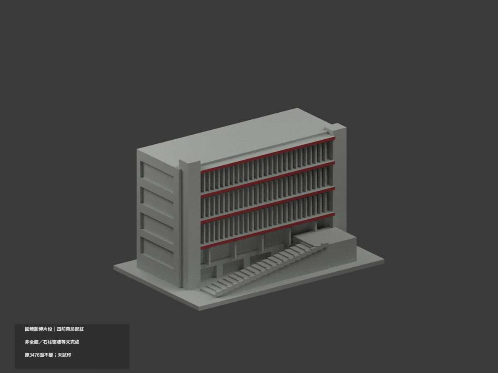
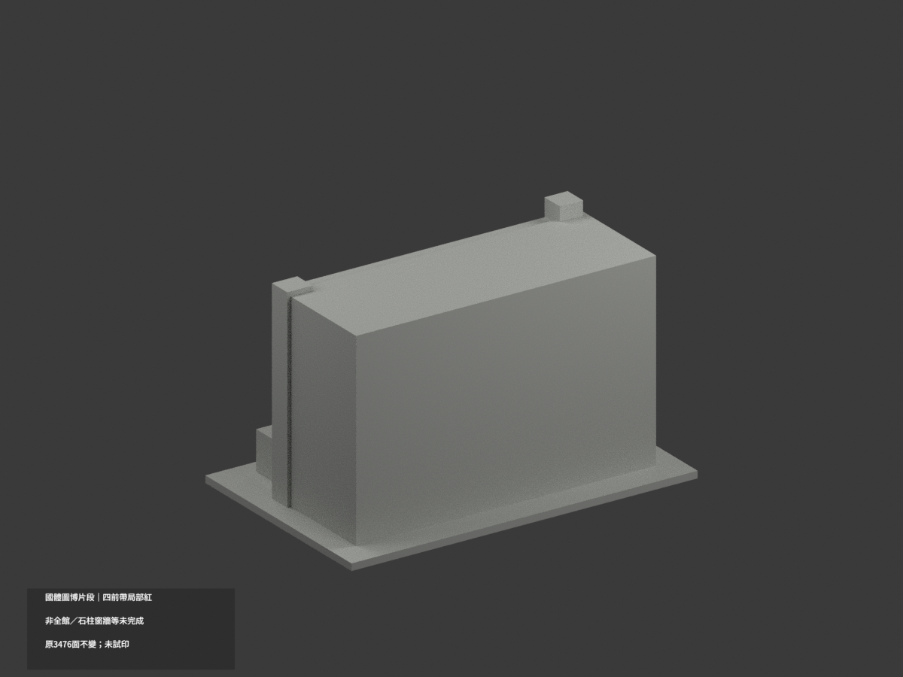
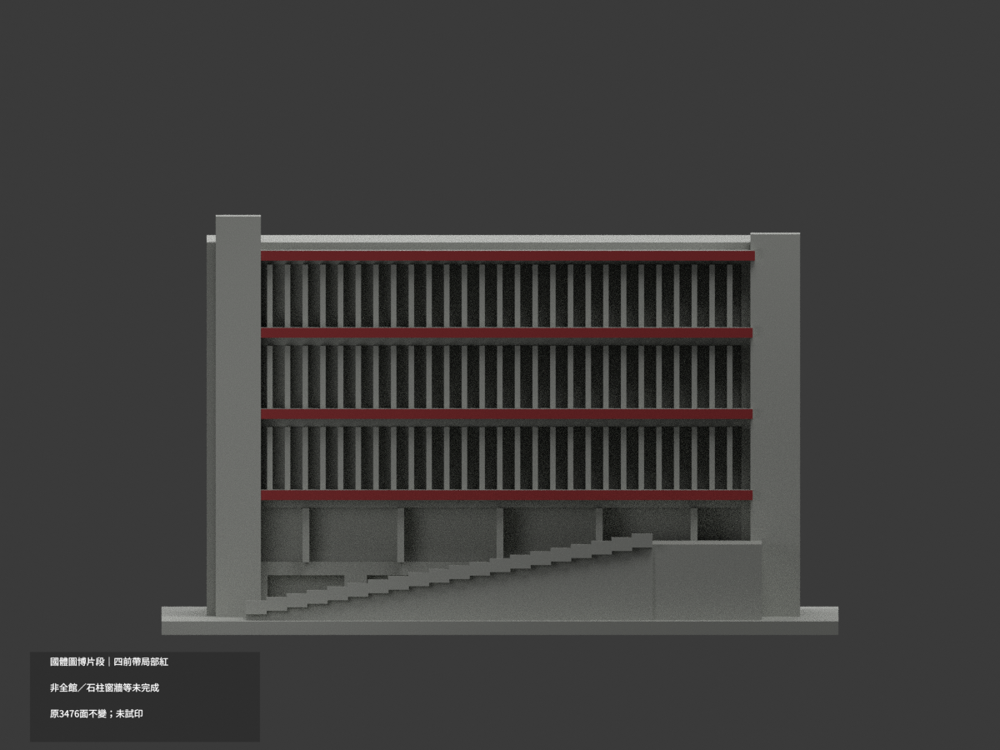
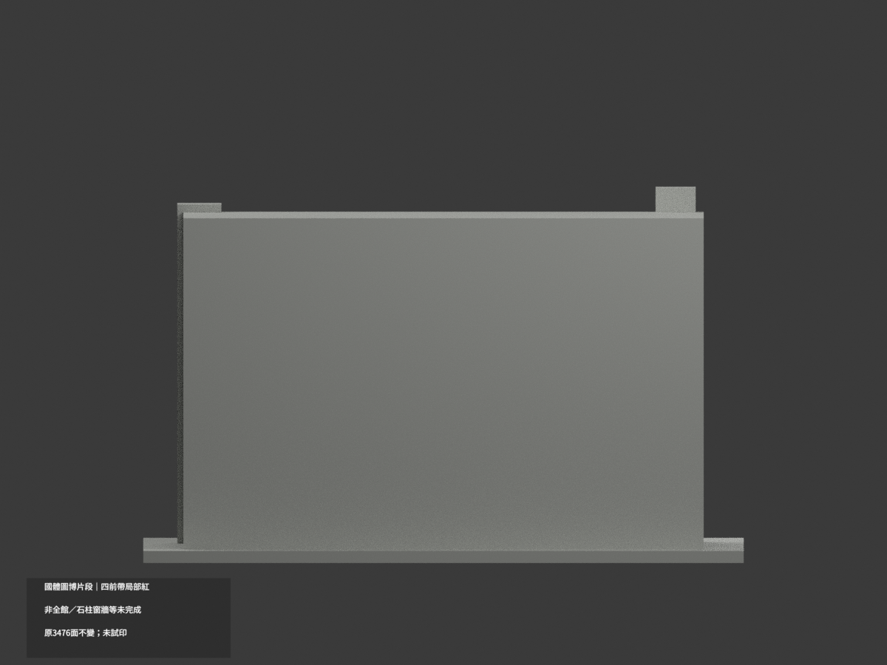
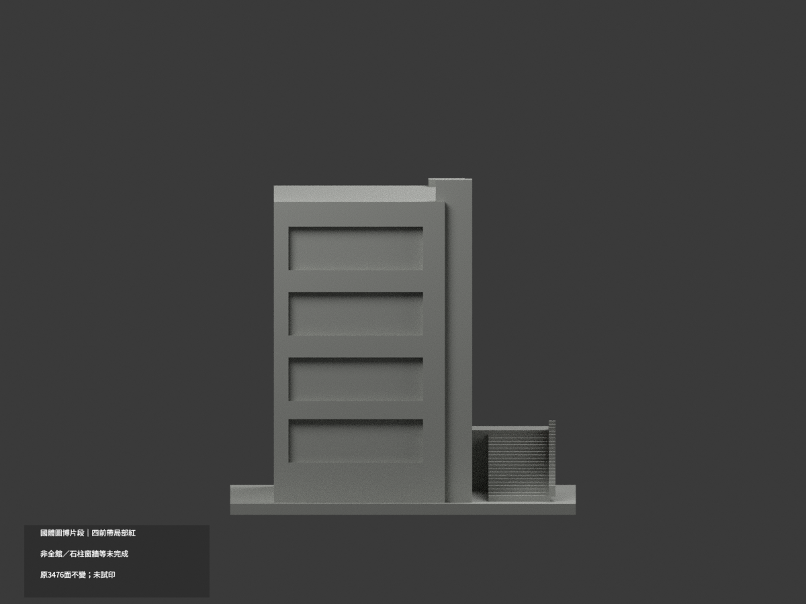
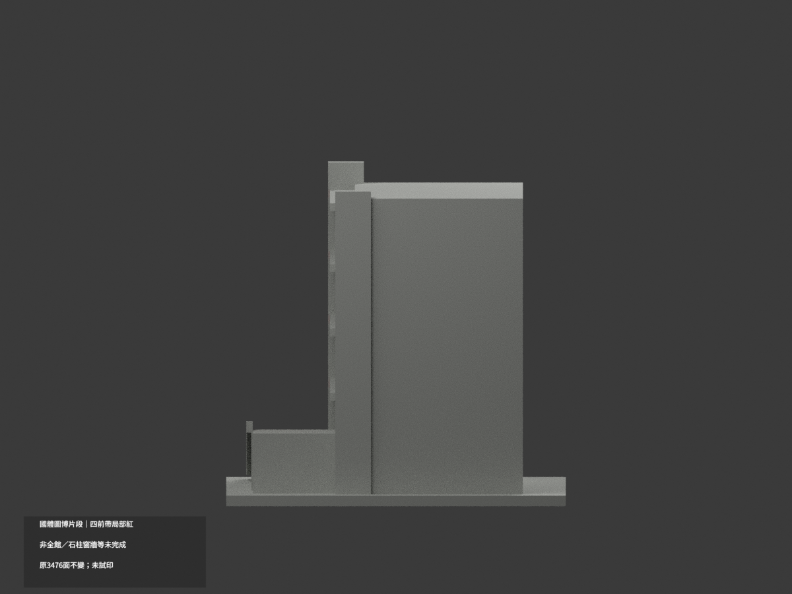
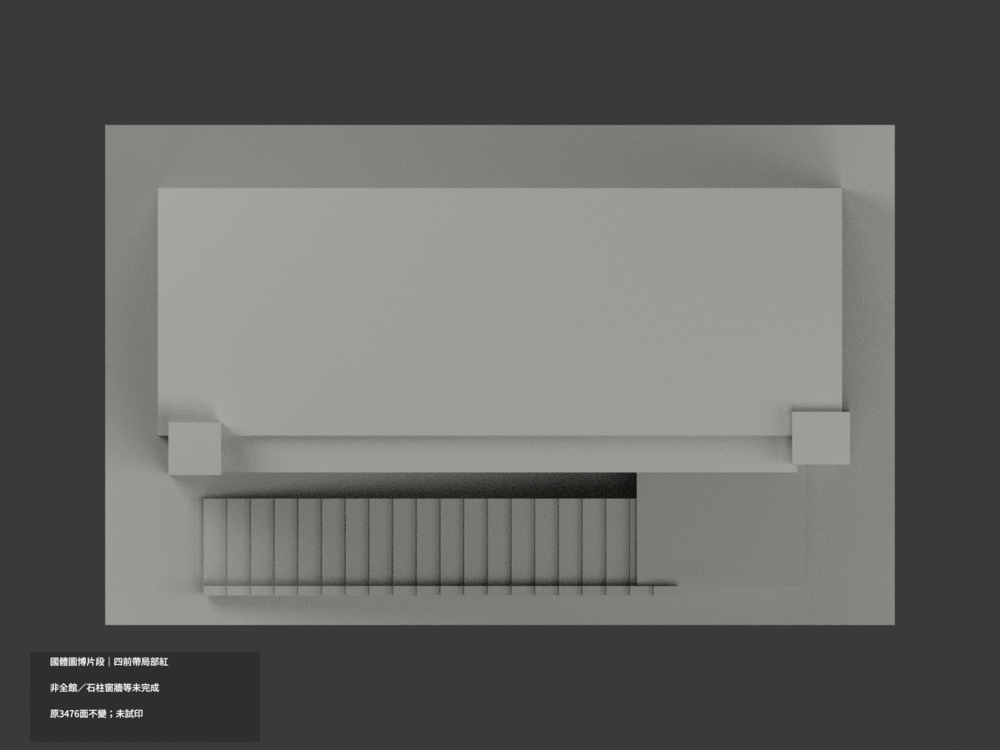
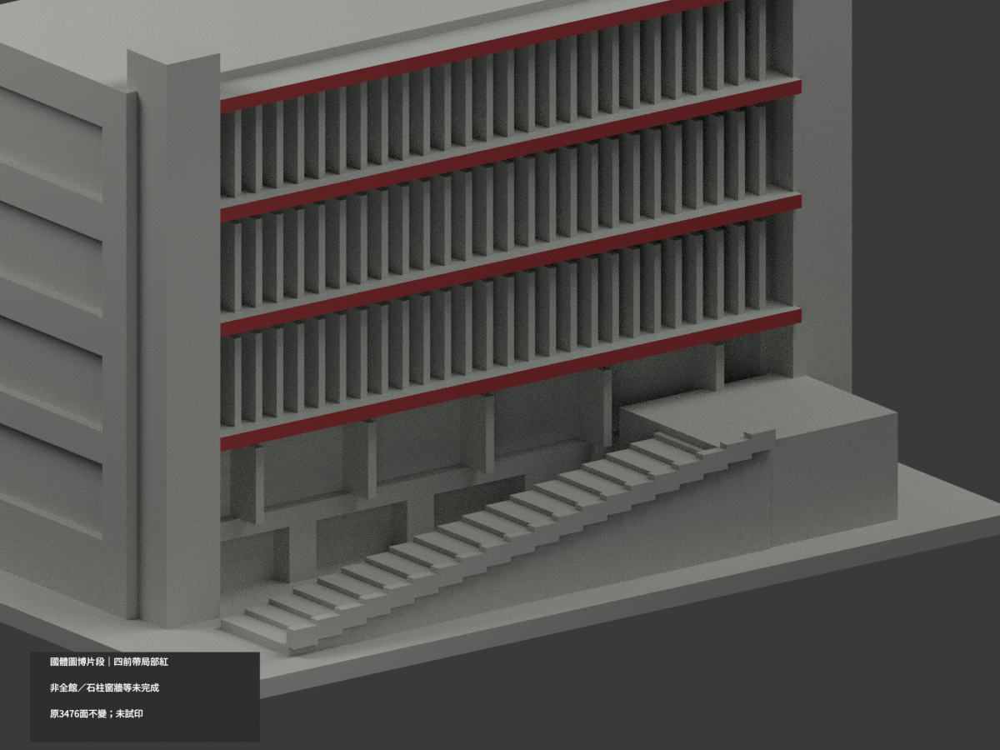
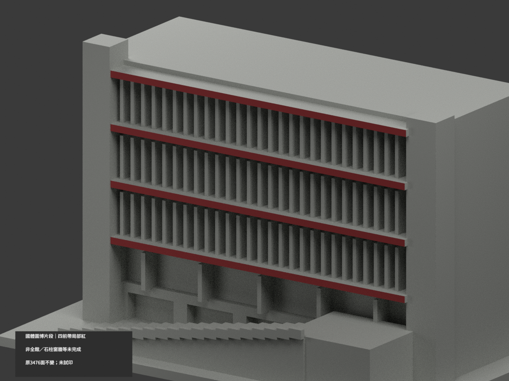
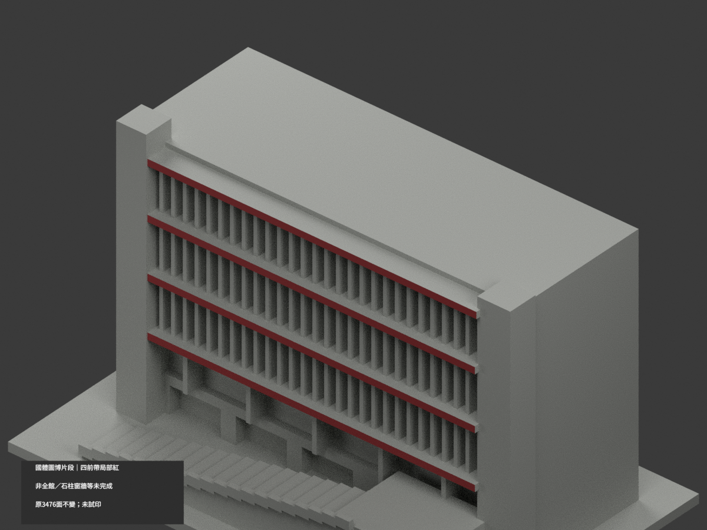

# 國體圖書博物館前側片段｜四前帶局部紅

**條紋石柱、窗牆與其餘材域未完成分色。** partial_color_incomplete=true、fully_colored_exterior=false。僅四道原橫帶正面局部紅色，不是全館補色完成。

| 總覽 | 背側 | 正面 |
|---|---|---|
||||
||||
||||
||||

## 材色範圍
同 ntsu-library-front-section 原項目，same-item、count_delta=0。3476原三角面、STL與build_model.py字節不變。國立體育大學（NTSU）桃園校區，圖書館與博物館同棟一群的前側及短左返片段，不是全館，也不是臺灣體育運動大學。原公開包無OBJ，不假稱保存不存在的原件。
- 四個完整前垂直矩形共8原面：y−18.5；三下帶原x±56，z28.9..31.1、46.9..49.1、64.9..67.1；頂帶原x±56.5，z82..84.2。只正面名義紅色，非夜照橙光。
- 全三頂點有限矩形核；整個無限y−18.5plane全部8原面等於四有限域聯集，各2面共對角線。原左石柱Boolean合併自然截至x−53，不是任意材色分界，不填缺／重造細雙脊。
- 其餘3468中性：條紋石柱原無分色界、窗背與厚豎遮陽代理混反光／框／暗洞、樓梯／平台／實欄代理（不能因真紅細扶手整塗紅）、橫帶頂／底／側返、其他牆與屋背／切斷端、字牌／植物／停車與地面。
- 原片段近似幾何不因材色背書為實測或現況；材色／中性分界為證據範圍，不是真實材接縫。保留所有原面，不新增紅扶手／條紋／細窗框。

## 來源與日期
親看校方PDF實頁17兩張外觀照片。白天照片是四道紅帶色族依據；夜照只證構件對位，不採橙照明作材料。拍攝日未知，PDF／規劃表與2026工程時程不等於已驗現況或拍攝日期。
原照私人參考、不公開、不貼圖；未確認CC或再散布授權，不保證商用。HEX為名義紅族非校準色票。正式GO已發行，繼承的先期review-only文字不改狀態，仍須builder QA。

## 格式與列印
[原STL](model.stl) · [逐面材色3MF](appearance.3mf) · [Blender](scene.blend)
原150×95mm展示底座，照片近似非測量比例。STL無色；3MF／Blender有真逐面材。兩材標籤不是驗證兩色／四色耗材切片，未實際列印，無切片路徑。

## 重建與 QA
原build_model.py → colorize_model.py → export_appearance.py → validate_color.py；Blender render_color.py／verify_color_scene.py。完整隔離原build＋color重建、原bytes／全三角multiset、閉合正體積、3MF逐面材、scene重開、十圖1200×900及圖文hash。原依賴隔離使用，不改原碼；程序不替代人工來源核對。
原README／previews／validation／renderer保留歷程，不冒充新QA；沒有刪檔。

## English scope
Partial only:8original triangles onfour complete front fascia rectangles,nominalred;3468unverifiedneutral. Original3476triangles unchanged,no originalOBJ. NTSU Taoyuan library/museum frontsection withshortleftreturn,notwholebuilding. Whole infiniteplane equalsfourfinite alldvertex rectangles;originalleft Booleanocclusion retained. Stripedpier,windows,stairproxies,sides androof neutral. Captureunknown;nightorange isillumination notmaterial. Not fullcurrent survey,testprinted or validatedfilament slicing.

## 版本 2 名稱勘誤

3MF 與 Blender 物件顯示名稱統一更正為「NTSU Library Front Section partial color」，並同步匯出、渲染與驗證程式的名稱。場景重新開啟與保存後，除物件名稱及非渲染執行期記錄外，網格、材質、變換、相機、燈光與字幕語義完全相同；場景檔案雜湊因此更新。原 STL、材色陣列與十張預覽位元不變，未重新渲染。原有局部補色及未試印限制不變。
