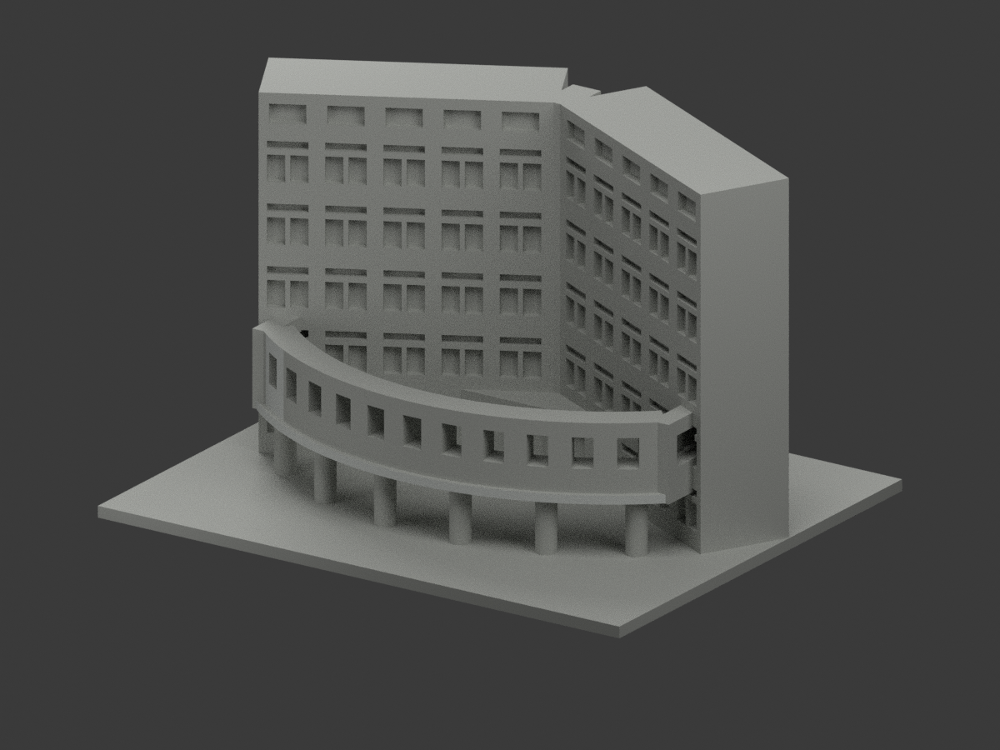
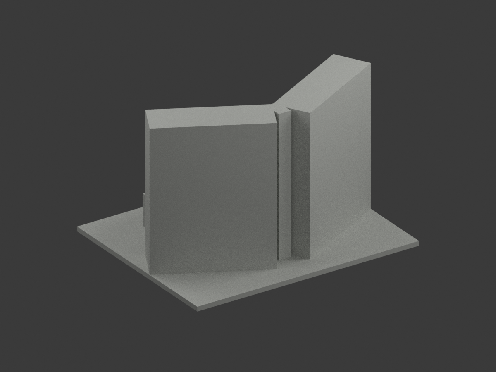
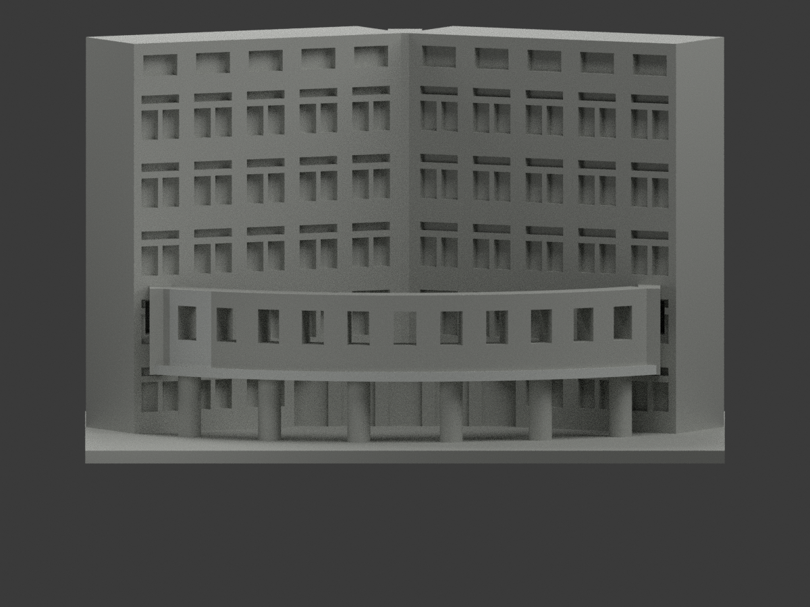
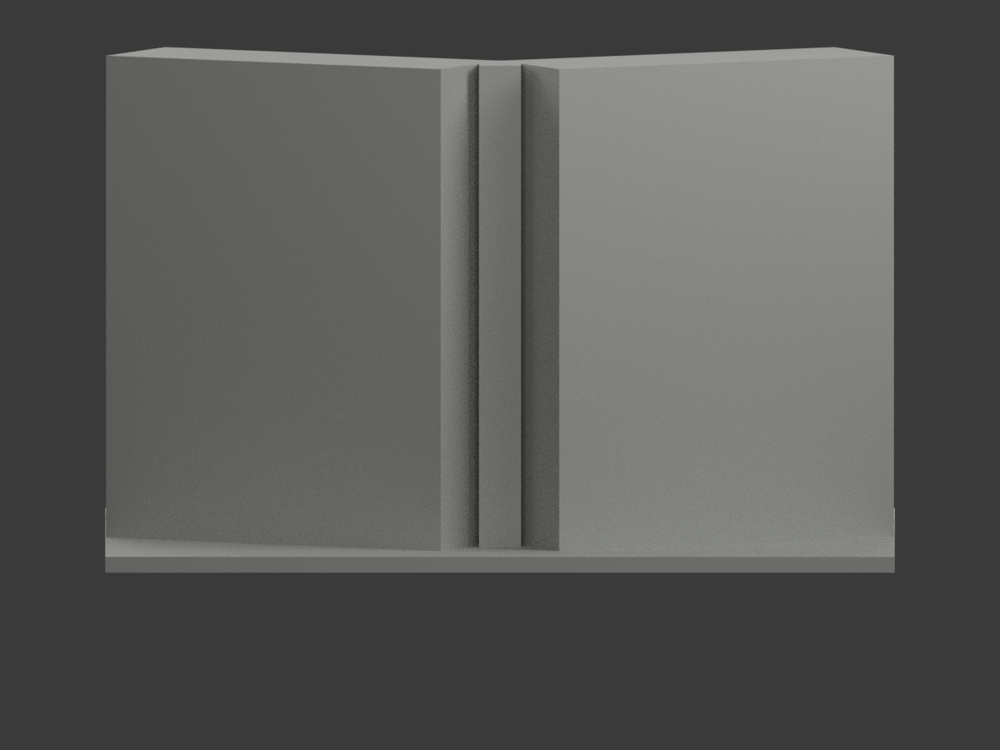
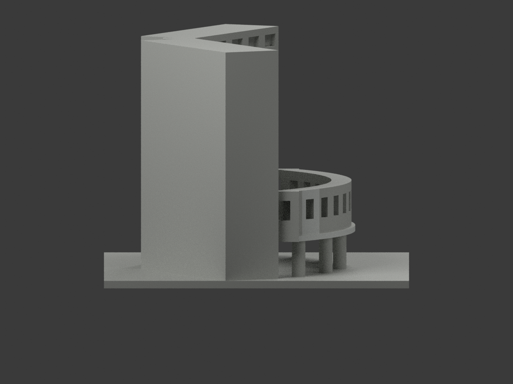
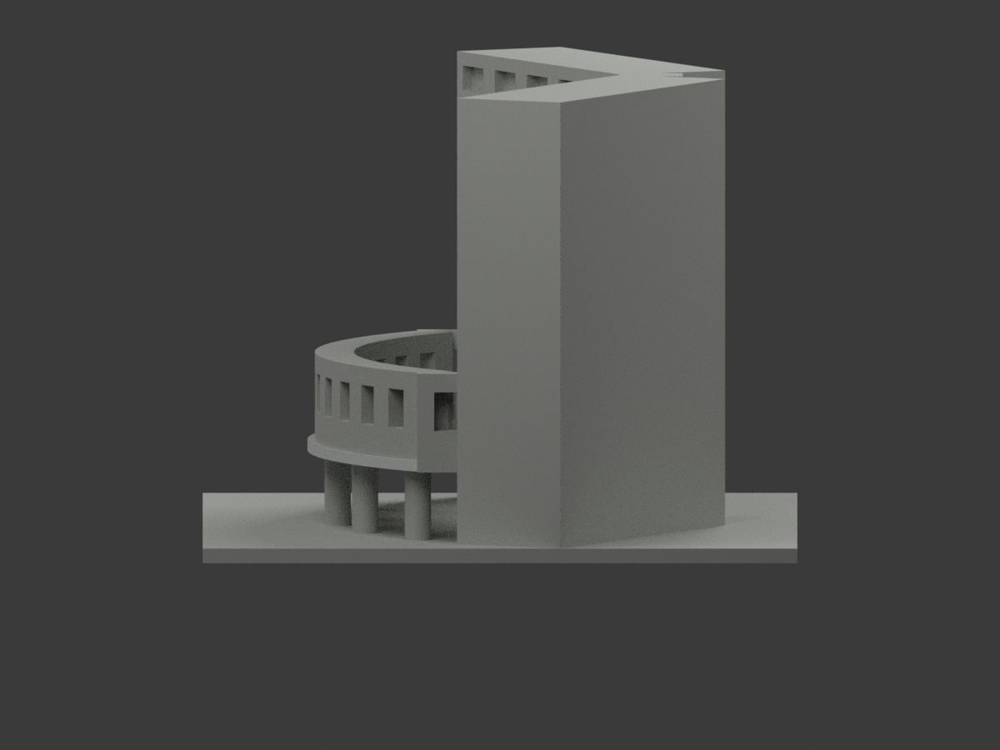
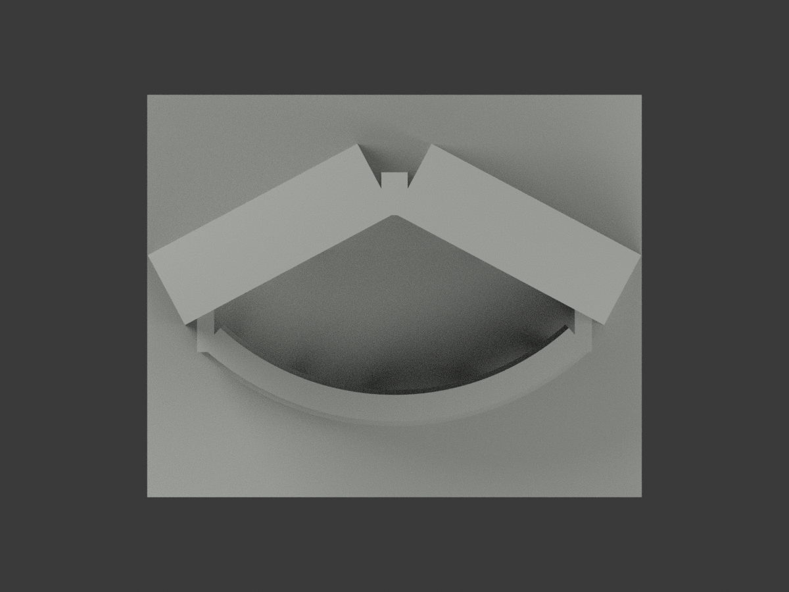
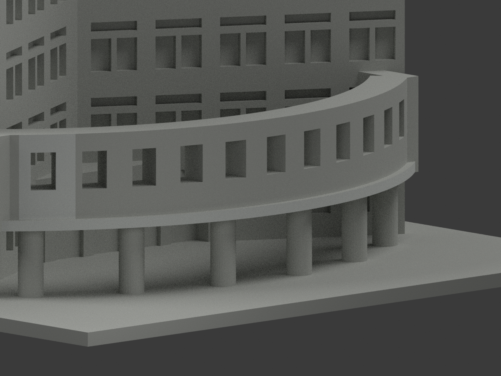
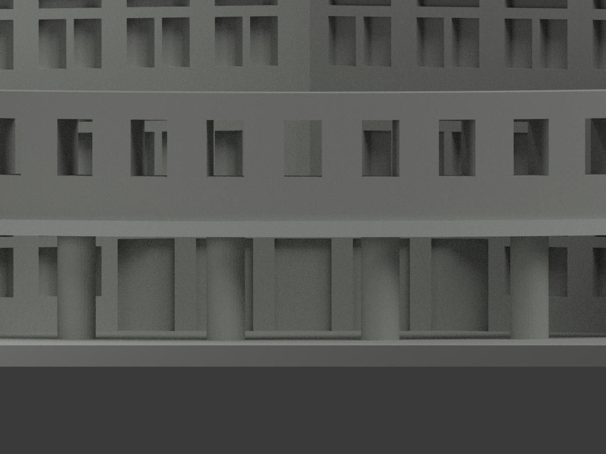
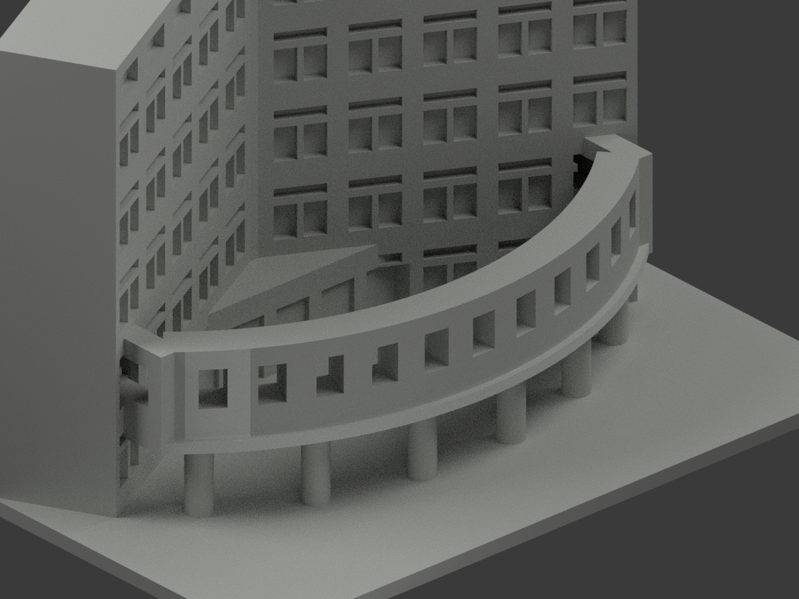

# 國體綜合科技大樓柱廊段｜遠左上弧欄外皮有限淺灰

只原上弧外皮最左第2..7弦段22面／7完整連通共面域，同既有index0名義淺灰#D3D6D3；原128下板外沿保持，總150色／4936中性／5086原三角，兩palette原樣。材名lower slab為歷史名稱，不表示本次上弧仍屬下板。原弧半徑87、center(0,49)、64弦分段中，有限x約[-55.192,-45.457]、y[-25.180,-18.252]、實露z19.8..37.8；不切面不改幾何。0混域。

原官800px外觀及原PDF照片原像素重審，左端開孔周圍外皮與中央字區/孔返可分，僅名義同淺灰族。不是新拍照、精準HEX或材質化學鑑定；弦段僅證據覆蓋界，不是真材縫。原孔數/尺寸、弧半徑/高度/厚度為粗代理，不獲本次認證。排除0..1接頭、其餘上欄、中央字、所有孔返/頂/內背/端、貼紙與花紋腳柱、牆窗與屋面。新會議簡章只小型樹遮正門/另一側入口，不提供本域新增細節，不能視2026外觀背書。2021外牆/2024空調整修歷史限制保留。

54原blob精確核，原STL/build/所有歷史檔保留，原無OBJ不新增。PDF嵌圖舊名page03-image3在本次工具提取序號為image2，但SHA完全吻合，不混淆內容。來源研究照片不公開、不作紋理。SOURCEpending快照固定，最終獨審另檔；qa/left-parapet-previous留原版本歷史。僅色域審核，不是新工程/試印或多材切片認證。下列原128面文字是歷史範圍，依本段更新22面，其餘限制仍適用。

## 原版歷史說明

# 國體綜合科技弧廊片段｜下薄板外緣局部淺灰

**局部補色未完成：只下薄板外垂直緣128原面淺灰；字帶柱與主牆未完成／非2026現況。** partial_color_incomplete=true、fully_colored_exterior=false。同項ntsu-science-portico-section／count_delta=0，桃園校區；只凹角門廊與裁切主翼，不是整棟綜合科技大樓。

| 前斜視 | 後斜視 | 正面 |
|---|---|---|
|  |  |  |
|  |  |  |
|  |  |  |
|  | | |

## 材色範圍

由原arc_strip獨立重建ro88.5、cy49、±42度65點64個chord。每chord所有三頂點須落完整無限垂直plane，再核切向0至原chord長與原z17.6..19.8有限界，容差0.0001mm。每個無限plane等於有限域，恰2共邊原面，共128淺灰、4958中性；不用面心或normal閾值漏碎面。所有1349原共面連通域一致，原5086三角不變。

只有下薄slab外垂直緣取名義淺灰；上層有字parapet與開口全部中性，圓柱貼紙/告示/異材腳未分界故整柱中性。薄板頂、暗底、內邊與端蓋不沿用前緣色。主翼磚牆混淺帶/底座/遮蔽區，玻璃窗背、地面、階、人工側後截面與未知面中性。中性不代表實景灰，資料範圍不是材料接縫。

## 來源與版本限制

親看舊官網斜照與官方PDF外觀照片，僅支持連續下薄緣淺灰色族，不稱精確飾面尺寸或測色。原舊外觀與2021外牆、2024空調改造脈絡保留，以上來源/計畫年份不是拍攝日期，不認證2026現況。凹角兩翼與弧門廊是原公開照片近似片段，側後人工截斷不是完整實測牆；補色不追認幾何、無室內或新翼。來源私人，不公開照片或貼圖，不推未見CC為商用許可。

## 檔案與 QA

原STL/build與5086三角字節/座標保留；immutable21件沒有OBJ，原builder只輸出STL。原README存ORIGINAL-MONOCHROME-README.md，舊單色previews與QA為歷程。appearance.3mf兩展示材、scene.blend真面材、color-mesh.npz同原三角。精確requirements隔離build+color、閉合正體積、3MF面材座標/Blender重開/10張1200×900檢核，重建保留不刪，未實際列印或證多色切片。

## English limitations

Partial only:128 original lower-slab outer vertical fascia triangles palegray;4958neutral. Recompute64 original chords from radius88.5,cy49,span±42degrees. All three vertices must lie on each infinite plane and finite tangent/z17.6..19.8 bounds;infinite plane equals finite pair for every facet. All1349coplanar components uniform,original5086triangles unchanged,noOBJ,count_delta0. Lettered upper parapet,columns with notices/mixedfeet,slabtop/underside/inneredge/endcaps,wingwalls,glazing and cutrear neutral. Cropped concave-corner portico section,not entire complex. Retain original older appearance and2021wall/2024AC context;unknown capture,no2026current survey. No source photos/textures public,no geometry recertification,not testprinted.
