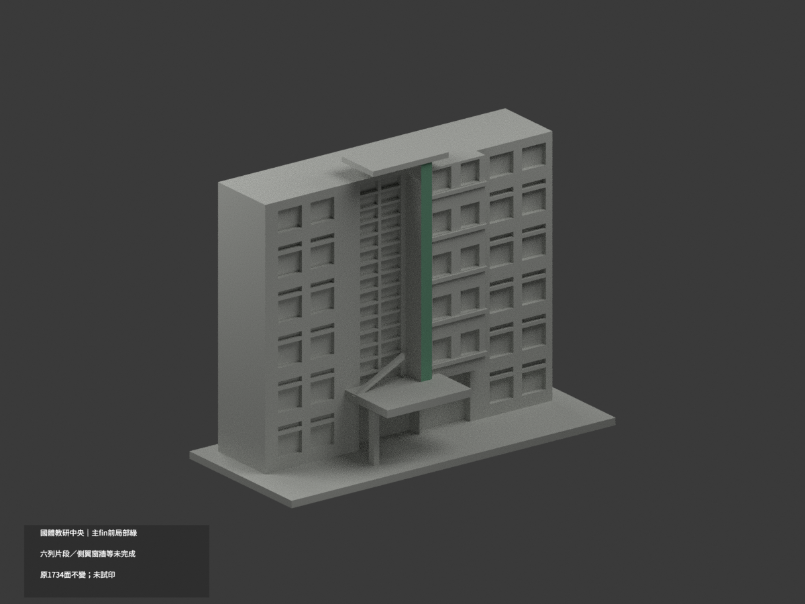
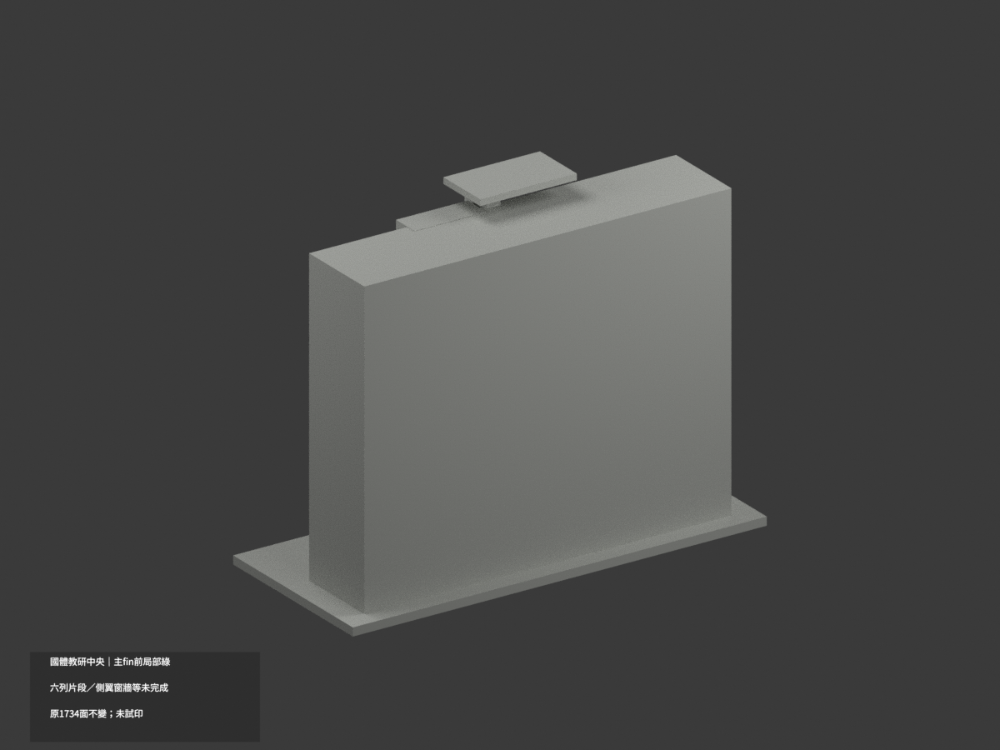
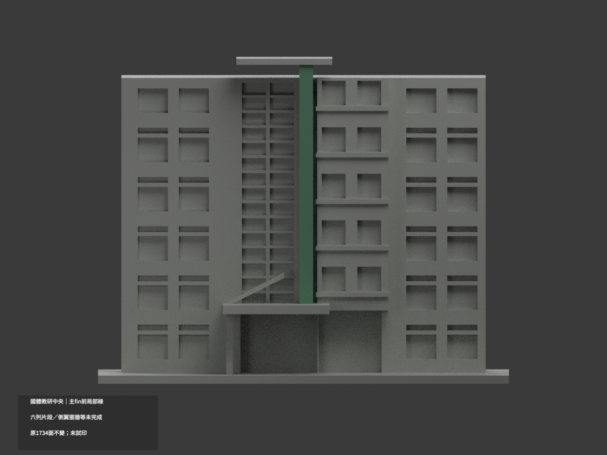
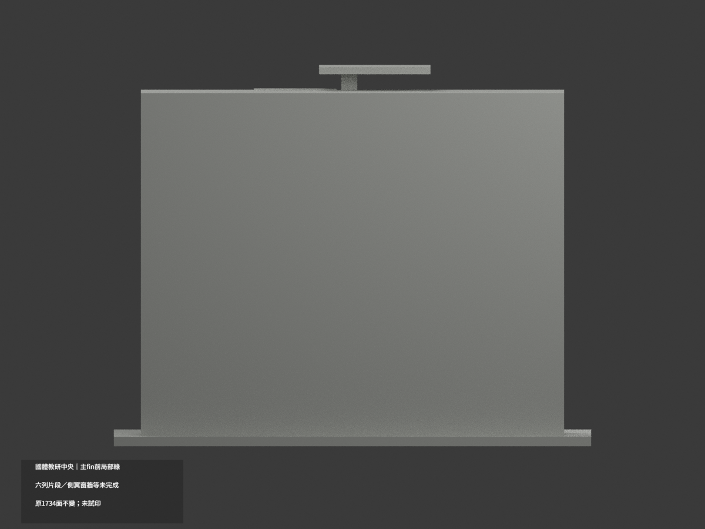
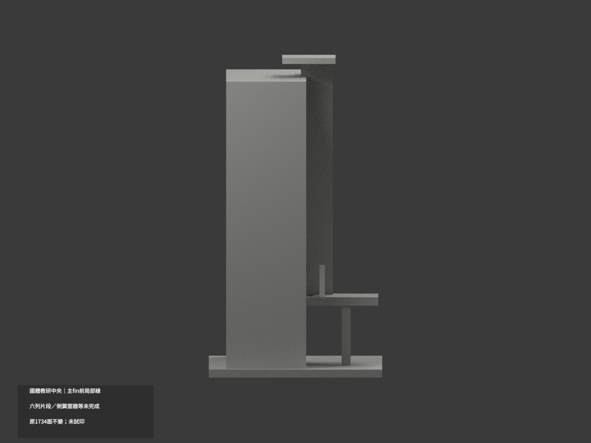
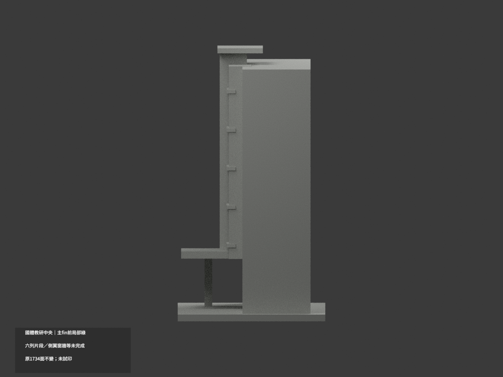
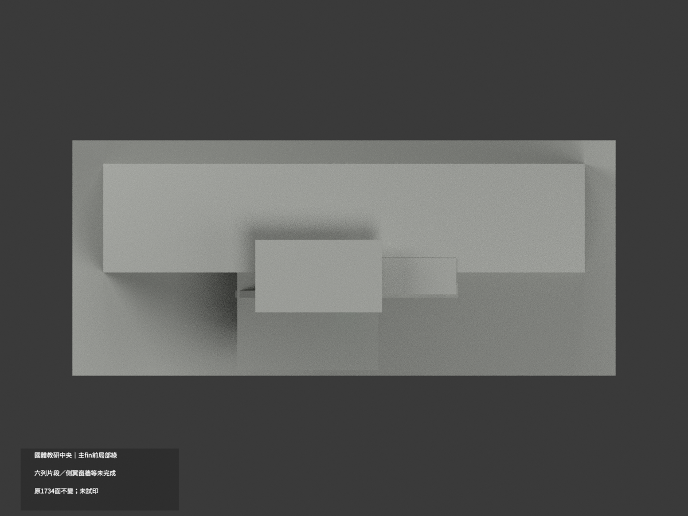
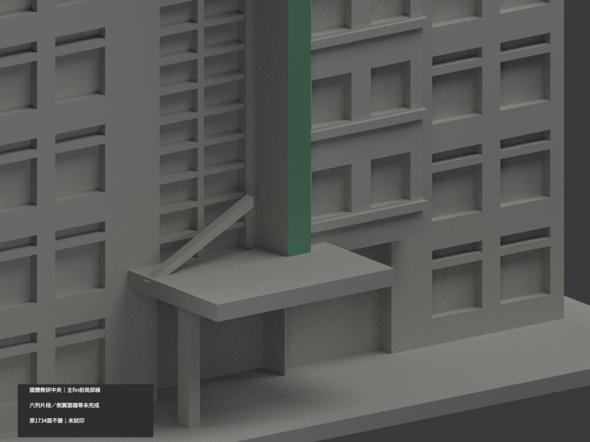
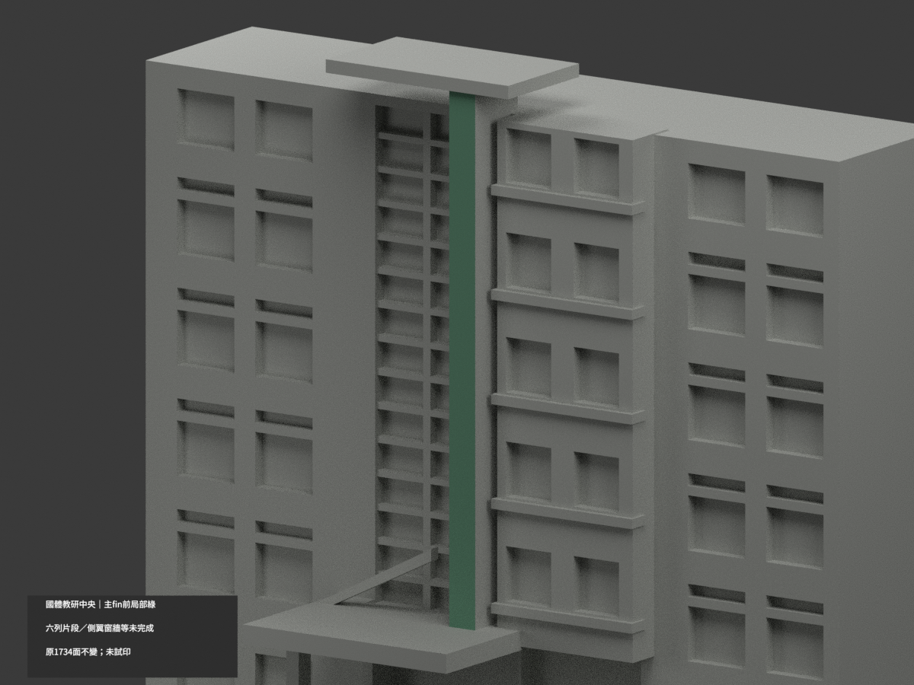
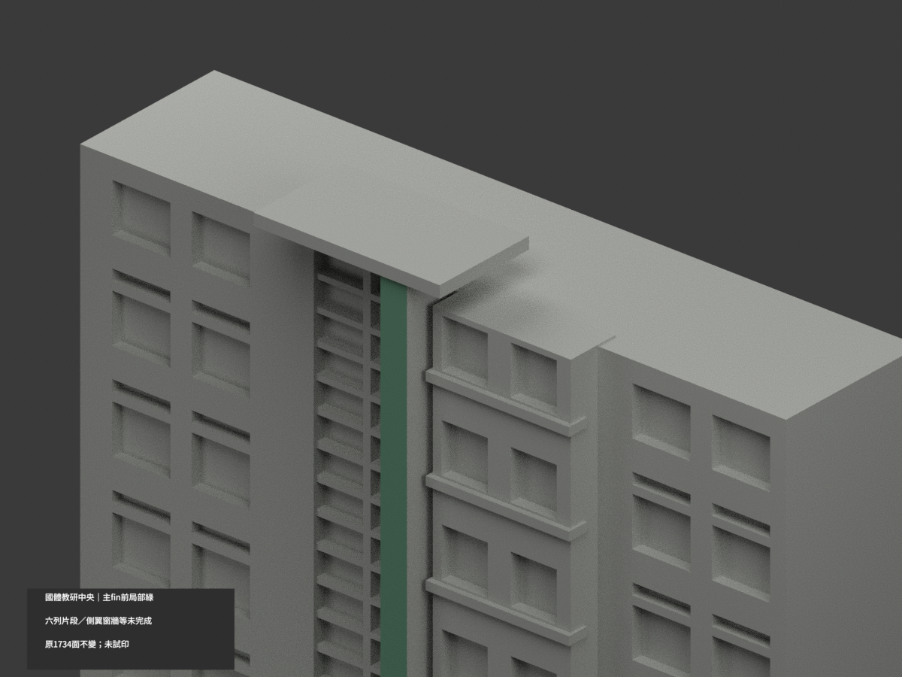

# 國體教研中央片段｜主fin前局部綠

**側翼、窗牆與其餘材域未完成分色。** partial_color_incomplete=true、fully_colored_exterior=false。僅中央綠色豎fin正面2原面，其他材域未完成，非全棟補色。

| 總覽 | 背側 | 正面 |
|---|---|---|
||||
||||
||||
||||

## 材色範圍
同 ntsu-teaching-central-section 原項目，same-item、count_delta=0。1734原三角面、STL與build_model.py字節不變。國立體育大學（NTSU）桃園校區，僅六列可見樓帶的中央教研立面群及窄鄰翼，不是全棟／全翼／房間數復原。原公開包無OBJ，不假稱保存不存在的原件。
- 原中央fin add(1,−8,2.8,5,12,115)完整前平面y−14、原x−1.5..3.5、z2.8..117.8；全三頂點有限域核，無限plane全部原面恰等於有限域2三角，共對角線完整矩形。
- Boolean門洞／入口雨庇與上帽合併自然剩z28.6..116，不人工裁色、不填回缺失下段，名義綠色只正面不包側／頂／背。
- 其餘1732中性：原全寬水平窗檻與照片不同長度綠區不合，不能整盒綠；右凸白窗間牆混窗／綠檻，主翼混磚灰牆、入口金字雨庇、玻璃／框／斜撐、屋背／切斷端與階地面均不硬染。
- 原粗化比例／樓帶與構件是舊外觀近似，不因本次材色背書為精測。材色／中性分界表證據範圍非真實材縫。不新增2024冷氣設備，不補全屋面／光電或翼樓。

## 來源與日期
親看校方斜向外觀及PDF入口近景，兩者支持中央連續綠fin。拍攝日皆未證；既有2024冷氣相關歷程保留，但不據此宣稱照片拍於2024／2026或模型是現況。
原照私人參考、不公開、不貼圖；未確認CC或再散布授權，不保證商用。HEX為名義綠族非校準色票。正式GO已發行，繼承的先期review-only文字不改狀態，仍須builder QA。

## 格式與列印
[原STL](model.stl) · [逐面材色3MF](appearance.3mf) · [Blender](scene.blend)
原150×65mm展示底座，照片近似非測量比例。STL無色；3MF／Blender有真逐面材。兩材標籤不是驗證兩色／四色耗材切片，未實際列印，無切片路徑。

## 重建與 QA
原build_model.py → colorize_model.py → export_appearance.py → validate_color.py；Blender render_color.py／verify_color_scene.py。完整隔離原build＋color重建、原bytes／全三角multiset、閉合正體積、3MF逐面材、scene重開、十圖1200×900及圖文hash。原依賴隔離使用，不改原碼；程序不替代人工來源核對。
原README／previews／validation／renderer保留歷程，不冒充新QA；沒有刪檔。

## English scope
Partial only:2original triangles onthe whole central verticalfin front,nominalgreen;1732neutral. Original1734triangles unchanged,no originalOBJ. NTSU Taoyuan sixvisibleband centralteaching facade andnarrow adjacentstrips,notwholebuilding. Entire infiniteplane equalsoriginalfinite allvertex domain;Boolean canopy/cap limits retained. Horizontal sills,mixedbrickgray walls,letteredcanopy,windows,sides andrear neutral. Captureunknown;2024AC history notnewgeometry or2026condition. Not fullsurvey,testprinted or validatedfilament slicing.

## 版本 2 名稱勘誤

3MF 與 Blender 物件顯示名稱統一更正為「NTSU Teaching Central Section partial color」，並同步匯出、渲染與驗證程式的名稱。場景重新開啟與保存後，除物件名稱及非渲染執行期記錄外，網格、材質、變換、相機、燈光與字幕語義完全相同；場景檔案雜湊因此更新。原 STL、材色陣列與十張預覽位元不變，未重新渲染。原有局部補色及未試印限制不變。
