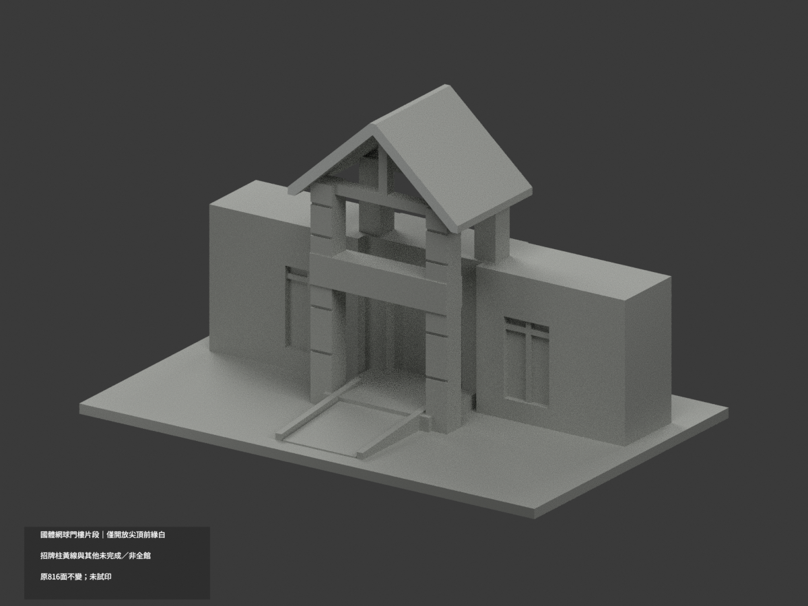
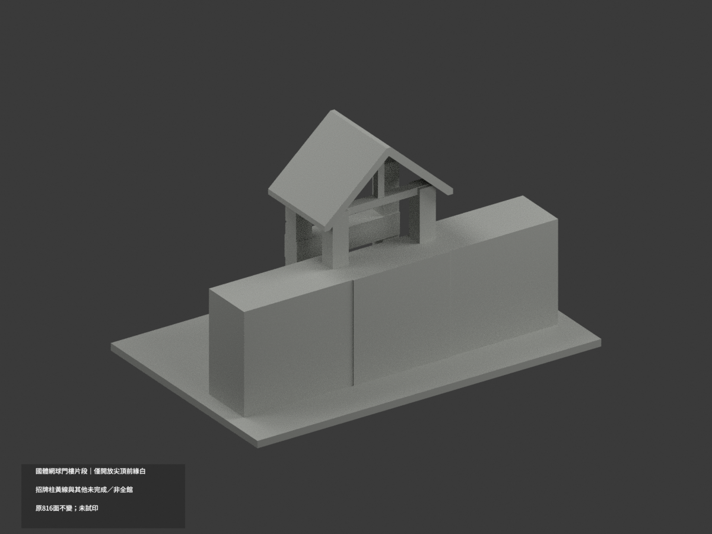
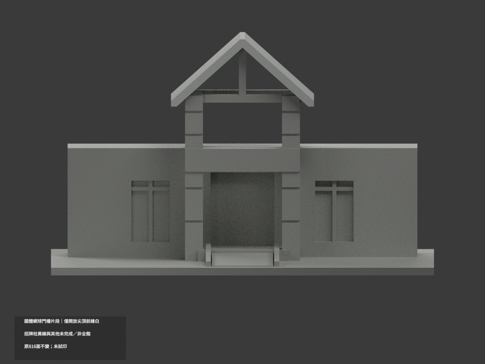
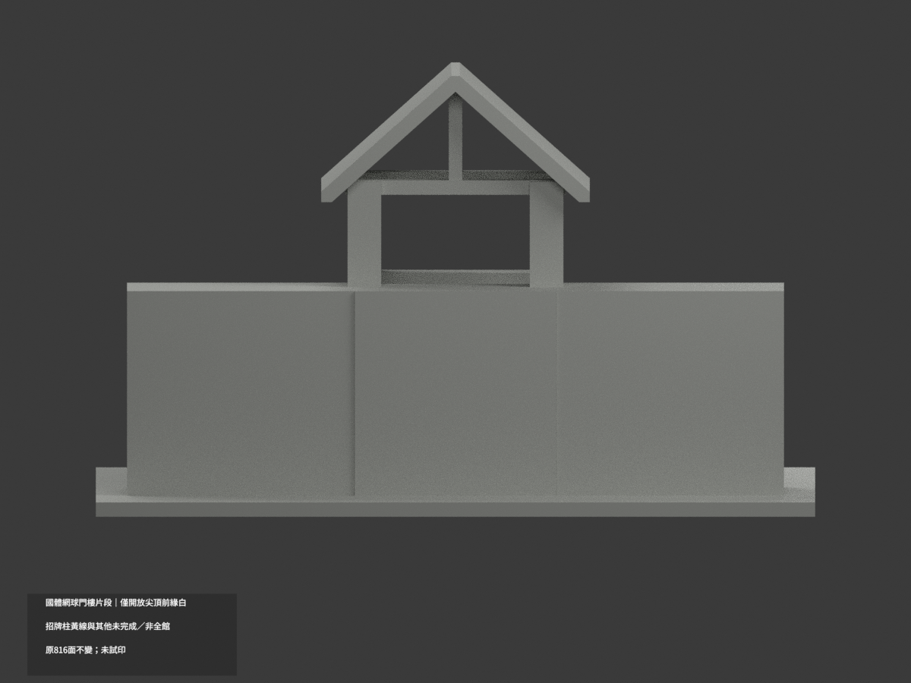
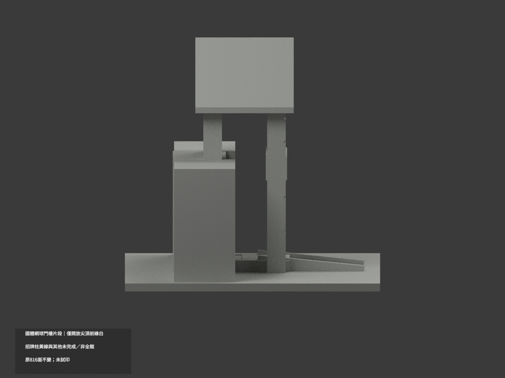
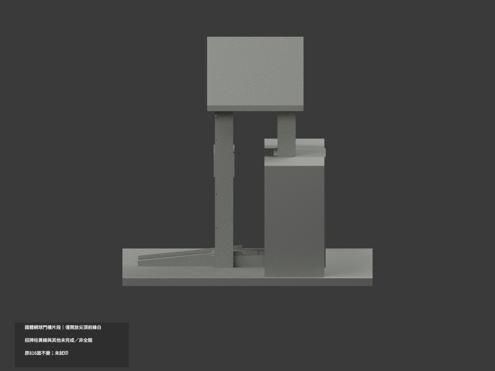
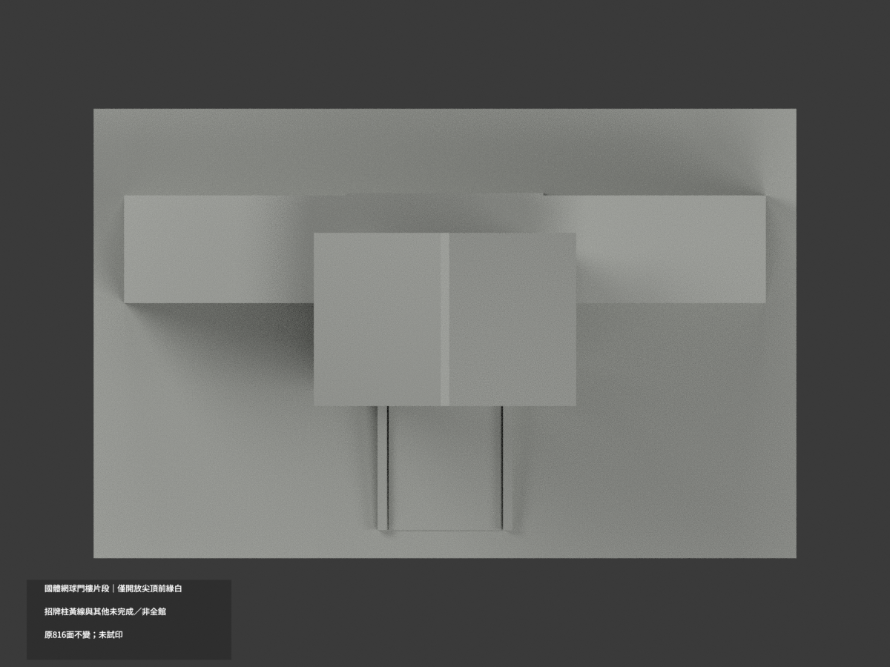
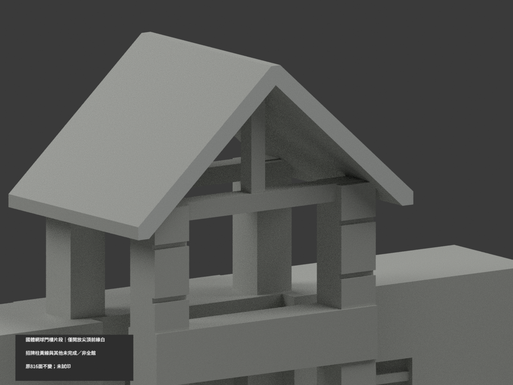
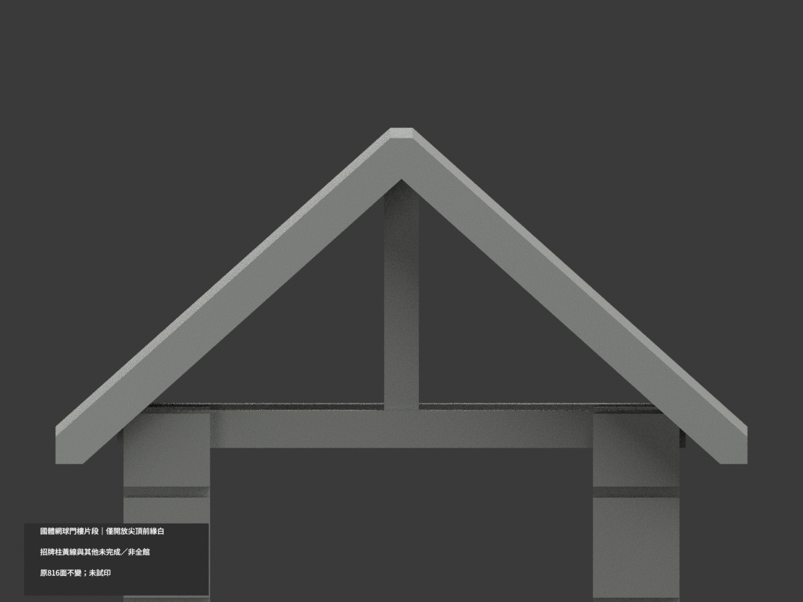
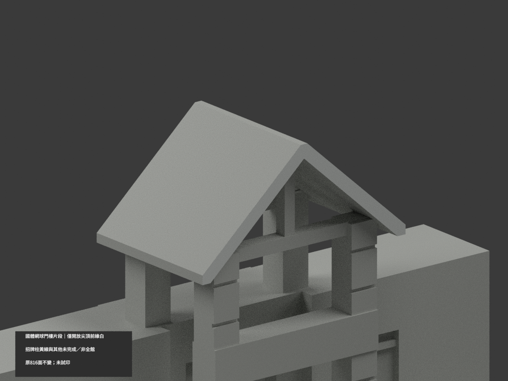

# 國體網球館中央門樓片段｜開放尖頂前緣局部白

**局部補色未完成：只開放山牆前緣7原面淺白；招牌柱黃線與其他未完成／非全館。** partial_color_incomplete=true、fully_colored_exterior=false。同項ntsu-tennis-entry-section／count_delta=0，桃園校區；中央門樓加左右各一窗，不是全網球館/多功能館，兩名稱不增另一套。

| 前斜視 | 後斜視 | 正面 |
|---|---|---|
|  |  |  |
|  |  |  |
|  |  |  |
|  | | |

## 材色範圍

只枚舉原y−15.5整個無限plane，三頂點容差0.0001mm；全部7面恰一共邊連通component，包含原削平尖端與兩端小三角，不用面心、normal或面積閾值漏面，不按bbox裁上半。7淺白、809中性，190共面連通域uniform，原816三角與頂點完全不變。保原開放三角口，不補實三角牆。

白前緣不外推整屋皮、深向側緣、內底與後山牆。實景柱有黃線、告示、石腳等未有原對應材界，整柱中性；橫招牌有字而原無界，整帶中性。藍綠桁架、窗背、坡道與實心欄代理、地坪、植栽/空調及人工截面與未知後部中性，不把照片綠地坪強套原坡道。中性不是實景灰，覆蓋界不是實際材接縫。

## 來源與版本限制

親看官方入口外照與原碼/預覽。白山牆前緣沿兩斜邊與尖端連續，只採名義色族，不重現污斑或精測材色。拍攝日期未知；光電計畫與多功能館命名不能證設備已裝或2026現況，不加光電板。原只是中央門樓和側窗片段，後部人工截斷不是完整實測牆；原加厚檐端、桁架與坡欄簡化不因補色獲幾何追認。照片私人，不公開貼圖，不推未見CC為商用許可。

## 檔案與 QA

原STL/build與816三角字節/座標保留；immutable21件無OBJ，原builder只輸出STL。原README存ORIGINAL-MONOCHROME-README.md，舊單色previews/QA保歷程。appearance.3mf兩展示材、scene.blend實際面材、color-mesh.npz同原三角。精確requirements隔離build+color、閉合正體積、3MF面材座標/Blender重開/10張1200×900檢核，重建保留不刪，未實際列印或證多色切片。

## English limitations

Partial only:all7 original triangles on y=-15.5 form one complete shared-edge front open-gable fascia component,offwhite;809neutral. Whole infinite plane selection with all3vertices tolerance0.0001mm,no bbox/centroid/normal/area clipping;retain pointed flattened tip and eave-end pieces. All190coplanar components uniform,original816triangles/STL/build unchanged,noOBJ,count_delta0. Roofupper/underside/reargable/depthfaces,piers with yellowstripes/notices,mixed signband,bluegreen truss,windows,ramp/solidrail proxy and hidden cuts neutral. Central pavilion plus one side-window bay each,not whole tennis/multiuse hall or separate buildings. Captureunknown,PVplan not installed-state proof,no2026survey. No source images/textures public,no geometry recertification,not testprinted.
