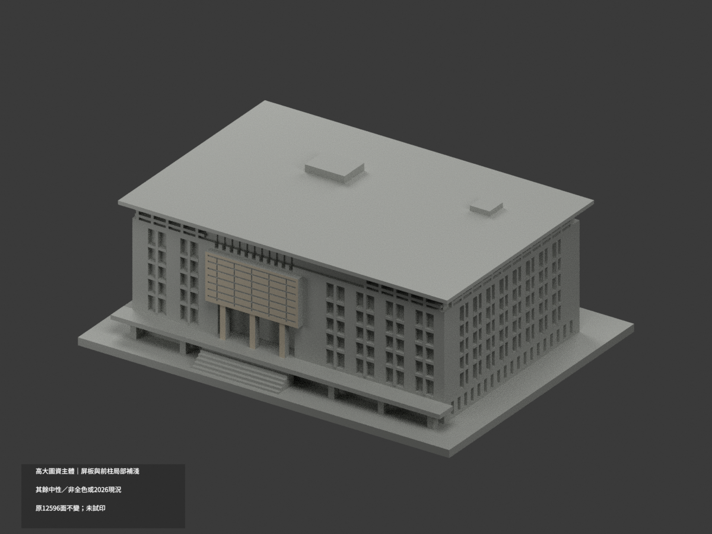
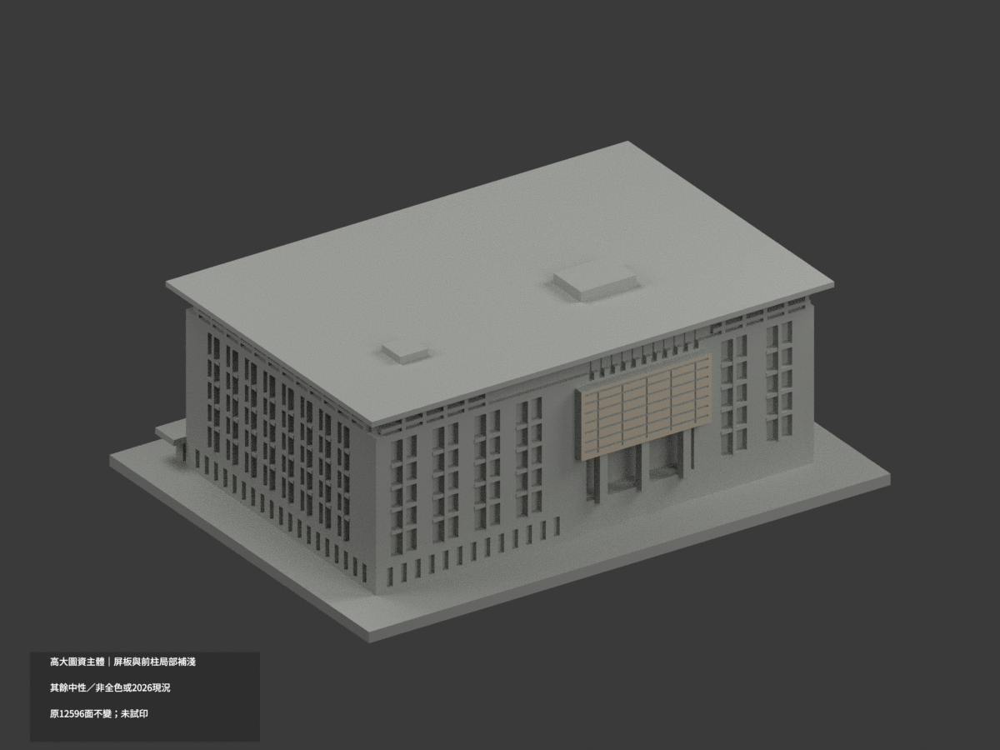
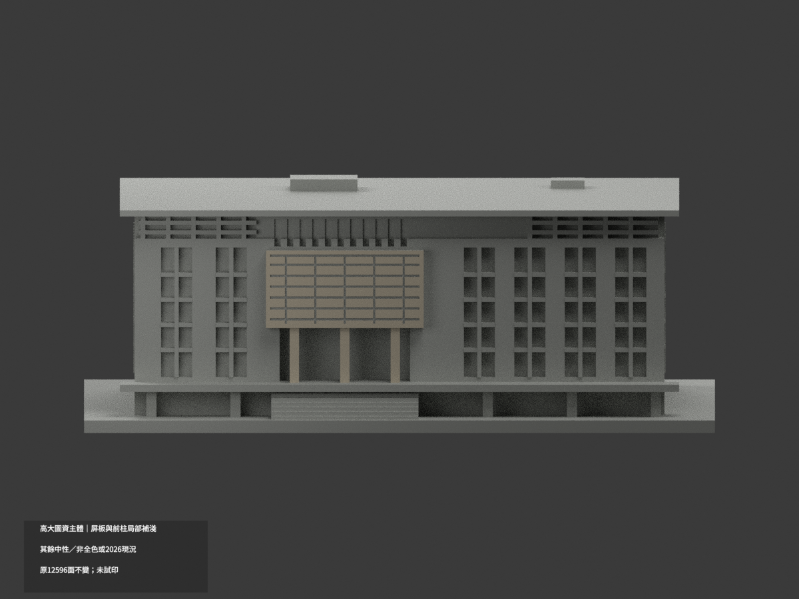
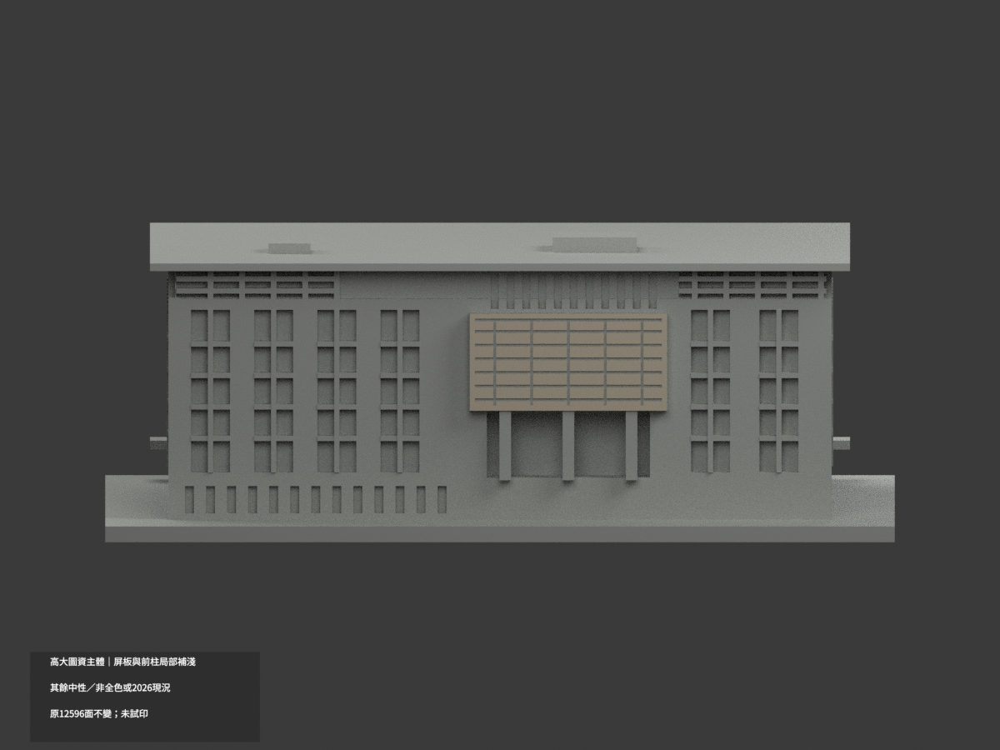
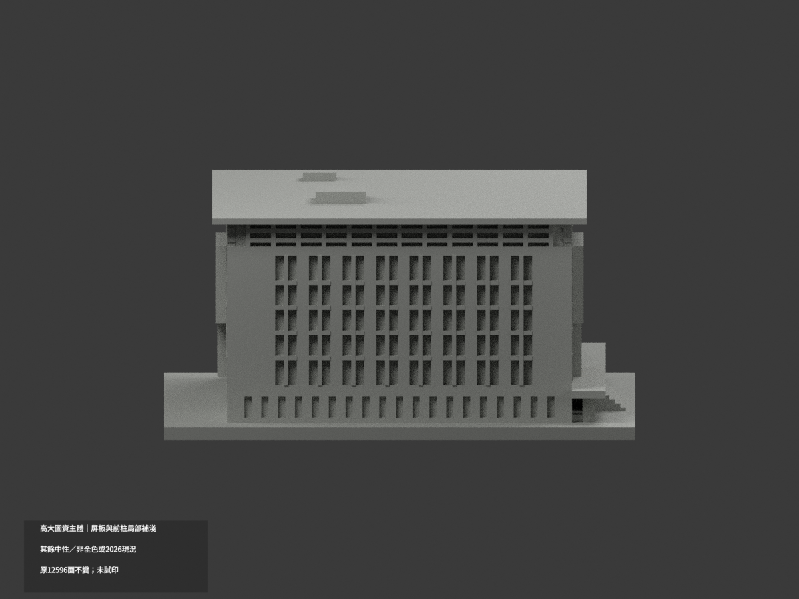
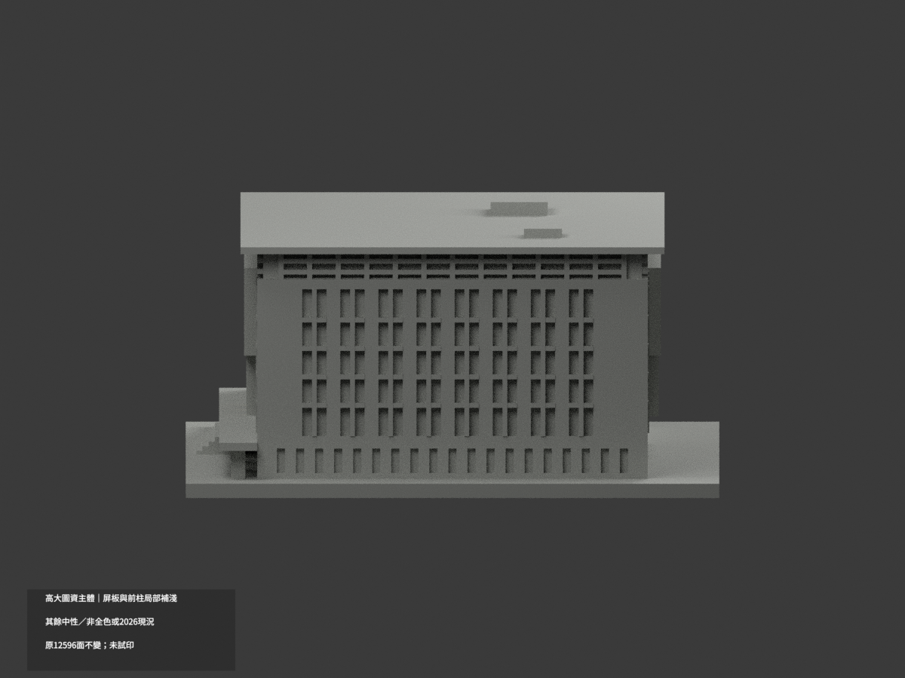
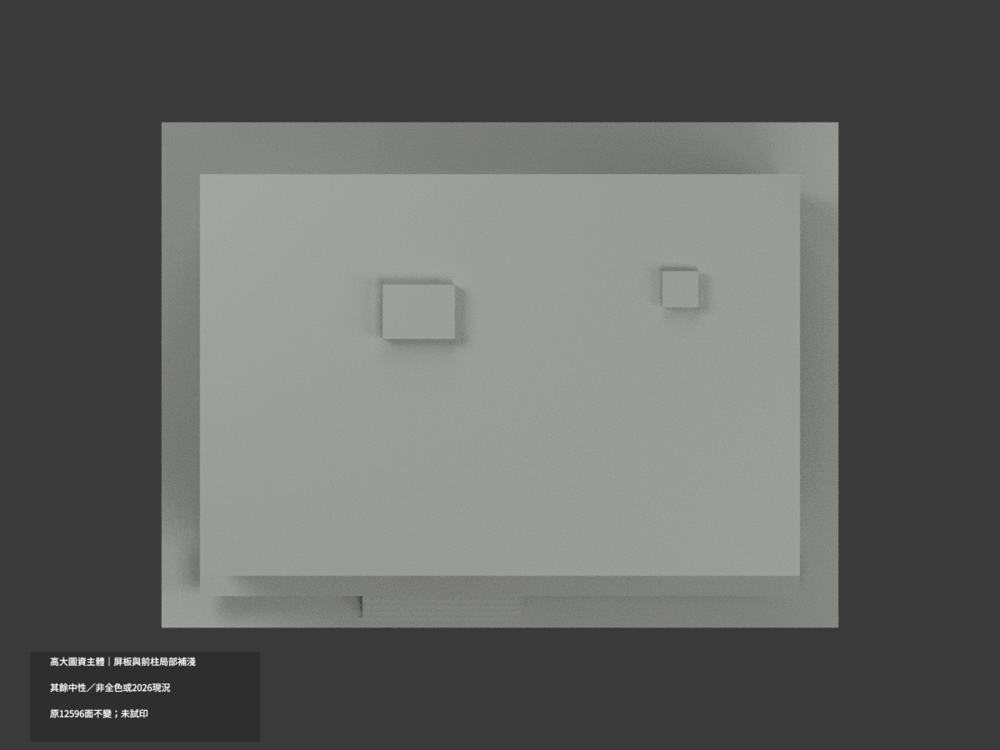
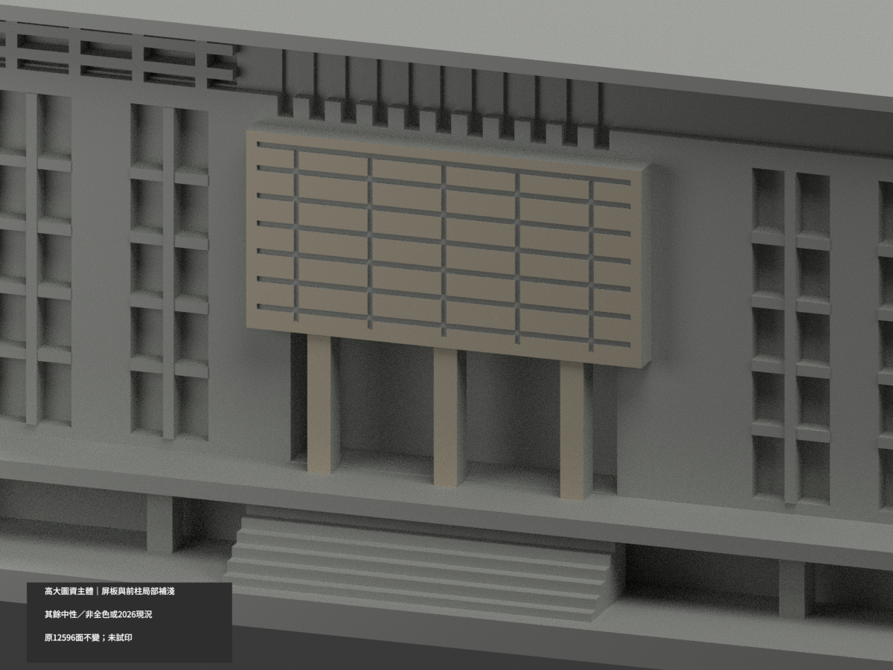
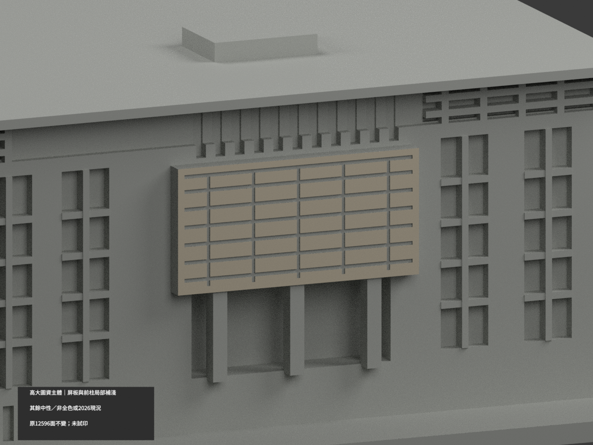
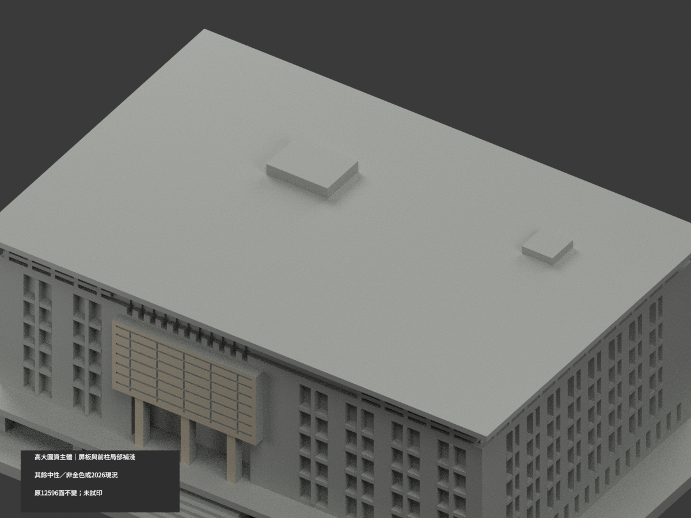

# 高大圖資主體｜前後屏板與前廊柱局部補淺

**局部補色未完成：僅前後屏真外平面及三前廊柱淺色；主牆、窗背與未知面未完成。非2026現況，不含低館與長橋。** `partial_color_incomplete=true`、`fully_colored_exterior=false`。同項目`nuk-library-main`／`count_delta=0`，不新增套數。

| 前斜視 | 後斜視 | 正面 |
|---|---|---|
|  |  |  |
|  |  |  |
|  |  |  |
|  | | |

## 材色範圍

前屏y-43.75真外平面125面、反屏y43.75真外平面127面，兩者x[-31.75,5.75]、z24..42.5，僅原刻槽之間剩餘表皮，不塗槽底與返側。另三前廊柱x-25/-13/-1、y-43.3原外露前面各2面，共258淺暖石灰色，12338面未核中性；**中性不是實景灰色證明**。

全部3246共面連通域uniform，不用bbox塗整屏箱體、不抹平原格槽。反柱遮蔽不複製前柱色。主粉磚牆與白基座原共面融合無材界，全牆中性，不以高度挑三角。長側窗背/粗網格/屋冠混金屬玻璃反光與近似，未整染銀或黑。屏內側、厚邊、槽底、屋面/設備/階/平台/基座均中性。

只圖資主體，排除低入口館／禮堂、長橋、樹及背景樓；材色邊界是有證範圍，不是真實不同材料接縫。原12596面、尺寸、STL及build字節不變，不增面、切色、移頂點，原近似幾何不由色審追認。

## 來源年代及權利

四張高大官網建築外照已親看；前後屏各有實照，不鏡推未見面。URL/hash見`COLOR-SOURCE-REGISTER.json`。**拍攝日期未確定，2003啟用不是拍攝日**；view2/3內嵌2002-01-01午夜疑預設重設不得採真拍攝，view1/4內嵌2007-01-12亦未獨立認證且無時區，不主張2002/2007或2026現況。

原照私存不公開、不貼圖；未見CC不沿repo license宣自由商用。HEX只是近似材色族，不是測量色票。

## 檔案、重建及 QA

`appearance.3mf`2展示材、`scene.blend`實面材、`color-mesh.npz`原頂點面與材索引。原STL無色、原build字節保留。原包OBJ存在且原字節保留。

舊README另存`ORIGINAL-MONOCHROME-README.md`或`.zh-TW.md`、舊previews/QA保留作單色歷程非本次新審。依`requirements.txt`跑`python colorize_model.py`、`python export_appearance.py`、`python validate_color.py`；Blender跑`render_color.py`與`verify_color_scene.py`。原build+color全隔離重建目錄保留不刪。格式／三角multiset／封閉正體積見`COLOR-*QA.json`，重開`SCENE-QA.json`，10張1200×900與hash綁定`DELIVERY-QA.json`，父另人工終審。

**未實際列印。** 2展示材不是已驗四色切片工程，支撐／薄部強度／材料對應另驗。

## English limitations

Partial reference only: front125/reverse127 true screen outer-field triangles plus6front pier faces;12338neutral. All3246coplanar components uniform; groove floors and sides unchanged neutral, no blanket boxfill or wall-height color cut. Original12596faces/STL/build bytes preserved, count_delta0. Main block only, excludes lowpavilion and longbridge. Capture dates unknown; default-looking2002EXIF is not reliable evidence,2003opening not capture,2007EXIF not independently authenticated. Not2026currentcondition and not full color. Source photos private. Not physically test-printed.
