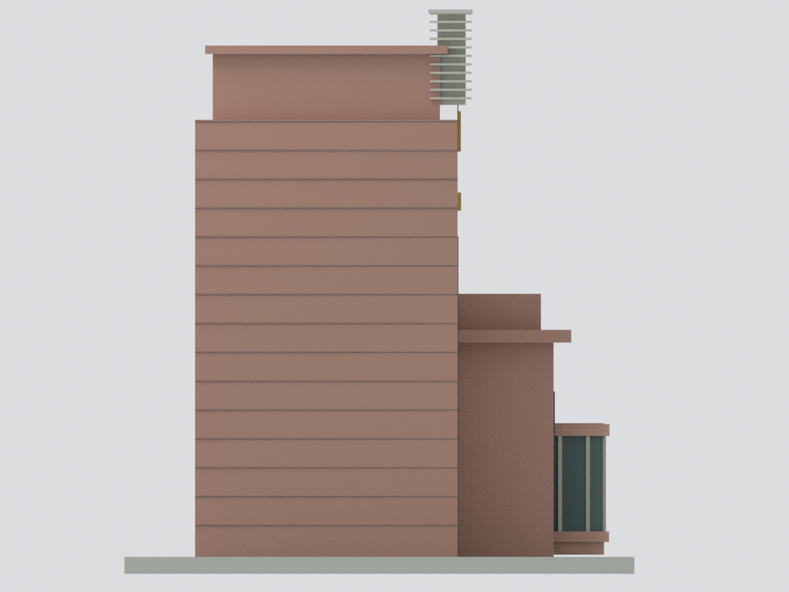
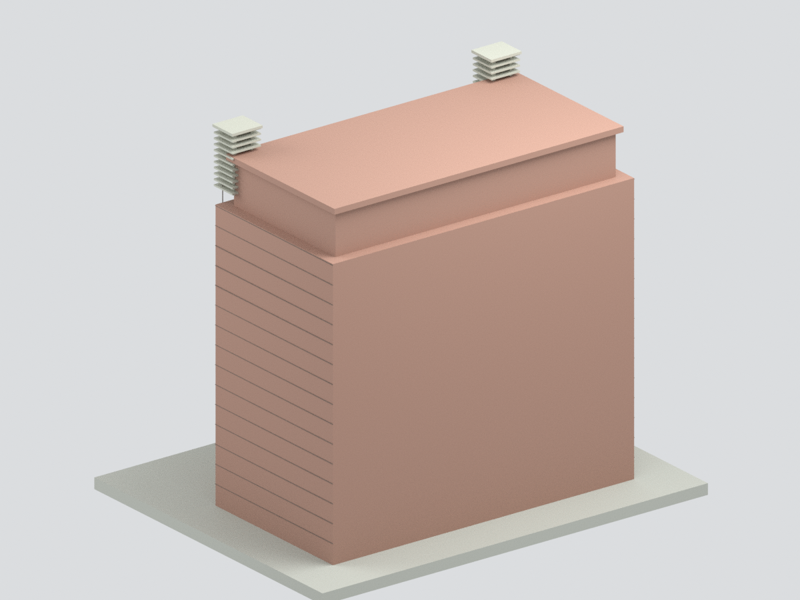
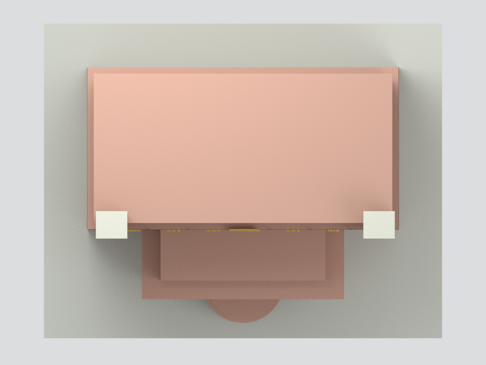

# 國立高雄大學正門中央警衛室及門塔

## 模型預覽

| 模型預覽 | 正面 | 警衛室細部 |
|---|---|---|
|  |  |  |
| 側視 | 未確認反面中性處理 | 頂視 |
|  |  |  |

目前網格使用六種表面色（3MF色表另保留一個未使用的中性屋頂色）。

本件為楠梓校本部正門的**中央核心歷史外觀近似**，不是整條校門、外側長牆或完整入口道路。未測繪、未核為2026現況、未實體試印。

側視、未確認反面與頂視展示圖改用 1200 × 900 無損 WebP，與原 PNG 的 RGBA 像素逐一相同。正面、正立面、警衛室細部、模型、場景和既有 QA 不變。用 Blender 4.3.2 與 Pillow 13.0.0（libwebp 1.6.0）執行 `python export_display_webp.py` 可重新輸出這三張 WebP，不覆寫交付場景或其他視角；工具會先核對渲染像素的 SHA-256。需要原始 PNG 位元時，請下載固定版本的 [原側視 PNG](https://github.com/hplin50643/taiwan-buildings-3d/blob/6cb78374e759e77ccf52cf42c994d856e6fb5b23/%E5%9C%8B%E7%AB%8B%E9%AB%98%E9%9B%84%E5%A4%A7%E5%AD%B8/%E6%A5%A0%E6%A2%93%E6%A0%A1%E6%9C%AC%E9%83%A8/buildings/nuk-main-gate-core/previews/observed_side.png) · [原中性反面 PNG](https://github.com/hplin50643/taiwan-buildings-3d/blob/6cb78374e759e77ccf52cf42c994d856e6fb5b23/%E5%9C%8B%E7%AB%8B%E9%AB%98%E9%9B%84%E5%A4%A7%E5%AD%B8/%E6%A5%A0%E6%A2%93%E6%A0%A1%E6%9C%AC%E9%83%A8/buildings/nuk-main-gate-core/previews/neutral_rear.png) · [原頂視 PNG](https://github.com/hplin50643/taiwan-buildings-3d/blob/6cb78374e759e77ccf52cf42c994d856e6fb5b23/%E5%9C%8B%E7%AB%8B%E9%AB%98%E9%9B%84%E5%A4%A7%E5%AD%B8/%E6%A5%A0%E6%A2%93%E6%A0%A1%E6%9C%AC%E9%83%A8/buildings/nuk-main-gate-core/previews/top.png)。Blender 重渲染的時間與路徑欄位可能不同。

[原發布逐檔清單](https://github.com/hplin50643/taiwan-buildings-3d/blob/6cb78374e759e77ccf52cf42c994d856e6fb5b23/%E5%9C%8B%E7%AB%8B%E9%AB%98%E9%9B%84%E5%A4%A7%E5%AD%B8/%E6%A5%A0%E6%A2%93%E6%A0%A1%E6%9C%AC%E9%83%A8/buildings/nuk-main-gate-core/manifest.json)保留於原提交；本目錄的校驗表與清單對應目前展示檔。

## 下載
- [STL](model.stl)；[多色3MF](model.3mf)；[Blender](scene.blend)
- [建模程式](build_model.py)、[渲染程式](render_model.py)、[重建字形](make_signage.py)
- [尺寸及網格](build-summary.json)、[幾何QA](QA.md)、[來源與限制](SOURCES.md)、[SHA256](SHA256SUMS)

## 範圍與可信度
- 官照支持：矩形有厚度門塔、上部後退屏牆、兩個前角格柵燈架、六字校名、前方警衛室薄簷、弧形玻璃及側旁窄窗。
- 模型校名採 Noto Serif CJK 替代字型，非原書法；校徽僅保留方形底牌，不虛構低解析標誌細節。
- 第4張夜景仍可見同款題字面，無法唯一判定前／背方位；不得把它算作確證背面。夜景旁邊低翼和高燈柱未加入中央模型；不鏡像複製成背面建築。
- 進深、絕對尺寸、格柵片數、石材分格均估計。未確認反面採中性封閉，不代表確認無窗。
- 外側門柱、長校名牆、阻車桿、車道、植栽、屋頂設備與室內均不在本件範圍。
- 無第三方來源照片嵌入模型或公開套件。六張預覽皆由實際交付網格渲染。

## 列印
單一封閉連通幾何僅代表網格與格式完整，不保證可直接列印。燈架格柵、字形、窄窗框與懸挑簷部較細，請依尺度、噴嘴及材質評估支撐與加粗。3MF含基礎材質色表，不是特定切片器多噴頭設定；未進行實體試印或全域最小壁厚認證。

## 重建
以含 numpy、trimesh、manifold3d 的 Python 執行 build_model.py，再執行 validate_model.py。signage-geometry.json 為已保存的替代字形幾何；需要重建字形時，以 Blender 執行 make_signage.py，需系統 NotoSerifCJK-Bold.ttc。再由 Blender 執行 render_model.py、重開scene.blend執行verify_scene.py。隱藏可編輯部件為布林合併前重疊部件，不能直接當獨立列印件。
