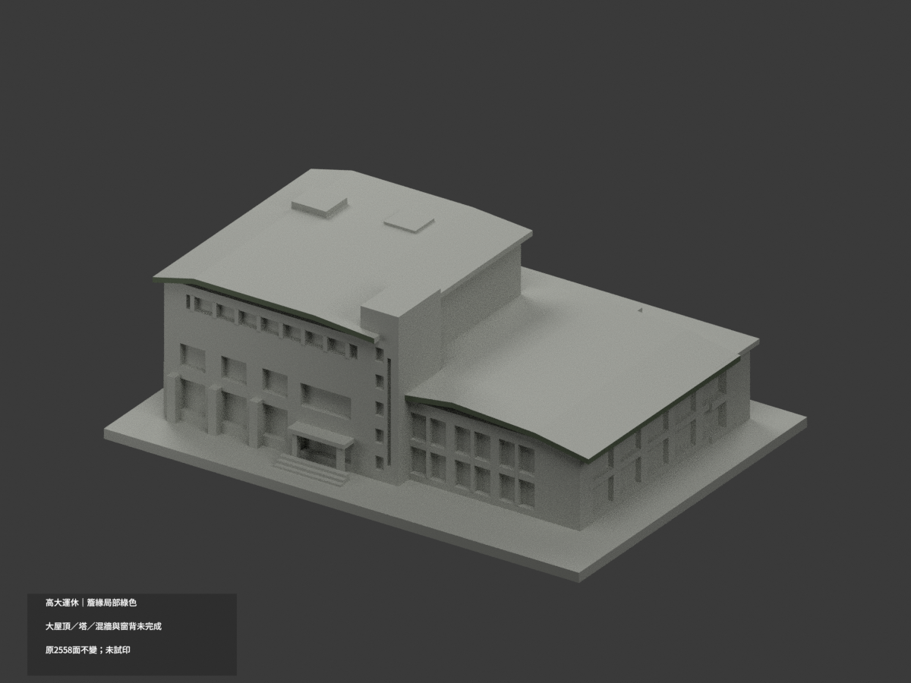
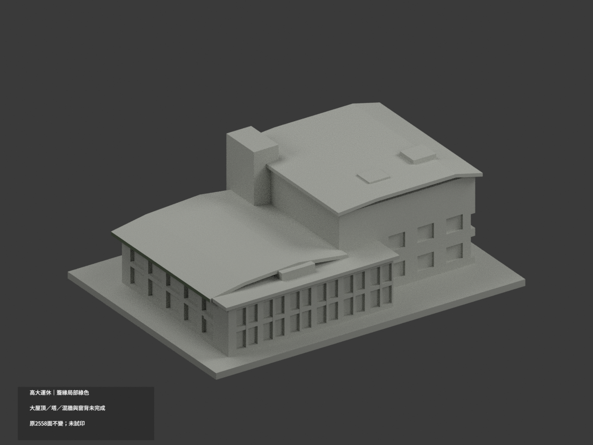
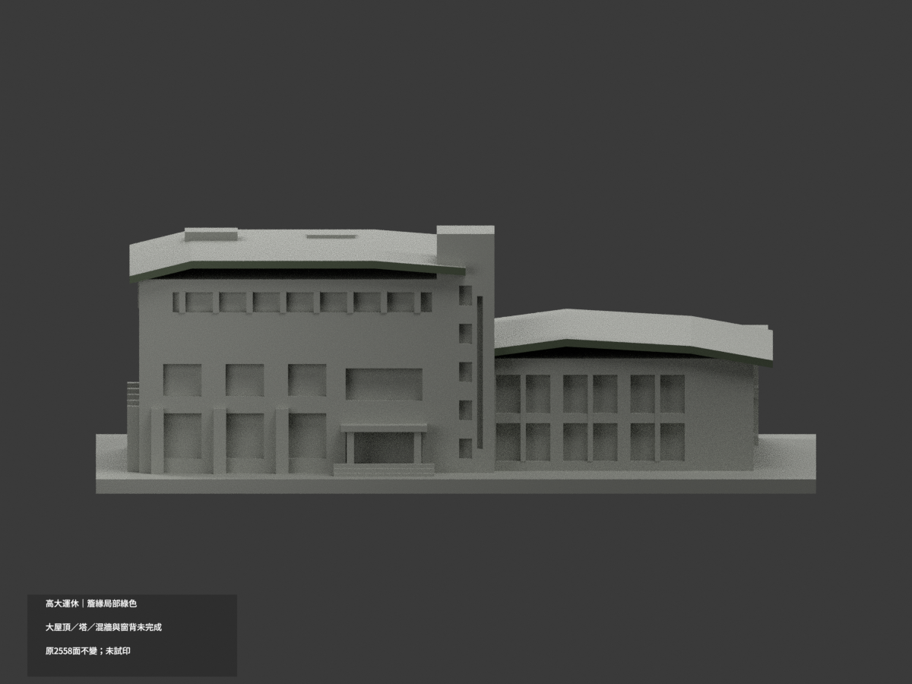
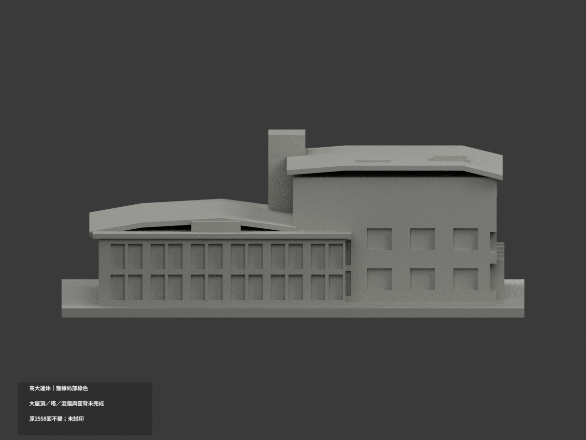
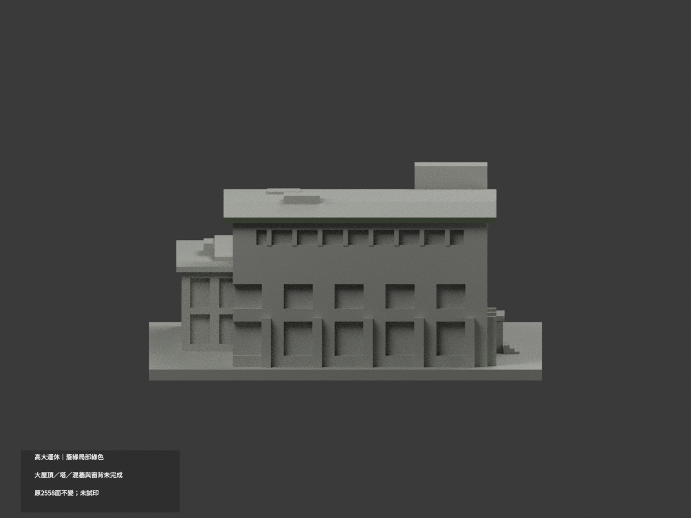
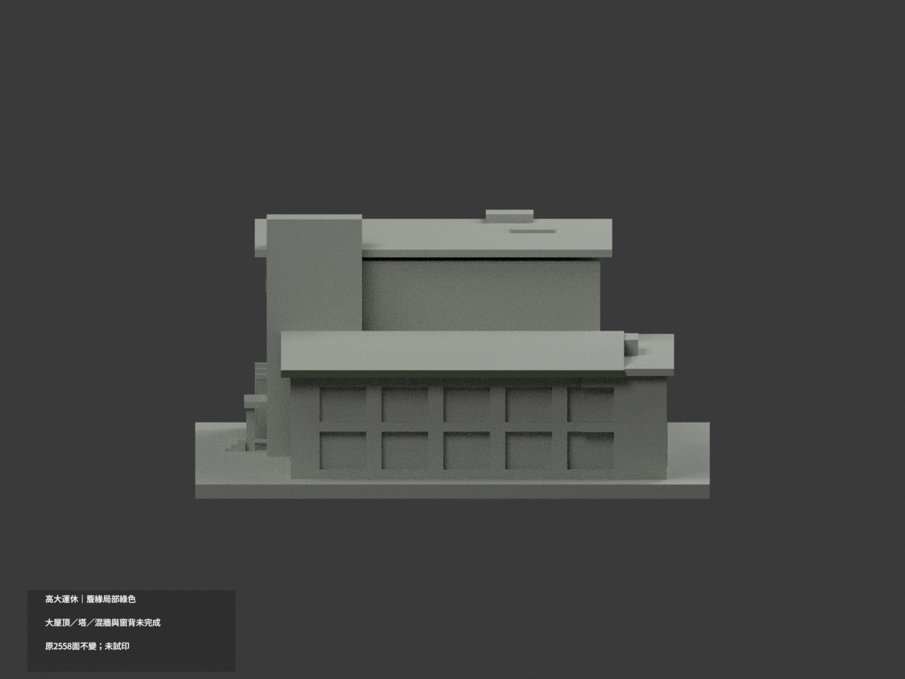
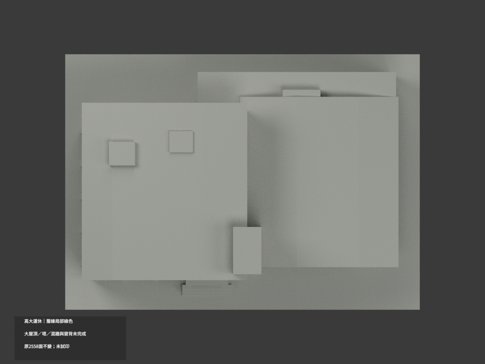
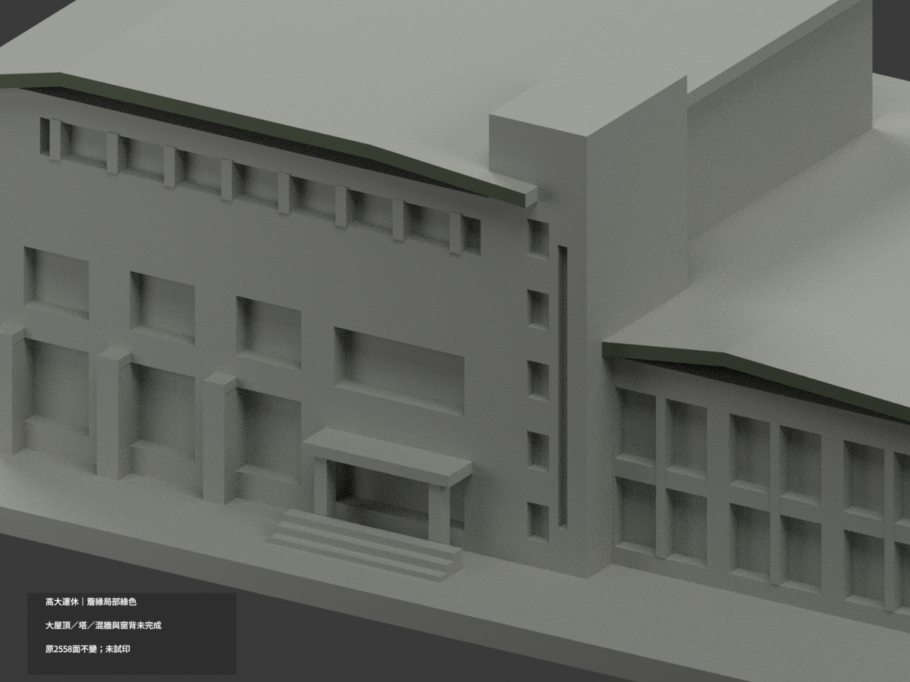
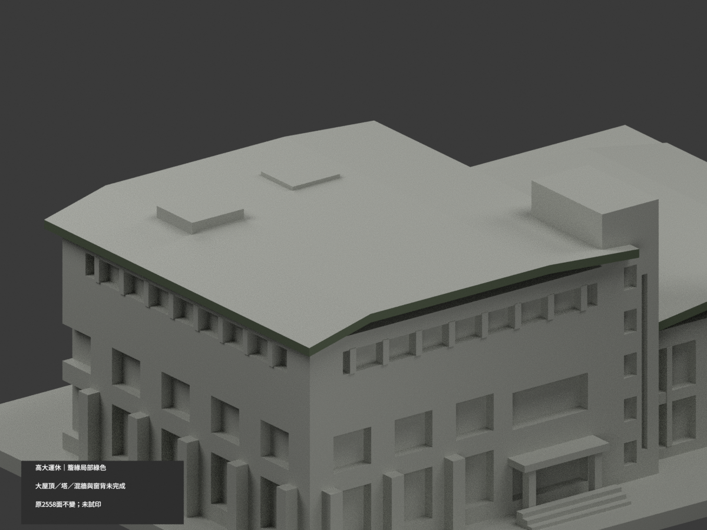
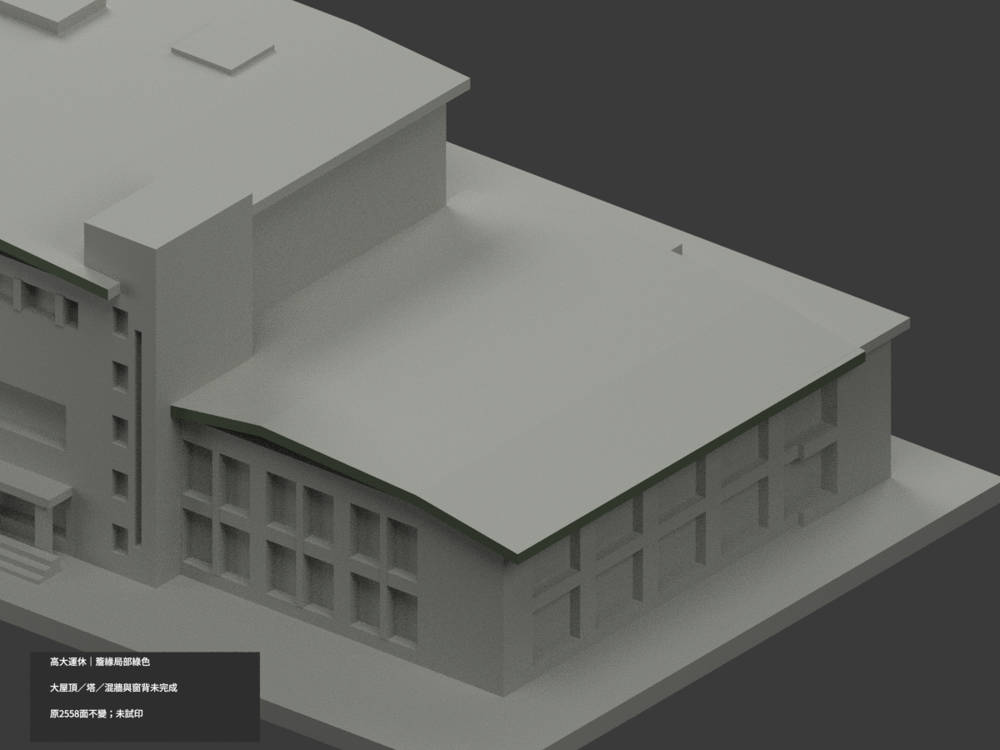

# 高大運休大樓｜屋簷前端與側邊局部綠色

**大屋頂、塔、混材主牆、底面與窗背未完成分色。** `partial_color_incomplete=true`、`fully_colored_exterior=false`。僅16原面簷緣，不是全色或2026現況完成。

| 總覽 | 背側 | 正面 |
|---|---|---|
||||
||||
||||
||||

## 材色範圍
同 `nuk-sports-leisure` 原項目，same-item、count_delta=0。**原2558三角面、STL、OBJ與build_model.py字節不變**；無切面／新增幾何。
- 高翼屋簷前端 y−41.5 的6面、低翼前端 y−36 的6面綠色。
- 高翼西側 x−68 完整延伸邊2面及低翼東側 x66 完整延伸邊2面，分別由照片3／4支持；不是未知後端或屋頂上皮，不按y任切前半三角。
- 其餘2542面中性：整塔、全部窗背、屋頂與底面、混粉灰主牆、階與基座、未知側後。不延用舊v1的27底面灰／128窗背灰綠／4上塔米色候選。
- 塔東 x8 原8面屬同連續混材平面，不能只染上4面造假斜楔；全部中性。所有連通共面域同材，0新增候選撤色。
- 色／中性界是來源及原拓撲限制，非真實材接縫；不拿補色背書原粗幾何精度。

## 來源／日期與權利
四張高大官網外觀照。EXIF圖1為2007、圖2為2005、圖3／4為2002年元旦零時疑重設，均未認證時鐘／時區／拍攝日期，不視為2026現況。
原照私有保存，不公開／貼圖；未確認CC／再散布授權，不保證商用。HEX僅近似灰綠簷材色族，非精確校色。
本次採最終GO與獨審v2，不採v1範圍；GO是來源放行，仍須建模及終審QA，不是發布核准。

## 格式與列印
[原STL](model.stl) · [原OBJ](model.obj) · [材色3MF](appearance.3mf) · [Blender](scene.blend)
150×108mm原展示底座，照片近似非精測比例。STL無色，3MF與Blender真逐面材質。兩材質標籤不是驗證兩色／四色耗材切片；**未實際列印**，無切片路徑。

## 重建與 QA
原 `build_model.py` → `colorize_model.py` → `export_appearance.py` → `validate_color.py`；Blender `render_color.py` 與 `verify_color_scene.py`。
原字節／三角multiset、閉合正體積、3MF面材、完整隔離原build＋color重建、scene重開、十圖1200×900及圖文hash皆核，程序不取代來源人工判讀。
原README與單色previews/render/validation保留歷程，不冒稱新QA，沒有刪除原件。
