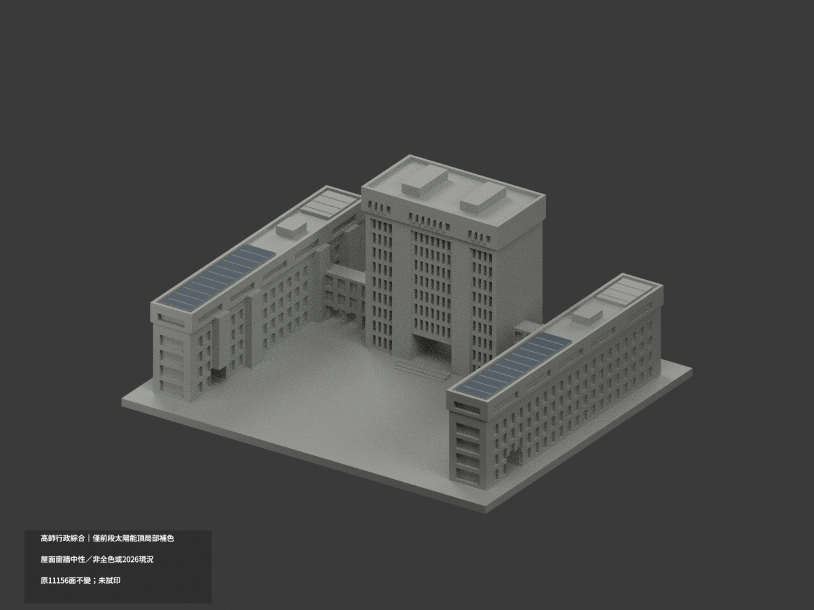
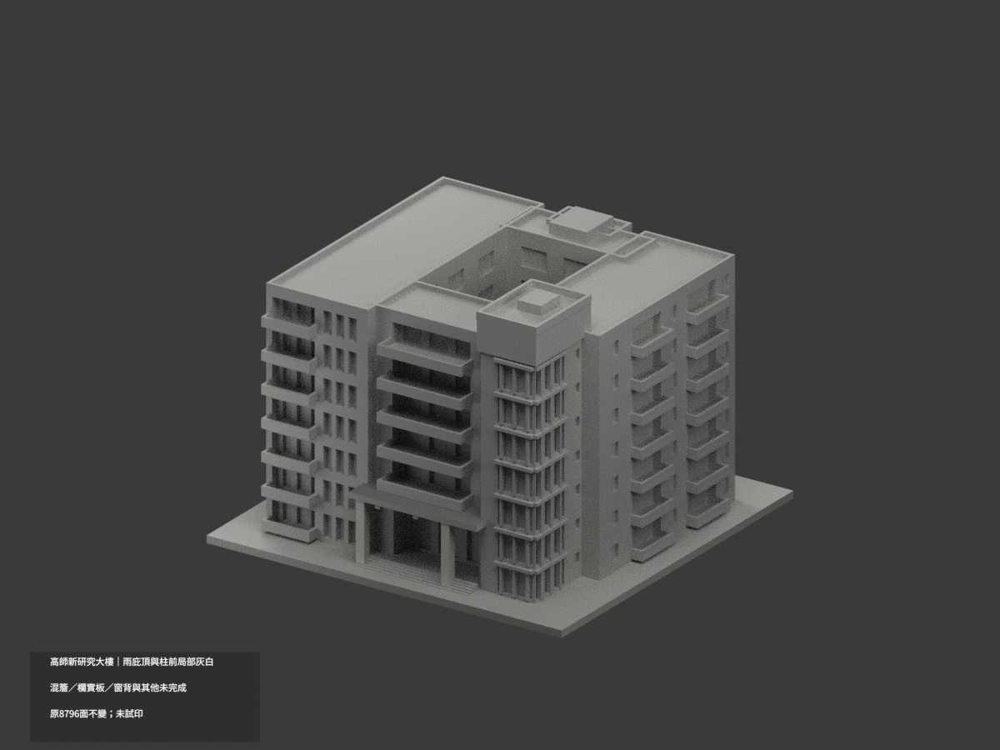
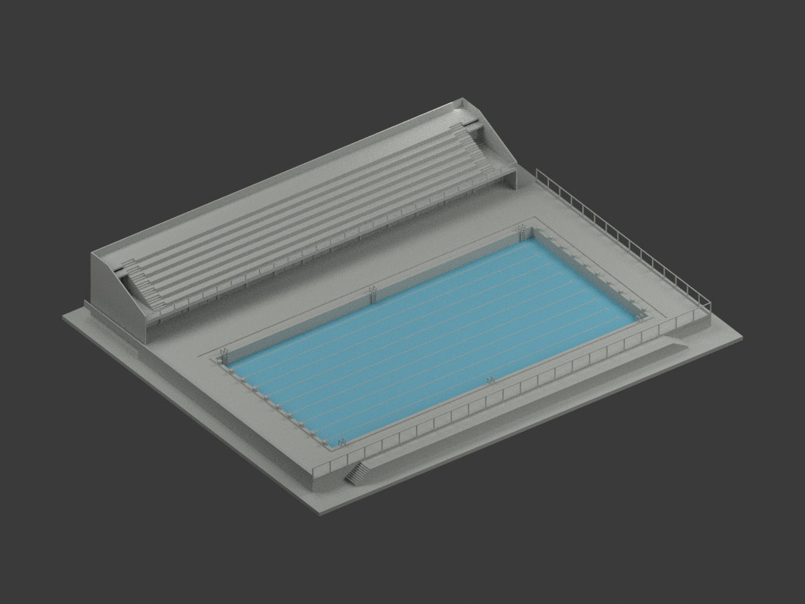

# 國立高雄師範大學

現行收錄 **5 套模型包**；數量不等於完整建築棟數，亦非全校／校區完成。新件與既有件的年代、截段範圍及未試印限制請閱各模型頁。

### 既有批次來源與列印限制（數量為各批歷史範圍，非現行總數）

依公開實拍與官方平面自主建立的3D列印外觀近似。已核對和平、燕巢兩校區，當批共3套：和平校區2套、燕巢校區圖資大樓1套；不是全校完成。

## 模型圖鑑

| 建築模型 | 建築模型 | 建築模型 |
| :---: | :---: | :---: |
|  **[行政大樓・圖書館・教育大樓複合體](和平校區/buildings/nknu-administration-complex/README.md)** [局部材色3MF](和平校區/buildings/nknu-administration-complex/appearance.3mf) · [範圍與限制](和平校區/buildings/nknu-administration-complex/README.md) |  **[新研究大樓（2020年啟用館）](和平校區/buildings/nknu-new-research-building/README.md)** [局部材色3MF](和平校區/buildings/nknu-new-research-building/appearance.3mf) · [範圍與限制](和平校區/buildings/nknu-new-research-building/README.md) |  **[燕巢圖資大樓｜2011–2012整棟地上外觀近似](燕巢校區/buildings/nknu-yanchao-library-information/README.md)** |
|  **[國立高雄師範大學｜和平校區｜歷史舊校門主體](和平校區/buildings/nknu-historical-gate-main-assembly/README.md)** |  **[游泳池與看台更衣室｜1985原設計圖版](和平校區/buildings/nknu-pool-stand-1985-design/README.md)** [STL](和平校區/buildings/nknu-pool-stand-1985-design/model.stl) · [彩色3MF](和平校區/buildings/nknu-pool-stand-1985-design/model.3mf) · [Blender](和平校區/buildings/nknu-pool-stand-1985-design/scene.blend) |  |

每列最多三個不同模型；不以同件不同角度湊件數。

[和平校區](和平校區/README.md) · [燕巢校區](燕巢校區/README.md) · [逐項續接](remaining-buildings.md) · [機器可讀範圍](building-inventory.json)

既有兩套模型原始附件保持不變。和平校區新研究大樓是2020啟用館，不是拆除的舊館。每件均含毫米STL、可編修Blend、自主參數腳本、actual-STL正背頂圖、繁中說明、來源年代、驗證與SHA。

不重新散布第三方原照片或PDF。尚未實體試印，支撐與細件警示見各模型頁。66條續接含建物、群棟、非建物、歷史與待核項目，不代表66棟，也不代表已完成全校調查。

[燕巢圖資大樓｜2011–2012整棟地上外觀近似](燕巢校區/buildings/nknu-yanchao-library-information/README.md)：燕巢圖資大樓（圖書及資訊大樓）：約2011–2012完工期整棟可見地上外觀比例近似，兩翼、中央封閉大廳、凸弧玻璃、完整屋面、入口平台／真通道、外梯及後露臺合計一套；不是和平圖書館、高科大燕巢圖書館、竣工圖或已確認2026現況。前方外弧為花台／坡道不是房間；最低弧門為1F、窗帶不等於樓層，不臆造隱藏B1。約1:400、245×215mm展示底板不是實際基礎；4660×3240cm尺寸鏈不等同外牆／挑簷外緣，6884.74／7481m²差異不平均硬套輪廓。架高周邊薄帶、圓形採光環斜撐與兩側不同翼向保留；局部視角east/west/south檔名不代表地理測量方位。7材質3MF、STL、可編輯Blend與467隱藏建構分件、公開Python及9張建築檢視圖與1張統一角度代表圖；重疊分件不與外殼同印。204截面、19空間射線、完整自交掃描與8控制、原生編輯及公開輸入重建通過；約0.6mm細件、平台／屋簷／採光環需支撐與尺度評估，未真正切片或試印、非免支撐認證。個別照片日期不明，2012簡報預定開館日不當成已核實實際開館。

## 新增1985原設計圖外觀範圍

1985年4／5月陳其寛建築師事務所原設計圖外觀；不是竣工測繪或2026現況，未核實精確啟用年，不將1987當已證年份。僅泳池、看台及更衣室，不補旁側體育館；15cm寬差、3cm高差及5cm場地鏈差保留，細件與場界為簡化，未實體試印。

設計者與典藏來源保留；原圖像標示CC BY-NC、未明示版本，與自行編寫程式／重建模型權利分開，不概括整包模型僅限非商業，也不宣稱取得原圖或建築設計的無限制商用權利。原圖、PDF與私人參考資料不配送。
