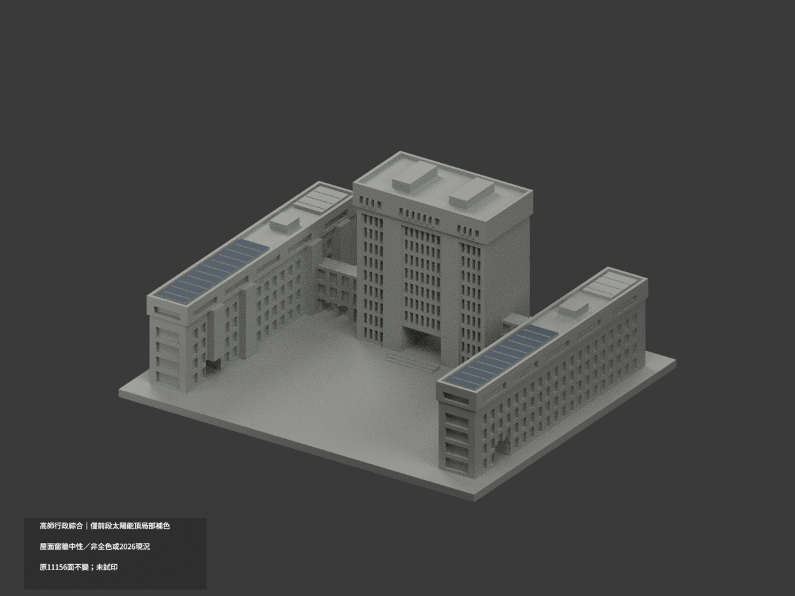
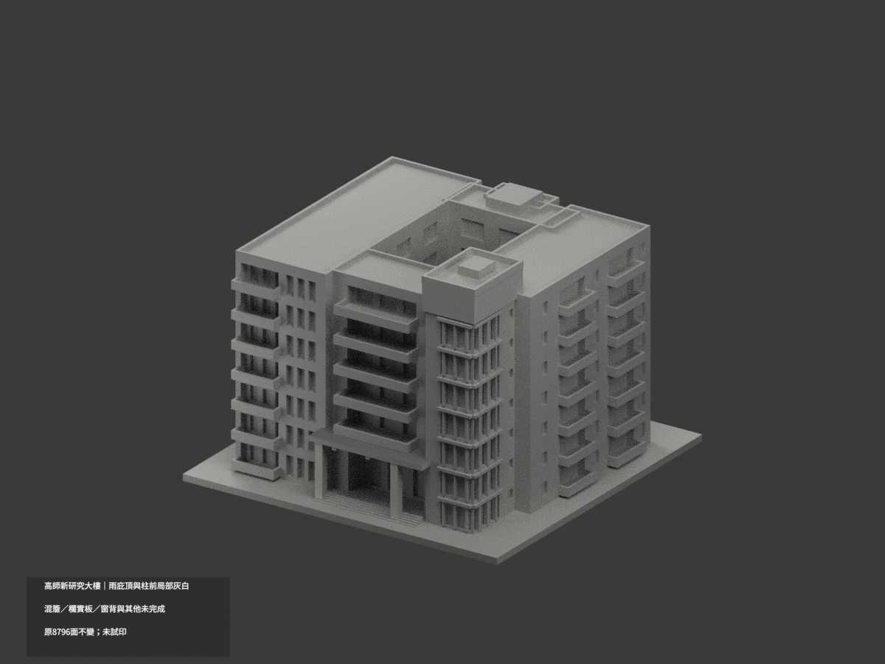
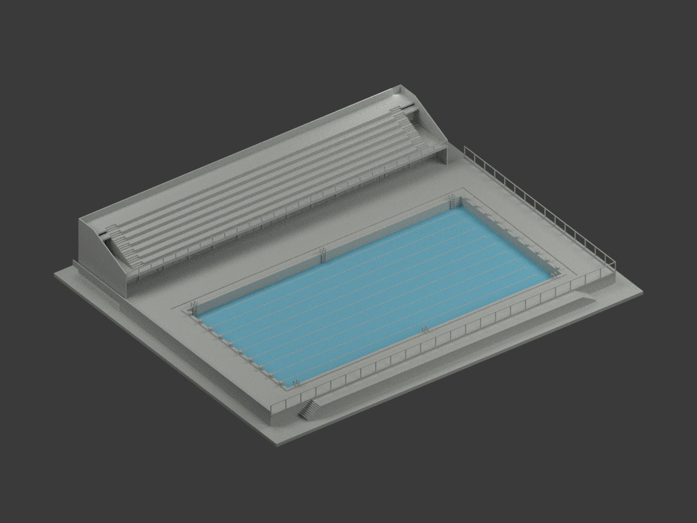

# 和平校區

現行收錄 **4 套模型包**；數量不等於完整建築棟數，亦非全校／校區完成。新件與既有件的年代、截段範圍及未試印限制請閱各模型頁。

### 既有批次來源與列印限制（數量為各批歷史範圍，非現行總數）

高雄市苓雅區和平一路116號。已建2件外觀近似模型，其餘仍待逐棟製作。

## 模型圖鑑

| 建築模型 | 建築模型 | 建築模型 |
| :---: | :---: | :---: |
| 模型預覽 行政大樓・圖書館・教育大樓複合體  [局部材色3MF](buildings/nknu-administration-complex/appearance.3mf) · [範圍與限制](buildings/nknu-administration-complex/README.md) | 模型預覽 新研究大樓（2020年啟用館）  [局部材色3MF](buildings/nknu-new-research-building/appearance.3mf) · [範圍與限制](buildings/nknu-new-research-building/README.md) |  **[國立高雄師範大學｜和平校區｜歷史舊校門主體](buildings/nknu-historical-gate-main-assembly/README.md)** |
|  **[游泳池與看台更衣室｜1985原設計圖版](buildings/nknu-pool-stand-1985-design/README.md)** [STL](buildings/nknu-pool-stand-1985-design/model.stl) · [彩色3MF](buildings/nknu-pool-stand-1985-design/model.3mf) · [Blender](buildings/nknu-pool-stand-1985-design/scene.blend) |  |  |

模型預覽

- [行政大樓・圖書館・教育大樓複合體](buildings/nknu-administration-complex/README.md)
- [新研究大樓（2020年啟用館）](buildings/nknu-new-research-building/README.md)

[回學校圖鑑](../README.md) · [逐項未完成範圍](../remaining-buildings.md)

## 新增1985原設計圖外觀範圍

1985年4／5月陳其寛建築師事務所原設計圖外觀；不是竣工測繪或2026現況，未核實精確啟用年，不將1987當已證年份。僅泳池、看台及更衣室，不補旁側體育館；15cm寬差、3cm高差及5cm場地鏈差保留，細件與場界為簡化，未實體試印。

設計者與典藏來源保留；原圖像標示CC BY-NC、未明示版本，與自行編寫程式／重建模型權利分開，不概括整包模型僅限非商業，也不宣稱取得原圖或建築設計的無限制商用權利。原圖、PDF與私人參考資料不配送。
