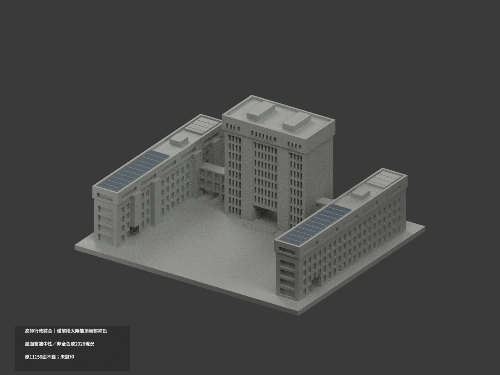
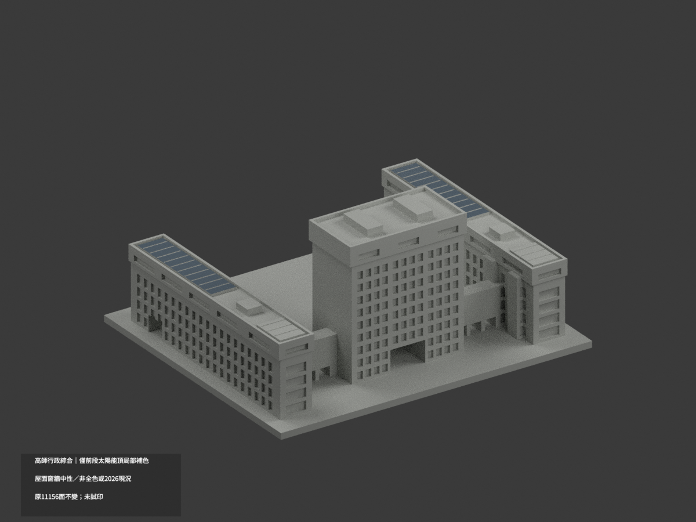
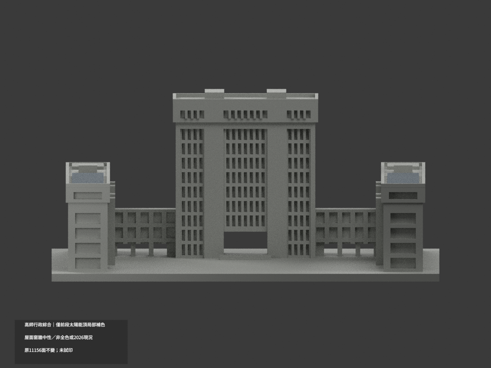
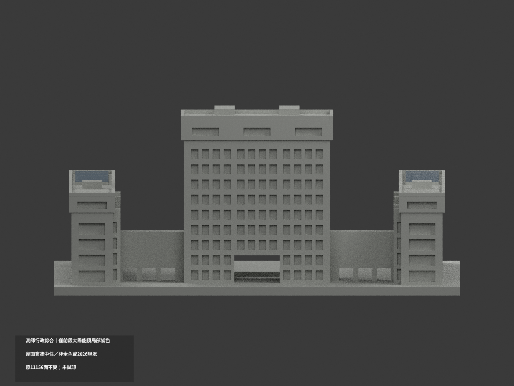
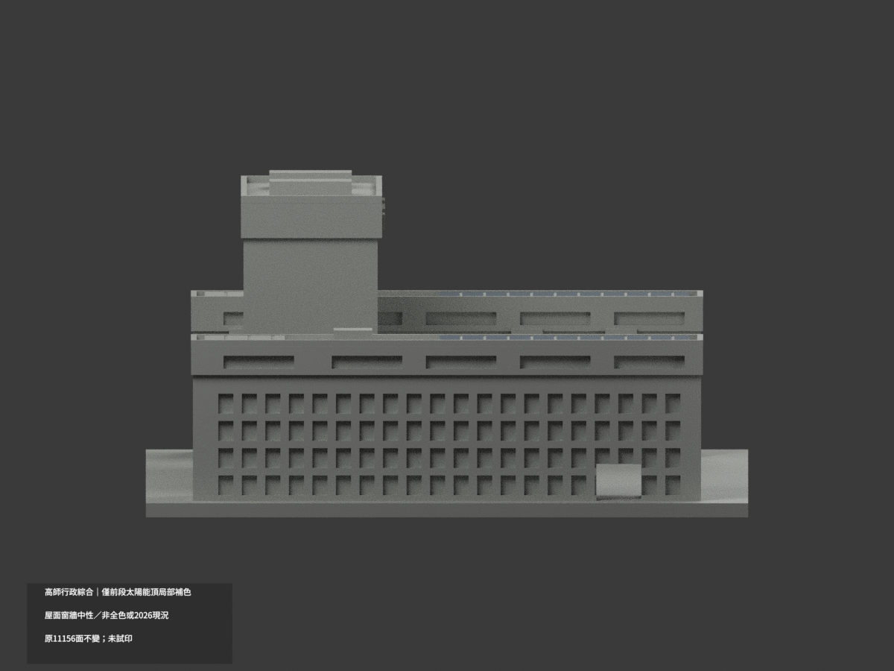
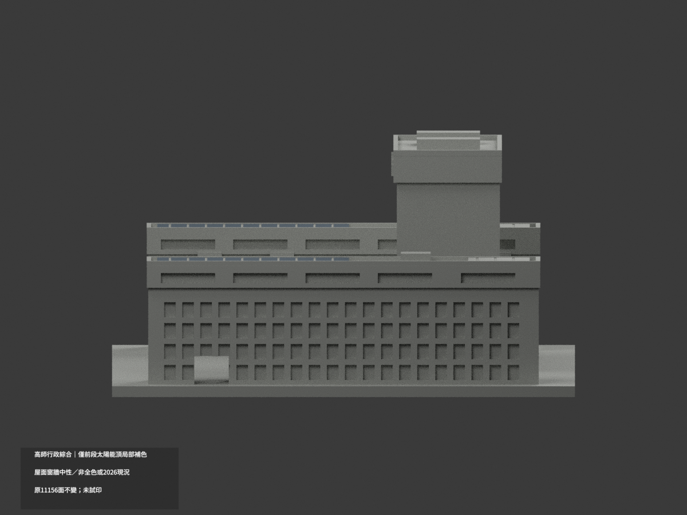
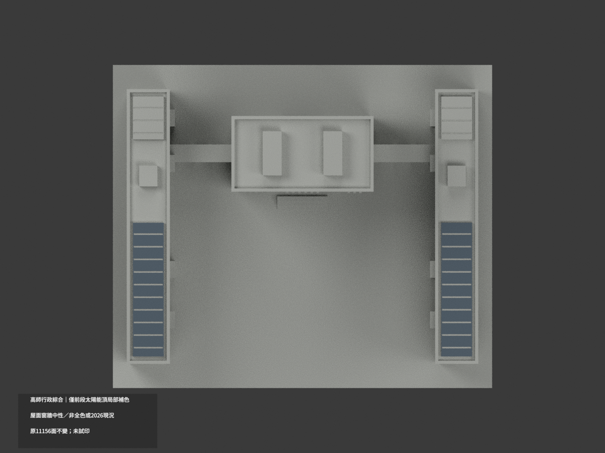
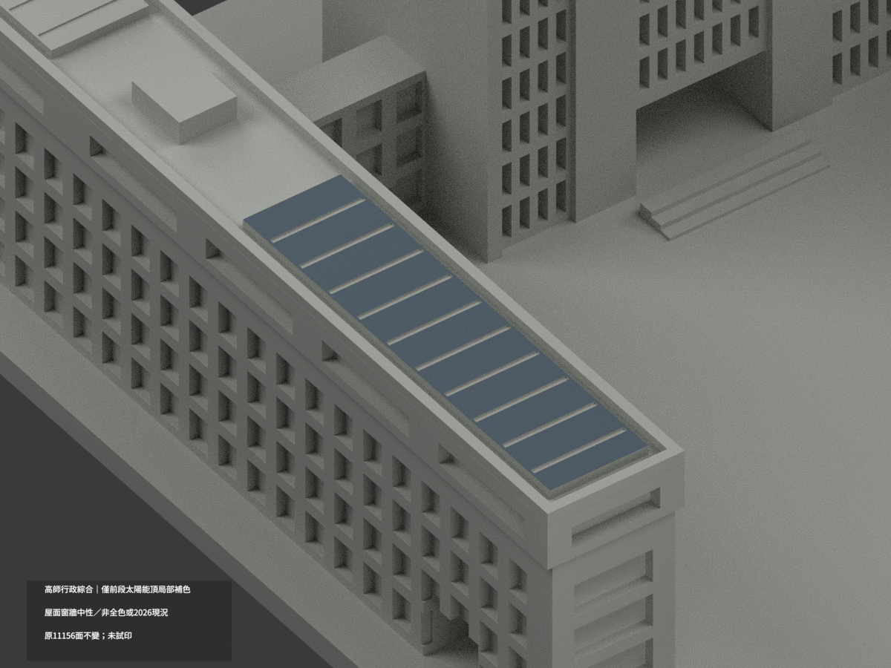
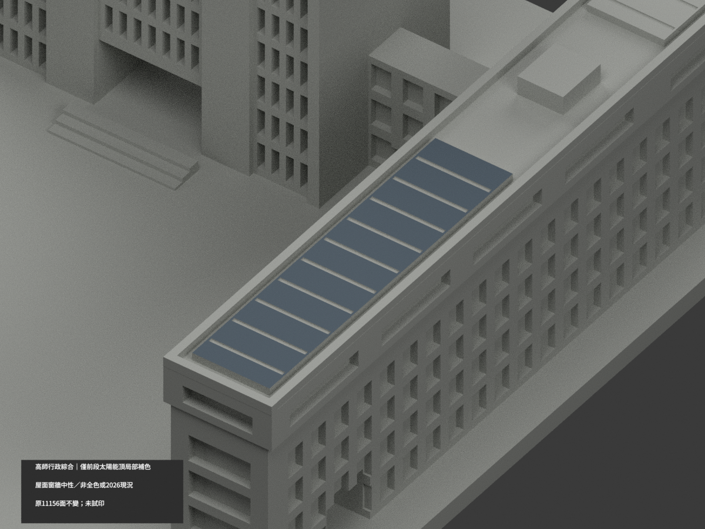
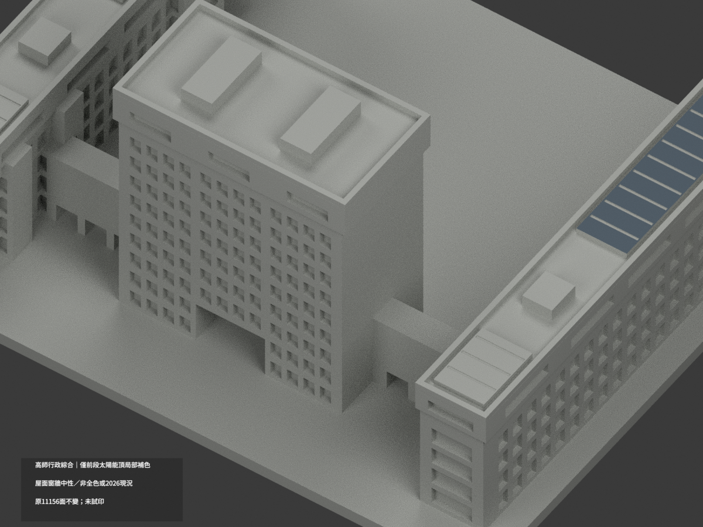

# 高師行政綜合｜僅兩前段太陽能頂面局部補色

**局部補色未完成：只兩前段長太陽能桌面藍灰；屋面、短後桌與窗牆未完成。非全色或2026現況。** `partial_color_incomplete=true`、`fully_colored_exterior=false`。同項目`nknu-administration-complex`／`count_delta=0`，不新增套數，沿和平校區原包。

| 前斜視 | 後斜視 | 正面 |
|---|---|---|
|  |  |  |
|  |  |  |
|  |  |  |
|  | | |

## 材色範圍

只有x±61、半寬6.1、y[-51.5,1.5]、z37.2真正朝上太陽能長桌表皮，各62原面共124藍灰；原格槽底／側／桌下不染。其餘11032原面未知中性，**不是實景灰色證明**；3284共面連通域均一致。粗桌板原刻槽只是近似，不新增電池格、模組片數、薄架或反射校準。

兩短後桌y43全部中性；航照左後實為紅屋瓦及設備，絕不複製前長桌藍色。主塔/帽/地層柱/招牌混材遮蔽，不整白；所有窗背含框、玻璃、簾、空調反光而未一色判讀。側翼牆、連橋、欄牆、屋頂、設備、階／基座皆中性。材料界線只資料範圍非真實材縫。

原11156面、尺寸、STL及build字節保留，不分割、加面或改形；本次色審不追認原幾何近似。兩個原短桌形體仍保留，但不得以補色暗示左後存在太陽能。

## 來源年代及權利

本案正式GO綁定兩張外部實照：校方招募航照與校友地面照，均已親看。航照充分對應兩前長陣列；地面照不補未見屋面色。各URL/hash見`COLOR-SOURCE-REGISTER.json`。2014校友相簿日期不是自動認證拍攝日；航照日期未獨核，不宣稱2026現況。只外部材色，不重建人／旗／字樣。

照片私存不公開、不作貼圖；未見CC不沿repo license推定自由商用。HEX是近似族群不是測色，未保證商業授權。

## 檔案、重建及 QA

`appearance.3mf`2展示材、`scene.blend`實面材、`color-mesh.npz`原頂點／面／材索引。原STL無色、原build字節保留。原包OBJ存在且原字節保留。

原README另存`ORIGINAL-MONOCHROME-README.md`或`.zh-TW.md`，舊previews／QA保留單色歷程不作新色審。依`requirements.txt`跑`python colorize_model.py`、`python export_appearance.py`、`python validate_color.py`，Blender跑`render_color.py`、`verify_color_scene.py`。原build+color全隔離重建目錄保留不刪。格式／三角multiset／封閉正體積見`COLOR-*QA.json`，重開`SCENE-QA.json`，10張1200×900與hash綁定`DELIVERY-QA.json`；父另人工終審。

**未實際列印。** 2展示材非已驗四色切片工程；支撐／材料對應／薄部強度另驗。

## English limitations

Partial reference only: two foreground long photovoltaic top fields62+62triangles;11032neutral. All3284coplanar domains uniform; groove floors/sides and rear short tables neutral. Photographed leftrear has redroof/equipment, so no cloned solar color. Original11156faces/STL/build bytes preserved, count_delta0; no new cells or geometry. Only two GO-listed exterior photographs used, capture dates unknown,2014album date not automatically capture. Not2026condition or complete coloring. Source photos private; not physically test-printed.
