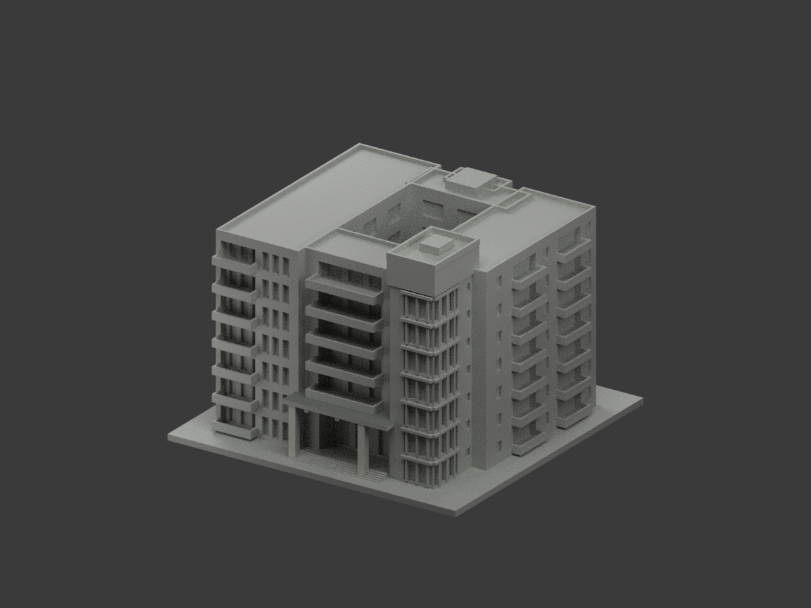
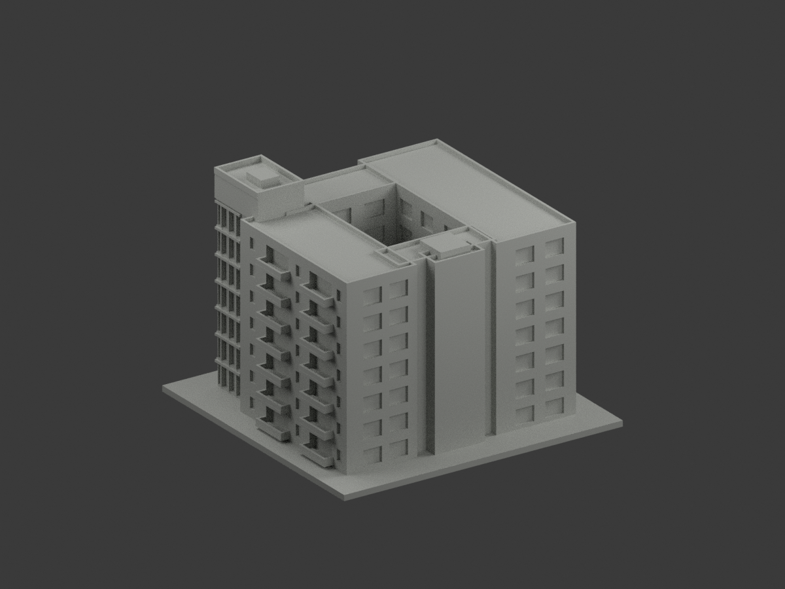
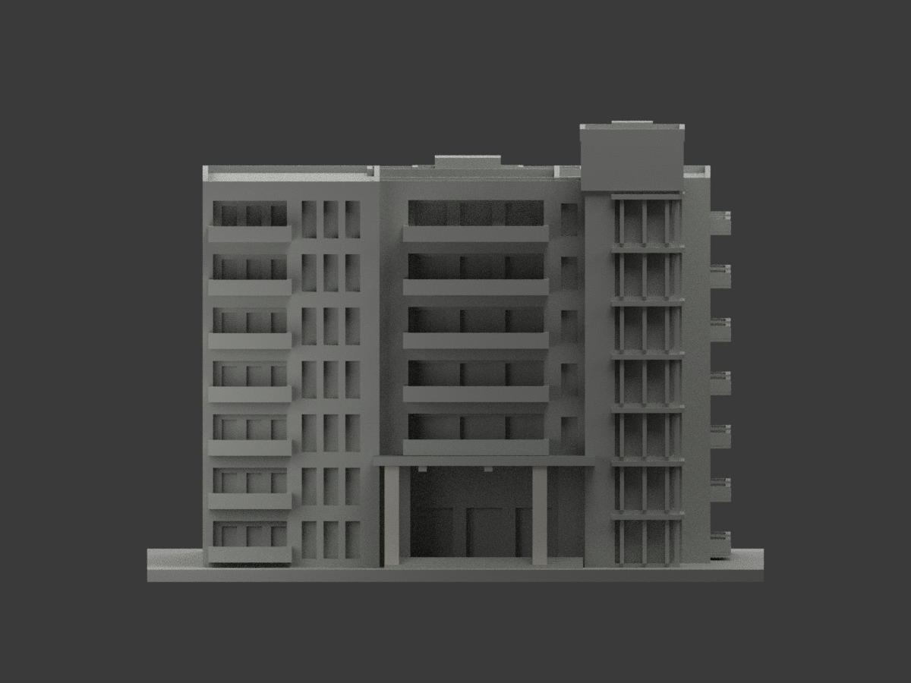
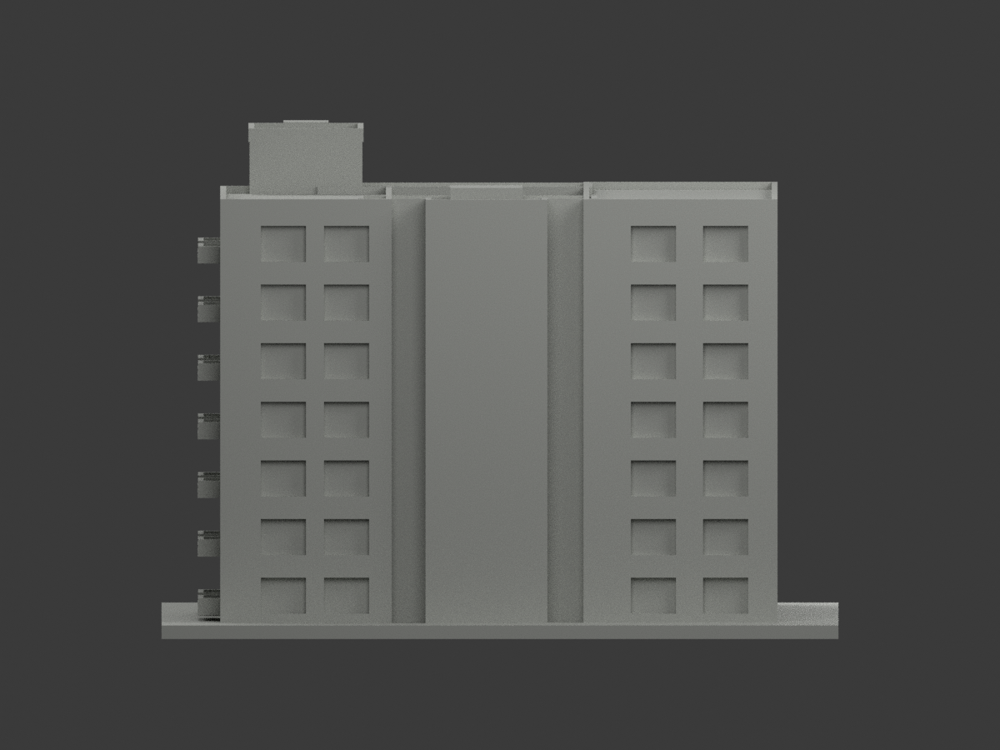
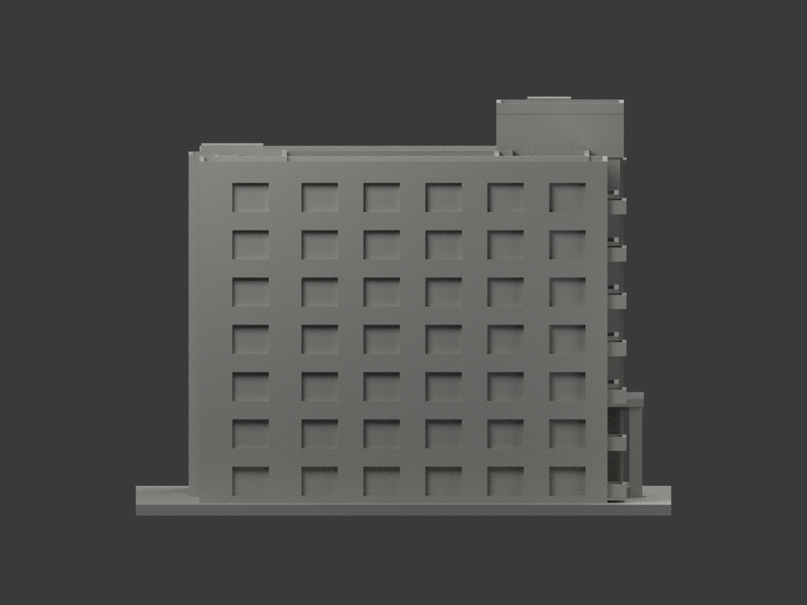
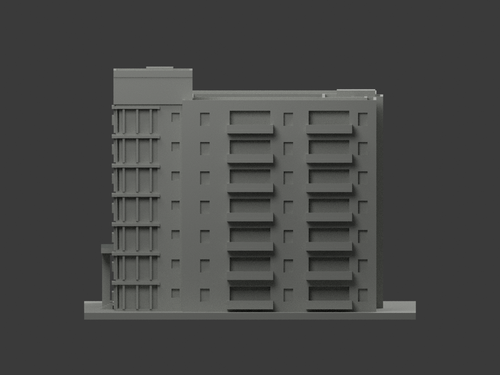
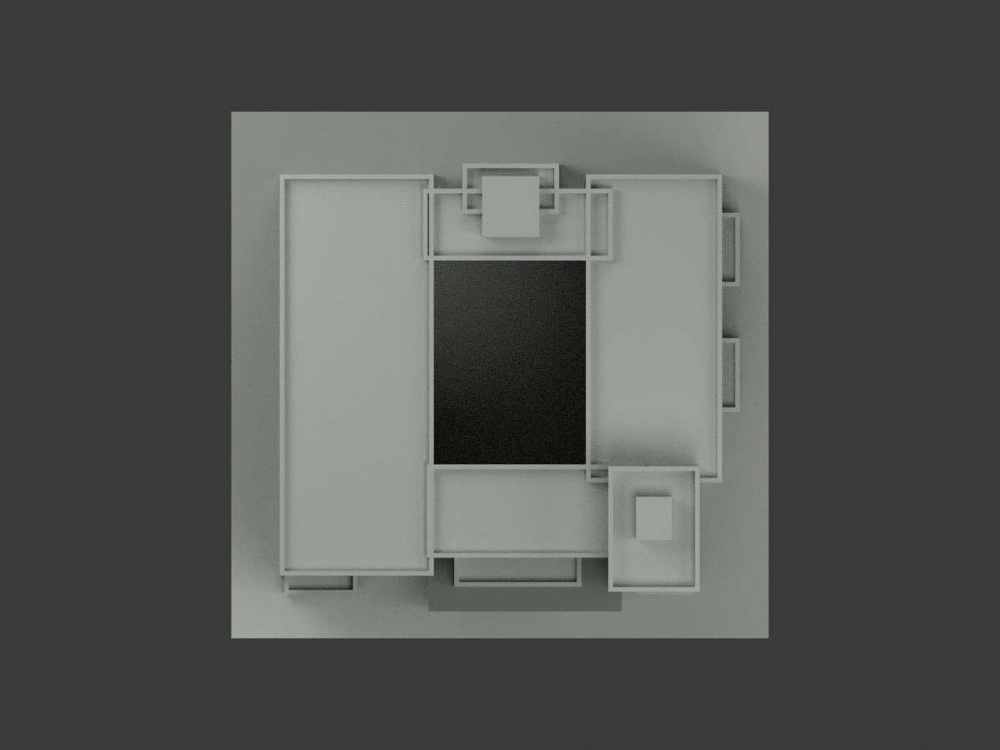
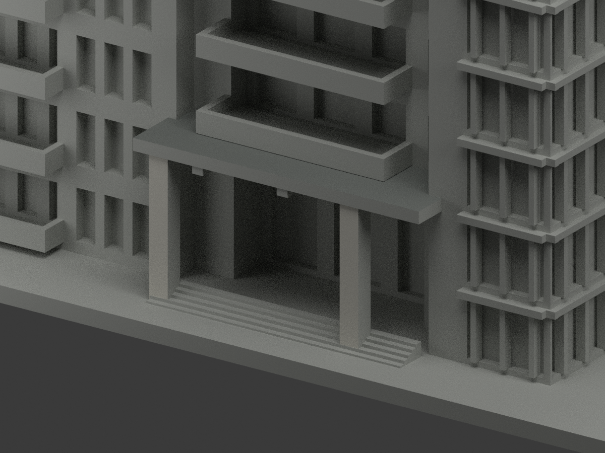
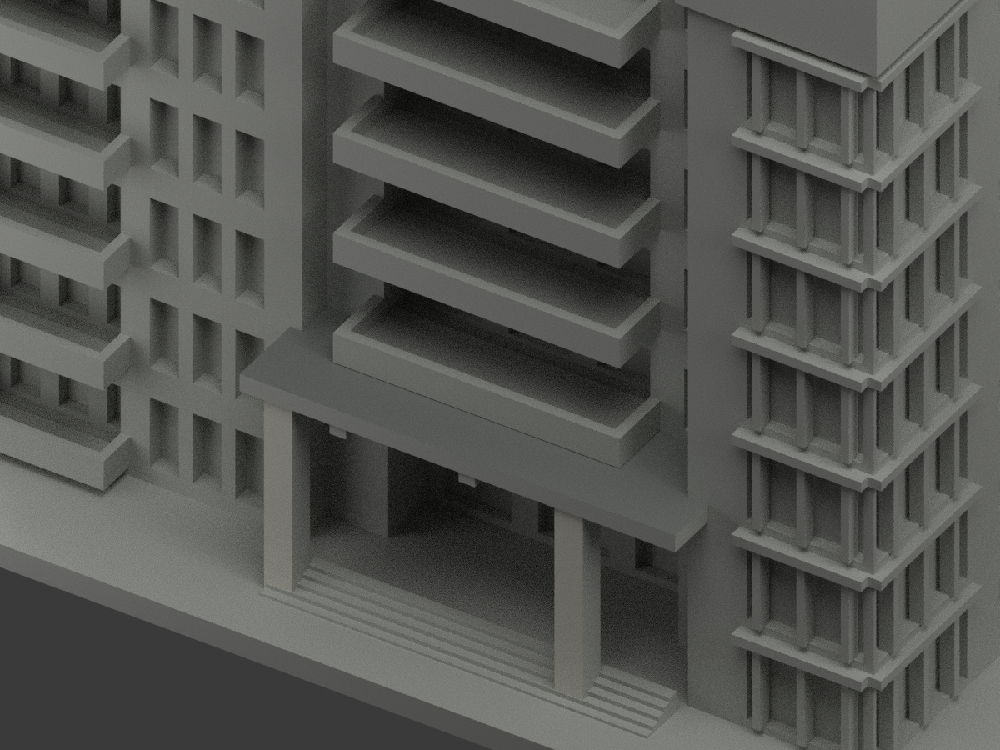
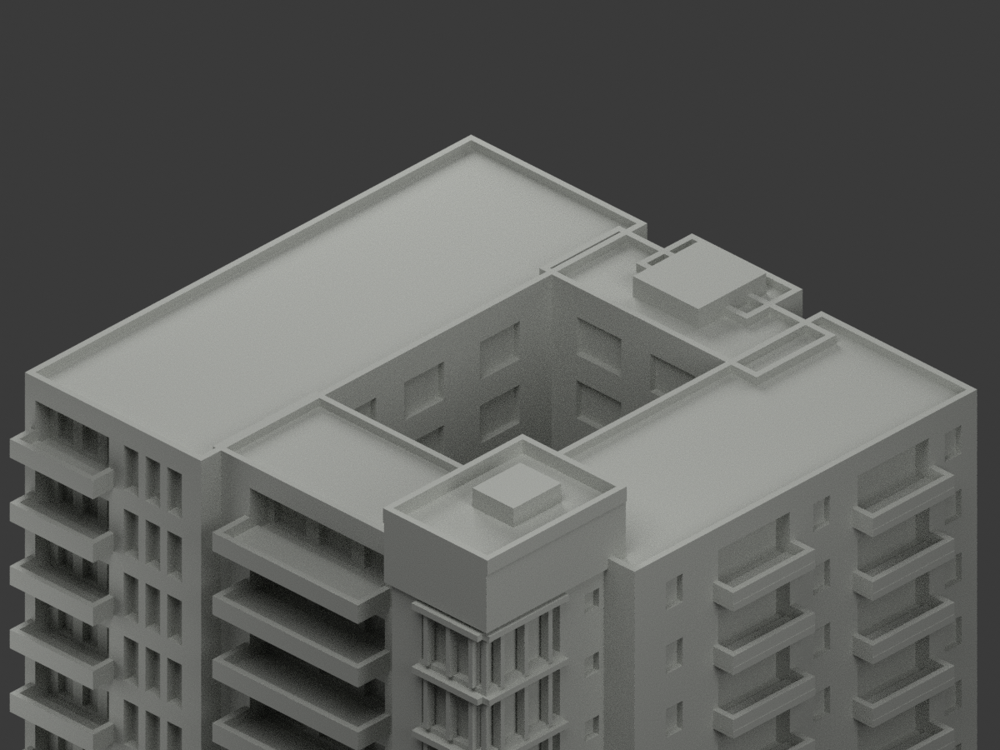

# 高師新研究大樓｜入口右柱內側有限暖白補色

局部分色未完成。保留原雨庇真頂6灰面及兩柱前6暖白面，新增右柱朝入口內側8原三角，合計20配色、8776未知中性、8796原面。三個原palette名稱、色票/index全部保持；新增8面沿用index2名義暖白#D7D5CC，歷史色名frontfaces不代表本次仍僅前面。原STL/OBJ/build、所有未選索引及工程aliases原bytes不變。

新實看官方啟用典禮近照（總務處SN233之04(1).jpg，1600×1067）直接可辨右柱內向平面的淺色洗石族，不是只由前面同構件推色。原地面照與高視角仍作入口身份交核。新近照柱頂被畫面裁去、下端部分有人遮，完整原平面採有限同平面連續推定，不宣稱逐面全高直接可見。小壁燈、分縫及材質顆粒原未建模，不新增或畫黑；HEX非校準色票，原3.5mm方柱深度非實測。

選取右柱x18.75、y[-65.55,-62.05]、原z[2.8,28.4]有限盒內的-X面，經原階梯/雨庇Boolean後實際z3.9..28，8面一完整共面域；不切面不取重心。左側實景較深回牆、右柱外側/背面/頂底、雨庇混深上緣與淺下皮fascia/底面、其他牆、欄代實板、窗背及屋頂都不擴色。

2020文章/典禮脈絡與2026附件路徑不等於獨立拍攝日期，不稱2026現況。本件為新研究大樓非舊拆館；原近似幾何及列印限制保留。照片私人研究不公開貼圖、不推定再散布權，未試印、未驗多料切片、沒有新工程精度認證。PILLAR-INNER-SOURCE-QA固定pending階段快照，最終獨審另檔；舊QA保存在qa/pillar-inner-previous。下列12面等統計僅屬歷史原版。

## 原版說明與工程限制（完整歷史原文）

# 高師新研究大樓｜入口雨庇頂與柱前局部灰白

**混材簷面、欄代實板、窗背與其他未證面未完成分色。** `partial_color_incomplete=true`、`fully_colored_exterior=false`。只12個入口有據原面，不是全色現況。

| 總覽 | 背側 | 正面 |
|---|---|---|
||||
||||
||||
||||

## 材色範圍
同 `nknu-new-research-building` 原項目，same-item、count_delta=0。**原8796三角面、STL、OBJ與build_model.py字節不變**；無切面／新增幾何。
- 獨立入口雨庇真頂 z30.2、x−20..34／y−66..−48，6原面中灰，並非整盒灰色。
- 兩柱真正前表面 y−65.55、中心x−15.5／20.5，原臺階／雨庇Boolean已剪界，6原面暖白。
- 其餘8784面中性：雨庇前fascia混深上緣與淺下皮、柱側／雨庇底、主體混牆、代欄杆的原實板、窗背與粗框、屋頂設備、側後、中庭及階。
- 全共面連通域同材，0候選撤色。不把實欄板塗黑冒充透空欄杆，不畫三角楔假材界。色／中性界是證據與原拓撲範圍，不是真實材接縫。
- 此為新研究大樓，非已拆舊館；補色不重新背書原照片近似幾何、窗框或樓層精度。

## 來源／日期與權利
官方完工高視角與地面外觀兩照片。2020文章／完成歷史、2026附件網址均不是獨立拍攝日期證明，不稱2026現況精測。
原照私有保存，不公開／貼圖；未確認CC／再散布授權，不保證商用。HEX只是近似灰白材色族，非校準色票。
最終來源GO是來源範圍放行，不是發布核准，也不免除幾何／共面／視覺QA。

## 格式與列印
[原STL](model.stl) · [原OBJ](model.obj) · [材色3MF](appearance.3mf) · [Blender](scene.blend)
150×147mm原展示底座，照片近似非精測比例。STL無色，3MF與Blender真逐面材質。三材質標籤不是驗證三色／四色耗材切片；**未實際列印**，無切片路徑。

## 重建與 QA
原 `build_model.py` → `colorize_model.py` → `export_appearance.py` → `validate_color.py`；Blender `render_color.py` 與 `verify_color_scene.py`。
原字節／三角multiset、閉合正體積、3MF面材、完整隔離原build＋color重建、scene重開、十圖1200×900及圖文hash皆核，程序不取代來源人工判讀。
原README與單色previews/render/validation保留歷程，不冒稱新QA，沒有刪除原件。
