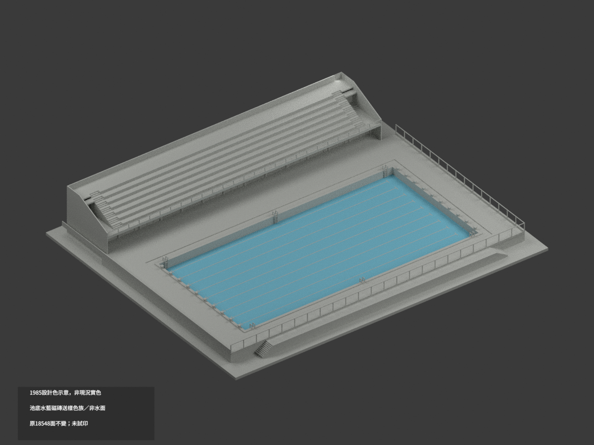
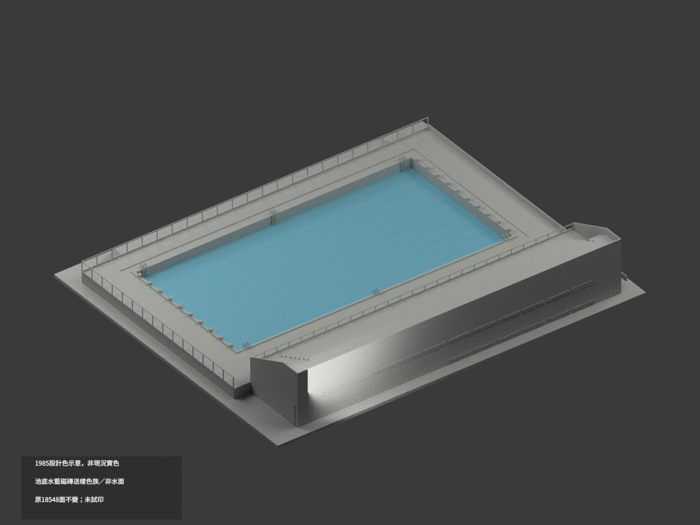
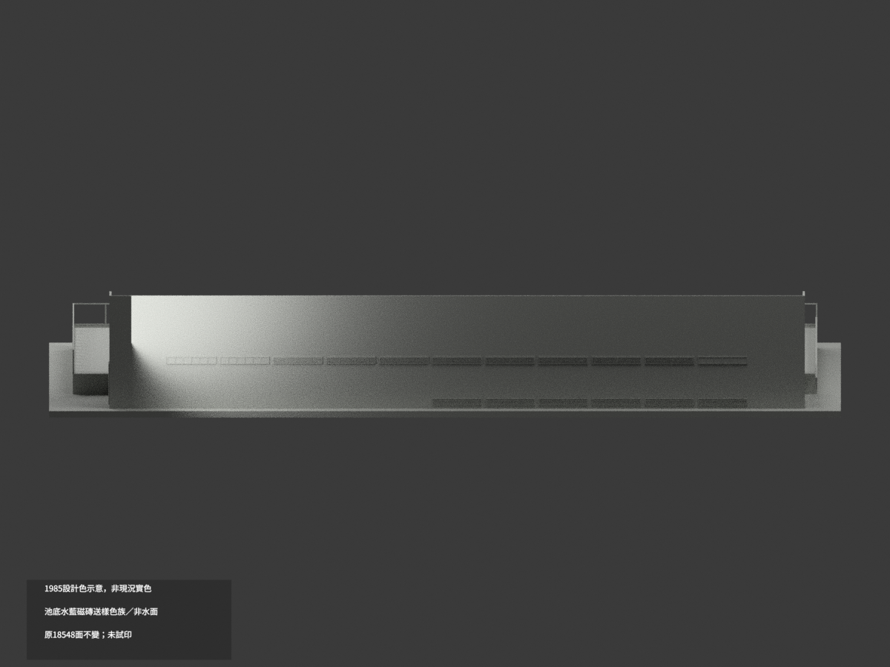
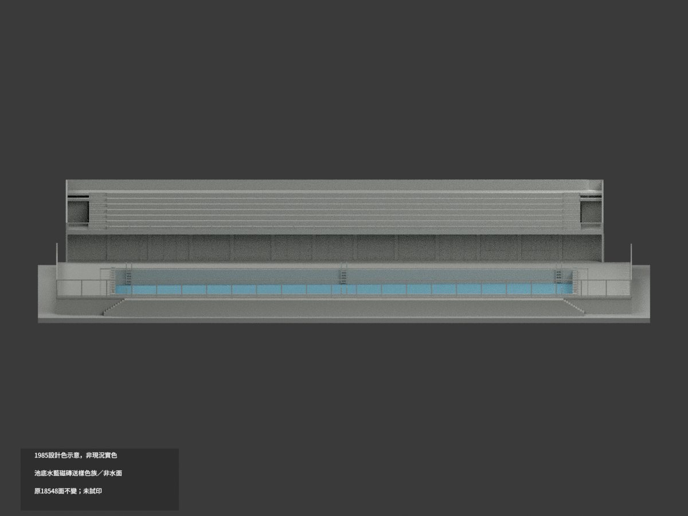
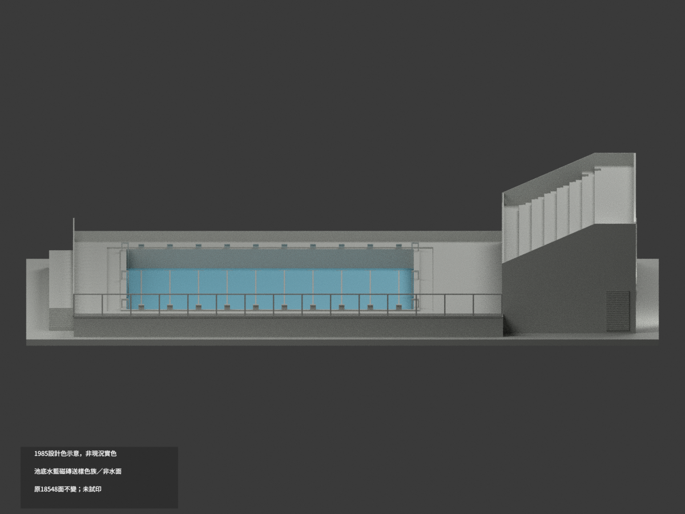
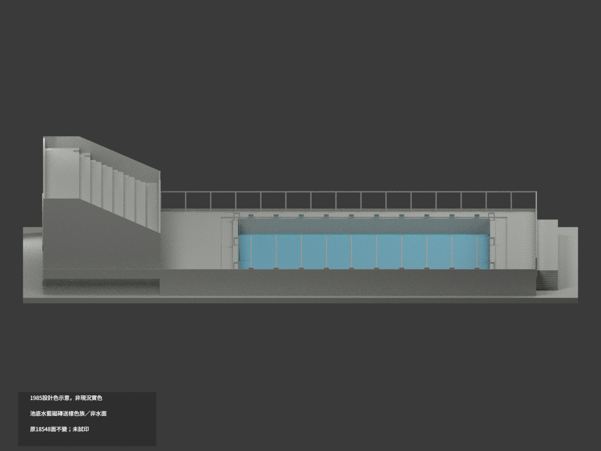
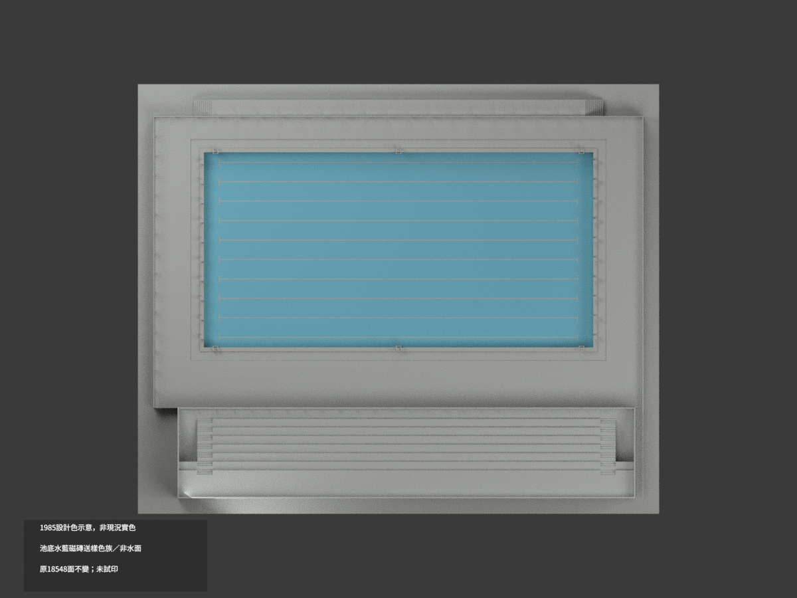
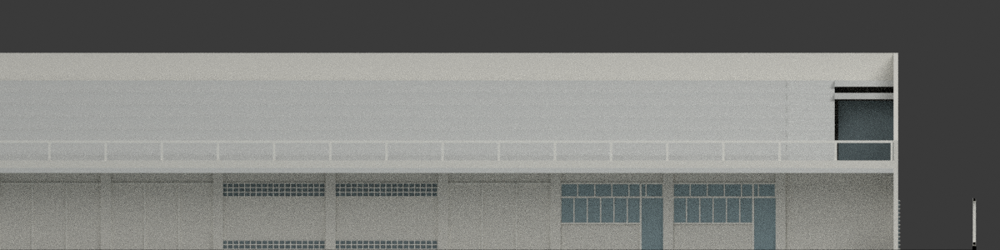
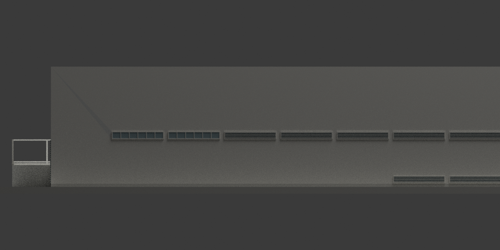

# 高雄師範學院游泳池與看台更衣室 — 1985 年原設計圖版

> 依陳其寛建築師事務所 1985 年原設計圖重建的校園建築組。**不是竣工測繪，不代表 2026 年現況。** 本地模型與數位 QA 已完成。

## 身分與版本

國立臺灣博物館典藏案名「國立高雄師範學院游泳池新建工程」，圖組 **CCCK296**，圖框日期民國74年4、5月（1985-04／05）；部分原始題名包含同案體育館。**本模型只重建泳池、看台及其更衣室，不以結構圖推造旁邊體育館。**

高雄師範大學官方歷任校長頁記載1983–1989年間興建體育館、游泳池，體育系資料確認和平校區泳池；這支持校園及年代背景，不等於逐項證明原圖完全照建。未直接核實精確啟用日期，不將「1987」寫成已證竣工年份。後續整建不混入本原設計版本。

## 幾何範圍與差異

- 看台／更衣室採A2-2外寬 **58.90m**、深 **11.70m**；A2-1另標58.75m，保留15cm圖間差，不假稱全部完全一致。
- 以GL=0，池邊地坪+1.50m；看台細部前走道+4.77m、後平台+8.27m、女兒牆頂+9.37m。整體立面將頂高概括為9.40m，差3cm；模型採細部完成面。
- 看台是**7個50cm升階、6個110cm踏面**；端部小梯為21升階、20踏面。下層主梯出口是有屋蓋的凹入通道，不是整片後平台開天井。地下室、設備與被遮蔽的完整內梯不重建。
- 池內結構控制50.10×25.10m，原圖說明完成貼面淨50×25m；本模型用結構內界。池底左端GL±0、右端−0.18m，乾池深1.50–1.68m。中間排水點−0.20m的小局部低點不另造槽。
- 洗腳池環槽保留淺凹；10泳道標記與兩端起跳台、兩長邊各3組爬梯可辨。六梯位置按原平面符號比例讀取（不是全部逐項標註），彎管角化，細桿約加厚到0.10m供縮尺表現。
- 更衣室池側保留DW1／DW2、窄格帶與三片入口的不同分組；背側保留高窗／百葉及六格外露地下層低通風窗。低窗高度依立面比例估讀約0.50m，非現場測量。玻璃封背、不透明。
- 場地主尺寸鏈合計51.25m，總標51.30m差5cm，依明標局部鏈配置，不將全場拉伸。既有圍牆、欄杆僅作輪廓及框架簡化；**不逐孔復原菱形金屬網，也不宣稱精確地界或既有圍牆支柱間距**。展示底座與承托不是地形測量。
- 所有色彩是中性分類色，不冒充原建築色票；水面不造，圖像呈現乾池幾何。隱藏管線、排水設備、細網、細磁磚分縫及部分微小五金省略。
- 比例1:250，STL／3MF單位mm。含底座約268.2×221×40.68mm；未實體試印，細欄杆／梯具需依印表機檢查厚度與支撐。

## 檢查與再現

`build_model.py`產生同源網格，`render_model.py`產生實際渲染。七張完整視角另附兩張明確裁切的建築細節圖；完整取景檢查不誤套於局部細節。來源視覺、格式回讀、壓縮BLEND重開與乾淨重建結果分別見`*-QA.json`，數位水密不等於實體製造保證。

## 來源與權利分開說明

原圖作者：**陳其寛／陳其寛建築師事務所**；典藏：**國立臺灣博物館／臺灣現代建築圖說**。原圖像頁標示 **CC BY-NC**，版本未確認；此標示屬原圖像，**不自動概括套用整包生成模型**。本包保留來源、設計者及歷史版本限制，不宣稱已取得不限用途商用權利。原圖、PDF及含token的HTML不隨成果包附送。

- [一層平面A2-1](https://collections.culture.tw/docomomo_collectionsweb/Collection?GID=MLM4MIMNMD)
- [看台／地下層平面A2-2](https://collections.culture.tw/docomomo_collectionsweb/Collection?GID=MXM4MIMNMD)
- [東西向立面A3-1](https://collections.culture.tw/docomomo_collectionsweb/Collection?GID=MNM4MIMNMD)
- [南北向立面A3-2](https://collections.culture.tw/docomomo_collectionsweb/Collection?GID=MCM4MIMNMD)
- [看台剖詳A4-1](https://collections.culture.tw/docomomo_collectionsweb/Collection?GID=M7M4MIMNMD)
- [門窗A6-1](https://collections.culture.tw/docomomo_collectionsweb/Collection?GID=MNMDMIMNMD)
- [泳池、爬梯、起跳台詳A7-4／原圖授權標示](https://collections.culture.tw/Object?RNO=Q0NDSzI5NjIzMDIw&SYSUID=31)
- [高師大官方歷任校長](https://w3.nknu.edu.tw/zh/his-president)

完整來源URL及查讀原檔雜湊見`sources.json`；查讀日期2026-11-01不等於建築年代。

## 其他視角

## 本機重建

Python 3.12，依 `requirements.txt` 安裝依賴；執行 `python build_model.py`、`python export_3mf.py`、`python validate_model.py`。影像與原生場景使用 Blender 4.3.2：`blender -b --python render_model.py`，完成後 `blender -b --python verify_scene.py`。一般重建請使用完整渲染，不使用僅更新細節的內部選項。

## 下載與重建檔案

[單色 STL](model.stl) · [彩色 3MF](model.3mf) · [可編輯 Blender 場景](scene.blend) · [建模程式](build_model.py) · [渲染程式](render_model.py) · [3MF 匯出程式](export_3mf.py) · [重建依賴](requirements.txt)
