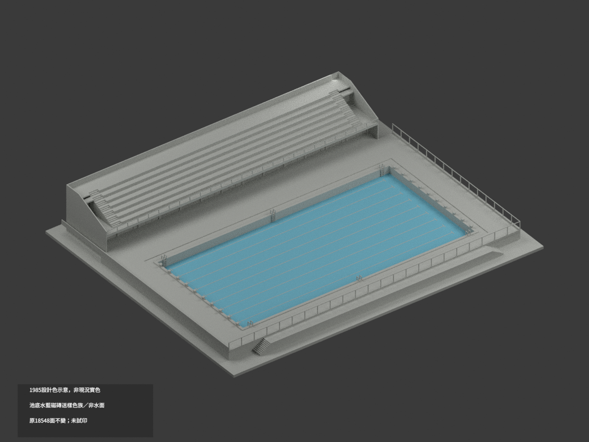
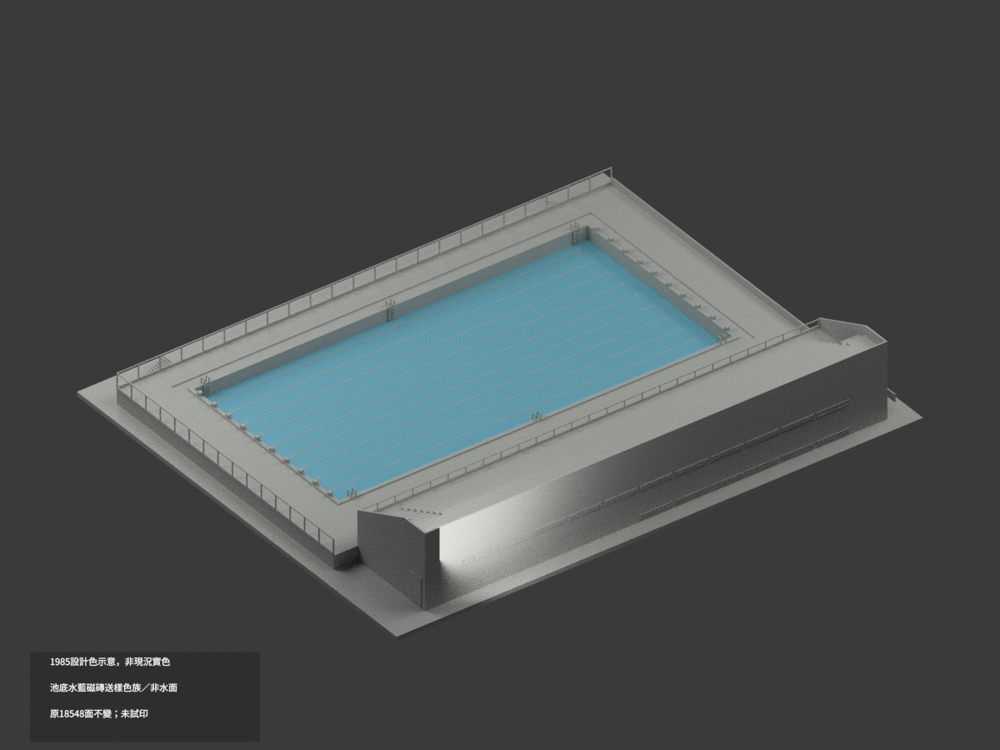
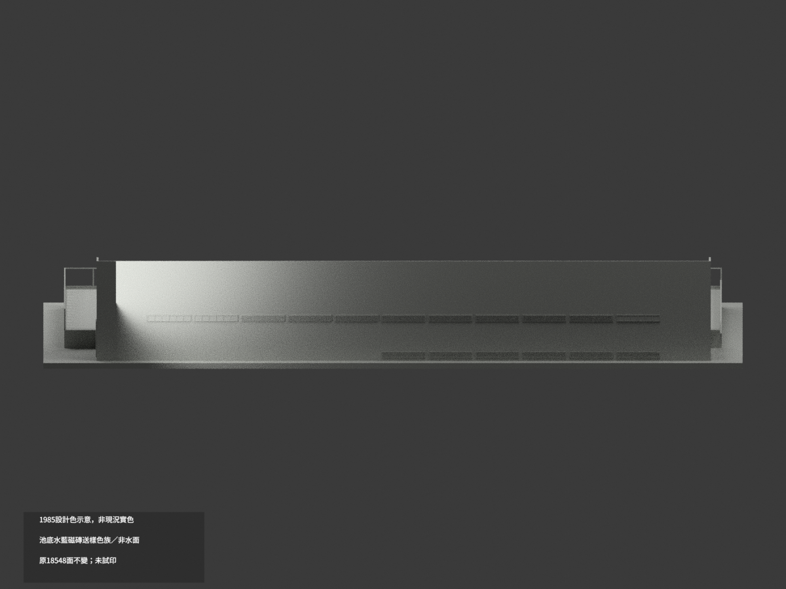
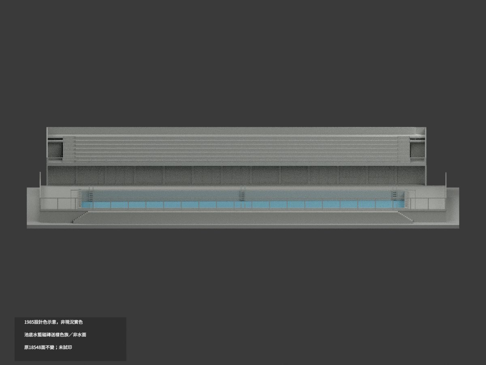
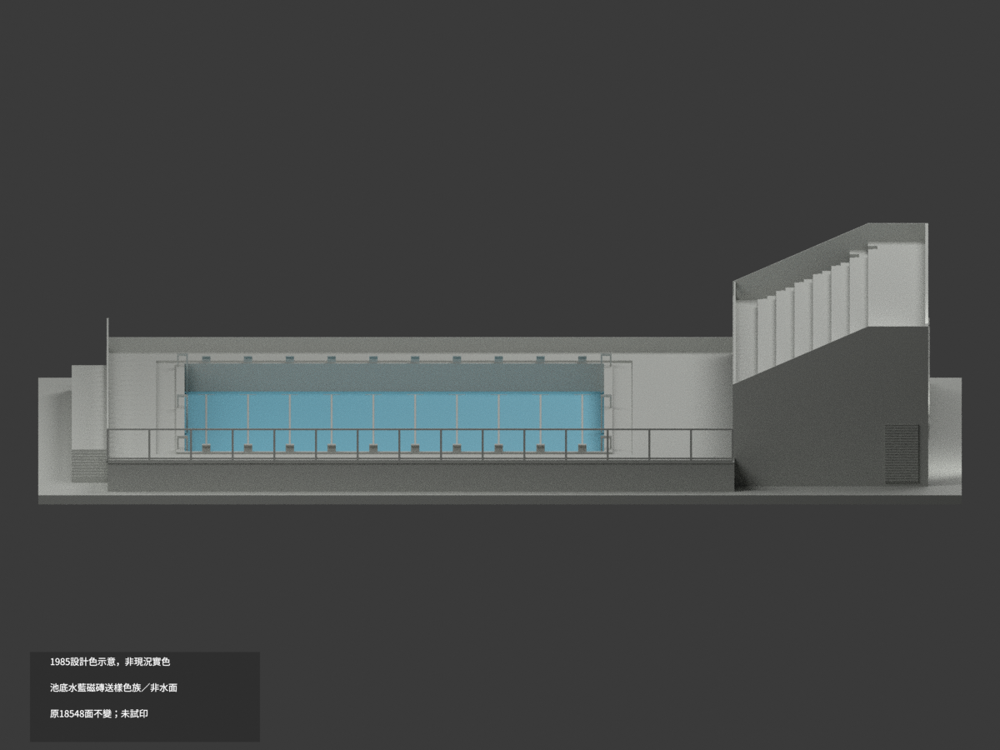
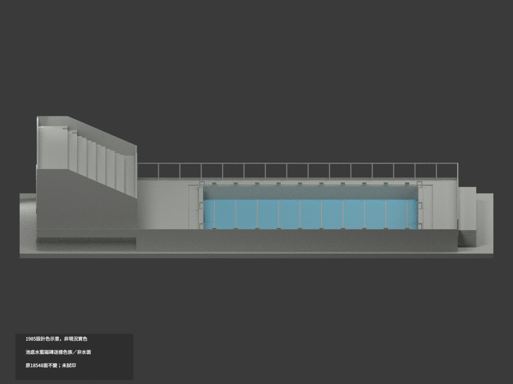
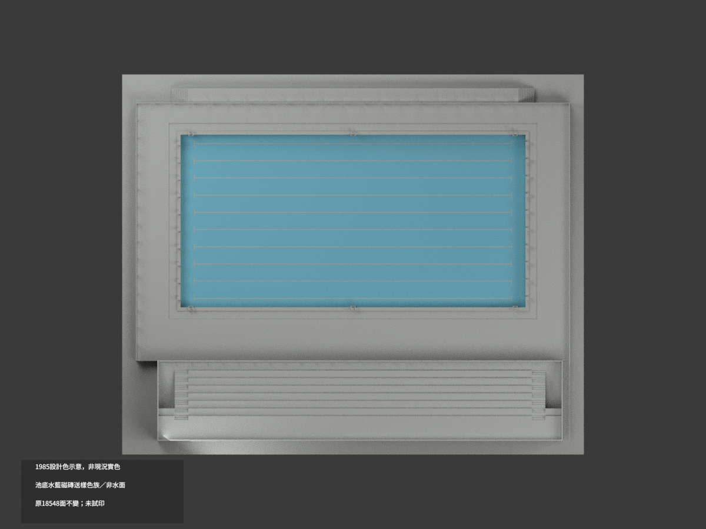
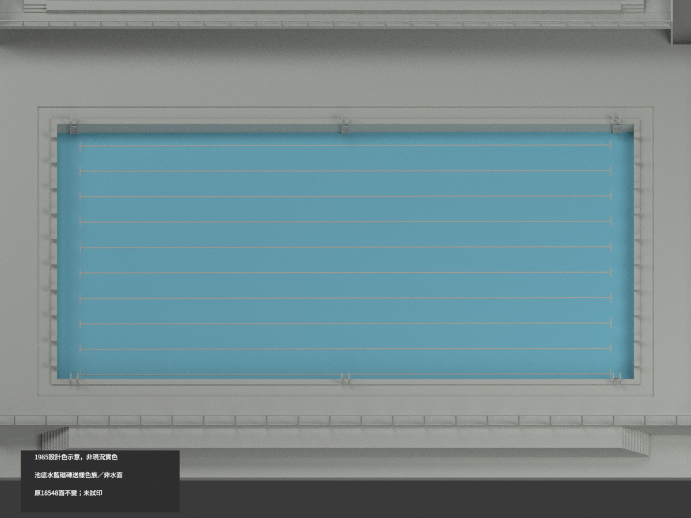
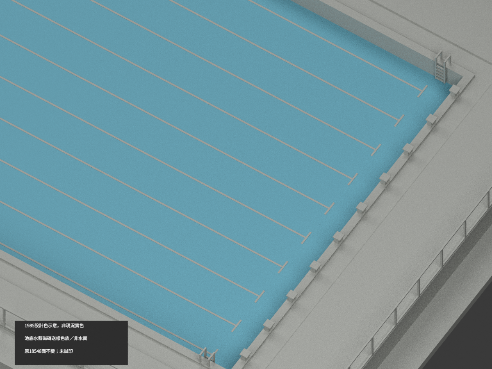
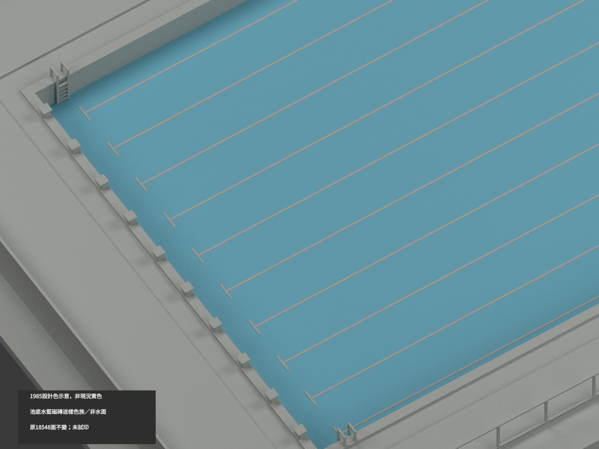

# 高師泳池與看台更衣室｜1985設計色示意，非現況實色

**1985設計色示意，非現況實色。** 僅依原設計圖的「水藍色磁磚、送樣」呈現乾池底144原面名義色族，**不是水面、不是已核准色票或竣工／2026現況實色**。其餘18404面未知中性；partial_color_incomplete=true、fully_colored_exterior=false。既有六分類展示非單色，原版及全部歷史保留。本次不追認全域壁厚、實體試印或強度。

| 總覽 | 背側 | 正面 |
|---|---|---|
||||
||||
||||
||||

## 材色範圍
同 nknu-pool-stand-1985-design 原群，same-item/count_delta=0，18548原三角不改。原包無OBJ，不新增OBJ。只分析平面z+(0.18/50.1)x=2.84、x±100.2、y−24.9..75.5全三頂點有限域，144面單一完整共面連通域，包括細小Boolean裁切片。十泳道凸線、20端標與起跳台、池壁、爬梯、看台、更衣室、池緣均中性；不補磁磚分縫或水面。
送樣表示尚需樣品選定，展示HEX只表設計色族，不是核准色票。原圖白磁磚十字註18處與原模型10泳道／20起跳台不一致，本次保留差異不靠上色默改。不是全池或全館完整補色。

## 原版與限制保留
原六分類材質、原scene/model.3mf/mesh.npz/palette/九圖/全部QA與程式完整保存於 original-classification-version/；原scene與README另有 ORIGINAL-SOURCE-GAP- 公開別名。原renderer render_model.py bytes不變，不否定原分類展示，也不將它當實景材色證據。新appearance.3mf/scene.blend及十圖是獨立1985設計色variant。
保留A2-2看台58.90m與A2-1 58.75m、9.37/9.40m、場地51.25/51.30m原差異。50.10×25.10m結構池界不改50×25m完成淨界；原斜底0至−.18m，不補−.20m局部排水。六梯比例位置、封背不透明玻璃、隱藏內梯/管線/細網省略與非測繪展示底座均保。1985原設計並非已證1987竣工，也不混整修後現況。原格式水密/單體/最小面積5.25e−9mm²數位檢查不等於全域最薄壁、支撐、強度或實體試印認證。

## 來源、格式與再現
陳其寛建築師事務所原圖A7-4，國立臺灣博物館典藏CCCK296，1985年5月圖框。圖像CC BY-NC版本未核，不自動套用生成模型；原圖只私存，不公開貼圖。下方掃描色條不是建築色票。
[原圖典藏頁](https://collections.culture.tw/docomomo_collectionsweb/Collection?GID=M8MEMIMNMD) · [原STL](model.stl) · [新增逐面設計色3MF](appearance.3mf) · [新增Blender](scene.blend)
原比例1:250、mm、約268.2×221×40.68mm；未實體試印，兩材標籤不是四色耗材切片。物件 NKNU Pool Stand 1985 Design partial color。build_model.py→colorize_model.py→export_appearance.py→validate_color.py，render_color.py/verify_color_scene.py；隔離重建只驗原幾何再現及本次材域，不新增幾何放行。

## English scope
1985 DESIGN COLOR ONLY, NOT CURRENT/AS-BUILT COLOR. 144 complete dryfloor triangles show the documented waterblue ceramic tile design family requiring sample approval, not water or an approved colorimetric swatch;18404 neutral. Original18548triangles and complete six-classification presentation retained unchanged.18whitecross design notes versus10lanes/20blocks remain unreconciled. Sameitem/count0/noOBJ/no geometry repair. Historic differences, omitted details and untested physicalprint/minwall/support limitations remain;newcolorQA does not endorse original globalprintability.

## 原歷史引用說明
原 DIMENSIONS-AND-LIMITS.json 保留兩個既有本機裁圖引用（pool-EL-left/right.png）；不是公開可開啟的圖片連結，未修原歷史bytes。本次新增文檔沒有新增私人路徑，不能將此說成整包零歷史路徑。

## 原分類QA相對路徑範圍
原QA的一般最終逐檔綁定解讀於 original-classification-version/，不綁根目錄新設計色版本；但歷史前像雜湊另列以下特例。原根QA副本原bytes移存 original-classification-qa-aliases/，詳 ORIGINAL-CLASSIFICATION-QA-SCOPE.json；完整原35件子包原位不變，未修改任何舊雜湊。根本次COLOR、SCENE、FRAMING、DELIVERY QA才驗新設計色成果。

歷史特例：PUBLICATION-DOC-QA.json 內 metadata_only_sanitization/original_sha256 的 SOURCE-VISUAL-QA.json 與 IDENTITY-QA.json 兩值，是更早sanitization之前的歷史前像雜湊，不匹配子包已sanitized的兩現存檔。原值及現存原件完整保留，不為通過檢查改舊hash，也不追認此兩前像為子包最終綁定。
