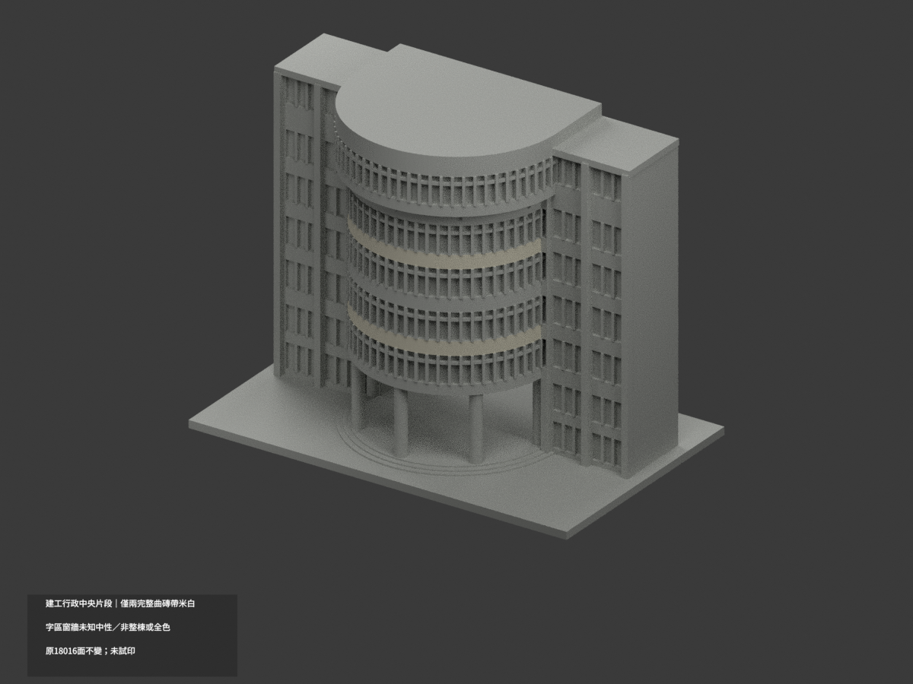
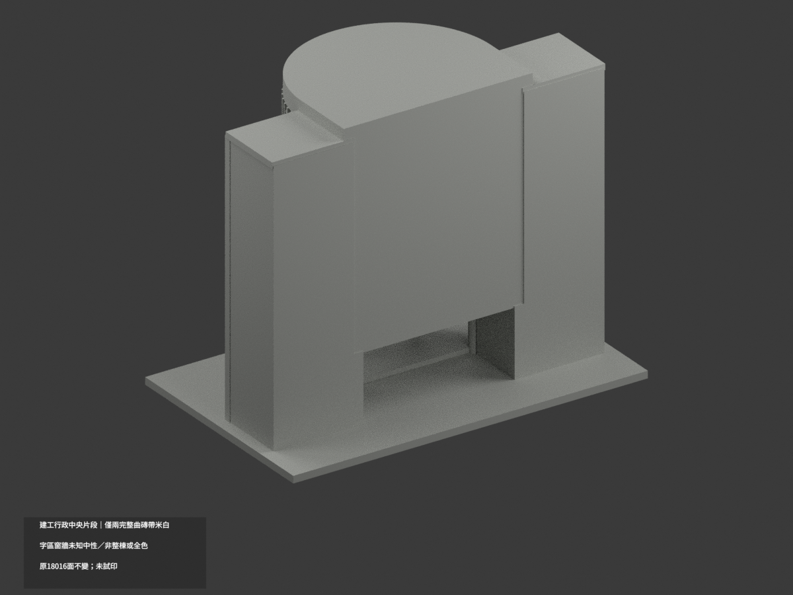
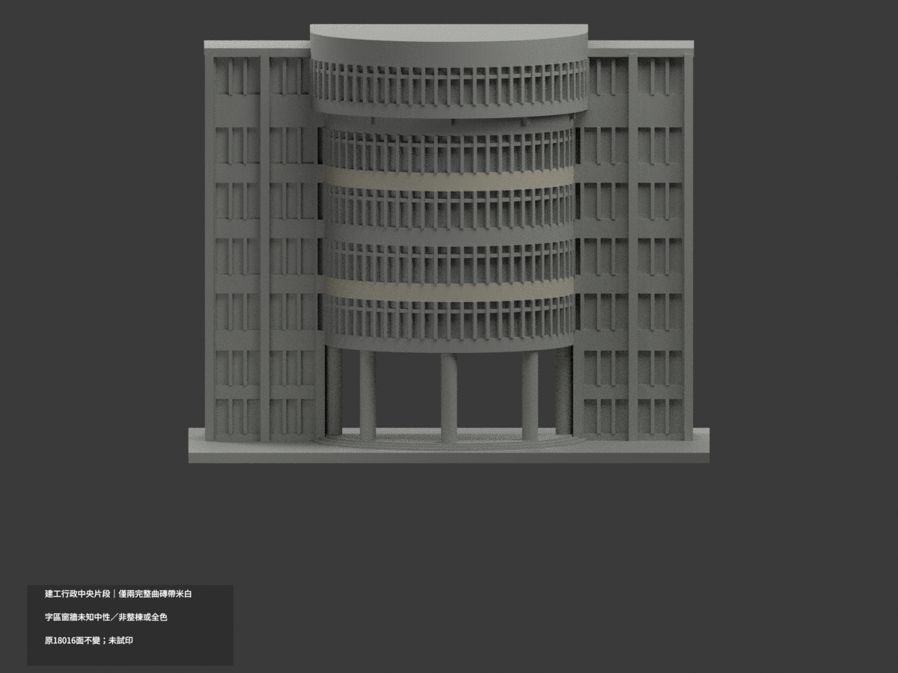
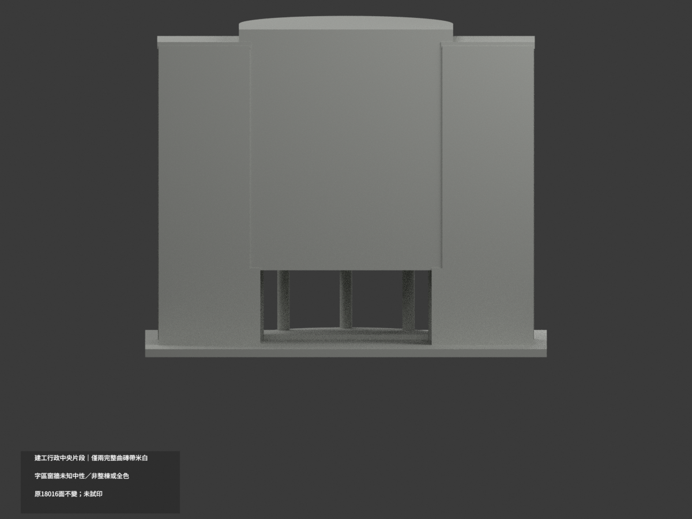
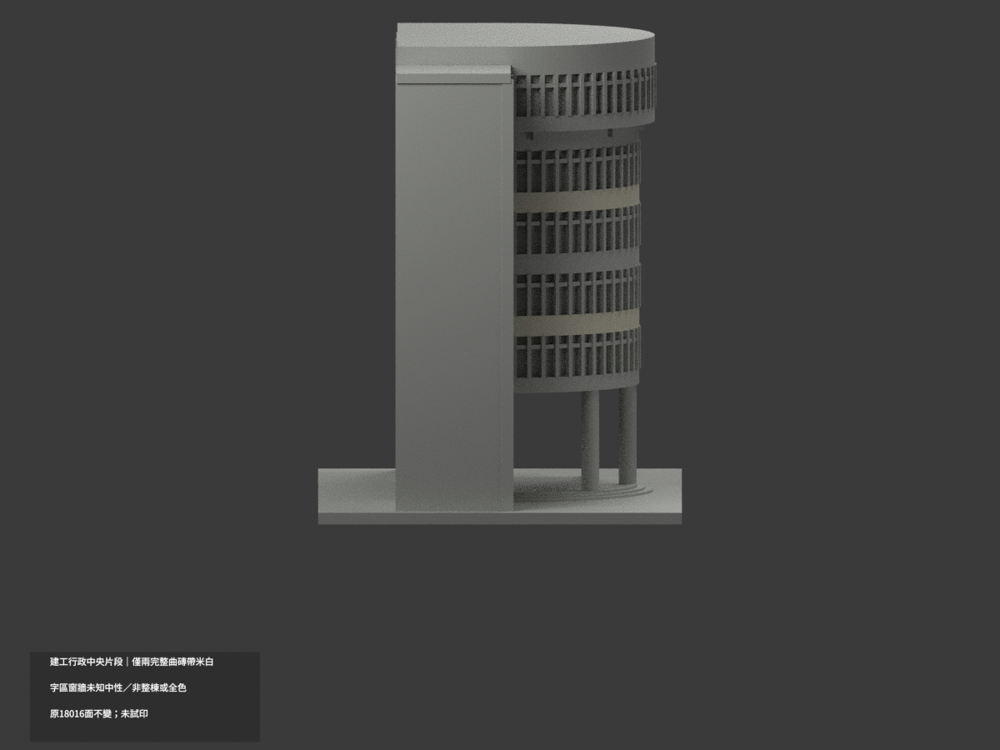
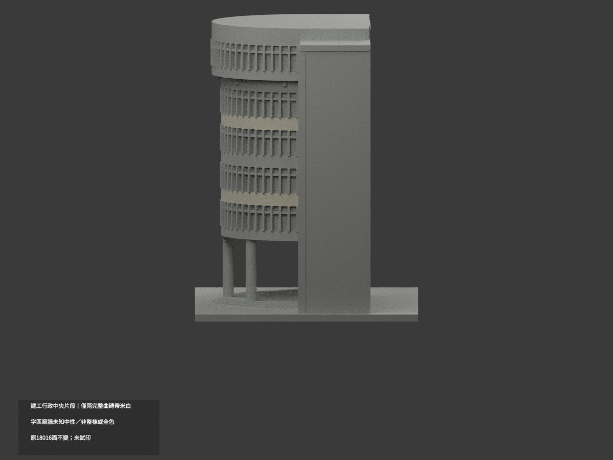
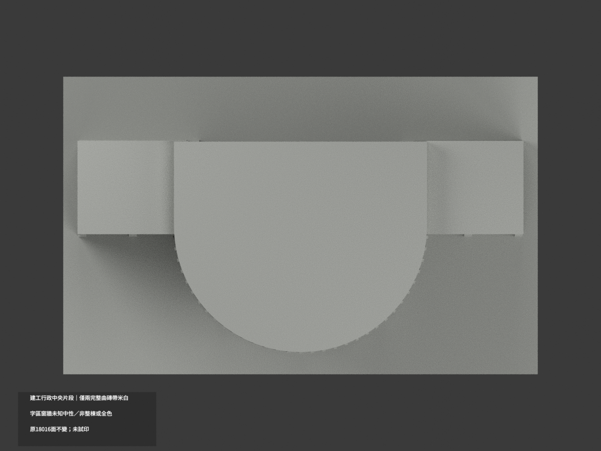
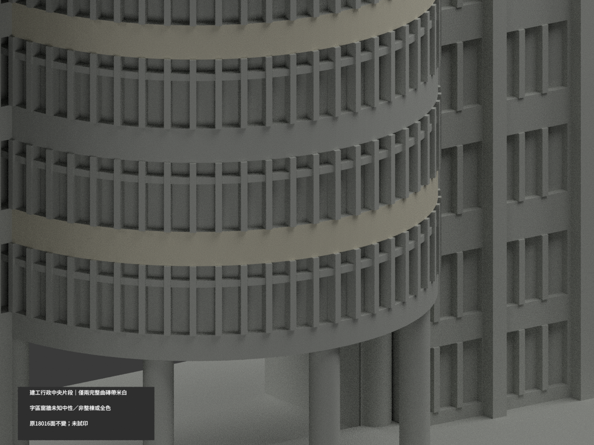
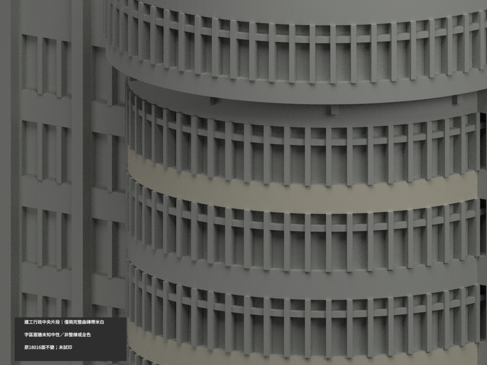
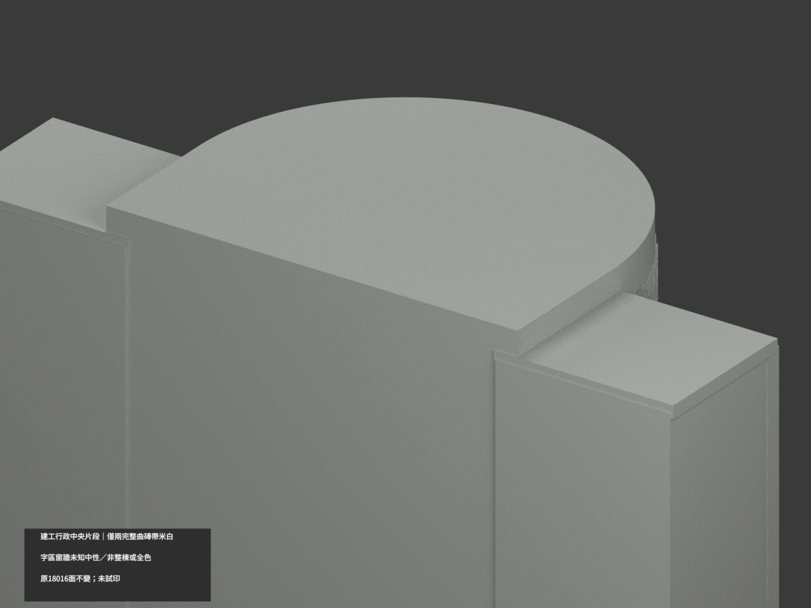

# 建工行政中央片段｜兩完整曲磚帶局部米白

**局部補色未完成：僅兩曲磚帶米白；字區、玻璃簾背及其餘域未完成。非整棟、非全色或2026現況。** `partial_color_incomplete=true`、`fully_colored_exterior=false`。同項`nkust-jianggong-administration-central-segment`／`count_delta=0`，沿建工校區原中央片段，不含整棟長翼。

| 前斜視 | 後斜視 | 正面 |
|---|---|---|
|  |  |  |
|  |  |  |
|  |  |  |
|  | | |

## 原面材色範圍

只原半徑36、160邊圓柱真正外向facet的兩完整磚帶z45.7–51及77.7–83米白；以每個原facet平面與全部頂點核，不以面心／粗半徑或任意z切開原面。中間61.7–67帶有原模型未建文字，保中性，不能拿整片米白宣稱完成字區。最低暗緣帶、最高帶與冠帽、所有窗背／反光／簾／框混合域、側翼／柱／入口階／後截斷／屋面均中性，**中性不是實景灰色證明**。色界是來源覆蓋而非實景材質接縫。

兩帶各264原面合528米白，其餘17488中性；源審早252/帶因浮點法向量過嚴漏12極細三角，現以原160邊真facet全頂點/完整共面域補回，不留假斜楔；原GO歷程保留，綁`SOURCE-DOMAIN-COMPLETENESS-ERRATUM-2341.json`的SHA見source register。4320共面連通域一致；原facet有限切向半寬36sin(pi/160)及平面/全z容差1e−5mm均核，不是無限平面誤收。

原18016三角與尺寸、STL/build字節不改，不新增文字、磚縫、欄杆或薄窗。原幾何是照片估讀近似，補色不追認精測／完整原貌。本次只中央入口片段，不擴展至原未建長翼。所有完整共面連通域同材，幾何全原樣。

## 來源年代、權利

三張來源已親看：會議頁前照、校方交通指引近照、門廊實照；2025是會議發表背景，不是認證拍攝年，三照capture均未知。不宣2026現況，門廊照不作未知後面色證。URL/hash在`COLOR-SOURCE-REGISTER.json`。原照私人保存不公開／不貼圖，未見CC不套repo開源license，名義HEX僅色族不是測色；不保證商用。

## 檔案與 QA

`appearance.3mf`兩展示材、`scene.blend`真面材、`color-mesh.npz`原三角與材索引。原STL無色/build保原字節。Immutable原包沒有OBJ；不冒稱保留原OBJ，也不新增為原件。

原README另存`ORIGINAL-MONOCHROME-README.md`或`.zh-TW.md`，舊previews／QA保單色歷程，不冒稱新色驗證。依requirements跑`colorize_model.py`、`export_appearance.py`、`validate_color.py`；Blender執行`render_color.py`、`verify_color_scene.py`。全原build+color隔離重建保留不刪；3MF/STL三角multiset/封閉正體積／scene reopen／10張1200×900見COLOR-*QA、SCENE-QA、DELIVERY-QA。父另人工終審。

**未實際列印。** 兩展示材非已驗四色切片工程，支撐、薄部與材料映射須另驗。

## English limitations

Partial color only: two complete original radius36 regular160gon outward spandrel fields, z45.7–51 and77.7–83. Lettered middle strip, all windows/curtains/reflections, crown, lowest darkedge, wings, columns, stairs, rear cut and roof remain unverified neutral. This is the central photographed segment, not the complete administration building. Original18016triangles and STL/build bytes unchanged; no new geometry/letters or face splitting. Conference2025 is not authenticated capture date; all source dates unknown, not2026condition. Nominal color families only, count_delta0, source photos private, not physically test-printed.
