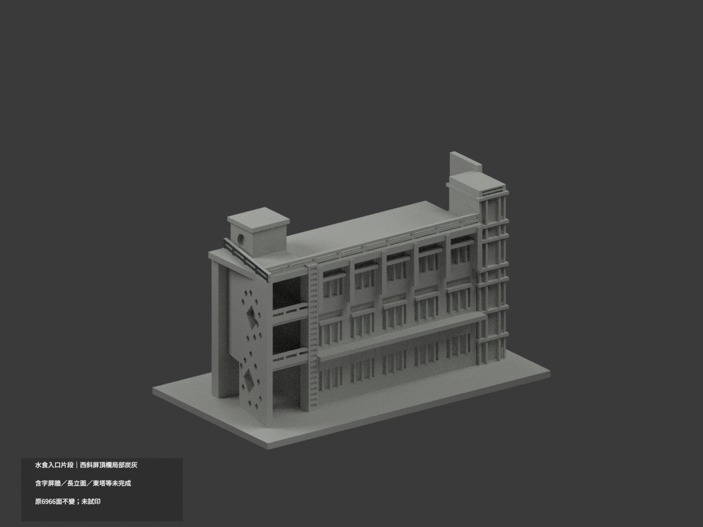
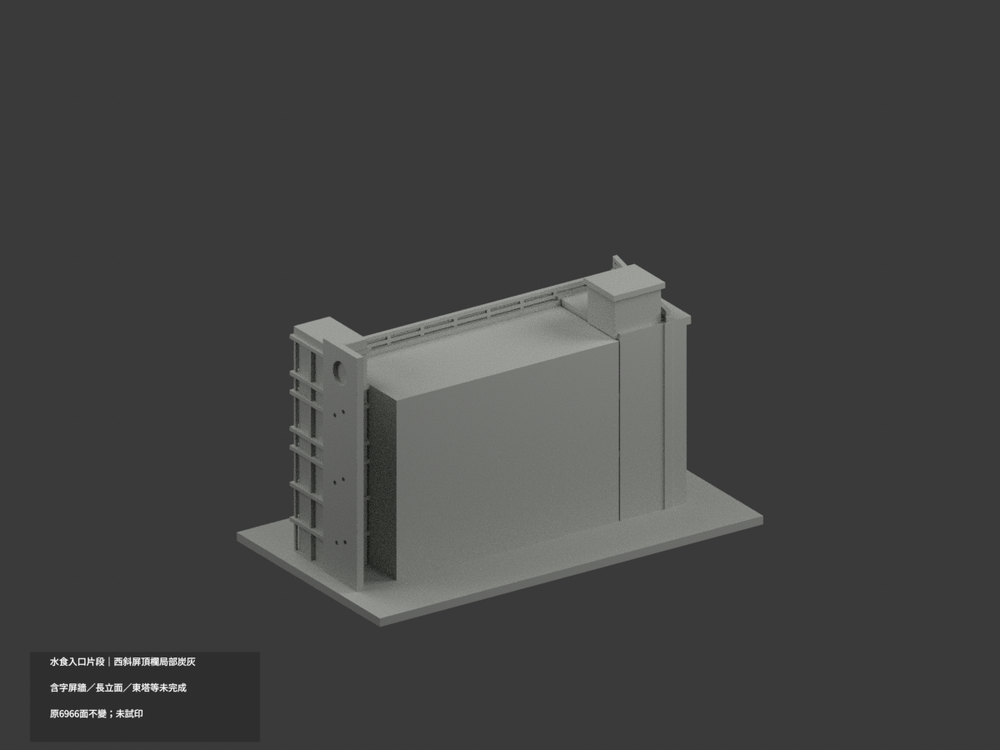
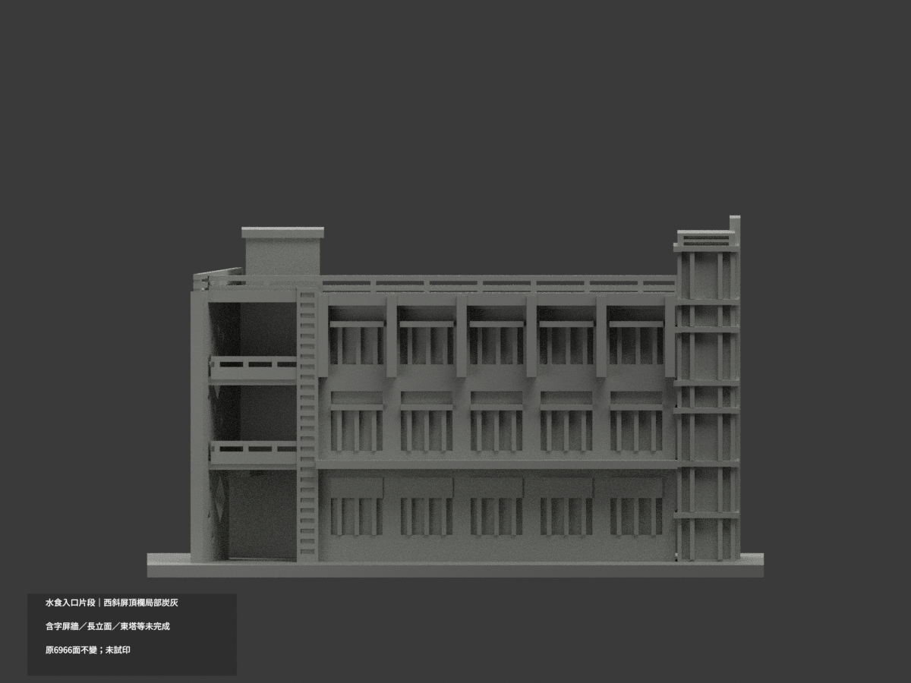
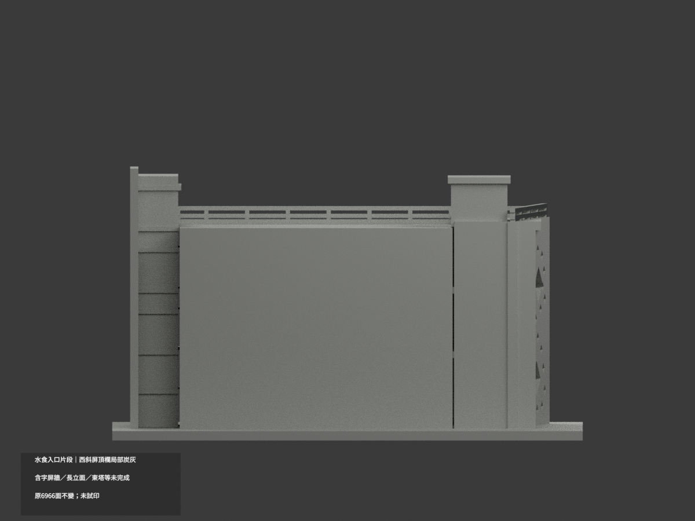
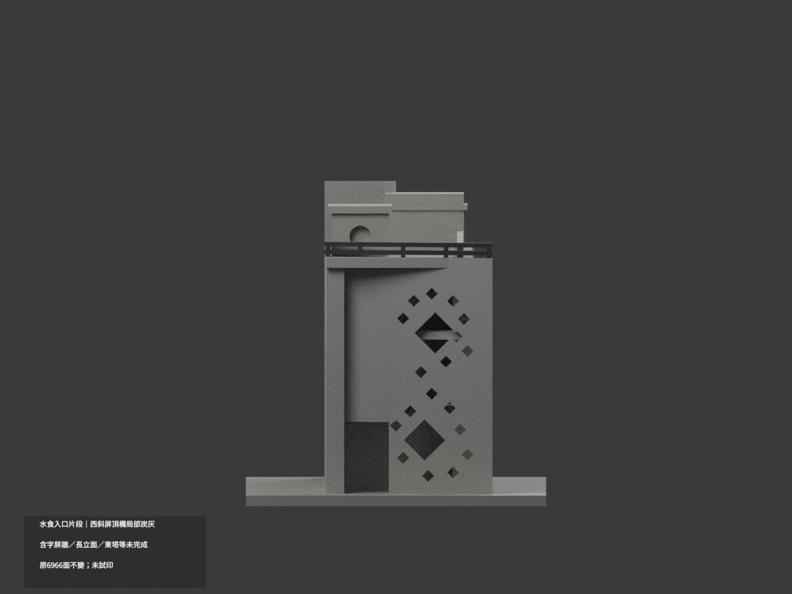
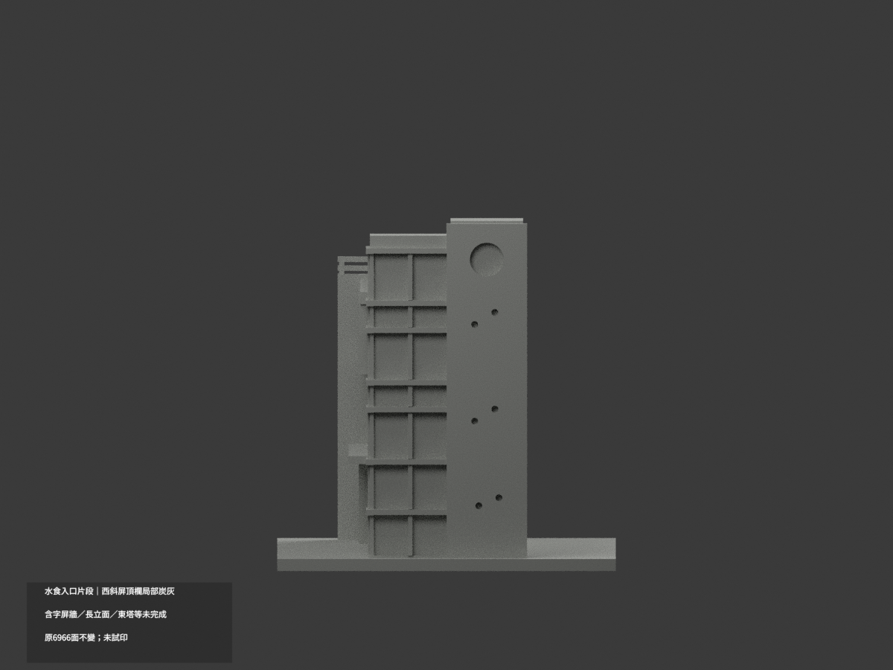
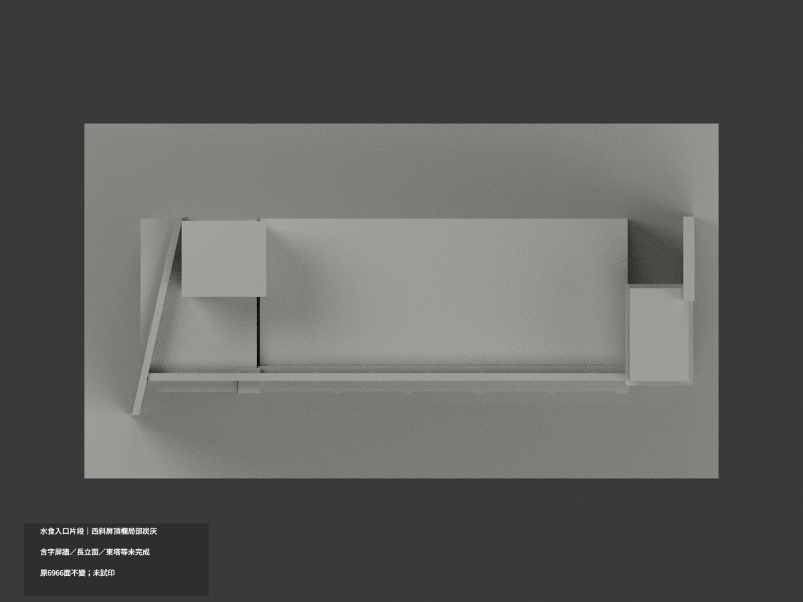
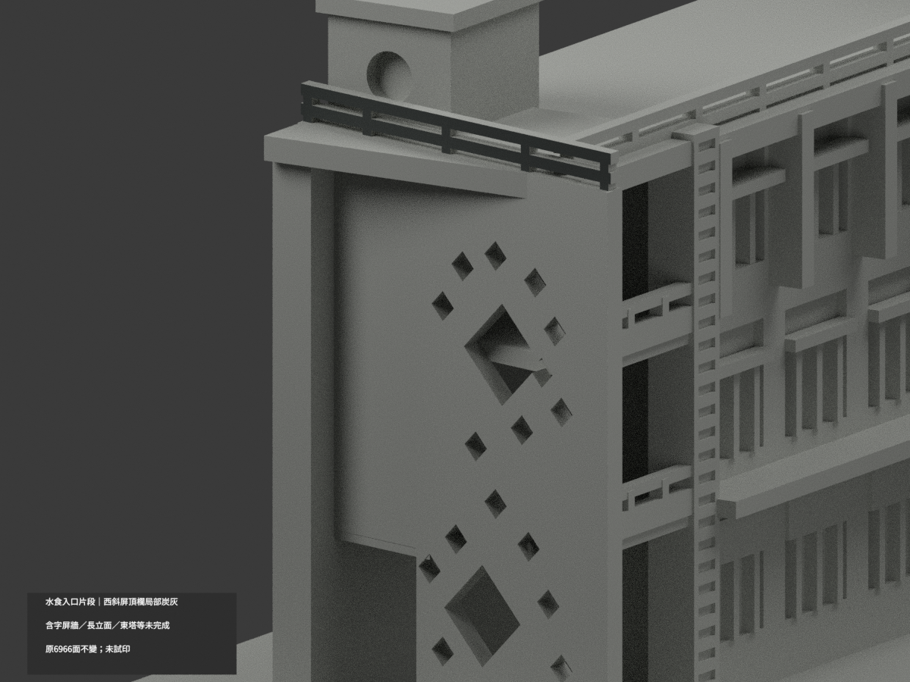
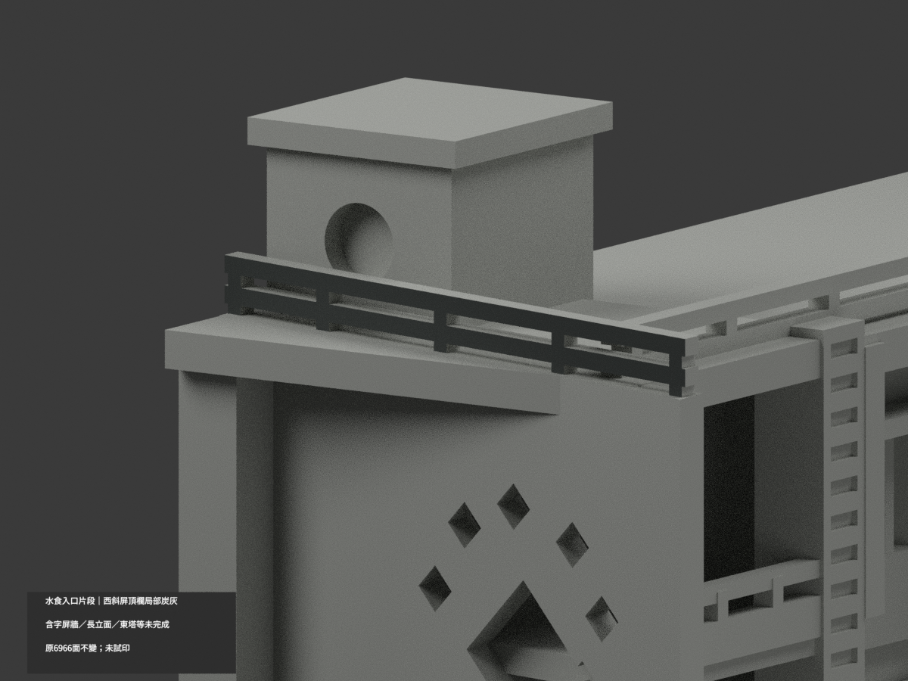
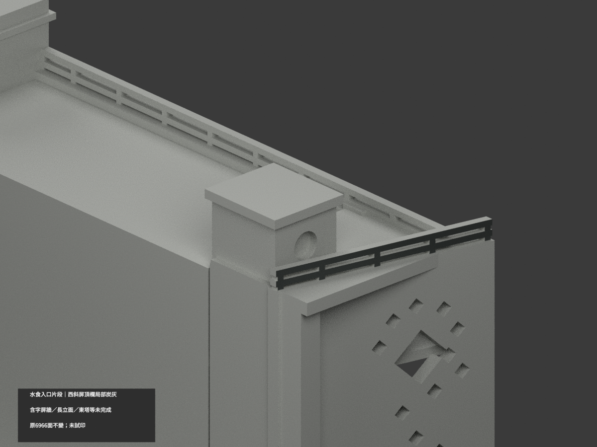

# 水食入口片段｜西斜屏頂欄局部炭灰

**含字屏牆、長立面、東塔及機房未完成分色。** `partial_color_incomplete=true`、`fully_colored_exterior=false`。只西斜屏頂欄外表面，非全棟或全色。

| 總覽 | 背側 | 正面 |
|---|---|---|
||||
||||
||||
||||

## 材色範圍
同 `nkust-seafood-practice-entrance-segment` 原項目，same-item、count_delta=0。**6966原三角面、STL與build_model.py字節不變**，無切面／新增幾何。原公開包沒有OBJ，不假稱保留。
- 西斜屏頂欄真正外垂直面 x−0.22y=−57.85、y−27..20、z69..73.3，72原面炭灰。
- 其餘6894面中性，包括欄杆頂／底／內／端、含字屏牆、長立面頂欄與窗背、東塔、入口雨庇、混紅灰機房、屋頂／基地／後截面。
- 1567共面連通域均一，0候選撤色；不以三角楔或染整個欄杆盒冒充確證。材色／中性界是證據使用範圍，不是真實材接縫。
- 原模型是南側與入口的局部建築片段，不含完整北實驗翼；補色不追認原幾何／層數／粗框的測繪精度，不增文字。

## 來源／日期與權利
官方系所入口排版實景圖，拍攝日期不明。只讀可用入口照；長立面圖503未讀，不以未知結果補證。
原照片私存，不公開／貼圖；未確認CC／再散布授權，不保證商用。HEX是名義炭灰色族，不是校準色票，不稱2026現況精測。
來源GO是有界材色放行，不是發布核准，也不免除模型QA；其繼承review的notformal文字僅早先審查階段。

## 格式與列印
[原STL](model.stl) · [逐面材色3MF](appearance.3mf) · [Blender](scene.blend)
150×84mm原展示底座，照片近似非精測比例。STL無色；3MF及Blender含真逐面材。兩材標籤非驗證兩色／四色耗材切片；**未實際列印**，無切片路徑。

## 重建與 QA
原 `build_model.py` → `colorize_model.py` → `export_appearance.py` → `validate_color.py`；Blender `render_color.py` 與 `verify_color_scene.py`。
原字節／三角multiset、閉合正體積、3MF逐面材、完整隔離原build＋color重建、scene重開、十圖1200×900與圖文hash核對；程序不替代人工來源審核。
原README與單色previews／render／validation保留歷程，沒有刪除原件。

## English scope
Partial color only: 72 existing outward faces of the west oblique screen's top rail are charcoal. The other6894 faces remain unverified neutral, including lettered wall, long facade, east tower and mixed-color rooftop core. This is an entrance/south-facade segment, not the entire building. Original6966 triangles unchanged; no original OBJ in the immutable package. Photo capture date unknown; unavailable503 long-facade source not used. Not test printed and not a verified multicolor slicer project.
