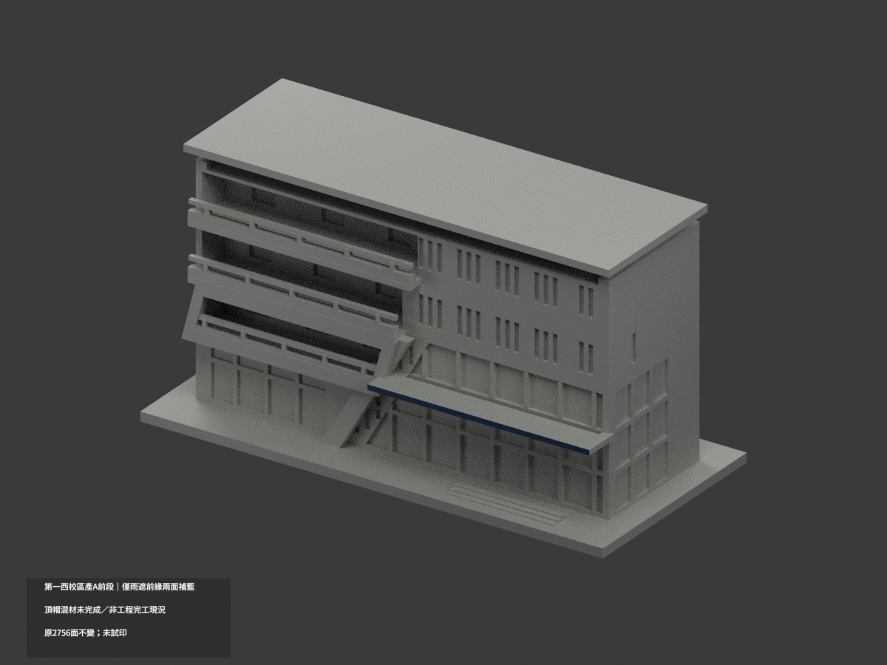
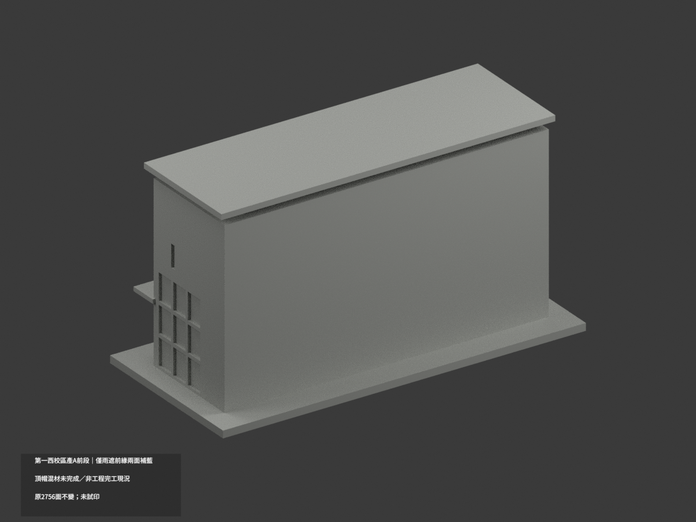
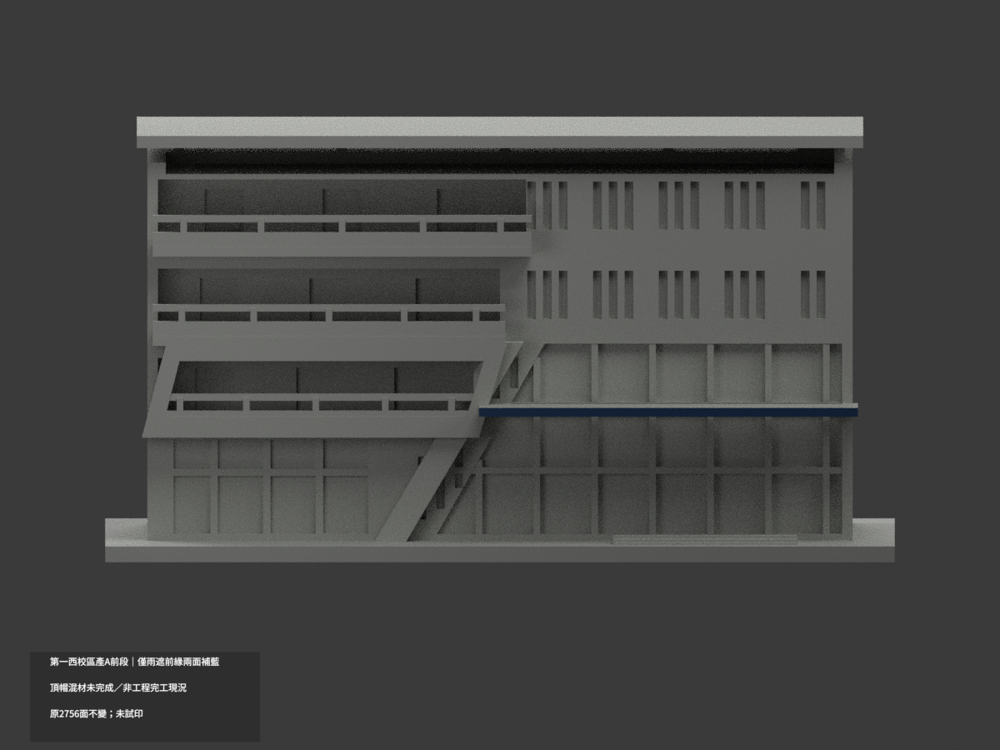
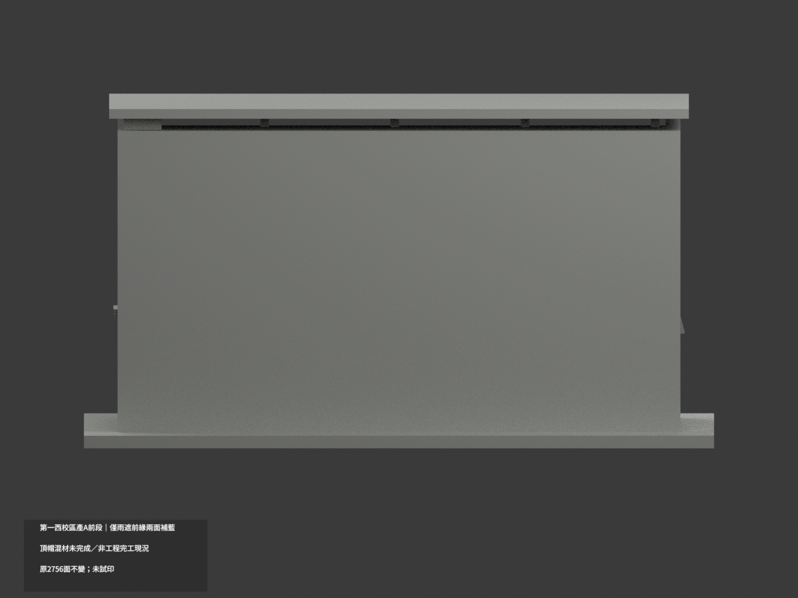
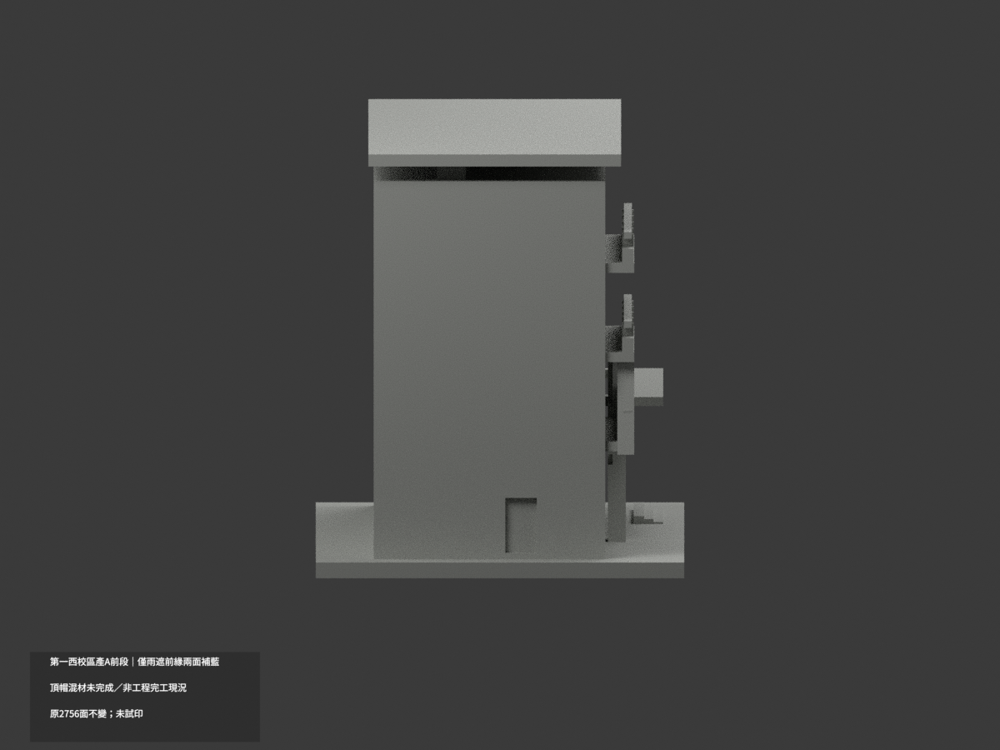
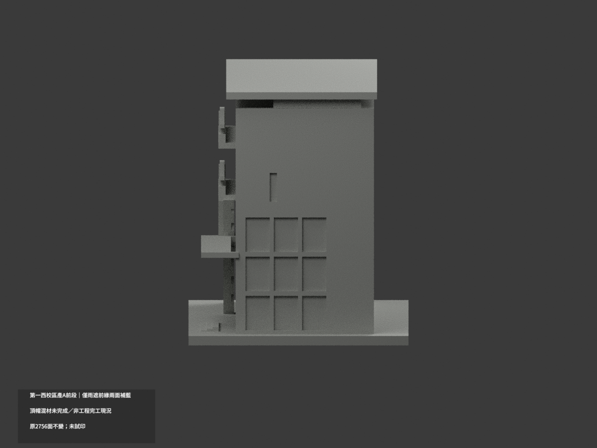
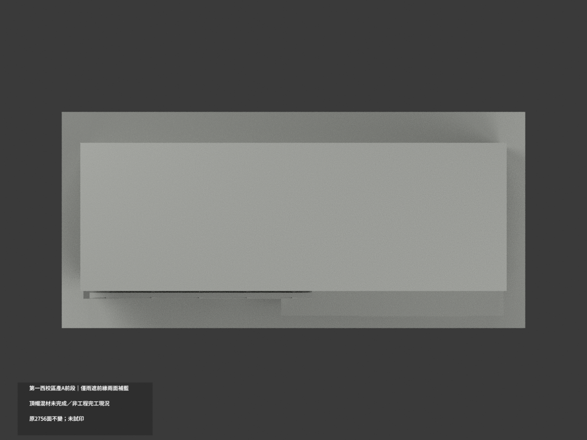
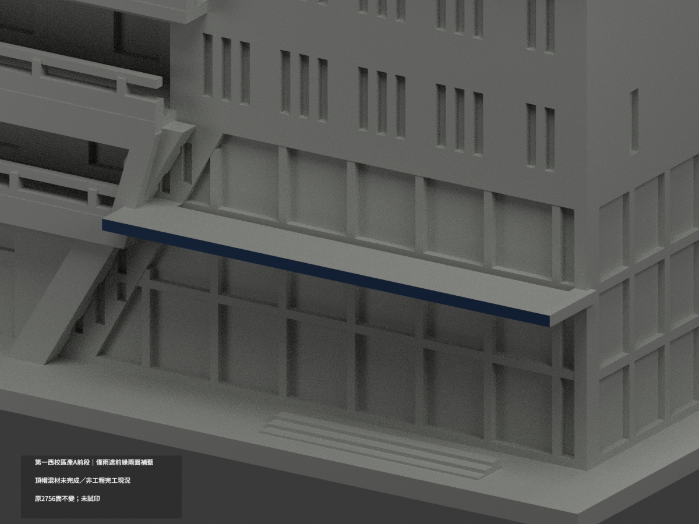
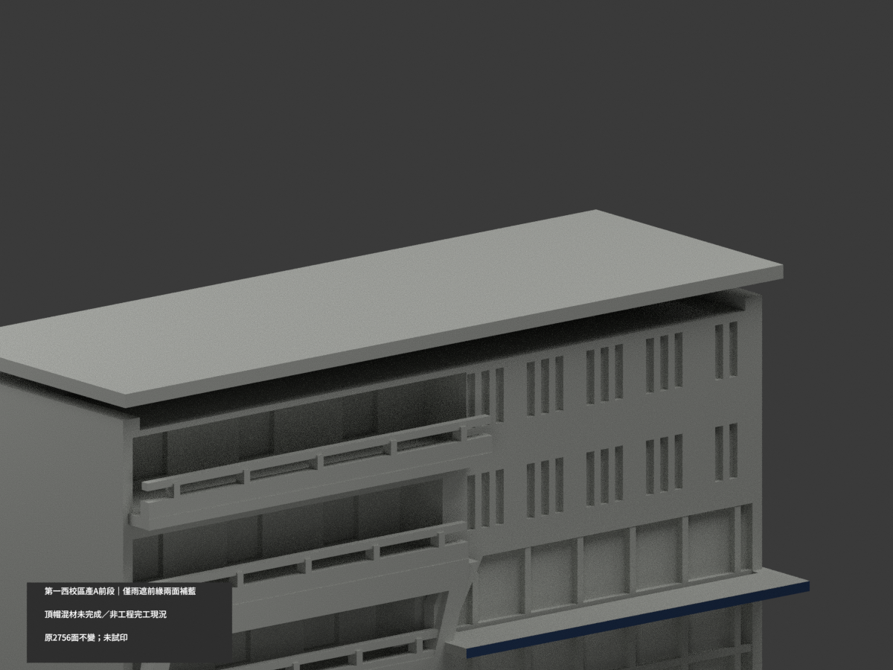
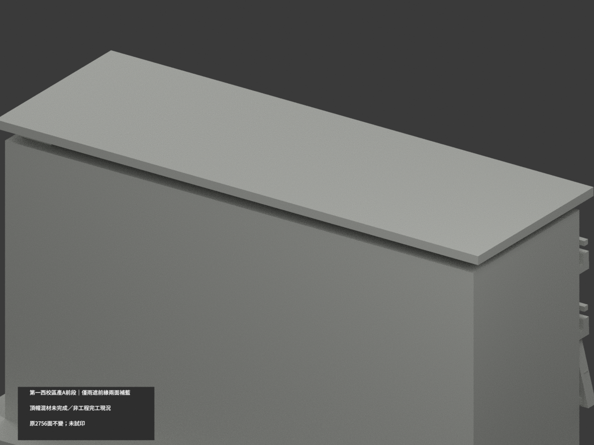

# 第一西校區產A前段｜僅雨遮前緣兩原面局部補藍

**局部補色未完成：僅入口雨遮前緣藍；頂帽、主牆、斜框與玻璃等未完成。非全色、非改善工程完工現況。** `partial_color_incomplete=true`、`fully_colored_exterior=false`。同項`nkust-industry-a-front-segment`／`count_delta=0`，原第一校區（西校區）／卓越路身份，不因建築師頁文字誤概括為燕巢就改校區。

| 前斜視 | 後斜視 | 正面 |
|---|---|---|
|  |  |  |
|  |  |  |
|  |  |  |
|  | | |

## 材色範圍

只有入口雨遮真正完整前矩形y−31、x−4..68、z27.4..29.1兩面藍，頂帽原完整前矩形y−23、x−69..69、z78..80.3兩面在v1曾染紅，後核照片左最高簷灰粉與右紅不同段，而原全寬138無材界，v2整兩面退中性；不硬選右半三角。舊v1保歷程但不作最終PASS。全頂點、正向、完整矩形面積與共面連通域核驗；不是盲套原面號或用bbox截面。原2756三角中2藍＋2754中性，678共面域一致，不新增分界／面／幾何。

紅斜環與樓板邊／實心欄代理共面混合，全部中性，不簡單z框整塗；長斜blade底腳實景灰但原無獨立色界，同樣中性。藍雨遮頂面／底面／未知側邊不沿前緣硬推；頂帽整件含前緣完全中性。全主粉牆／窗框玻璃簾反光／玻璃欄實心代理／後截斷／階廣場中性，**中性不是實景灰色證明**。資料色界不是真實不同材料接縫。

只原照片前段近似，不含全建物／鄰棟；原STL/build／2756三角字節座標不變，不添加拉索、細欄與字樣，補色不追認粗原幾何精度。

## 日期及權利

兩張建築師日照已親看，對應原前段雨遮與頂帽色族，捕捉日未知。2025–26入口改善規劃／工程資訊不是驗證完工，不宣2026完工現況；不按檔案發布年當拍攝年。URL/hash見`COLOR-SOURCE-REGISTER.json`。原照私存不公開／不貼圖，未見CC不沿repo license推商用，名義HEX非測色。

## 檔案與 QA

`appearance.3mf`兩展示材、`scene.blend`真面材、`color-mesh.npz`原三角／材索引。原STL無色、原build字節保留。Immutable原包無OBJ，不冒稱原OBJ存在或已保留。

原README另存`ORIGINAL-MONOCHROME-README.md`或`.zh-TW.md`，舊previews／QA保留單色歷程不冒新色驗證。依requirements執行`colorize_model.py`、`export_appearance.py`、`validate_color.py`；Blender執行`render_color.py`與`verify_color_scene.py`。原build+color全隔離重建保留不刪，3MF/STL三角multiset／封閉正體積／重開／10張1200×900見COLOR-*QA、SCENE-QA及DELIVERY-QA，父另終審。

**未實際列印。** 兩展示材非已驗四色切片工程，支撐、材料對應與薄部強度另驗。

## English limitations

Extremely limited partial color: one original complete entry fascia rectangle,2blue faces and2754neutral. All678coplanar domains uniform;2756originaltriangles/STL/build unchanged. Mixed red diagonal ring/floor/parapet proxies and blade grayfoot have no reliable original material boundary and remain neutral, as do canopy upper/undersides, glazing, mainwall and rear. Fullwidth cap fused pinkleft/redright photographed regions, so v2 withdraws both previously red faces wholly to neutral; retained v1history is not final QA. Only original front segment, not wholebuilding. FirstCampusWest identity retained, notYanchao. Both photographs capture date unknown;2025–26improvement is not verified completion. Nominal color, count_delta0, sourcephotos private, not physically test-printed; color review does not validate original approximate geometry.
