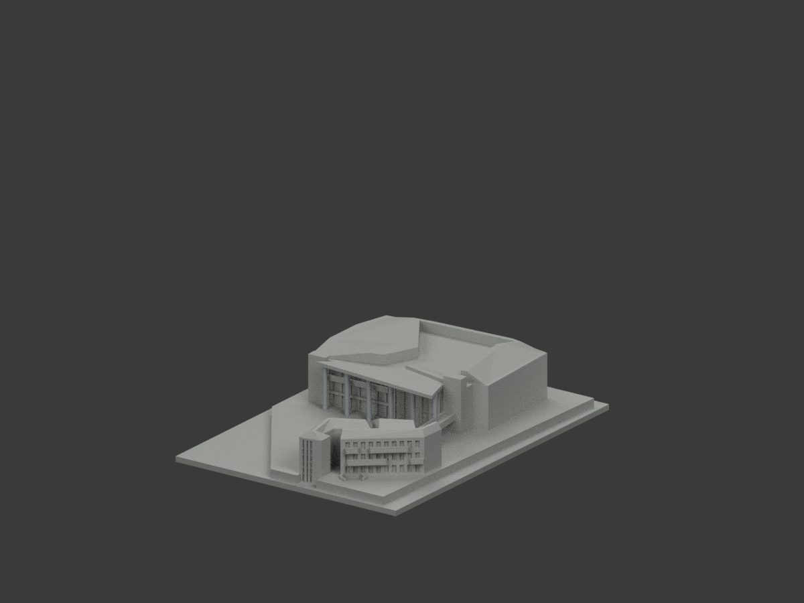
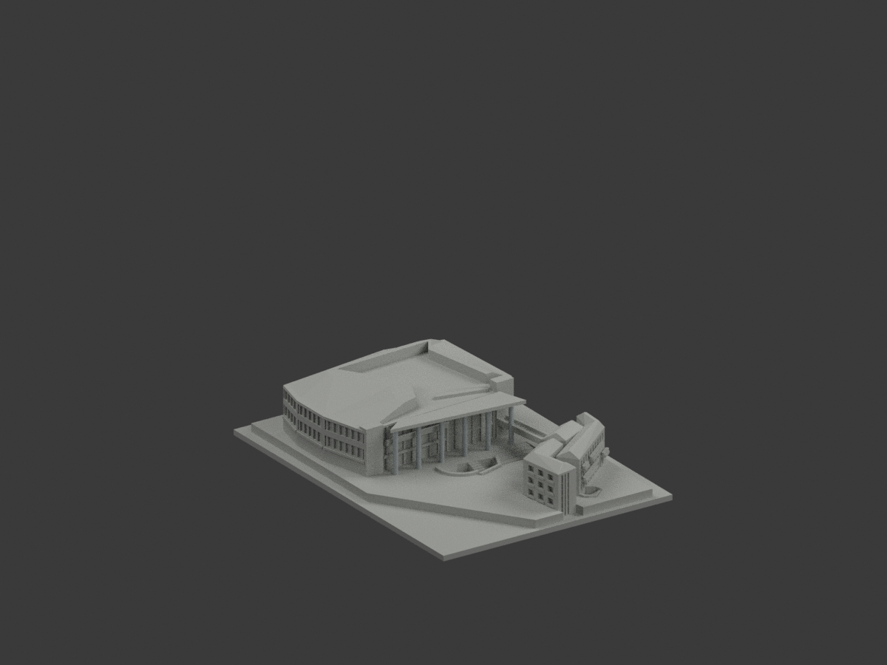
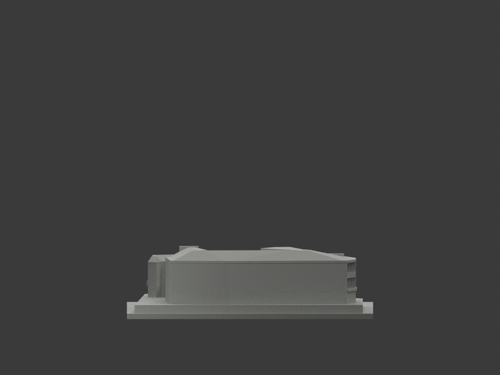
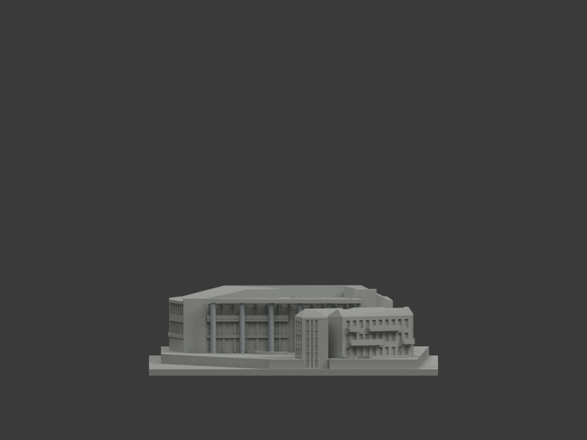
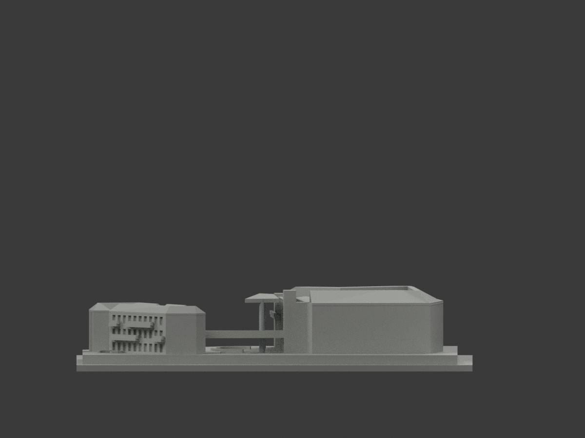
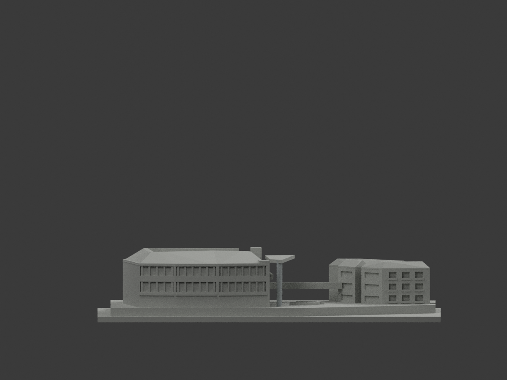
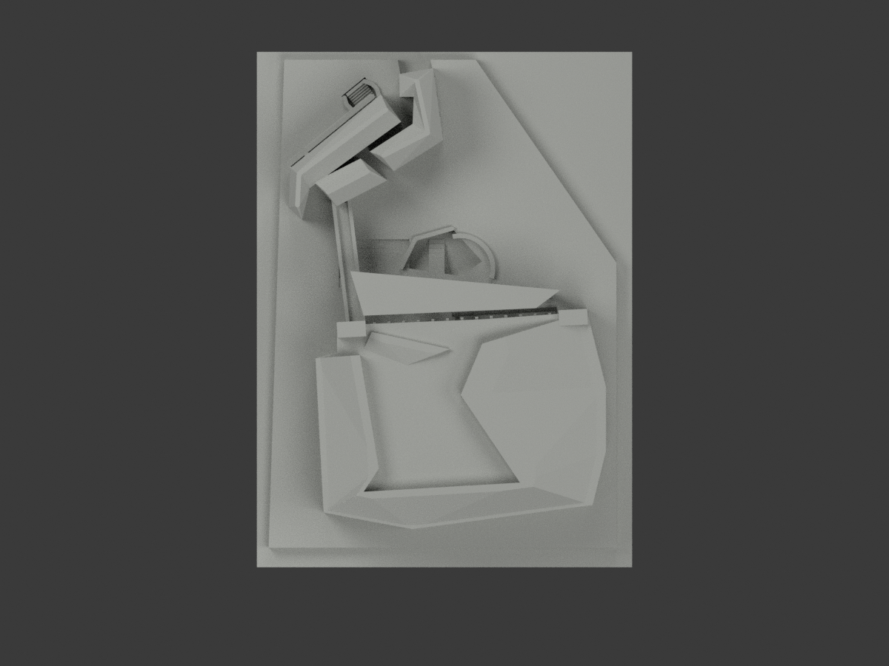
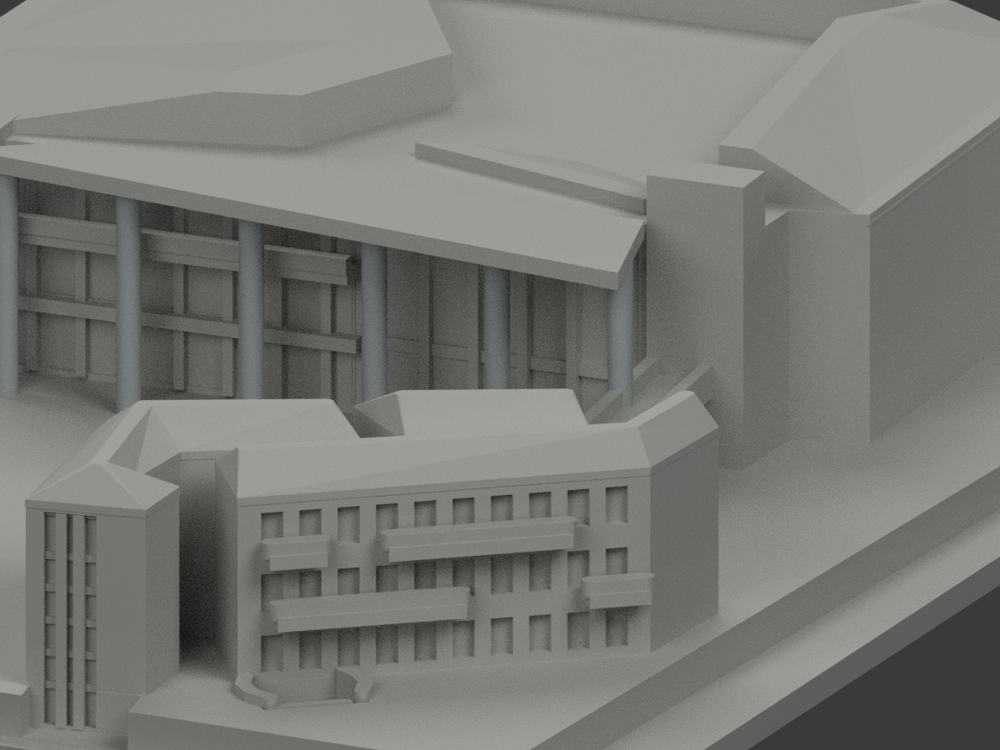
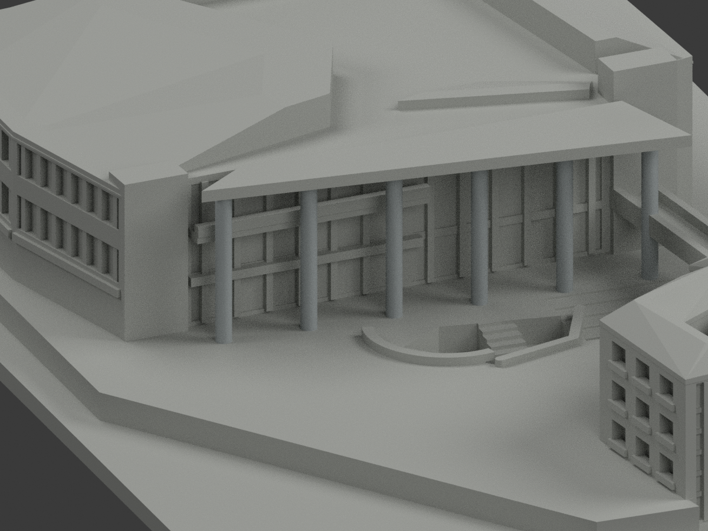
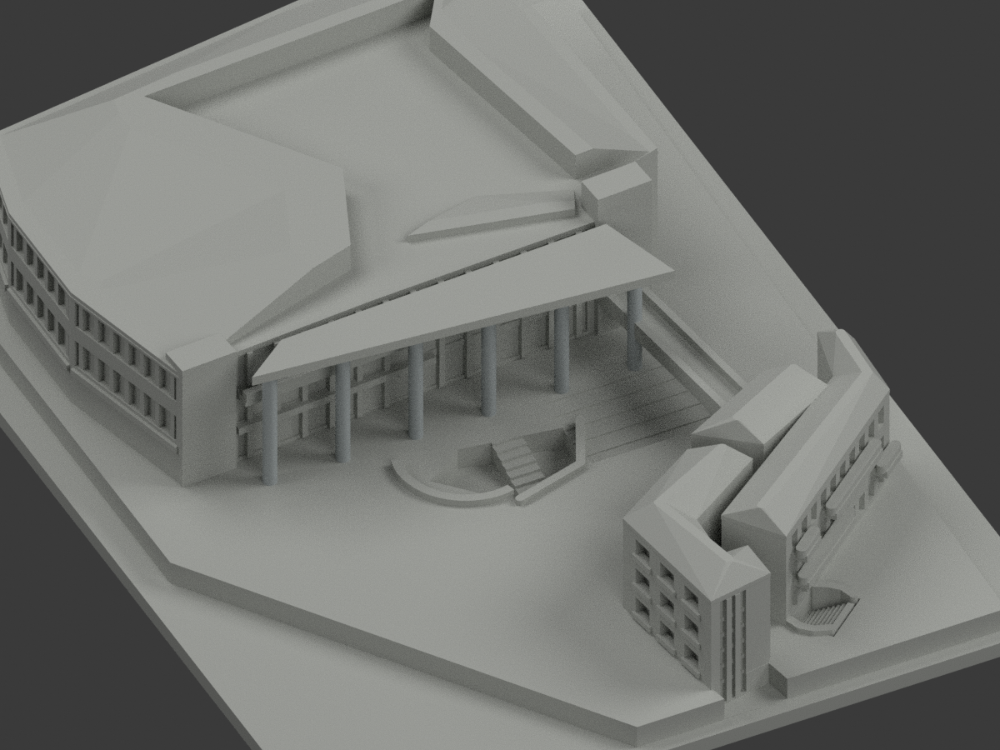

# 高餐學生健康活動中心｜六柱有限側面銀灰連續推定

**雨棚、窗背及其他混材未完成分色。** `partial_color_incomplete=true`、`fully_colored_exterior=false`。原活動中心與附屬群體範圍保留，同slug不新增套數。

| 總覽 | 背側 | 南向 |
|---|---|---|
||||
||||
||||
||||

## 材色範圍
同 `nkuht-student-health-center` 原項目，same-item、count_delta=0。**7854原三角面、STL與build_model.py字節不變**；不切面或補斜撐。原公開包無OBJ，不假稱保留。
- 六支原 48 邊圓柱，沿原中心、半徑及完整軸高有限側面選取。保留原 327 個北向面，新增 335 個背向側面採同構件銀灰連續推定，共 662 面；逐柱為 178／96／96／96／96／100 面，第一及末柱包含原 Boolean 交接碎面。
- 每個三角全部頂點須符合有限原 facet 平面、tangent 端界及軸高；不使用中心點或法線單獨挑色，不切面、不增加幾何。新增背向面不是逐面可見照片實證。
- 全 2036 個共面連通域均一，0 混域撤色。其餘 7192 面中性：柱帽、雨棚混鋼架透明皮、玻璃與窗框代理、欄杆、主屋頂、附屬量體、橋、基座與下沉庭院等，未知中性不代表真實材料色。
- 色／中性界是證據範圍，不是真實柱材接縫；原屋緣比例描繪、地坪高差、厚化柱徑與省略斜撐均不因本次補色追認為精測。

## 來源／日期與權利
親看建築師日照9738及9707作銀灰柱色族；9695夜照只對位，綠色燈光不當材料。拍攝日期未知，URL的2016/04發表路徑不是拍攝日期，不稱2026現況。
原照私人保存，不公開或貼圖；未確認CC／再散布授權、不保證商用。人物不建模、不公開來源人物照片。HEX為名義銀灰非校準色票。
GO是有界來源放行，不是發布核准或幾何重審；先期review-only文字只保留歷程。

## 格式與列印
[原STL](model.stl) · [逐面材色3MF](appearance.3mf) · [Blender](scene.blend)
原150mm展示長邊與S比例不變；圖量群體近似非精測BIM。STL無色；3MF與Blender真逐面材。兩材標籤不是驗證兩色／四色耗材切片；**未實際列印**，無切片路徑。

## 重建與 QA
原 `build_model.py` → `colorize_model.py` → `export_appearance.py` → `validate_color.py`；Blender `render_color.py`／`verify_color_scene.py`。
請使用原 requirements.txt 的 Shapely==2.1.2。本機預設2.2.0會將11個共面頂帽三角重新剖分（頂點／表面union／體積不變），不是原byte再現；保留該失敗歷程，以既有2.1.2私人隔離target重建後，原STL byte及色版NPZ皆精確再現。公開檔一直使用immutable原STL。
原字節／三角multiset、閉合正體積、3MF面材、完整隔離原build＋color重建、scene重開、十圖1200×900與圖文hash核對，程序不取代人工源控。
原README、單色previews／render／validation保留歷程，不冒充本次QA；不刪檔。

## 本次 QA 與歷史範圍
`COLUMN-RETURN-SOURCE-QA.json` 及本次 COLOR-ASSIGNMENT / COLOR-FORMAT-GEOMETRY / SCENE QA 對應目前候選。原 QA、文件與程式副本保存在 `qa/column-return-previous/`。其他舊 FREEZE、獨立審核與交付紀錄僅對應歷史版本，不能當作本次放行。新十圖、場景及文件須獨立審核後才凍結；尚未發布。

## English scope
Partial color only: retain 327 original observed north-facing column facets and add inferred same-column silvergray continuity to 335 original reverse-side faces, totaling 662. All 7,192 other faces remain unknown-neutral, including caps, mixed canopy, glazing and rails. All vertices must lie on finite original 48-gon side facets with tangent and axial bounds; no new geometry, cuts or mixed coplanar material domains. The original 7,854 triangles and STL/build bytes are unchanged; the original package has no OBJ. Daylight official photos support the material family, not direct observation of every reverse face. Night lighting is excluded. Capture dates unknown, not a claim of 2026 condition. Approximate original geometry, uncalibrated color, no physical printing or validated filament slicing. Reference photos stay private. Historical QA is not current release approval.
