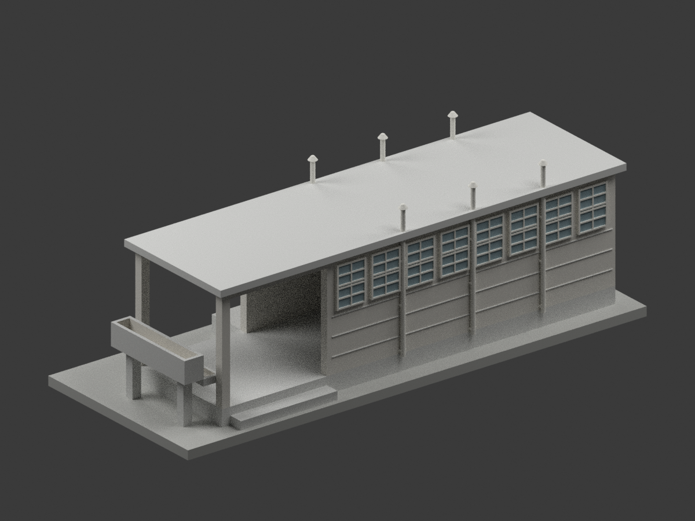
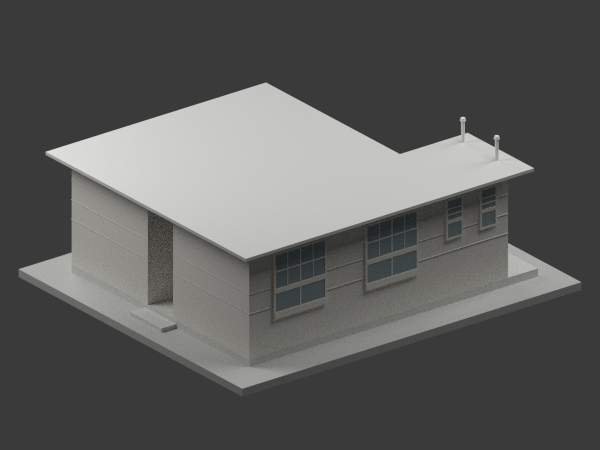

# 國立鳳山高級商工職業學校｜校本部建築研究模型

現行收錄 **2 套模型包**；不等於完整建物棟數或全校完成。「校本部」是本資料庫入口分組，不另推定原圖精確基地位置或官方校區名。

陳仁和建築師事務所《省立高雄商業職業學校鳳山分校廁所新建工程設計圖》CCRH12623009；原圖未讀得設計日期，不以學校改制年推定。只是歷史原設計圖外觀，不是竣工復原、現況測繪或實施證明；不聲稱此小棟仍存，未試印。

歷史「高雄商業職業學校鳳山分部／分校」依校史歸入本校；不是今日高雄高商或鳳山高中。校方現名為「國立鳳山高級商工職業學校」。參見[校方學校簡介](https://www.fsvs.khc.edu.tw/p/412-1003-2099.php?Lang=zh-tw)及[學校沿革](https://www.fsvs.khc.edu.tw/p/412-1003-2184.php?Lang=zh-tw)。

保留陳仁和建築師與國立臺灣博物館典藏來源；原圖像CC BY-NC標示（版本未明）與自行編寫程式／重建模型權利分開，不概括整包模型僅限非商業，不宣稱已取得原圖或建築設計無限制商用權利。不附原圖、PDF或私人參考資料。

| 建築模型 | 建築模型 | 建築模型 |
| :---: | :---: | :---: |
|  **[鳳山分校廁所新建工程｜未定年原設計圖版](buildings/fsvs-toilet-undated-design/README.md)** [STL](buildings/fsvs-toilet-undated-design/model.stl) · [彩色3MF](buildings/fsvs-toilet-undated-design/model.3mf) · [Blender](buildings/fsvs-toilet-undated-design/scene.blend) |  **[單身宿舍｜未定年原設計圖版](buildings/fsvs-single-dormitory-undated-design/README.md)** [STL](buildings/fsvs-single-dormitory-undated-design/model.stl) · [彩色3MF](buildings/fsvs-single-dormitory-undated-design/model.3mf) · [Blender](buildings/fsvs-single-dormitory-undated-design/scene.blend) |  |

[回學校圖鑑](../README.md)

## 單身宿舍原設計研究

陳仁和之省立高雄商業職業學校鳳山分部新建單身宿舍工程設計，典藏CCRH12623005；設計年、是否按圖興建及現存狀況未知。與獨立廁所CCRH12623009不同，不是現況或竣工模型。圖面無可靠方位控制，圖檔方向僅為模型座標；中性配色、尺寸估讀與薄件製造限制保留，未試印。
