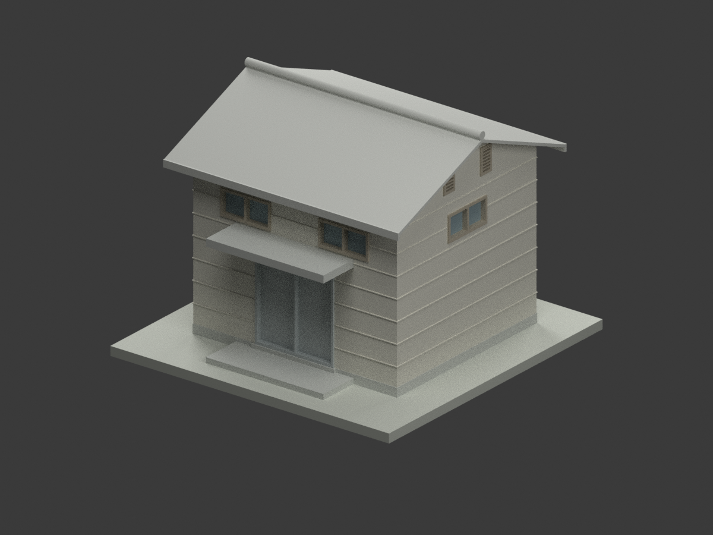
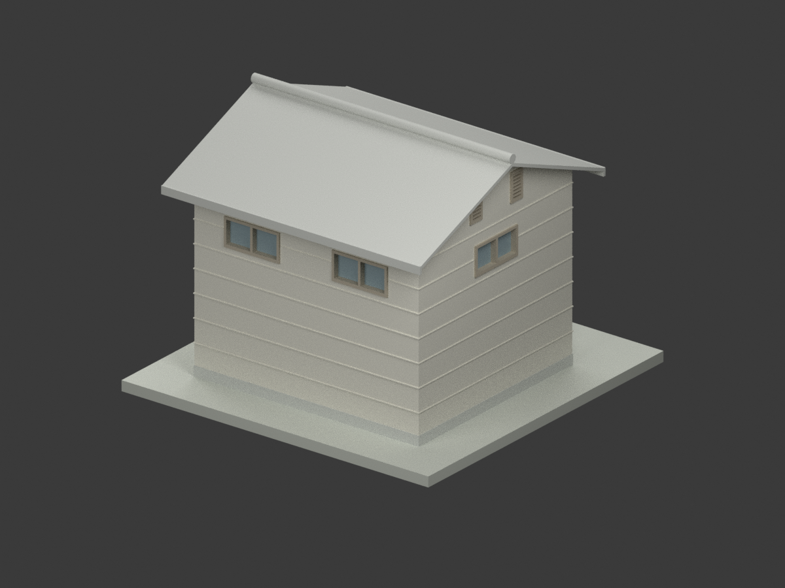
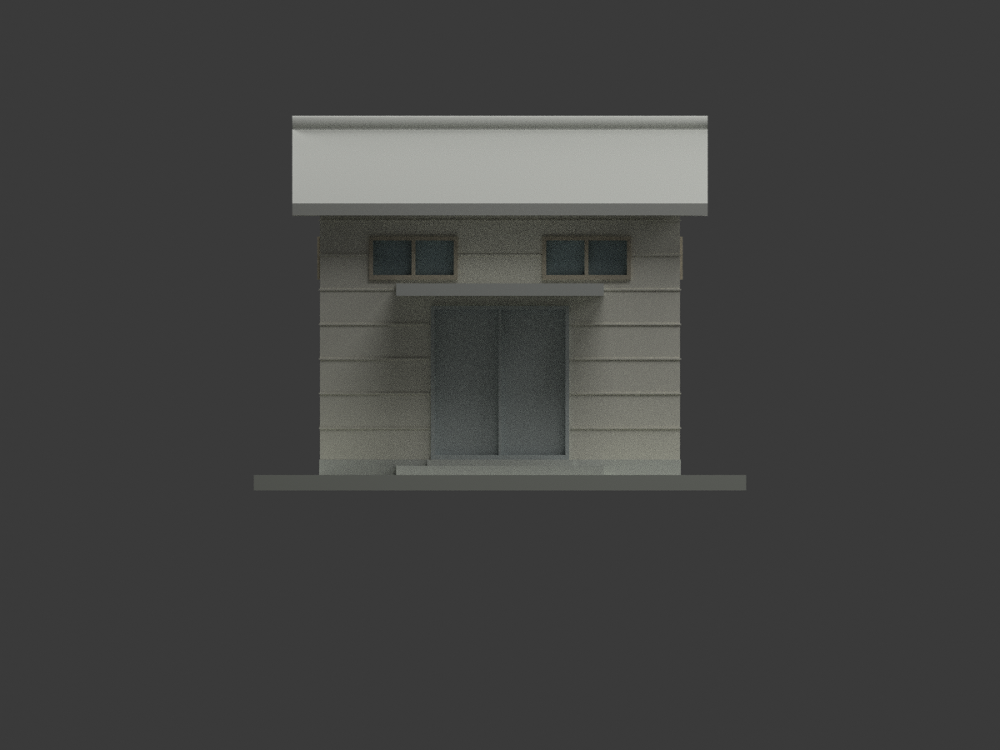
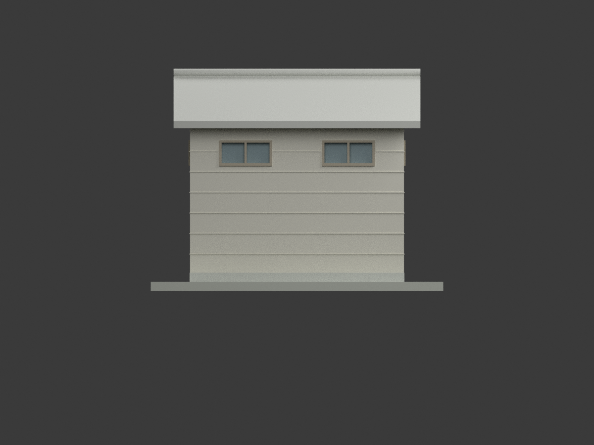
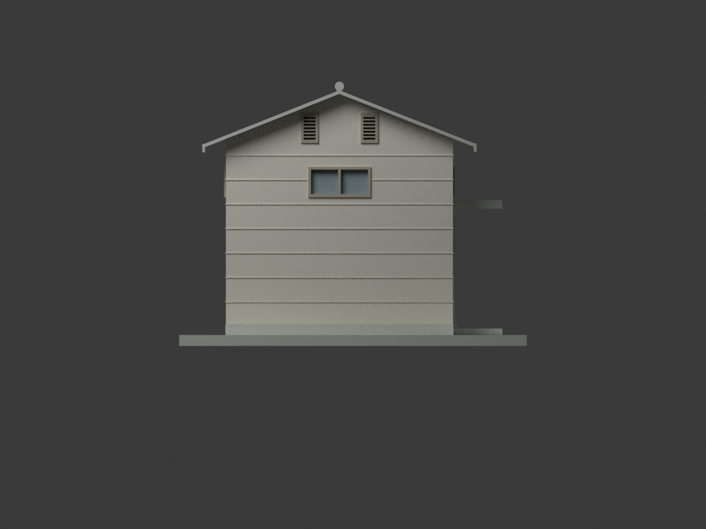
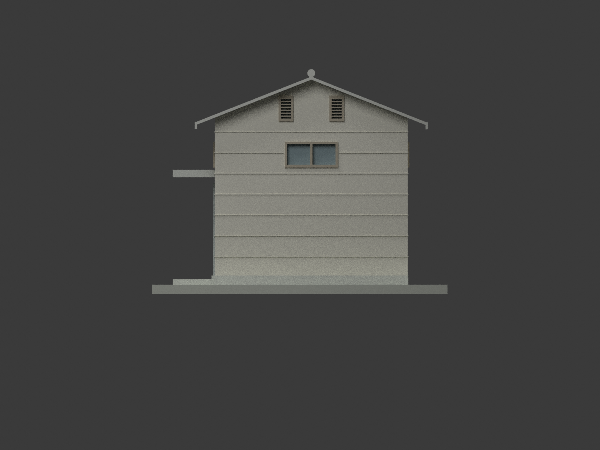
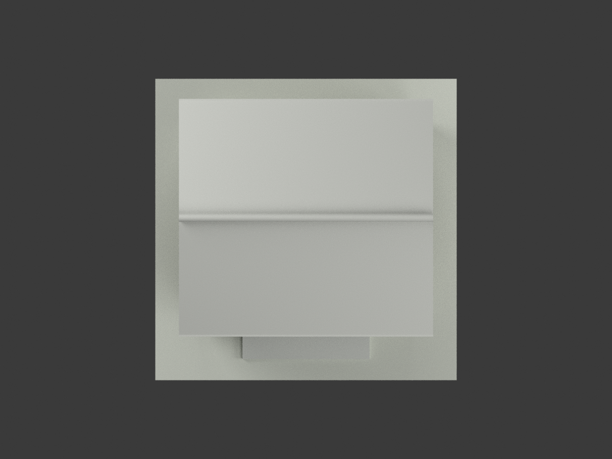
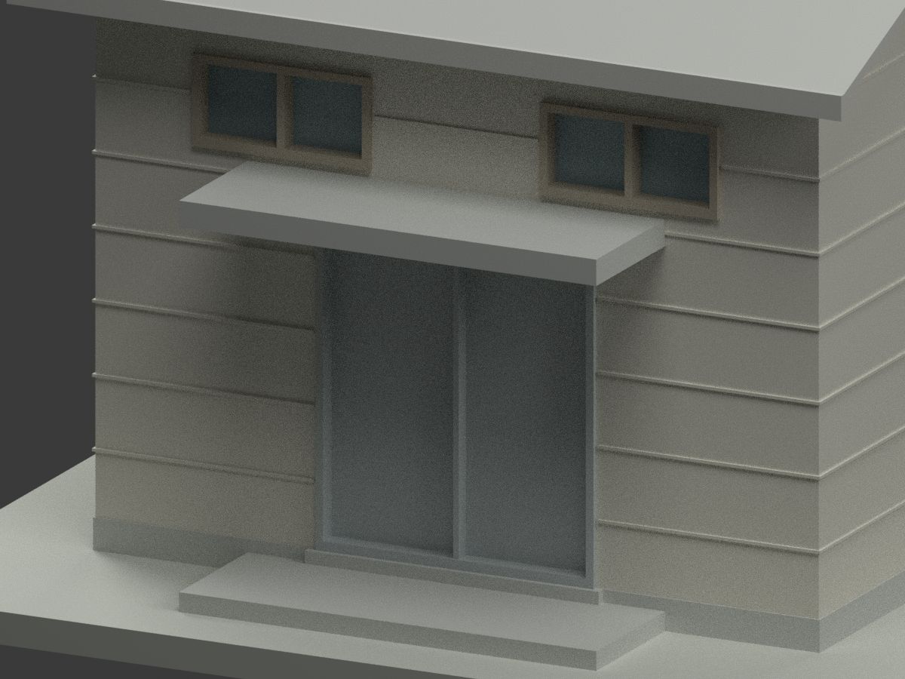
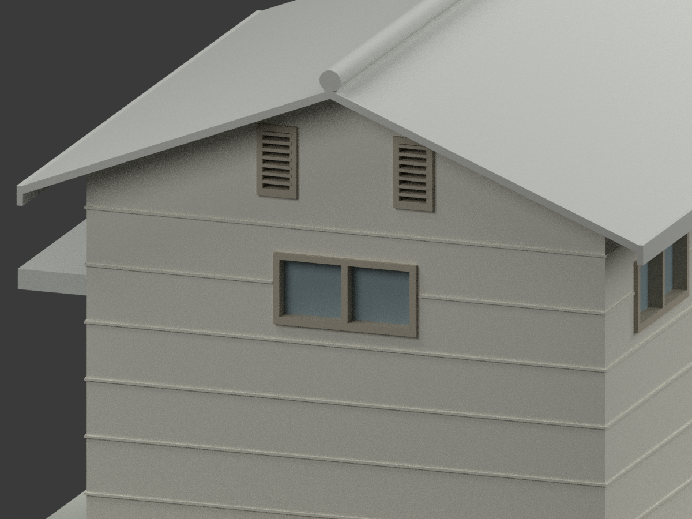
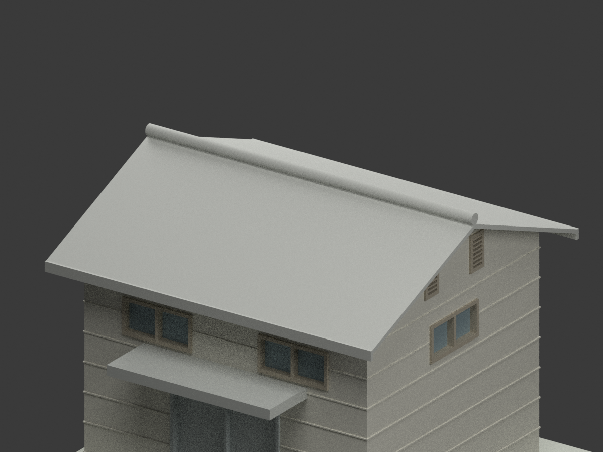

# 鳳山分部歷史小庫房｜未定年原設計外觀模型

## 模型預覽

| 整體 | 另一側 | 入口面 |
|---|---|---|
|  |  |  |
|  |  |  |
|  |  |  |
|  | | |

## 原圖身分與範圍

原圖正式題名為「**省立高雄商業職業學校鳳山分部槍械庫新建工程設計圖**」，陳仁和，館藏 [CCRH11423036](https://collections.culture.tw/docomomo_collectionsweb/Collection?GID=MDM6MNM4)，國立臺灣博物館／臺灣現代建築資料典藏。日期未建立，不從同校沿革或其他圖紙推定年份。

本件只呈現這張歷史圖紙的**小建築外觀**：雙坡屋頂、入口小雨棚、各面外窗與表面分線。**不重建內部用途、儲存配置、鎖具或保全機構，不主張目前存在、現址、現役用途或今日外貌。** 不是同校鳳山單身宿舍或廁所，也不混用高商本校宿舍圖。

原圖及裁圖保持私人參考，不在公開包。原圖授權標示 **CC BY-NC**，描述性後設資料另為 CC BY，後者不放寬圖檔權利。保留原設計者與館藏出處；不宣告第三方設計及其衍生物可無限制商用，也不作商業權利保證。

## 來源控制與估讀

- 主軸 **4.50 × 4.00 m**，不是屋頂外框；長向端部各挑 **45 cm**，橫向各挑 **50 cm**，屋頂名義外框約 5.40 × 5.00 m。
- 圖示 **3.60 m 是上牆／屋架支承控制，不是屋脊，也不能直接當屋皮簷口**。
- 屋面註記可讀作「4/10 勾配，蓋理想瓦」，坡度約 21.8°，與三點圖量約 21°相容；「理想瓦」商品／型式未確認，不猜為石棉、紅陶或鋼板。屋脊仍缺直接高度尺寸。獨立審核以原像素 GL、360 cm、249 cm、233 cm 及 400 cm 橫向尺度交叉校準（約 228 px/m），採屋皮左簷 **3.526 m**、脊 **4.51 m**、右簷 **3.518 m**；脊蓋最高 **4.67 m**。這是明示的**圖量重建值，採 ±0.07 m 解讀容差**，不是實測精度或全圖精度保證。勿將標示的小數位數解讀為精確施工尺寸。
- 屋皮視覺厚度約 6.5 cm、脊蓋截面及邊板作可列印外觀簡化；不聲稱復原隱藏木構、瓦厚或原始結構性能。
- 入口棚獨立控制：寬 **2.70 m**、挑出 **1.00 m**、頂 **GL+2.49 m**、底 **+2.33 m**。門洞 1.80 × 2.00 m；只呈現關閉的素面雙扇外觀，不含功能機構。
- 外平台約 GL+0.12 m，室內完成地坪約 +0.20 m（後者圖量）；門上緣約 +2.20 m。展示模型不提供內部分間或用途布局。
- 前後各兩個高橫窗，兩山牆各一個中央高窗及兩個上部窄通風孔。大窗以兩扇 50 cm 加 5 cm 中框為內寬控制；含外框約 1.15 m，45 cm 葉高另加上 5／下 6 cm 框，外高約 56 cm。葉下緣為完成地坪上 2.40 m，故名義 GL+2.60 m；外框約 +2.54..3.10 m。
- 山牆窄孔尺寸與位置依立面估讀：外框約 0.32 × 0.56 m、頂約 +4.10 m，簡化水平葉片並有不透明背板。未標細部不得視為精確窗表。
- 外牆水平分線、顏色與門窗面材質是歷史外觀示意；不作現場測色或砌法保證。GL 與另外製作的展示底座分開；north/south/east/west 檔名只指模型座標視向。

## 比例與製作限制

**1:50；STL／3MF 單位 mm；含底座 128 × 128 × 97.4 mm，2,324 三角面；未實際列印。** 模型為單一閉實體外觀，玻璃與通風孔有背襯，省略室內與隱藏結構。小框、葉片與線腳作厚度簡化；地坪邊緣外展 1 cm、脊蓋底部約 1 cm 隱藏交疊為避免 STL 浮點共面刀口的製作修正，不改主軸與最高點；屋簷／入口棚仍需依設備與材料設計支撐。水密檢查不等於實體列印成功或工程安全認證。

## 檔案與重現

`model.stl`、材質 `model.3mf`、`scene.blend`、數值網格、可重現程式、十張實際模型渲染及 QA。原始掃描、私人逐像素審核與 `.blend1` 自動備份不納入公開清單。

```bash
python -m venv .venv
. .venv/bin/activate
pip install -r requirements.txt
python build_model.py
python export_3mf.py
python validate_model.py
blender -b -t 4 --python render_model.py
blender -b -t 2 --python verify_scene.py
```

QA 包括來源／外觀獨立審核、網格與格式、重建雜湊一致、場景重開與圖像構圖；不取代測繪、施工或實體列印驗證。
